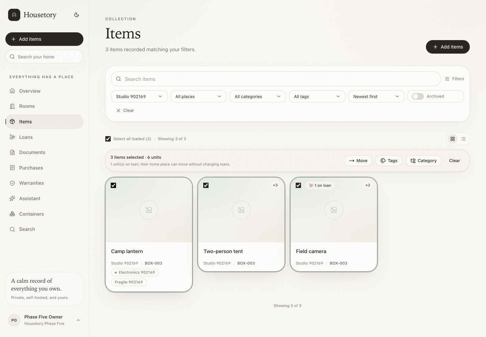
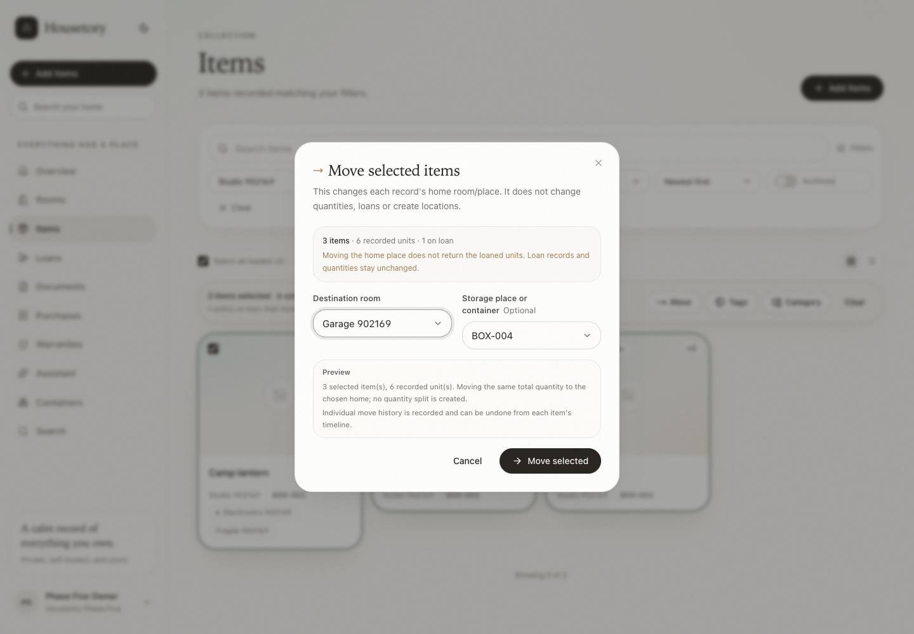
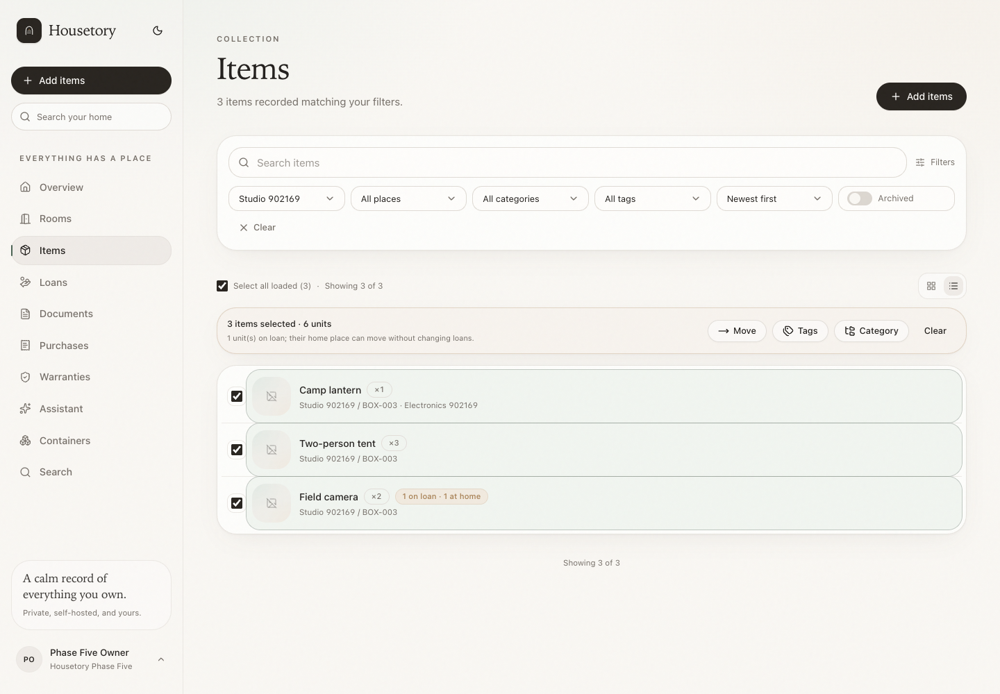
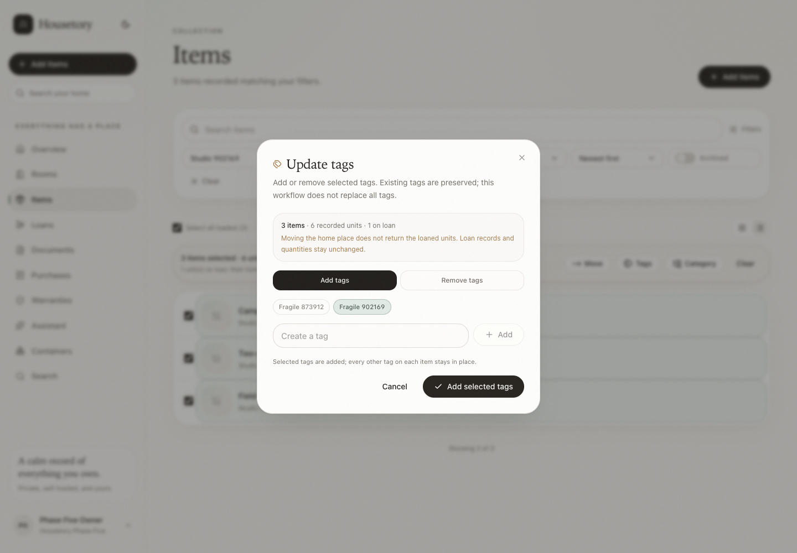
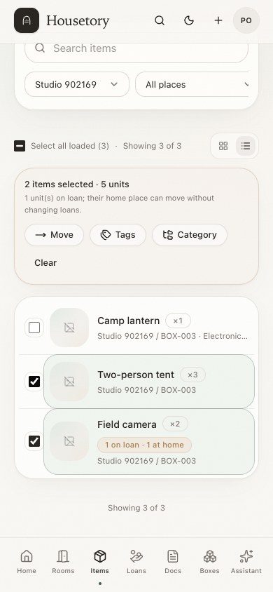

# Bulk organisation and compact list view

This milestone adds explicit multi-item selection, bounded bulk move/tag/category
actions and a compact list view alongside the existing item cards. It reuses the
current item movement, taxonomy, lending, history and permission model. It does
not add a new dashboard, a household-wide activity page, quantity splitting,
tag replacement or batch undo.

## Selection boundaries

Selection is deliberately limited to records that are **already loaded** in the
Items page:

- Each card and compact row has a native checkbox. The checkbox is outside the
  item link, so selecting an item never navigates to it.
- **Select all loaded** selects every non-archived record currently loaded by the
  page query, not every record matching the filters. The control is labelled with
  the loaded count.
- The summary always reports loaded scope. When more records match, it says
  `Showing X of Y; only loaded items can be selected`.
- Loading more pages keeps the existing selection and makes the newly loaded
  records selectable. The selection count and unit total update accordingly.
- Archived items keep a disabled checkbox. They are never included by
  **Select all loaded**, and a selection containing an item that becomes archived
  cannot be submitted.
- Viewers see no selection controls or bulk action bar. Owner and member roles can
  select and submit batches.
- Changing search, room, place, category, tag, archived state or sort clears the
  selection and shows a short notice. The card/list view toggle does not change
  the queried records and preserves selection. Navigating away or refreshing the
  page also clears it because selection is component state, not a saved query.
- If a selected record disappears from the loaded result after a refetch, it is
  removed from the selection rather than acted on unseen.

The card and compact row both show the item name, recorded quantity, room and
container/place path, category and on-loan/at-home status. Borrower names and
notes stay on the lending surfaces and are not exposed in item list rows.

## Bulk actions

### Move

- Choose one destination room and an optional storage place/container in that
  room. A place from another room is rejected.
- Each selected inventory **record** moves its existing home room/place. Its
  recorded quantity, category, tags, documents, purchase and warranty links are
  unchanged. No quantity is split, cloned or copied.
- Bulk move never creates rooms, containers or storage places and never changes a
  loan's outstanding quantity, borrower or snapshots. Moving a loaned item changes
  where the physical record says the owned stock belongs; it does **not** return
  the loaned units or move them out of the borrower's hands. The dialog states
  this before confirmation.
- If every selected record is already at the destination, the API returns
  `409 bulk_noop`. If only some are already there, the changed records move and
  the response reports moved and unchanged counts; the batch is still atomic.
- Partial-quantity moves are out of scope. The operation always applies the whole
  record at its current total quantity.

### Tags

- The workflow supports **add** and **remove** only. Existing tags are preserved;
  this milestone deliberately has no replace-all action.
- Selected tag IDs are deduplicated. Tag IDs are household-scoped; a foreign or
  missing tag returns 404 without disclosing the other household's tag.
- An empty tag list is rejected with 422. A valid request that would change
  nothing returns `409 bulk_noop` with a clear message.
- A new tag can be created through the existing tag endpoint and is then added to
  the pending selection. Creating a tag does not by itself change any item.
- Tag updates create one batch history event. They are not undoable.

### Category

- The client must choose an explicit mode: `set` with exactly one existing
  category, or `clear` with no category ID.
- An empty or missing category input is never interpreted as clearing. The clear
  action is a separately labelled, destructive-styled choice with its own review
  text.
- Setting or clearing a category leaves tags, location, loans, quantities and all
  other relationships unchanged. A request that would change nothing returns
  `409 bulk_noop`.
- Category updates create one batch history event. They are not undoable.

## API contract

| Endpoint | Purpose |
| --- | --- |
| `POST /api/v1/items/bulk/move` | Move every selected record to one room and optional place |
| `POST /api/v1/items/bulk/tags` | Add or remove selected tags on every selected record |
| `POST /api/v1/items/bulk/category` | Set one category or explicitly clear the category |

All three accept:

- `item_ids`: 1–100 unique item UUIDs;
- `request_id`: a required client-generated UUID;
- action-specific fields.

Additional bounds and rules:

- Tag batches accept 1–20 tag IDs. Duplicate tag IDs are deduplicated. Duplicate
  item IDs are rejected with 422 rather than silently collapsing the request.
- Requests over the item or tag limits are rejected with 422.
- Every item, destination room, place, tag and category must belong to the current
  household. Missing, deleted or foreign references return a household-neutral
  404; responses do not reveal which record belongs to another household.
- Viewer sessions are rejected by the existing write guard with 403. Owner and
  member roles may submit.
- Archived items are rejected with `409 bulk_items_archived`. The whole batch is
  refused; no selected record is changed.
- Validation happens before writes. Each request runs in one transaction: either
  every intended change commits or none does. There are no partial-success
  responses or retry-only failures. Mixed same-destination/no-op records are
  reported as unchanged counts, not as a failure.
- The timestamp/actor history event, affected-item events (for moves) and all row
  changes commit together.

### Replay safety

`request_id` is required for every bulk endpoint. The server stores a SHA-256
fingerprint of the action and canonical payload on the batch event:

- repeating the same request ID with the same action and payload returns the
  stored result without repeating writes or history;
- reusing the request ID with a different action, item set, destination, tags or
  category returns `409 request_id_reused`;
- request IDs are household-scoped, so one household cannot probe another's
  request history.

This makes safe client retries possible without inventing a second batch or
duplicate move events.

### Locking

Bulk operations take the existing per-household hierarchy advisory transaction
lock first, then lock item rows with `FOR UPDATE` in sorted UUID order. This is the
same ordering used by container moves and prevents concurrent bulk/container
moves from corrupting a shared hierarchy. Existing item-edit and lending paths
lock item rows, so they serialize with the item portion of a bulk batch. The
bounded item count avoids unbounded SQL and the services use set-based validation
plus bounded per-item work.

## History and undo

### Moves

- Each record that actually changes location gets its own `item.moved` event with
  actor, time, stable item/room/place IDs and preserved from/to names, identifiers
  and paths.
- The per-item event also carries `details.batch` with the batch id, action and
  selected item/unit counts, so the move remains understandable after the batch.
- One `items.bulk_moved` event with `entity_type = "batch"` records the selected,
  moved and unchanged counts, affected IDs, destination snapshot, on-loan count and
  the stored idempotent result.
- Individual moves can be undone from each item's timeline using the existing safe
  undo. Undo rechecks that the item is still at the destination, has no later item
  move, is not archived and that the original place still exists. Undoing one item
  does not move its siblings, delete the batch event or imply a batch-level undo.
- The batch event itself is not undoable. If another item in the batch was moved
  again or edited, that does not block undo of a different item, but the usual
  per-item intervening-change checks still apply.

### Tags and categories

Tag/category changes are recorded as one batch event with mode, affected item IDs,
tag/category IDs and names, counts and actor/time. They are intentionally **not**
undoable. No per-item tag/category events are fabricated, and a batch event cannot
be silently partially reversed.

Batch events are persisted for auditability and future history surfaces. This
milestone does not add a separate household-wide batch activity screen; item
timelines expose per-item move events and their batch context. Legacy items are
not given invented history.

## Permissions and privacy

- All reads and writes are explicitly household-scoped. Foreign item, room, place,
  tag or category IDs return 404 without per-item disclosure.
- Viewers can browse cards, the compact list and existing history but cannot
  select, move, tag, categorise or create tags.
- Bulk requests do not expose borrower notes or contact details. An active-loan
  warning reports only aggregate on-loan units for the selected records.
- No email is sent and no paid AI is used by these operations.

## Verification

Automated PostgreSQL tests cover atomic transaction behavior, mixed no-op and
changed batches, archived/missing records, household isolation, viewer rejection,
destination consistency, active-loan preservation, tag add/remove semantics,
explicit category set/clear, duplicate/oversized payloads, request-id reuse with
different action/payload, concurrent same-request replay, per-item move undo and
the non-undoable batch event. Frontend tests cover loaded-only selection, select
all loaded, view persistence, filter clearing, move/tag/category previews and
explicit category clearing. The disposable-stack browser workflow covers checkbox
keyboard use, loaded-versus-total wording, move/tag/category actions, loan warning,
compact list persistence and mobile layout.

## Representative screenshots

Card view with loaded-only selection and the bulk action bar:

Move preview with destination, selected record/unit counts and active-loan warning:

Compact list view with the same selection and quantity/location/loan context:

Tag review with add/remove modes and preserved existing tags:

Mobile compact list with selection, bulk bar, quantity and on-loan status:

## Deliberate limitations

- Only loaded records can be selected; there is no "select all matching results"
  action.
- No batch undo, no tag replace-all and no per-item tag/category activity.
- Partial-quantity moves and quantity splitting are out of scope.
- Bulk move changes home-location records only; it does not return loans or move
  physical units held by borrowers.
- Batch history is stored but does not yet have a dedicated household-wide
  timeline. Item timelines show per-record moves and their batch context.
