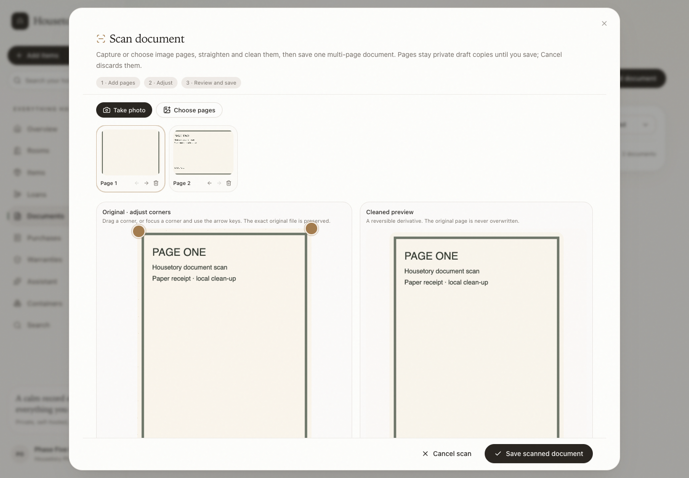
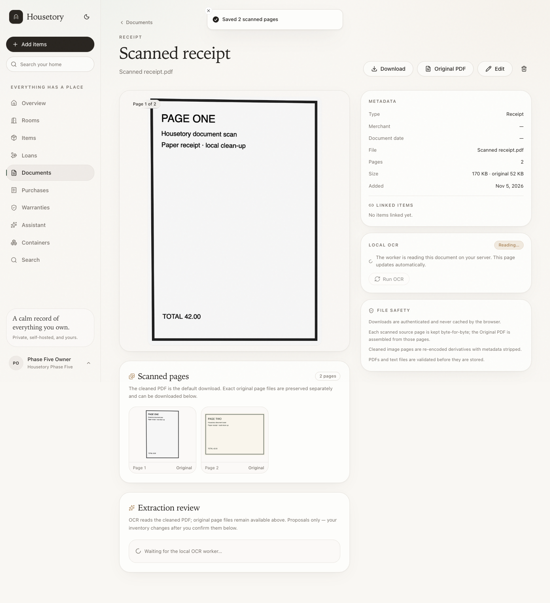
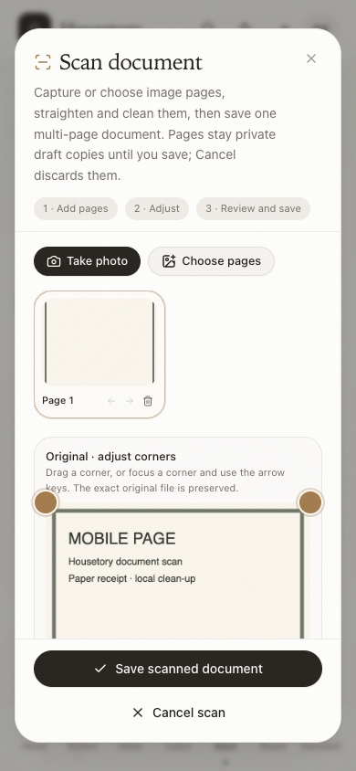

# Receipt and document scanning

This milestone adds a private, local-first scanner to the existing Documents
library. It captures or accepts multiple image pages, lets the user correct
perspective, crop, rotation and contrast, then saves one multi-page PDF with every
source page retained. It does not add new AI extraction, automatic purchases or
automatic item creation.

## Where scanning fits

- **Documents → Scan pages** opens the multi-page editor from the library.
- **Item → Documents → Scan** opens the same editor with that item preselected;
  the linked items can still be reviewed before saving.
- **Documents → Add document** remains the straightforward single-file path for
  PDFs, images and text. Multi-page PDFs from scanner apps are attached unchanged.
- Existing item attachments, library search, OCR review, downloads, exports and
  deletion keep working.

The scanner is not a replacement for the existing photo/recognition workflow:
document scanning organises paper pages, while recognition suggests inventory
items from a photograph.

## Supported input and limits

- Scan pages: JPEG, PNG, WebP, HEIC or HEIF images. File signatures are decoded
  with the same allowlisted Pillow/HEIC pipeline used for other media; the declared
  extension or MIME type alone is not trusted.
- A page can have at most 40 million source pixels (the existing application image
  bound) and at most the configured upload limit, normally 25 MB.
- One scan can contain at most 20 pages and 100 MB of original page files.
- Up to 5 unfinished scan drafts per household are allowed. Starting another
  requires finishing or cancelling one.
- Cleaned page derivatives are capped at 3500 pixels on the long edge and saved as
  JPEG quality 86. The PDF images are capped at 2400 pixels on the long edge.
- PDFs are assembled synchronously one page at a time. The bounds keep the work
  predictable; OCR remains a background worker job.
- Existing PDFs and text files are not edited, recombined or flattened by this
  editor. They are still attached as-is through **Add document**. This limitation
  is deliberate: it avoids losing embedded text layers or annotations.
- Automatic document-edge detection and text restoration are not implemented.
  Crop corners are manual because an unreliable auto-edge suggestion would be
  worse than no suggestion. No letters, numbers or details are invented.

## Page workflow

1. **Take photo** uses the browser camera capture input on supported phones; it
   still requires a secure origin and the browser's camera permission. **Choose
   pages** accepts one or more image files on desktop and mobile.
2. Pages are uploaded one at a time into a private draft. A thumbnail strip shows
   all pages. Temporary drafts are not documents yet and never create inventory
   records.
3. Select a page to edit it:
   - drag the four corner handles to crop and correct perspective/straighten;
   - focus a corner and use arrow keys for keyboard adjustment (Shift moves
     farther);
   - rotate left/right in 90° steps;
   - choose Color, Grayscale or Document mode;
   - adjust contrast from 0.50× to 2.00×;
   - reset the page to the full original and neutral adjustments.
4. Move pages earlier or later with the arrow controls, or remove a page. Reorder
   and removal reject stale/invalid page sets rather than silently skipping.
5. Review the original and cleaned previews. The original preview is the exact
   uploaded page; the cleaned preview is a reversible derivative. If a browser
   cannot display the original HEIC image, the cleaned copy is shown with a note
   and the original remains downloadable.
6. Fill optional title, type, merchant and document date, review linked items, and
   save. Title, type and date are compact; no purchase fields are required.
7. **Cancel scan** deletes the draft pages. Stale drafts older than 24 hours are
   pruned when the API starts or another scan is created. Page originals and
   derivatives are deleted with the draft, document or item.

## What is stored

For a scan, all page records and files are attached to one document; the library
does not show each page as a separate document:

- **Original page files** preserve the exact uploaded bytes, in private
  household-scoped storage.
- **Cleaned page JPEGs** are separate derivatives. Re-adjusting a page regenerates
  its cleaned derivative from the original; the original is never overwritten.
- **Cleaned PDF** is the default document download and the OCR input. It contains
  the reviewed pages in order with one A4 page per image, using landscape pages for
  landscape images and portrait pages for portrait images. Images are fitted
  without squashing and retain their aspect ratio.
- **Assembled source PDF** is available as the document's **Original PDF**. It is
  assembled from the source pages; the exact per-page original files are available
  from the saved document's **Scanned pages** section.
- Regular single-file uploads retain the existing exact original bytes plus the
  normalized safe download copy.

The default document download and OCR use the cleaned PDF. The page-level original
links are clearly labelled. No page copies are added to the library separately.

## OCR behavior

- OCR uses the existing background `documents.ocr` job and retry endpoint. It reads
  the **cleaned PDF** for scanned documents and the preserved original for ordinary
  uploads.
- The extracted metadata records `ocr_artifact: "cleaned_pdf"` or `"original"` so
  the source is explainable. The document detail page shows that OCR reads the
  cleaned PDF while original page files remain available.
- OCR text is untrusted. Existing deterministic review and explicit apply behavior
  is unchanged; no item, purchase or warranty is created by scanning or OCR alone.
- Empty/unreadable text is treated as a failed read with a clear adjustment/retry
  message. The document remains usable and the existing **Retry OCR** action
  appears. A failure is never reported as a silent success.
- This milestone does not expand OCR into line-item extraction, candidate ranking,
  automatic linking or automatic purchase creation.

## Save, retries and cleanup

Saving a scan requires a client `request_id`. The scan row is locked for the
commit and stores the request id and resulting document id:

- retrying the same scan with the same request id returns the existing document;
- reusing the request id for a different scan or action is rejected;
- a scan can only be committed once; changing the request id after commit returns
  `409 scan_committed`;
- PDF generation and preview regeneration happen from bounded page counts, and any
  failed save leaves the draft available for correction or cancellation.

The scanner does not provide a batch undo. OCR has its existing retry action, and
editing a saved document uses the ordinary document edit/delete flows. Deleting a
document or deleting an item that owns the only copy removes the cleaned PDF,
assembled source PDF and all retained page files.

## Security and privacy

- All scan sessions, pages, files, previews and commits are household-scoped and
  require authentication. Viewers can read permitted scans/documents but cannot
  create drafts, upload pages, edit, commit or cancel.
- Scan files are private authenticated responses with `Cache-Control: private,
  no-store`, `nosniff`, same-origin resource policy and no public static paths.
- Image decoding is allowlisted and bounded. PDF generation uses ReportLab and
  validated page images; no embedded URLs are fetched and no cloud/LLM provider is
  involved.
- Uploaded page names are sanitized; storage keys are generated UUID paths. Original
  filenames are never used as filesystem paths.
- Abandoned drafts are deleted, not merely hidden. Deletion and cancellation gather
  every original/cleaned key before removing records so retries cannot leave the
  page files behind.

## Verification

The current suite contains 251 PostgreSQL tests, 90 frontend tests and 22
disposable-stack browser workflows. Document-scanning PostgreSQL tests cover
crop/perspective/rotation/contrast geometry, HEIC input and exact original-byte
preservation, ordered multi-page PDF generation, page count/order and
landscape/portrait page sizes, idempotent commit replay, request-id reuse,
cancel/prune cleanup, private file headers, viewer rejection, household isolation,
item attachment, no automatic item/purchase writes, item/document deletion cleanup,
and OCR artifact selection. Frontend tests cover page upload, original/cleaned
previews, keyboard corner adjustment, rotation, reorder, removal, cancel, save
metadata and request-id stability on retry. The browser workflow covers desktop and
mobile capture, edit, reorder, save, document pages and cancel.

## Representative screenshots

Multi-page editor with original/cleaned comparison, corner handles, rotation,
mode, contrast and private draft status:

Saved scan as one document, with the cleaned PDF preview, retained page
originals and OCR queue state:

Mobile scan editor with full-page preview, accessible controls, internal scrolling
and persistent save/cancel actions:

