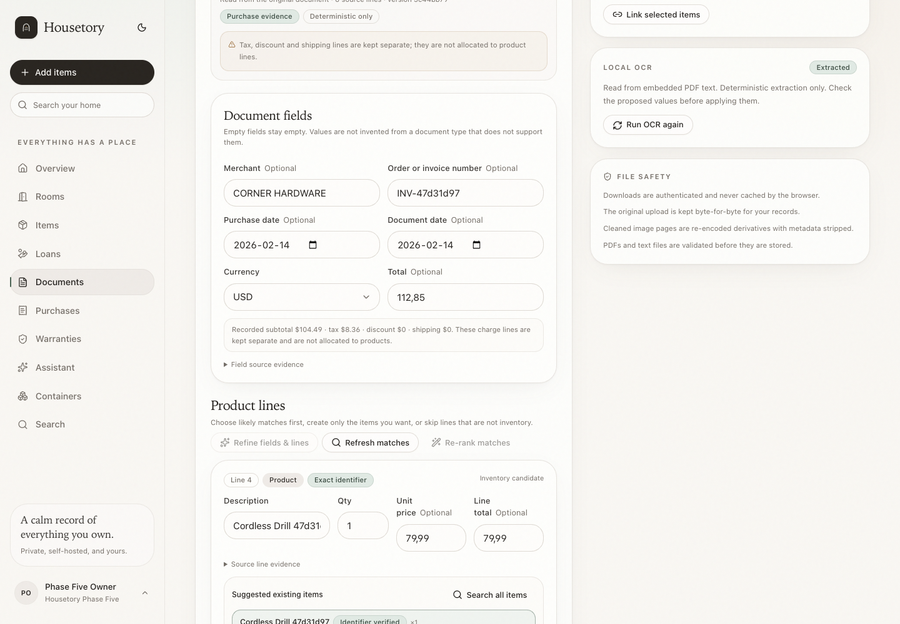
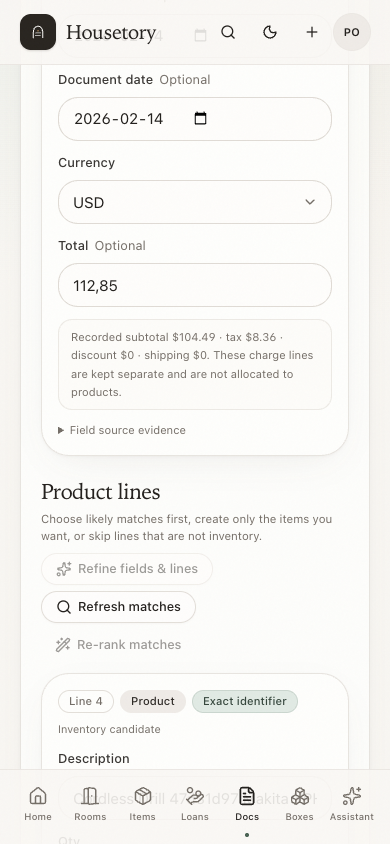
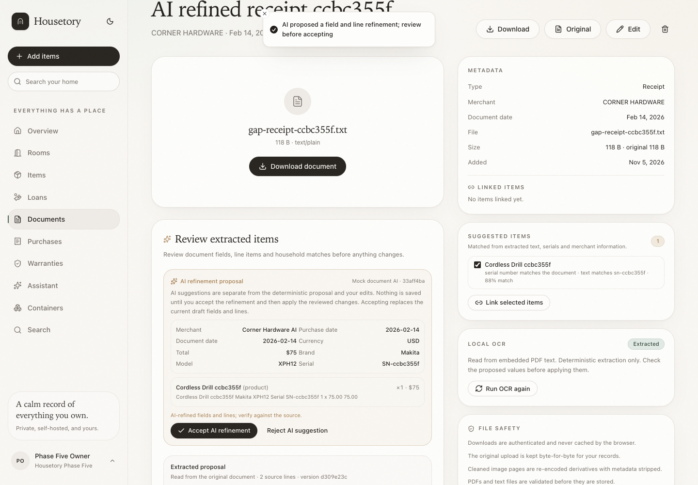
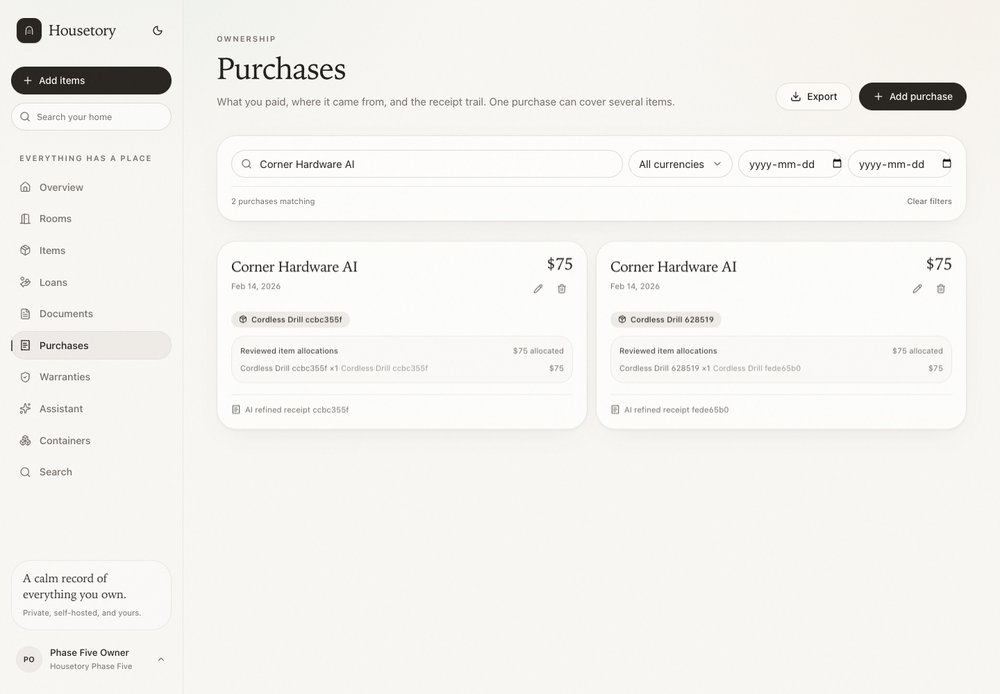
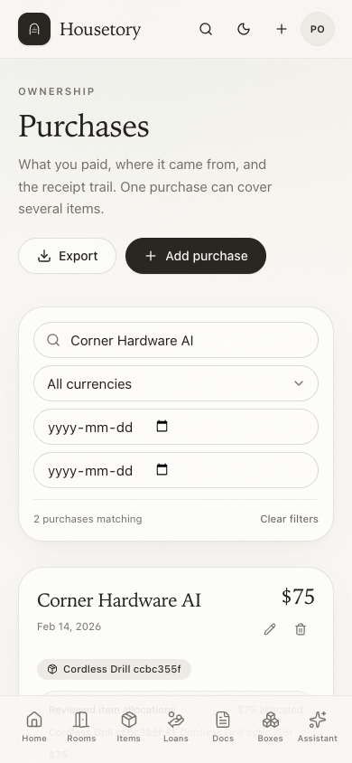

# Intelligent document extraction and inventory matching

This milestone turns an OCR-read receipt, invoice, manual or warranty document into
a reviewed proposal of document fields, product lines and likely household
inventory matches. Nothing is created, linked, purchased or overwritten until the
user confirms the reviewed changes.

The existing document/scan/OCR pipeline, purchase model, warranty model, role rules
and visual shell are reused. The milestone does not add a new AI provider, change
task assignments, create one purchase per receipt line, start unified search or
implement later stocktake/property/household work.

## Flow

1. Upload a file or finish a scan as before. The worker runs OCR on the cleaned
   scan PDF or the ordinary document artifact and records the source artifact.
2. Deterministic extraction proposes document fields, product/charge lines,
   quantities, monetary values and evidence excerpts. No value is invented when a
   value is missing.
3. The Document detail page shows a compact review: editable document fields,
   product line cards, source evidence, warnings, likely household matches,
   manual search, create/update/link/skip choices, and a purchase/warranty review.
4. The user explicitly chooses which lines are inventory-worthy and confirms. The
   apply endpoint validates the complete reviewed payload and commits one
   transaction, or rolls everything back.
5. A request id makes retries safe. Re-applying a previously applied extraction
   requires an explicit acknowledgment. Exact duplicate file content is warned
   about but never merged or deleted automatically.

## Document and money semantics

- Monetary values are parsed and applied as integer minor units (cents). Decimal
  parsing avoids floating-point rounding for line arithmetic.
- Product lines have an explicit quantity, optional unit price and optional line
  total. A quantity without an explicit unit price is kept with a warning; Housetory
  does not invent a unit price.
- Discount, tax, shipping, payment and change lines are classified separately and
  are never treated as product lines. They are never automatically allocated across
  products. Subtotal, product-sum and total discrepancies are displayed with their
  values and left for review; they are not silently coerced.
- Several equivalent product lines remain separate proposals with their own source
  evidence and editable quantities. No automatic grouping or line deletion occurs.
- Dates and currencies are extracted conservatively. If multiple dates or currencies
  are found, the fields are marked uncertain and a warning is shown. Missing dates,
  totals, serials, models or warranty terms stay empty.

## Document types

- Receipts and invoices can be recorded as purchase evidence.
- Manuals, specifications, warranty certificates and other documents are **not**
  treated as proof of purchase. Their purchase action is disabled. They can still
  provide item evidence (including a document-level brand/model/serial line) and
  warranty evidence.
- Existing PDFs remain attached unchanged; the editor does not recombine or flatten
  them.

## Matching

Matching is household-scoped and always available without AI:

- Exact serial numbers are checked first. Exact model/brand evidence is also ranked
  strongly; there is no barcode field in the current inventory model, so barcode
  matching is not claimed.
- Otherwise Housetory compares product names, descriptions, brands and models with
  the current household inventory. Candidates show short deterministic reasons,
  current quantity/on-loan quantity, room/container and any current purchase.
- Candidates are shown best first, but no invented percentage confidence is shown.
  A line with no likely match stays in the “create new item”, manual search or skip
  path.
- Manual household search is always available. Creating a new item requires an
  explicit destination room (optional container); linking/updating does not.
- Multiple distinct lines may be explicitly linked to one existing item, with a
  warning; Housetory does not automatically collapse them.

### Optional AI field/line refinement and match ranking

The existing **documents** AI task can do two separate explicit actions:

1. **Refine fields and lines.** Housetory sends the OCR text and deterministic
   proposal to the configured/consented provider. The AI may interpret ambiguous
   abbreviations, restructure product/charge lines, clarify quantities and unit vs.
   line totals, and propose brand/model/serial/warranty evidence. It must return a
   bounded, schema-validated structure with an exact OCR evidence excerpt for every
   field and line. Housetory rejects the whole refinement, with a clear error and no
   stored proposal, when evidence is missing, a monetary/date value is not present in
   that evidence, quantity arithmetic is inconsistent, or the output is malformed.
   The AI cannot invent missing facts, add inventory/candidate IDs or execute tools.
2. **Re-rank matches.** The request sends only reviewed line text and at most five
   supplied candidate records per line. The AI may only reorder those candidate IDs;
   unknown IDs are discarded and exact identifier candidates remain pinned ahead of
   vague suggestions.

A successful field/line refinement is stored as a separate versioned proposal under
`extraction_refinements`, bound to the deterministic base version. The UI compares
the AI values with the current draft and requires explicit **accept** or **reject**;
accepting replaces the current draft only after showing that warning, and applying
inventory changes is still a separate confirmation. AI refinement never writes
inventory, purchases, warranties or links by itself. Repeated identical output maps
to the same refinement version; only the most recent five proposals are retained.

If no provider, capability or consent is available, the UI shows the provider state
and keeps deterministic extraction/matching. Availability is confirmed when the
explicit action is requested; a provider error or invalid response falls back with a
clear message. No provider is silently switched. Automated tests mock the optional
AI path and do not use a paid provider or live credentials.

## Reviewed apply

Each reviewed line can choose:

- **skip** — leave the line out of inventory and purchase changes;
- **link** — attach the document/purchase evidence to an existing item without
  changing stock;
- **update** — explicitly update selected item fields and/or move the item;
- **create** — create a new item with the reviewed name, quantity, optional
  brand/model/serial, room and optional container.

Stock rules:

- Linking a receipt to an existing item does **not** increase its quantity.
- The user must explicitly check **Add this quantity as new stock** before an
  existing item's quantity increases. Active loans and their outstanding quantities
  are preserved; adding owned quantity only changes the owned total.
- Creating an item creates exactly the reviewed quantity. Lines left as skip do not
  create items.
- A purchase can be created, linked to an existing selected purchase, or left
  unchanged. Housetory still stores one shared purchase total for the linked items,
  but reviewed product-line amounts are also persisted as explicit per-item
  allocations. Tax/discount/shipping amounts remain separate and are not invented or
  equal-split across items.
- Warranty evidence is offered only for lines where the document contains
  warranty/provider/date/duration evidence. Applying it is a separate checkbox and
  a warranty document link is recorded explicitly. Existing warranty details are
  shown before replacement.
- Document fields and item/attachment links are separate choices. A document can be
  linked to multiple items without changing quantities.
- Existing values remain visible; changed document/item fields in the request are
  explicit reviewed choices. No automatic overwrite is hidden behind a match.

### Purchase allocations

Reviewed product-line decisions persist in `purchase_allocations` when a purchase is
created or linked:

- Each row stores the item, purchase, source document, extraction version, source
  line id, description, reviewed quantity, optional unit price, line total, allocated
  amount, currency and exact source evidence.
- Several receipt lines may map to one item; several items may share one purchase.
  Rows are unique per purchase/source line and are upserted on explicit re-apply, so
  retries do not duplicate them.
- The purchase grand total remains the single shared amount and is counted once in
  ownership totals. Allocation rows are not another purchase total. Product
  allocations may sum below the total (tax/shipping/unknown charges) or above it
  (recorded discount); the UI shows the unallocated/over-total balance and reports do
  not silently rebalance it.
- Purchase and item displays show reviewed allocations and their line evidence.
  Inventory exports use persisted allocation cents; purchases exports include
  allocated, unallocated and per-item breakdown columns. Currencies are never
  combined.
- Legacy purchases without allocation rows remain valid and still contribute their
  shared total once, but no historical per-item split is fabricated.
- Allocations with a currency different from the purchase currency are rejected, as
  are product allocations exceeding the purchase total plus recorded discounts.
- Allocation is money/evidence only. It does not increase owned quantity; the explicit
  new-stock checkbox remains the only way an existing item's quantity increases.

### Idempotency, stale state and failure semantics

- Apply requires a client `request_id` and the extraction version shown in the
  review. Repeating the same request returns the stored result without new items,
  purchases, stock or links.
- Reusing a request id for another document or a different payload/action is
  rejected; the stored apply result is bound to the reviewed payload fingerprint.
- If the OCR/extraction proposal changed, `extraction_stale` requires a refresh.
- A previously applied extraction returns a warning and is blocked unless the user
  explicitly allows a re-apply. The same request id still replays the original.
- The reviewed apply is atomic: all chosen item creates/updates, purchase/allocation
  changes, warranty changes, document links and metadata changes commit together, or
  none do.
  There is no partial-success response. Invalid/deleted/archived items, stale
  destinations, conflicting updates and revoked member access return useful errors
  and leave all data unchanged.
- Viewers can read an extraction proposal and its deterministic matches but cannot
  request AI ranking, upload/apply changes or submit paid work.
- Exact duplicate files are detected with a stored SHA-256 of the original upload
  (or cleaned scan PDF) and shown as a warning. The library does not silently
  deduplicate or delete either document.

## Security and limits

- All extraction, candidate, apply and document queries use the explicit household
  id. Cross-household records return 404; provider calls are never made from a
  viewer request.
- OCR/document text is untrusted data. The constrained extraction/matching prompts
  never grant tool execution, and validated outputs cannot introduce unknown item
  IDs or modify records directly.
- Source scans/documents are served only through authenticated, private, no-store
  routes. No embedded URLs are fetched.
- Limits: extraction keeps at most 50 source lines; matching accepts at most 30
  reviewed lines and returns at most five candidates per line from a bounded
  household inventory scan; AI candidate IDs are limited to the supplied set.
- AI field/line refinement is limited to 50 lines; every evidence/value is validated
  before storage, and only five refinement versions are retained.
- Apply is bounded to 50 line decisions and corresponding allocation rows. All
  referenced items, rooms, locations, categories, purchases, warranties and
  documents are rechecked at confirmation.
- Provider credentials and raw OCR/candidate payloads are not logged. Automated
  tests use synthetic text documents and mocked AI, not real household records or
  paid calls.

## Known limitations

- There is no barcode field, so barcode matching is not available.
- Tax, discount and shipping amounts are not allocated to product lines; the UI
  flags the unallocated balance and keeps the shared purchase total. Proportional
  charge splitting is not implemented.
- Per-line allocation amounts are product-line amounts; there is no general manual
  allocation editor outside the reviewed extraction flow. Legacy purchases keep no
  fabricated split.
- Source evidence is shown as raw OCR source lines with line numbers; page-level
  mapping is not added for OCR text.
- AI field/line refinement is explicit and bounded. Automatically merging AI output
  into confirmed data or expanding missing facts remains out of scope; deterministic
  OCR extraction/manual review is the fallback.
- A live paid-provider extraction/matching run was not performed. Automated tests
  mock provider behavior and validate evidence, malformed output, consent/fallback
  and unknown-ID handling.
- The editor does not combine or flatten existing PDFs; that remains the scanning
  milestone limitation.

## Verification

The current suite contains **262 PostgreSQL tests**, **94 frontend tests** and
**24 disposable-stack browser workflows**. Extraction tests cover multi-line
receipts, quantities/unit-vs-total totals, tax/discount/payment separation, date and
currency ambiguity, exact/approximate/no-match ranking, mocked AI forbidden IDs,
prompt-injection text, consent/unavailable fallback, duplicate content warnings,
manual-type purchase gating, stale/replayed/already-applied guards, viewer and
cross-household isolation, atomic mixed-batch rollback, explicit new-stock behavior
with active loans, purchase/warranty creation, document links and no automatic item
creation. Frontend tests cover editable fields, line matching, manual/type choices,
new-item destination/warranty review, AI action wiring and stable apply payloads.
The browser workflows cover upload, OCR, review, exact match, create-new-item
selection, apply, purchase/allocation creation and stock preservation, plus mocked
AI field/line refinement through accept/edit/apply and allocation readback.

## Representative screenshots

Desktop document-field and product-line review with exact identifier matching,
source evidence, charge separation and manual/create/skip actions:

Mobile review with stacked editable fields and product-line controls:

AI field/line refinement proposal with evidence and explicit accept/reject:

Persisted reviewed allocations under a shared purchase total:

Mobile purchase allocation review:

