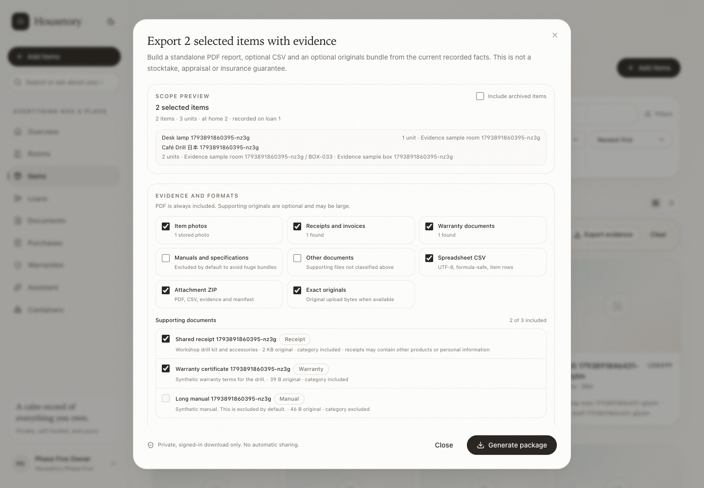
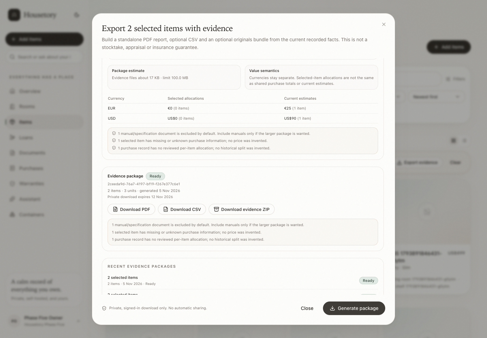
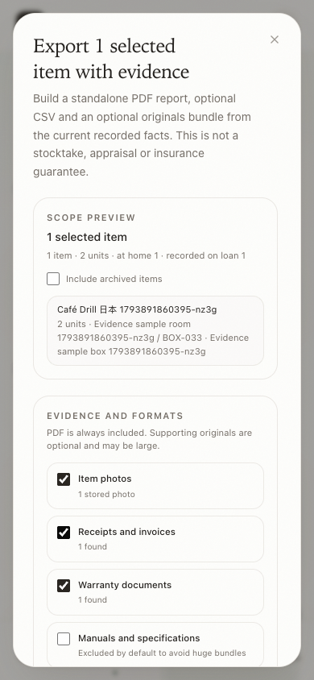
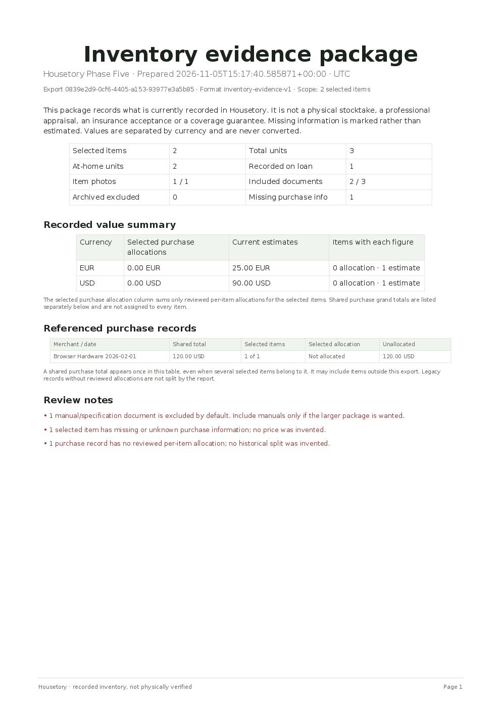
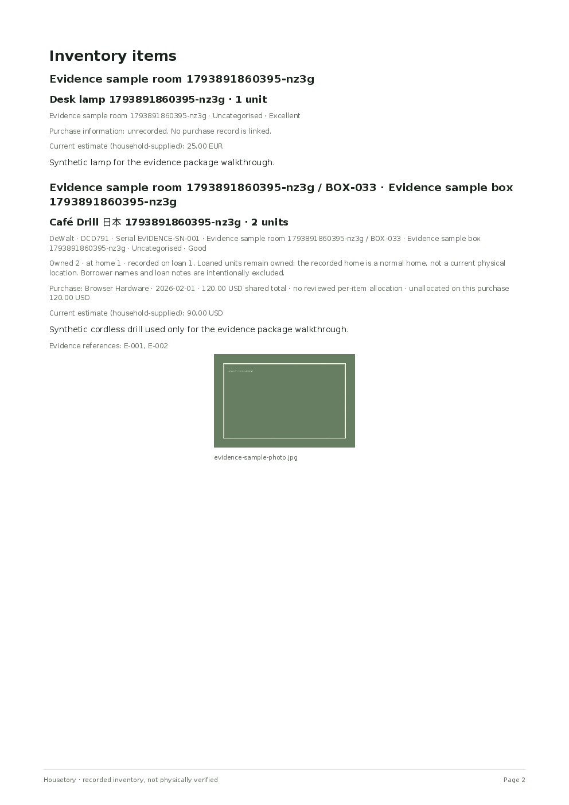
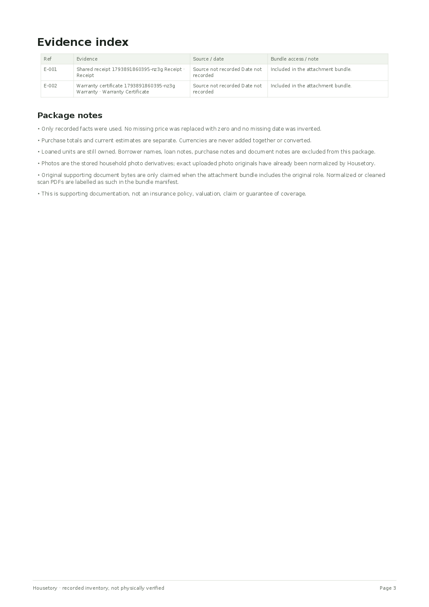

# Inventory evidence package

This milestone adds **Export inventory with evidence**: a presentable PDF report,
an optional UTF-8 CSV and an optional private ZIP containing the report,
spreadsheet, manifest and selected supporting files. It is built from the facts
already recorded in Housetory. It is not a stocktake, appraisal, insurance
acceptance, claim or coverage guarantee, and it is never sent automatically.

The feature reuses the existing item, room/container hierarchy, photos, documents,
purchase allocations, loans, warranty and export foundations. It does not add an
insurance dashboard, a new reporting framework, properties or stocktake.

## Where to start an export

- **Overview:** **Export evidence** exports the current home.
- **Items:** select one or more loaded items, then use **Export evidence** in the
  bulk action bar.
- **Room detail:** exports the room and its descendant rooms/items.
- **Container detail:** exports the selected container and descendant containers.

The item page and existing CSV export links are unchanged.

## Scope semantics

The server accepts a union of explicit item IDs, room IDs, container IDs and an
optional current-home flag. All IDs must belong to the authenticated household.
The resolved item set is de-duplicated by item ID, so overlapping room/container/
item selections never duplicate an item.

- **Room** includes the selected room, descendant rooms and their items.
- **Container** includes the selected storage location, descendant locations and
  items assigned to those locations.
- **Current home** includes all household items in scope.
- **Archived items** are excluded by default; the preview reports the excluded
  count and offers an explicit include-archived control.
- **Empty scopes** show an empty preview and cannot generate.
- **Unselected inventory** is not implicitly included. Documents are included
  only when linked to selected items, a selected item's warranty or a selected
  item's purchase receipt.
- A document also linked to items outside the selection is flagged **Also linked
  elsewhere** and the preview warns that it may contain other products or personal
  information. The user can exclude it individually.

## Preview, fingerprint and snapshot

Preview and generation use the same server-side snapshot builder. A preview
returns a fingerprint over the scope, options, items, documents, photos, purchase
allocations and loan quantities. Generation requires that fingerprint. If anything
changed after preview, the server returns `409 inventory_changed` and asks the user
to review the refreshed preview. The confirmed snapshot is stored on the package
row and the worker renders from that snapshot, so a later item edit does not
silently change a package that was already confirmed.

A client `request_id` makes package creation idempotent. Repeating the same request
returns the same package; reusing it for a different scope, options or fingerprint
returns `409 export_request_conflict`.

Snapshot format `inventory-evidence-v2` records each current value as a per-unit
amount, owned quantity, extended total, currency, basis and estimate date where
available. A previously generated `inventory-evidence-v1` package keeps its stored
v1 snapshot and is rendered as a legacy record total: the amount is reported once
and is never converted into a per-unit value or multiplied by quantity. New
per-unit estimates do not retroactively change historical packages.

## PDF report

The PDF is always generated, even when no AI is configured. It uses ReportLab
vector text with embedded DejaVu fonts and standard PDF CJK/Hangul CID fallbacks;
names such as `Café Drill 日本` are rendered and text-extractable. Long names,
paths, URLs and excerpts wrap; multi-page evidence grows by pagination rather than
clipping.

Contents:

1. **Cover summary** — household name, generated timestamp with timezone, export
   ID, format version, scope, selected item/unit counts, at-home and on-loan unit
   counts, evidence counts, archived and missing-purchase counts.
2. **Value summary** — selected-item purchase allocations and current estimate
   totals by currency. Each current estimate is `unit value × owned quantity`;
   loaned owned units remain included and borrowed items are excluded. Legacy
   record totals are included once and are not multiplied. Shared purchase
   transaction totals are listed separately and are never multiplied across items.
3. **Referenced purchase records** — each purchase total once, selected item count
   versus all items in the purchase, selected allocation, and unallocated amount.
   Shared totals are labelled; legacy purchases without reviewed allocations are
   not split.
4. **Review notes** — shared receipts/documents, excluded manuals, missing purchase
   data, legacy allocations and size/exclusion warnings.
5. **Inventory items** — grouped by full location path; name, quantity, owned/at-home/
   on-loan amounts, brand/model/serial, condition, category, tags, purchase status,
   purchase merchant/date/currency, selected allocation if any, explicit current
   value unit amount, owned quantity and extended total, description, property path,
   evidence references and, where an exact completed stocktake observation exists,
   a last-checked date/status/quantity. A legacy record total is labelled as such
   and is not given a fabricated per-unit amount. A missing estimate is reported as
   unknown, not zero. A changed item is labelled as changed since that check rather
   than claimed as verified now. Up to three photos per item are embedded (global
   PDF photo cap), with a clear missing-photo warning if a stored file cannot be read.
6. **Evidence index** — reference (`E-001` etc.), title, type, source/date and bundle
   note. Shared-document warnings are repeated. No external URLs or active content
   are embedded.
7. **Package notes** — recorded-versus-verified, no invented values, no currency
   conversion, lending/privacy, photo derivative and original-bytes semantics, and
   the non-appraisal/non-insurance limitation.

The PDF has no external hyperlinks, JavaScript or remote resources. It can be
opened offline with any standard PDF reader.

## CSV

The optional CSV is UTF-8 with a BOM for spreadsheet compatibility and stable
columns:

`export_id`, `exported_at`, `timezone`, `household_name`, `scope_label`,
`format_version`, `export_item_count`, `export_unit_count`, `item_id`,
`item_name`, `description`, `brand`, `model`, `serial_number`,
`quantity`, `at_home_quantity`, `on_loan_quantity`, `condition`, `category`, `tags`,
`room_path`, `property_id`, `property_name`, `location_path`,
`full_location_path`, `archived`, `purchase_status`,
`purchase_merchant`, `purchase_date`, `purchase_currency`, `purchase_total_cents`,
`purchase_total_scope`, `purchase_item_allocation_cents`,
`purchase_unallocated_cents`, `current_value_unit_cents`,
`current_value_quantity`, `current_value_total_cents`,
`current_value_currency`, `current_value_basis`, `current_value_estimated_at`,
`warranty_provider`, `warranty_end_date`, `warranty_status`, `last_checked_at`,
`last_checked_status`, `last_checked_quantity`, `last_checked_owned_quantity`,
`last_checked_on_loan_quantity`, `last_checked_location_path`,
`last_checked_stale`, `photo_count`, `evidence_count`, `evidence_references`.

`property_id`/`property_name` identify the physical property when the item is
located; the full path begins with the property. Last-checked fields are populated
only from completed stocktake observations for that item. `last_checked_stale=yes` means the item/loan/location changed after
that check; the historical date is still exported, but not as a current
verification claim. Reference images, AI item illustrations and category icons
are not `item_photos` and are excluded from the preview, PDF, CSV, ZIP and
manifest. Only actual photographs count as photographic evidence.

`purchase_total_scope` explicitly identifies a shared purchase total and whether it
includes unselected items. The purchase total is not duplicated into a per-item
allocation or multiplied by quantity. `current_value_unit_cents` is blank for a
legacy record total; `current_value_total_cents` is the truthful extended per-unit
total or the legacy amount once. `current_value_basis` is `per_unit` or
`legacy_record_total`, so consumers never have to guess. Missing estimates leave
unit and total blank rather than writing zero. Text cells beginning with `=`, `+`,
`-`, `@`, tab or carriage return are prefixed with an apostrophe to prevent
spreadsheet formula injection. No borrower names, loan notes, purchase notes or
document notes are exported.

## ZIP evidence bundle

The optional ZIP is generated only when **Attachment ZIP** is selected. It contains:

```text
inventory-evidence.pdf
inventory.csv                        (when CSV is selected)
manifest.json
README.txt
documents/E-001-.../original.pdf     exact stored original role
documents/E-001-.../download.pdf     normalized/cleaned role when different
documents/E-001-.../source-page-01.* exact original scan page role
photos/<item>-<id>/<photo-id>.*      stored item photo derivative
```

The manifest maps every file to its item/document, role, content type, byte count
and SHA-256, and records missing files instead of silently omitting them. A shared
document is written once even when several selected items link to it. Filenames and
directories are generated from safe slugs and IDs, never user-controlled paths.

Semantics:

- **Exact originals** means the exact stored upload bytes under the `original` role.
- **download/normalized** is the safe/cleaned derivative. For scanned documents it
  is the cleaned scan PDF; source page images are included under `source-page-*`
  when exact original scan pages are selected.
- **Item photos** are the stored, EXIF-stripped household photo derivatives. The
  package does not claim an untouched camera original for photos.
- If a selected file is missing, generation completes with an explicit warning in
  the PDF, package status and `manifest.json`; it does not fake success.

Manuals/specifications and unclassified documents are excluded by default to avoid
shipping huge bundles. Receipts, warranty documents and item photos are included by
default. Every category and every candidate document has an explicit control before
generation.

## Totals and purchase semantics

- Currencies are never added together or converted.
- **Selected-item purchase allocations** sum only persisted reviewed allocation
  rows for the selected items. They are separate from a shared purchase grand total.
- **Shared purchase grand totals** appear once in the referenced-purchase table,
  even when several selected items belong to the purchase. The table states whether
  items outside the export are included.
- **Legacy purchases without allocation rows** show no invented split. The selected
  allocation is blank/not allocated and the unallocated amount remains visible.
- **Current estimates** are household-supplied estimates and remain separate from
  purchase price.
- **Loaned units remain owned.** The report shows owned, at-home and recorded
  on-loan quantities. Borrower names, loan notes and personal contact details are
  never included. The recorded home is described as a normal home, not a physical
  current location while units are loaned.
- Missing purchase information is marked using the existing Recorded/Unrecorded/
  Unknown/Not-applicable statuses. No missing price becomes zero and no missing date
  is invented.

## Background jobs, download and retention

- Package creation queues `exports.evidence` on the existing durable worker queue.
- The API returns a private package row immediately; the UI polls queued/running
  status. A queued/running package can be cancelled. Failed/cancelled/expired
  packages can be regenerated; the source snapshot is retained.
- Generated artifacts are written to a separate private `/data/exports` volume,
  not into the read-only uploads mount. They are served only through authenticated,
  household-scoped, `private, no-store` routes. There are no public share URLs.
- Packages expire after `EVIDENCE_EXPORT_RETENTION_HOURS` (default 168 hours/7 days).
  A maintenance job and access checks mark expired rows and delete derived artifacts
  and temporary files. Source inventory, photos and documents are never deleted.
- Downloads are bounded by the configured item/document/photo/bundle limits and
  current upload limits. The ZIP writer enforces the uncompressed bundle cap while
  adding files and removes temporary/partial artifacts on failure.
- Viewers may preview and generate/download their own read-only evidence packages
  under the existing read-only export rules. They cannot cancel or retry another
  user's package. Owners/members can manage household packages.
- All package, scope, item, document, photo and download lookups recheck the
  authenticated household. Cross-household IDs return 404 or a validation error.

## Configuration

| Variable | Default | Meaning |
| --- | --- | --- |
| `EVIDENCE_EXPORT_MAX_ITEMS` | `300` | Maximum items in one package |
| `EVIDENCE_EXPORT_MAX_DOCUMENTS` | `300` | Maximum candidate documents |
| `EVIDENCE_EXPORT_MAX_PHOTOS` | `500` | Maximum selected photos |
| `EVIDENCE_EXPORT_MAX_BUNDLE_MB` | `100` | Maximum uncompressed ZIP evidence bytes |
| `EVIDENCE_EXPORT_MAX_PDF_PHOTOS` | `60` | Maximum photos embedded in the PDF |
| `EVIDENCE_EXPORT_RETENTION_HOURS` | `168` | Private artifact lifetime |
| `EVIDENCE_EXPORT_TIMEOUT_SECONDS` | `180` | Maximum generation wall-clock time |
| `EXPORTS_DIR` | `/data/exports` in Compose | Private artifact volume |

The API and worker both receive these settings. The export volume is not part of
the normal uploads/imports backup because generated packages are temporary and can
be regenerated; source uploads remain in the backed-up uploads volume.

## Security and privacy

- No external HTTP fetch is performed by this feature. PDF/CSV/ZIP are built only
  from stored household data and files.
- Authenticated household scoping applies to preview, create, list, detail, cancel,
  retry and every download.
- PDF has no active content or external links; CSV is formula-protected; ZIP paths
  are generated safely and cannot traverse directories.
- Raw inventory details, evidence contents and signed download URLs are not logged.
- Package artifacts are private and expire. The system does not upload, email or
  share them automatically. The user may save the downloaded file outside the
  server.
- The report deliberately distinguishes recorded inventory from physically verified
  contents. It does not claim insurer acceptance, policy compliance or professional
  appraisal.

## Formats and limitations

- PDF and CSV are implemented. No XLSX workbook is generated; CSV is the supported
  spreadsheet format and is labelled honestly.
- The PDF embeds up to `EVIDENCE_EXPORT_MAX_PDF_PHOTOS` photos (three per item);
  the ZIP can contain all selected photos within the size cap.
- CJK/Hangul text uses standard PDF CID fallbacks for text extraction and rendering;
  the exact viewer font may vary. Latin, Greek, Cyrillic and other DejaVu-covered
  scripts use embedded DejaVuSans.
- A full insurance/claims workflow, appraisal, policy comparison, public sharing,
  email delivery and stocktake verification are intentionally out of scope.
- Automated browser tests fixture the private download response where the
  disposable mock service cannot be a public SSRF destination; real PostgreSQL and
  storage tests exercise PDF/CSV/ZIP generation and exact-original handling.

## Walkthrough and sample artifacts

Synthetic sample outputs are in
[`docs/samples/inventory-evidence/`](samples/inventory-evidence/):

- `inventory-evidence-sample.pdf`
- `inventory-evidence-sample.csv`
- `inventory-evidence-sample.zip`

Representative screenshots and rendered PDF pages are in
[`docs/walkthrough/inventory-evidence/`](walkthrough/inventory-evidence/):













## Verification

- **423 PostgreSQL backend tests**, **214 Vitest tests** and **77 disposable-stack
  Playwright workflows** pass (76 passed, 1 fixture-dependent skip); Ruff, strict
  TypeScript typecheck, production build and Alembic drift checks pass.
- PostgreSQL backend tests cover item/room/container/home/overlap scope resolution,
  archived/empty/missing scope behavior, viewer and cross-household isolation,
  shared purchases and allocations, legacy unallocated purchases, multicurrency
  separation, loan quantities and private-note exclusion, Unicode item names,
  PDF page/text extraction and independent reader parsing, CSV BOM/formula escaping,
  ZIP source bytes and shared-document deduplication, missing-file warnings,
  stale fingerprint/reconfirm, idempotent creation, limit enforcement, expiry,
  cancellation, failure and retry. Current-value tests cover quantity × unit =
  extended total, loaned owned units, borrowed-record exclusion, shared-purchase
  separation, multicurrency, missing values, zero quantity, overflow validation,
  legacy record-total migration/conversion audit and v1 snapshot rendering
  without reinterpretation. Actual PDF text, CSV rows, ZIP manifest/CSV and
  stored v2 snapshots assert unit 40.00 / quantity 2 / total 80.00.
- Vitest tests cover preview/options/document selection, generate/download links,
  failed/retry states, keyboard controls and private-download messaging.
- Disposable-stack Playwright workflows cover selecting items, previewing,
  generating and downloading PDF/CSV/ZIP, preview errors, cancellation/regeneration
  and mobile screenshots. Current-value Playwright coverage checks the item
  detail math, evidence preview total, and explicit legacy review/conversion.
  The Brave/manual workflow is separately fixture-gated.
- No real household records, paid AI, email, remote deployment or unsupported
  external service calls are used by the automated tests.

## Per-unit current-value walkthrough

- [Item detail: $40 per unit × 2 owned units = $80 total](walkthrough/current-value/01-item-unit-value-desktop.png)
- [Evidence preview: currency total $80](walkthrough/current-value/02-evidence-preview-desktop.png)
- [Legacy record total remains unmultiplied](walkthrough/current-value/03-legacy-record-total.png)
- [Legacy conversion review](walkthrough/current-value/04-legacy-conversion-review.png)
- [PDF value summary page](walkthrough/current-value/05-insurance-report-page.png)
- [PDF item page: 40.00 per unit × 2 = 80.00 total](walkthrough/current-value/06-insurance-report-item.png)
