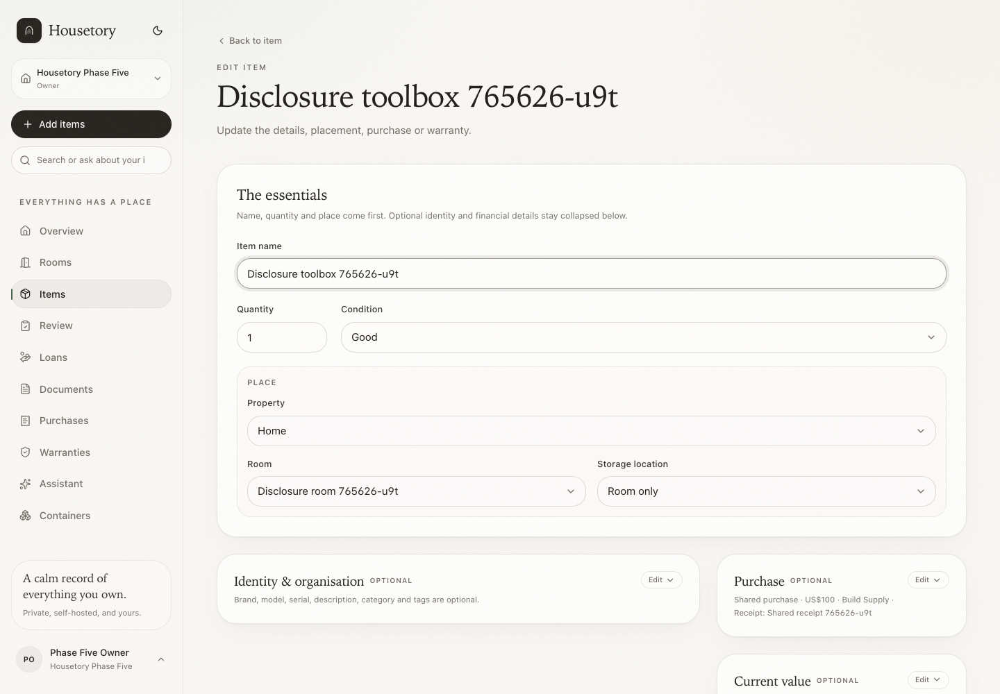
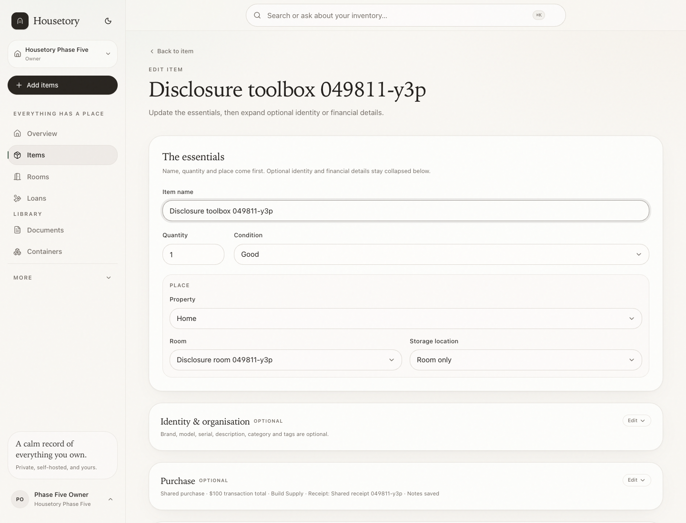
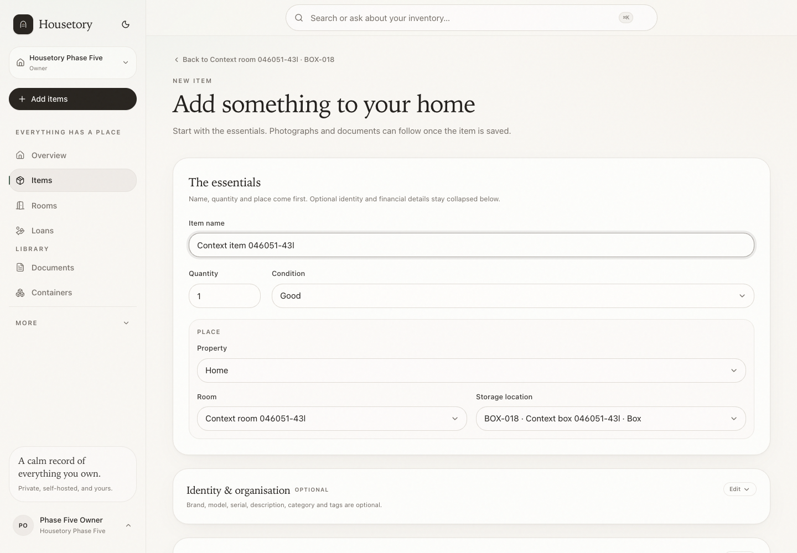
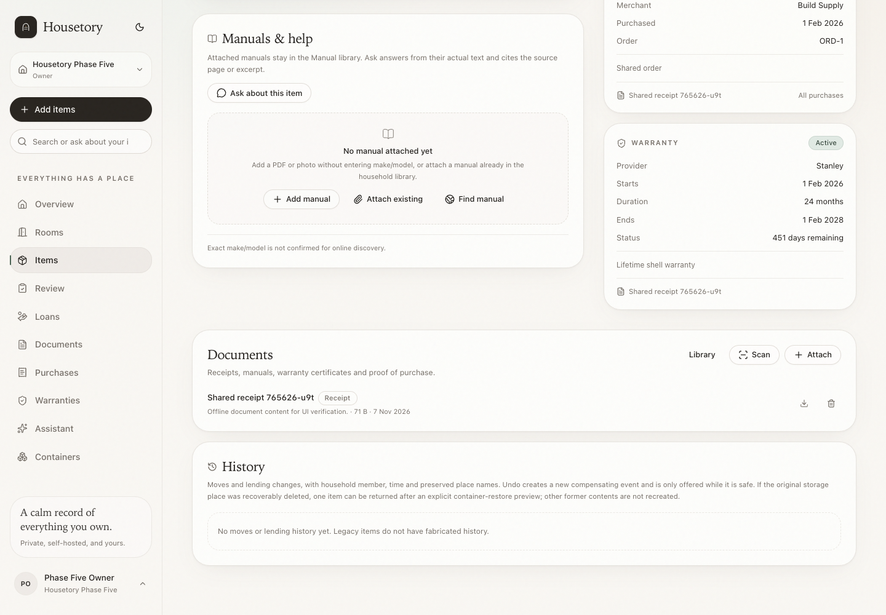
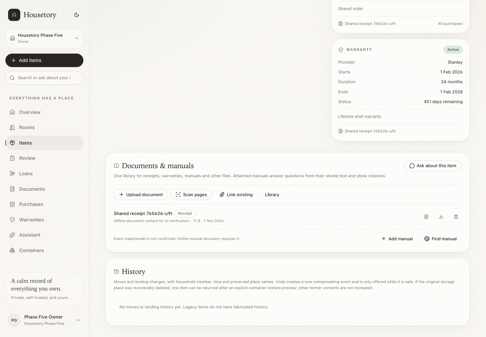
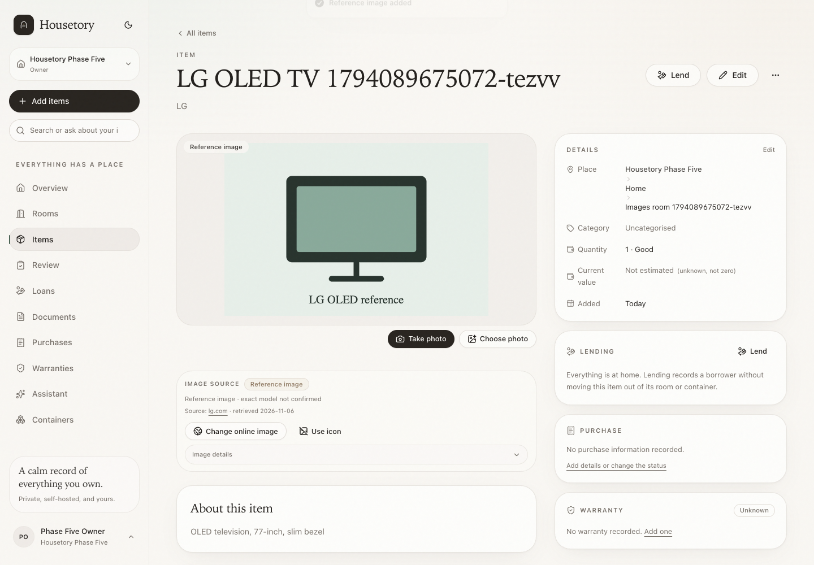
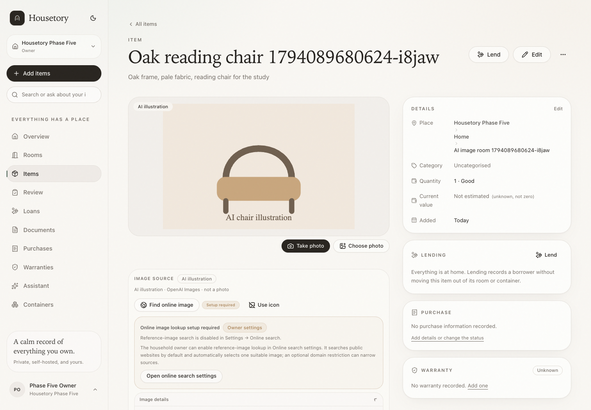

# Item form, files and image-source disclosure

This simplification keeps the existing item model and APIs. It changes grouping,
default disclosure and the item-page file presentation so routine capture stays
focused on the essentials.

## Item create/edit

The first card contains only what is needed to add an item:

1. name;
2. quantity and condition;
3. property, room and storage location, including the contextual place supplied
   by **Add items**.

Brand, model, serial number, description, category and tags are grouped in one
optional **Identity & organisation** section. Purchase and Warranty are separate
optional cards stacked below it at every viewport width. If an older value exists,
a read-only **Earlier estimate** card links to Insurance instead of offering
current-value editing. All optional cards start collapsed and expand in place, so
purchase details get the full form width instead of a narrow desktop side column.

Each optional card shows a compact summary before expansion, such as
`Shared purchase · receipt linked`, `$50 per unit · $50 for 1 unit`,
`Stanley · ends 2028-02-01`, or `No warranty recorded`. Collapsed fields remain in
React state and are still submitted, so changing only the name does not clear:

- brand/model/serial/description/category/tags;
- shared purchase membership, original transaction total, receipt link or
  unknown/not-applicable purchase status;
- an earlier estimate, which remains read-only and is preserved by omitting all
  current-value keys from the payload rather than resubmitting them;
- warranty provider, dates, reminder, notes or document link;
- existing item documents/manuals.

Expanding a section exposes the same existing fields and validation. There is no
new wizard and no confirmation step. For a non-shared item with quantity greater
than one, Purchase offers **Total paid for package** or **Price per unit**; the
form calculates the other value and always stores the package total. Shared
purchases and reviewed allocation lines stay total-only. A derived per-unit
value is view-only until explicitly edited, so rounding or quantity transitions
cannot silently rewrite the original package total. The item page shows the
package total plus an effective per-unit amount derived from the item quantity.

### Contextual Add items

The shared Add items chooser now carries both the destination and an origin back
to the source page. Manual item creation therefore keeps the room/container/
owned-storage place and after save offers **Back to** the originating room,
container or owning item.

The Room selector also offers **New room or sub-room…**. It opens the ordinary
room dialog without unmounting the item draft, preselects the current room as
parent when one is chosen, and selects the newly created room on save.

### Duplicate an item

**Duplicate item** opens a new-item form with the source name, description,
brand, model, condition, category, tags and place. Quantity always starts at 1 so
separately located physical copies can have independent loans, histories and
future moves. Serial number, actual photos, purchase details, current value and
warranty start empty; storage capability and document links are not copied.

New purchase entries and insurance lists start with the household's **Default
currency** from Settings. Existing item/purchase currencies and currencies
extracted from documents remain explicit and are never rewritten by that default.

### No longer owned

**Mark as no longer owned** archives an item with an outcome (`sold`,
`given_away`, `donated`, `discarded`, `lost`, `consumed` or `other`), a date and
an optional note. The record, photos, documents and history remain available
under Archived while active inventory, stocktake, lending and current totals
exclude it. Restoring clears the outcome. Permanent deletion remains a separate
action for mistakes, with the existing loan/storage safeguards.

## Documents & manuals

The item page now has one **Documents & manuals** surface instead of a separate
Manuals card and Documents card. It lists every attached document once, including
manuals that also appear in the manual API.

Available actions are context-sensitive:

- empty item: one compact entry surface with Upload document, Add manual,
  Scan pages, Link existing, Find manual and Ask about this item;
- non-empty item: Upload document, Scan pages, Link existing, Library, Add manual,
  Find manual and Ask about this item;
- Link existing opens the household document library and links one existing
  receipt, warranty certificate, manual or other document without uploading a
  copy;
- Ask about this item remains available to all household roles; writes remain
  owner/member only.

**Add manual** submits the current item ID with the file, title and notes and does
not show a second compatible-item selector. It does not require make/model fields.
Additional compatible items can be linked later through **Link existing** on those
items. The global Documents upload and ordinary item document upload retain their
existing item selectors and fields.

Existing `Document` rows and `item_documents` links are reused. No attachment is
copied, duplicated or deleted by the merge. Manual answers still use actual stored
manual text with page/section citations. Online manual discovery still requires a
deliberately confirmed exact manufacturer/model and a configured provider; an
uploaded or linked manual does not require make/model fields. Ordinary offline
documents remain in the same library. On a manual's detail page, extracted text
stays available while purchase-style extraction review is an optional collapsed
advanced action; other document types keep the existing review presentation.

## Image source disclosure

Image-source labels remain honest:

- actual photo takes priority;
- reference image says whether the exact model is confirmed;
- existing AI illustration says **not a photo** and remains removable;
- category icon appears when no photo or selected image exists.

The primary line keeps concise attribution and the exact-model distinction.
License evidence, full source/image URLs, permission basis, stored dimensions,
provider/model metadata, retrieval date and technical status are inside an
accessible **Image details** disclosure. The Find/Change online image and Use icon
buttons remain visible.

No illustration Generate/Generate another UI, AI headline control or saved summary
workflow returns. Public reference lookup remains optional and does not require a
domain list.

## Limits

- Optional sections are disclosure groups, not separate tabs or wizard steps.
- Summaries are derived from the same form state; they do not create new stored
  fields.
- Linking an existing document requires a deliberate choice. There is no automatic
  merge by title, merchant or manual text.
- Online manual discovery is still restricted to a confirmed exact model and a
  configured search provider; this change does not add a provider.
- Technical image provenance is available on demand rather than removed.
- Actual item photographs remain separate from reference/AI display images and
  document attachments.
