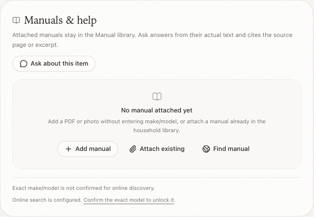
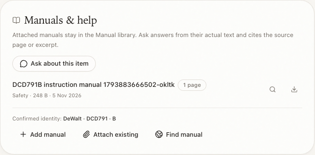
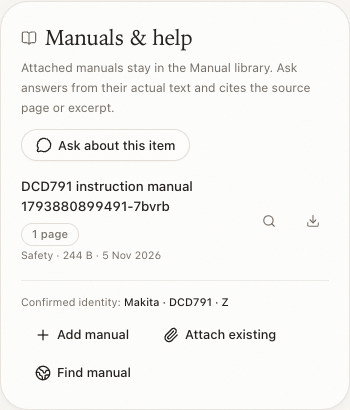
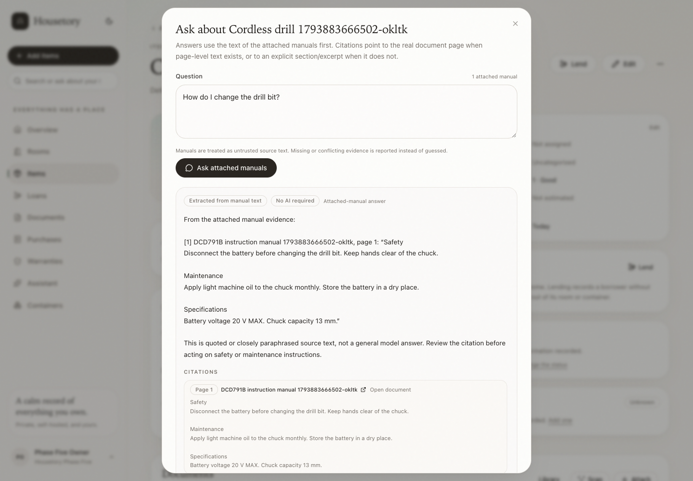
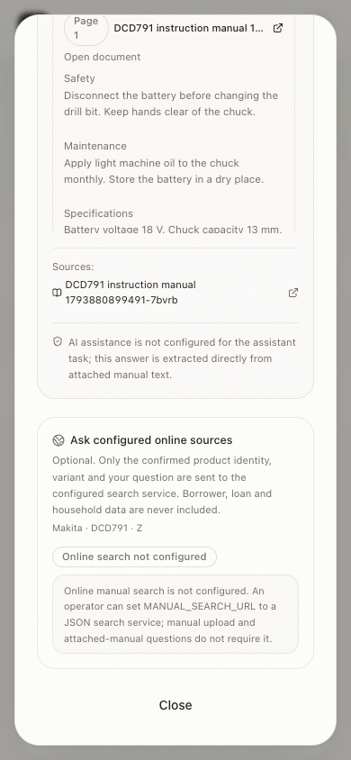

# Item manuals and grounded product help

This milestone adds compact manual attachment, manual reading by the assistant
and an explicit reviewed path for finding a manual online. It deliberately
reuses the
existing **Manual** document type, document library, upload validation, OCR,
private storage and authenticated file routes. There is no separate manual
library.

The milestone does not start evidence export, stocktake, properties or
multi-household work.

## Attaching manuals

- **Add manual** on an item opens the ordinary document upload in manual mode.
  The current item ID is submitted automatically, so the dialog does not ask the
  user to choose compatible items again. A PDF, image or text manual can be
  uploaded with a title and notes but without any make/model fields. The exact
  original is preserved and the normal document limits, duplicate warning, OCR,
  scan and authenticated download behavior still apply. To cover additional
  items later, use **Link existing** from those items rather than repeating the
  upload.
- **Link existing** in the combined **Documents & manuals** surface lists every
  household document not yet linked to the item, including manuals, receipts and
  warranty certificates. One manual can be linked to several compatible items
  through the existing `item_documents` association. Nothing is uploaded again
  and the original document is not copied.
- A non-manual document cannot be attached through the manual route. Cross-
  household documents and items return 404.
- The item page shows one **Documents & manuals** surface. Manuals and ordinary
  documents are de-duplicated by document ID, so a manual is not listed twice.
  Item photos, lending controls and purchase panels remain separate.
- The card shows how many items use a manual and warns before linking a manual
  that is already linked elsewhere. Housetory never infers compatibility from a
  shared brand or a similar name.

## Reading manuals: where AI is needed and where it is not

Housetory keeps a clear line here.

- **Without AI** you can open a manual in the file viewer, download it, and read
  the text of its pages on the document's **Details** page. Attaching, linking
  and removing manuals also need no AI.
- **Understanding a manual is the assistant's job.** There is one assistant and
  it uses the provider set for the **assistant** AI task. Housetory has no second
  question-answering pipeline and no keyword-based answer generator.
- When the assistant is not set up, the item page says so: “Questions about
  manuals need the AI assistant, which is not set up. Every file can still be
  opened and downloaded.” The **Ask about this item** button is disabled. The
  app does not pretend to answer.

**Ask about this item** opens the assistant on the item page. The assistant
already knows which item the page shows.

### Page text is stored with the document

A document's text is stored page by page in the `document_page_texts` table.
The text belongs to the document, so every item the document is linked to uses
the same rows. Nothing is read twice.

- The first reading of an upload is short on purpose. It reads the first pages
  only, which is what a receipt review needs (`OCR_MAX_PDF_PAGES`, default 5,
  for a scanned PDF).
- For documentation (types **Manual**, **Specification** and **Other**) a
  background job, `documents.read_pages`, then reads every remaining page. A
  page with a text layer uses that text. A scanned page is drawn with Poppler
  and read with Tesseract, the same tools as the first reading.
- The job works in small batches (8 scanned pages or 90 seconds) and queues
  the next batch itself, so one long manual does not block other work. It reads
  up to 500 pages.
- One page that cannot be read does not stop the job. The page is stored as
  **failed** (`source = "unreadable"`) with the reason and the number of tries.
  If the OCR tools are missing, the job stops and keeps the reason.
- Replacing a document's file starts a new generation. Text from the old file
  no longer counts.

**Tried is not the same as read.** A failed page has no text. It is not
counted as read, the manual is not called complete, and the page cannot be
cited. The progress reports both numbers: pages read, and pages whose reading
failed.

A failed page is tried again only when someone asks:

- the assistant calls `process_manual`, or
- a person uses **Run OCR** on the **Details** page.

Each request tries each failed page once. A page that fails again is not tried
again in the same request. After three tries in all (`MAX_PAGE_ATTEMPTS`) a
page is left alone, and the report says so. Pages that were read are never
read again. Nothing retries by itself, so there is no retry loop. **Clean up
scan** replaces the file's content, which starts fresh. The assistant can also
read a failed page from its picture with `look_at_manual_page`.

The job is queued after the first reading (also when that reading failed), when
a manual is linked to an item, and when the assistant asks for it. A manual
stored before this change gets its remaining pages in any of these ways: the
assistant calls `process_manual`, the manual is linked again, or **Run OCR** is
used on its **Details** page.

`GET /documents/{id}/text` returns the stored pages and the progress. The
**Details** page shows them under **Extracted text**, one block per page, each
with a link to that page in the file viewer.

### The map

When all pages are read and the assistant is set up, a second job,
`documents.map`, asks the assistant's provider to index the document. The
result is stored in `document_readings.map`:

- **sections**: title and page range;
- **topics**: a short phrase and the pages that cover it, with other words a
  person might use (for example “measuring current (amps, amperage)”).

The map is built once and reused. It is rebuilt when more pages are read or
the file is replaced.

- A PDF's own bookmarks are used as the sections when it has three or more.
- A manual that fits in one request is sent whole. A longer one is sent as the
  start of each page, in at most six requests.
- Every page number is checked. Pages that do not exist or were not read are
  dropped. A section whose title stands alone on a line of one page is moved to
  that page: models are often one page off. A contents page prints every title
  too, so a page that lists three or more section titles is not counted as the
  place of a heading. Page numbers printed inside the text are not trusted.
- The map helps to find pages. It is never shown as a source and never cited.

### A manual goes to the assistant first

Every uploaded document can get AI suggestions (the ordinary enhancement job,
`ai.enrich`). For a **manual** the order is now fixed, so that two model
requests do not run about the same file at the same time:

1. When an assistant is set up, the manual is read and mapped with the
   assistant's model first. No enhancement job is started. The document shows
   “Read by the assistant · no separate AI suggestions”.
2. When that fails (the pages could not be read, the map request failed, or
   the assistant is no longer set up when the map is due), the ordinary
   enhancement runs instead, as a new processing attempt with its own time
   limit.
3. Without an assistant, the ordinary enhancement runs at once, as before.

Receipts, invoices and all other document types are not changed. **Retry AI
only** on the document page still starts the ordinary enhancement by hand.

### The assistant's tools

The tools are in `services/assistant_tools/registry.py` and
`services/assistant_tools/manual_tools.py`.

| Tool | What it does |
| --- | --- |
| `find_manuals` | Lists the manuals of an item, or one manual by document ID, with **Open**, **Download** and **Details** links and how many pages are read. Returns no text. |
| `read_manual` | Without `pages`: the map. A short manual (up to about 8,000 characters) also returns its complete text. A longer manual with a map returns the map only, and the assistant asks for the pages it needs. Without a map, the complete text is returned up to about 30,000 characters, and the first pages of a longer manual. With `pages` (“11”, “9-12”, “3,7-9”): the text of those pages. |
| `search_manual` | Finds pages that contain given words and shows the matching lines. It points to pages; it returns no page text. |
| `look_at_manual_page` | Draws one page and lets a vision model read it. For garbled text, drawings, symbols and tables. The look runs as its own job and the request waits for it. The result is stored with the page. |
| `process_manual` | Queues the reading of pages that were not tried yet, one more try of pages whose reading failed, or the map. Needs the owner or member role. The assistant then waits and reads the manual again by itself. |
| `find_manuals_online` | Searches the configured provider for the manual of an item and returns the reviewed candidates. Takes the item and, when the user named one, a variant. Saves nothing. Needs the owner or member role. See “The assistant finds a manual online”. |
| `prepare_action` | Also prepares the two manual proposals: `confirm_manual_identity` and `save_manual`. The user applies them. |

The assistant is told to read further when the pages it has do not answer the
question, and that a word search that finds nothing proves nothing. Search and
the map are aids. They do not limit what the assistant may read.

`look_at_manual_page` uses the assistant's own model when it can read pictures.
Otherwise it uses the model of the **Vision** task. If neither exists, the tool
says so and the stored text stays readable.

**A look is its own job.** Reading a page from its picture is slow on a local
model. Inside the assistant's attempt it ran out of time in about half of the
calls. So the tool queues a `documents.look_page` job and the request waits for
it, like it waits for page reading. The job has the full time of one AI request
(`AI_TIMEOUT_SECONDS`) and does not use up the assistant's attempt. When the
job is done, the tool returns the reading. When it fails, the tool says why
(no vision model, the model did not answer, the page cannot be drawn) and the
OCR text stays. The same job serves the looks the application makes before an
answer is shown.

**A long manual opens with its map.** The first real-model run put a whole
25-page manual in the prompt and then needed many attempts to answer. Now a
manual that has a map and more than about 8,000 characters of text opens with
the map only. The assistant picks the pages for the question from the topics
and sections and reads those. It may still read any page, and a manual without
a map opens as before.

**Words OCR was unsure about.** Tesseract gives every word a confidence. Words
below 60 (of 100) are stored with the page and given to the assistant as
`ocr_unsure_words`. On a scanned manual these are mostly symbols, units and
the labels of dials and sockets, which OCR reads as nonsense words. The
assistant is told not to guess what such a word stands for, and to look at the
page with `look_at_manual_page` when its answer depends on one. Once a vision
model has read a page, its reading is given instead of the warning.

**The application looks by itself before an answer is shown.** A real model
did not always follow that instruction: it guessed a socket label from the
misread words. So when an answer cites pages that still list unsure words, and
a model that reads pictures is set up, the application calls
`look_at_manual_page` for those pages (at most two) and asks the model to
correct its answer with the readings. This happens once per request. The
reading is stored with the page, so later questions about the same page need
no new look.

Both `find_manuals` and `read_manual` take an item ID, a document ID, or both.
When both are given, the document must belong to the item: it is linked to the
item now, or a reviewed online download saved it for that item. Any other pair
is refused with `manual_not_for_item`. The tool never guesses a link.

Three kinds of document count as an item's manual:

1. Manual-library documents linked to the item.
2. Documents that a reviewed online download saved for the item, found through
   `manual_search_candidates`.
3. Other documentation attached to the item with the type **Specification** or
   **Other**.

Receipts, invoices and warranty certificates are never read as manuals. A
Manual-library document with no linked item can be opened and read by its
document ID, after `search_documents` finds it.

The tool result always says what the situation is, and the assistant repeats it:

| Situation | What the assistant is told |
| --- | --- |
| No manual attached | Look for the manual online with `find_manuals_online`, or offer **Add manual**, **Link existing** or **Find manual** on the item page. |
| Only some pages read | The result starts with “INCOMPLETE: only N of M pages…”. Call `process_manual` (owner or member), or say that an owner or member has to start it. |
| Pages are being read | Wait. The request continues when reading is done. |
| Reading failed | The stored reason is given, for example that the OCR tools are missing. |
| Reading failed on some pages | “READING FAILED on page N…” with the recorded reason. The pages can be tried again with `process_manual`, or it says that they failed three times and are not tried again. The assistant must tell the user which pages could not be read. |
| Manual too long to return whole | Choose pages from the map, or search. |
| No vision model | The page cannot be looked at. Its stored text can still be read. |

In every case except the first the manual keeps its links, and the assistant is
told not to ask for a new upload.

### The assistant finds a manual online

The assistant can do the steps of **Find manual** itself. It adds no search or
download code: the tool calls the same functions as the item page
(`services/manuals.py`, `services/manual_web.py`). The code is in
`services/assistant_tools/online_manuals.py`.

The steps of one conversation:

1. The user asks about an item. The assistant reads what is attached first.
2. No manual is attached, or the manuals do not cover the question. The
   assistant calls `find_manuals_online`.
3. The product identity is not confirmed. Nothing is searched. When the item
   records a real brand and model, the tool itself prepares a
   `confirm_manual_identity` proposal with them. When they are missing or
   generic, the assistant asks the user to read them from the product label
   and prepares the proposal from the answer.
4. The user checks the card and presses **Apply**. Only this stores the
   identity. It does not change the item's brand or model.
5. The assistant searches. It gets the candidates that show the exact model,
   with the identifiers each source really shows. Similar models are left out.
6. A `save_manual` proposal is prepared for one candidate. The tool prepares it
   itself when one candidate is the clear choice: the only one with a file, or
   the only one with a file from the manufacturer or another official source.
   Otherwise the assistant chooses or asks. The card shows the title, the
   publisher, the identifiers the source shows, the source page and the file
   address.
7. The user presses **Apply**. Only now the file is downloaded, with all checks
   of “Download safety”, stored as a Manual document and attached to the item.
8. The pages are read by the normal jobs. The assistant reads the manual with
   `read_manual` and answers with page citations.

After **Apply** of one of these two proposals the web app sends “Continue.” in
the same conversation, with the ID of the applied proposal
(`applied_proposal_id`), so the user does not have to type anything. The server
checks that the proposal belongs to this user and household, that it is
applied, and that it is a manual proposal. Then the request starts with the
step that follows: `find_manuals_online` after a confirmed identity,
`process_manual` and then `read_manual` after a saved manual. The assistant
goes on from that result with the earlier question. Other proposals do not do
this, and a proposal that is not applied starts nothing.

**A card appears when the request has ended.** A proposal is often prepared in
the middle of a request, and the assistant still has to write its answer. A
card that could be applied at that moment looked like the end of the request.
So while the assistant works, the page shows a spinner with “Working on your
request…” and “A proposal is prepared. It appears for your review when the
assistant has finished.” The card is shown when the request has ended. This
holds for every kind of proposal, not only for manuals.

Three steps are done by the application and not left to the model, because a
real model did not do them reliably (see “Verification with a real model”):

- With a brand and model on the item, the model still asked the user for them
  in words and prepared no proposal. So the tool prepares the proposal.
- After **Apply**, the model answered “I will now search” and called no tool.
  So the request starts with the next step.
- With one clear candidate, the model wrote “please apply the proposal” and
  had prepared none. So the tool prepares the proposal for that candidate.

All three only do what the user's request or the user's Apply already decided.
The user still checks and applies every proposal.

Rules the tools enforce, whatever the model decides:

| Rule | How |
| --- | --- |
| Attached manuals come first | `find_manuals_online` refuses with `read_attached_first` when the item has documentation and no manual tool was used in this conversation. |
| No search without a confirmed identity | The identity gate of the item page. The tool returns `manual_identity_required` and the brand and model recorded on the item. |
| Nobody but the user confirms an identity | A proposal is only a preview. Generic values are refused when it is prepared. |
| The assistant cannot download or attach | Only **Apply** by a signed-in owner or member does. A viewer gets `read_only_role`. |
| No second copy | A candidate that is already saved is refused with `manual_already_saved`. A file whose content is already in the library is attached, not stored again. |
| No second card | A manual proposal that already waits for the same user with the same content is shown again; no new one is made. |
| No guessed file address | A source page without a PDF link is refused with `manual_source_page_only`. |
| A changed identity or source | **Apply** returns `proposal_stale`. **Refresh proposal** shows the current values for a new review. |
| Failed download | **Apply** shows the reason, for example a private address or a web page that is not a PDF. Nothing is stored and the proposal stays pending. |

The tool result says what the situation is:

| Situation | What the assistant is told |
| --- | --- |
| Identity not confirmed | A proposal with the item's brand and model is prepared: tell the user to check it. Without a real brand and model: ask the user for them. Never guess. |
| Search not set up | The stored reason, for example that no key is saved. Offer **Add manual**. |
| Search failed | The provider's error. The search service or the internet may be down. |
| No source shows the exact model | Say so. Ask the user to check the model and variant on the label. |
| The user named another variant | Nothing is searched. A proposal with that variant is prepared (`manual_variant_not_confirmed`). After **Apply** the search looks for that variant only. |
| Candidates | A proposal for the one clear candidate is prepared: tell the user to check the source. Without a clear one: choose only a candidate that shows the confirmed model and variant, or ask. |

What leaves the server: `find_manuals_online` sends the confirmed manufacturer,
model and variant, and nothing else. No question text, name or other household
detail is sent. Titles and snippets that come back are untrusted text. The
assistant gets them shortened, and the web app shows the sources as outside
links under **Online sources**.

### Citations

An answer names the pages it rests on. The model lists them in `sources`
(document, pages and an optional short quote).

- A page is kept as a citation only if a tool returned its text **in this
  request**. Pages read in an earlier turn do not count: their text is not kept
  in the conversation, so a new answer was not written from them. A page that
  gave no text (reading failed, or an empty page) cannot be cited either.
- An answer that names manual pages although none of them was returned in this
  request is sent back to the model once, with the instruction to read the
  pages first. If the model still does not read them, its answer is shown
  without page links.
- A quote is shown only when its words really stand on that page. The words are
  taken from the stored page, not from the model. A quote that is too long is
  cut; a badly formed source is dropped. Neither makes the answer invalid.
- Each citation links to `/documents/{id}/view?page=N`, the file viewer at that
  page.
- The wording of the answer comes from the model and is not checked sentence by
  sentence.

### When the model needs more time

One attempt of a request has 90 seconds. When an attempt runs out of time, or
one AI request times out, the request does not stop for the user to press
**Retry assistant**. It goes on by itself, up to three more times. The steps
already done are kept, so the next attempt starts where the last one stopped.
While this happens the page says “This takes longer than usual. The assistant
is still working and goes on by itself.” After the last try the request ends
with the normal error and **Retry assistant**. Other failures (a provider that
is not reachable, a refused request) are not tried again automatically.

### Keeping the conversation small

- A read returns at most about 30,000 characters of page text. One prompt keeps
  at most about 56,000 characters of page text from all steps.
- An earlier step or an earlier turn keeps the map and the numbers of the pages
  that were read, not their text. A follow-up reads only the pages it needs.
- The item and document IDs stay in the conversation, so “How do I check
  amperage?” after “Show me the multimeter documentation” needs no new search.

### Safety

- Page text, the map and what a vision model read are untrusted data. They
  reach the model only inside tool results. Summaries written by the tools never
  contain page text.
- Household and property scope are checked on every call. A manual outside the
  conversation's property is reported as not found.
- Reading a manual creates no import, no capture and no extraction review.

### The file viewer

**Open** goes to `/documents/{id}/view`. This page shows the stored file and
nothing else from the document page: it starts no extraction review and no
processing. It loads the document's name and the file, with the same API calls
and the same access checks as a download.

- A PDF is drawn page by page on canvases by pdf.js, inside the app. The
  browser's own PDF viewer is not used. Nothing inside the file is run or can
  be clicked: no scripts, no working forms, no links. The file is still only
  served as a download (`Content-Disposition: attachment`).
- An image is shown as an image. A text file is shown as plain text.
- `?page=N` opens a PDF at page N. Citations use it.
- Zoom buttons stay under the app header. Zooming, turning the phone and
  resizing the window keep the place being read.
- Only pages near the screen are drawn, so a long manual does not fill the
  memory.
- **Download** and **Details** are on the page. **Details** is the document page.
- A link from a conversation in another household switches to that household
  first, if the user is a member. Otherwise the file is not loaded.

Limits of the viewer: text on a page cannot be selected or searched, and links
inside a PDF cannot be clicked. Use **Download** for that. The viewer was tested
in Chrome on desktop and phone sizes only.

## Confirming the product identity

Online search and online download use one server-side gate stored in
`item_manual_profiles`:

- a manufacturer with at least two characters and at least one letter;
- a complete model identifier with at least two characters, containing a letter
  or digit, and not a generic label;
- an optional variant/revision string;
- an explicit `confirmed: true` acknowledgement from a signed-in writer.

Completeness is the manufacturer-specific identity the user verified against the
physical label, not an arbitrary regex. Housetory does **not** require every
model to contain a digit: legitimate letter-only models such as `Sonos One` are
accepted. Generic values such as “Unknown”, “Heavy drill”, “cordless drill”,
“tool” or “manual” are rejected, as are empty/one-character fragments.

The UI pre-fills item brand and model only as suggestions; the user must check
the physical label and confirm. The assistant can prepare the same confirmation
as a `confirm_manual_identity` proposal; it is stored only when the user applies it. Saving the profile never edits the item's brand,
model or other fields. Regional, hardware or revision variants can be recorded;
when a variant is present, candidate evidence must show the variant or the
concatenated model form (for example DeWalt `DCD791B` for model `DCD791` with
variant `B`).

The gate is rechecked on every search and download request, from the item page
and from the assistant. Missing or invalid profiles return `409 manual_identity_required` /
`409 incomplete_manual_identity` or `422 incomplete_manual_identity`. Manual
upload and the assistant's reading of attached manuals do not require the gate.

## Reviewed online discovery and download

### Primary provider: Brave Search API

The primary supported adapter uses the official
[Brave Search API](https://api.search.brave.com/) Web Search endpoint. It is a
real search API, not an ordinary chat model and not a hosted Housetory gateway.

Provider contract implemented by Housetory:

```text
GET https://api.search.brave.com/res/v1/web/search
    ?q=<manufacturer, model, variant, manual terms or question>
    &count=<5-10>
    &extra_snippets=true
    &text_decorations=false
    &safesearch=moderate
X-Subscription-Token: <BRAVE_SEARCH_API_KEY>
Accept: application/json
```

Optional `country` and `search_lang` parameters are sent only when
`BRAVE_SEARCH_COUNTRY` / `BRAVE_SEARCH_LANG` are configured. Housetory reads
`web.results[]` and normalizes the documented result fields `title`, `url`,
`description`, `extra_snippets`, `profile.name` / `profile.long_name` and
`language`. It does not use a guessed endpoint or invent result fields.

Registration/configuration (household owner, no restart):

1. Create a Brave Search API account and subscription token in the
   [Brave API dashboard](https://api-dashboard.search.brave.com/). Review
   Brave's current plan, quota and terms; a paid tier may be required for the
   volume you need.
2. Sign in as the household owner and open **Settings → Online search**. Paste
   the token into the write-only **Brave Search API key** field, enable
   **Online manual search**, and save. The key is encrypted at rest with the
   installation credential key and is never returned to the browser, written to
   logs, or placed in a URL. A saved-key indicator confirms storage; leaving the
   field blank keeps the existing key. Replacement and removal are explicit.
3. One saved Brave key serves both manual discovery and reference-image lookup;
   their enable controls are separate. Changes are resolved from the database on
   the next API or worker request, without editing deployment environment files
   or restarting services.
4. Do not press **Search** until you are ready for a real request. The manuals
   status endpoint and UI report whether a provider/key is configured without
   contacting Brave. The first actual Brave request happens only when a writer
   confirms an item's exact identity and explicitly presses **Search for exact
   model**.

Optional connection validation (user-triggered, bounded): the owner can press
**Test connection** in Settings → Online search and confirm the dialog. Housetory
sends one fixed neutral query (`Housetory connectivity test`) to the Brave
endpoints and reports the result. It sends no inventory, manual, borrower or
household content, does not download anything and may use subscription quota. The
manuals status endpoint still reports configuration without contacting Brave.
Walkthrough screenshots: [not configured](walkthrough/online-search/01-not-configured.png),
[saved write-only key](walkthrough/online-search/02-saved-write-only-key.png),
[test confirmation](walkthrough/online-search/03-test-confirmation.png) and
[bounded test result](walkthrough/online-search/04-test-result.png).

Installation fallback (operator-only): if a household has no saved online-search
row, the installation environment can provide `BRAVE_SEARCH_API_KEY` and the
older provider-selection variables. Saving the Settings card makes the household
row authoritative, including when both channels are explicitly disabled or the
key is removed; the fallback is not silently reactivated. The advanced
`MANUAL_SEARCH_URL` gateway remains an operator-only fallback and is not edited
in the household card.

The default base URL is the official `https://api.search.brave.com`. The base URL
override exists for a compatible proxy or isolated test fixture; production
should leave it at the official HTTPS endpoint. Automated tests use a fixture
and never call Brave.

Household provider selection is controlled by the saved Settings row:

- **Online manual search** enabled with a saved key: use Brave regardless of the
  installation fallback.
- **Online manual search** disabled: keep upload and attached-manual Q&A, and do
  not fall back to an environment key.
- No household row: use the operator `MANUAL_SEARCH_PROVIDER` fallback:
  - `auto` (default): use `MANUAL_SEARCH_URL` when set (advanced gateway),
    otherwise use `BRAVE_SEARCH_API_KEY` when set, otherwise remain unconfigured.
  - `brave`: require `BRAVE_SEARCH_API_KEY`.
  - `gateway`: require `MANUAL_SEARCH_URL`.
  - `none`: disable online discovery while keeping upload and attached-manual Q&A.

| Variable | Default | Purpose |
| --- | --- | --- |
| `MANUAL_SEARCH_PROVIDER` | `auto` | Operator fallback when no household row exists: `auto`, `brave`, `gateway` or `none` |
| `BRAVE_SEARCH_API_KEY` | empty | Operator-only fallback key; prefer Settings → Online search |
| `BRAVE_SEARCH_BASE_URL` | `https://api.search.brave.com` | Official endpoint or compatible operator test/proxy base |
| `BRAVE_SEARCH_COUNTRY` | empty | Optional Brave country code |
| `BRAVE_SEARCH_LANG` | empty | Optional Brave search language code |
| `MANUAL_SEARCH_URL` | empty | Advanced JSON gateway URL; only when provider is `gateway`/`auto` |
| `MANUAL_SEARCH_API_KEY` | empty | Optional bearer token for the advanced gateway |
| `MANUAL_SEARCH_PROVIDER_LABEL` | `Configured manual search` | Gateway label shown in the UI |
| `MANUAL_SEARCH_TIMEOUT_SECONDS` | `20` | Search, landing-page and manual-download timeout |

### Source evidence and PDF discovery

Brave returns web pages, not a guaranteed manual file. Housetory handles two
real outcomes:

1. **Direct PDF result.** If the result URL path ends in `.pdf`, it is stored as
   the candidate's file URL. The UI labels it as having a direct PDF.
2. **Landing/support page.** The result is still shown with its actual source
   URL and publisher, but no `.pdf` is guessed. For at most two
   manufacturer/official results, Housetory may read that page with the same
   safe public-IP/redirect/byte/deadline fetch path and inspect actual `<a
   href>` links. A linked PDF is accepted only when it is a real anchor ending
   in `.pdf` and its link text/URL shows the confirmed model/variant or clear
   manual wording. No embedded PDF references, JavaScript links, meta refresh or
   guessed paths are followed.

If no real linked PDF is found, the candidate is marked **source page only**.
The UI offers **Open source page** and **Upload manual** instead of a download
button. Housetory never downloads an HTML page as if it were a PDF and never
invents a PDF address.

Brave does not supply an official/manufacturer flag. Housetory derives source
type conservatively:

- `manufacturer` only when the registrable host label matches the confirmed
  manufacturer token and the Brave profile name also matches it (for example
  `dewalt.com` + profile “DeWalt”);
- `official` when a host/profile match exists but not both exact checks;
- `other` otherwise.

This is evidence for review, not a guarantee. The UI shows the real source URL,
publisher, language, model coverage, retrieval date and direct-file state. A
similar-product result is hidden unless its title/snippet/URL actually contains
the confirmed model and variant.

### Advanced gateway option

The original generic JSON gateway remains available for an operator who already
has a custom search service. It is not required and is not the only usable
integration.

Gateway request:

```json
POST <MANUAL_SEARCH_URL>
{
  "mode": "manual",
  "manufacturer": "DeWalt",
  "model": "DCD791",
  "variant": "B"
}
```

Expected response:

```json
{
  "results": [
    {
      "title": "DCD791B instruction manual",
      "source_url": "https://www.dewalt.com/support/DCD791B",
      "file_url": "https://www.dewalt.com/-/media/manuals/DCD791B.pdf",
      "publisher": "DeWalt",
      "language": "en",
      "source_type": "manufacturer",
      "model_coverage": ["DCD791", "DCD791B"],
      "snippet": "Optional short source excerpt"
    }
  ]
}
```

`source_type` is one of `manufacturer`, `official` or `other`. Candidate titles,
snippets, publishers and coverage must show the exact confirmed model (and
variant, if set); similar products are hidden with a notice. At most 30 gateway
results are inspected and at most 10 exact-model candidates are kept. Gateway
redirects are refused so credentials cannot be forwarded.

Search candidates are persisted in `manual_search_candidates` with source URL,
file URL, publisher, language, source type, model coverage, snippet, retrieval
time, direct-file state and creator. Repeated searches update the same source URL
instead of creating duplicates. Nothing is downloaded during search.

A download is accepted only for a specific reviewed candidate with a direct PDF:

- the candidate must belong to the same household and item;
- `confirm_model: true` and a `request_id` are required;
- an existing download for the same candidate returns the existing document;
- a retry with the same request id does not create another candidate/document;
- identical file bytes already in the household reuse that document and only add
  the item link, never a second copy;
- the returned provenance includes the candidate/source URL, final resolved file
  URL, publisher/language/source type, model coverage, search retrieval time,
  download time and the resulting document.

Only PDF downloads are accepted from online sources. The downloaded original is
stored privately through the same normalized/original document storage as an
uploaded manual, and OCR is queued. If the source is unavailable, ambiguous or
not a PDF, the request fails clearly and the user can still upload a manual.

### Download safety

- URLs must be absolute HTTP(S), contain no embedded credentials and be at most
  2,000 characters.
- The hostname is resolved before connecting. Every resolved address must be a
  public global address; loopback, private, link-local, metadata, multicast,
  reserved, unspecified, IPv4-mapped loopback and alternate numeric forms are
  rejected. Connections use the pinned resolved address while preserving the
  original Host header and TLS server name, which limits DNS rebinding.
- Redirects are bounded to three, revalidated at every hop, and HTTPS may not
  downgrade to plain HTTP. Credentials, invalid ports and unsupported schemes are
  rejected.
- Response size is bounded (`MAX_UPLOAD_MB` for downloads, 512 KB for landing
  pages) and the total wall-clock time by `MANUAL_SEARCH_TIMEOUT_SECONDS`, not
  only per-read socket timeouts. HTML responses and non-PDF bytes are rejected
  even if the declared content type claims otherwise.
- Landing pages are read only from accepted manufacturer/official results, at
  most two per search. Only actual anchor links are inspected; no embedded
  references, linked PDF previews or arbitrary redirects are recursively
  fetched.
- Filenames are reduced to a basename and passed through the existing storage
  sanitizer. Embedded references inside a PDF are never fetched.
- Search/download endpoints do not accept a URL from the browser as their
  destination; the operator-configured provider or a previously stored reviewed
  candidate is the only source. Downloaded text, queries and keys are not logged.

## No answers from search snippets

There is no **Ask online sources** dialog any more, and the assistant has no
tool that answers from search snippets.

- The old dialog had its own AI request and, without AI, built an answer from
  snippets. Both are gone (`POST /items/{id}/manual-questions/online`,
  `ask_online_question`, `search_online_sources`). The assistant is the only
  place that answers.
- A tool that gave the assistant short online excerpts for a question was built
  and tried with a real model. For “what wattage does it use?” the only
  excerpt said “User manual for the Northlake NL-900 space heater.” The model
  answered “1500 watts, according to an online source”. That value was in no
  excerpt. A search snippet is too little evidence, and the model fills the
  gap. The tool was removed.

For a question about a product without a manual, the assistant finds the
manual online, the user saves it, and the answer comes from its pages with
page citations.

## OCR and citation limitations

- A manual's document page keeps OCR status, extracted text and downloads. Like
  every other document type, it also has an open **Extraction review** section
  for purchase-style fields and product lines. The stored extraction result is
  loaded with the page once the text has been read. The full review opens with
  **Review extraction**; lookups of related items, rooms and locations wait
  until then. To read a manual without this section, use
  [the file viewer](#the-file-viewer). Questions about a manual are asked in
  the assistant, not on the document page.
- The first reading still stores up to 40 pages under
  `extracted_metadata["ocr_pages"]` and `extracted_text` (capped at 200,000
  characters). The later pages of a manual are stored only in
  `document_page_texts`. So text search over documents and the extraction
  review still see the first reading only.
- Image OCR maps to page 1. Text documents map to page 1. Digital PDFs and
  scanned PDFs map to their real page numbers.
- OCR makes mistakes, most often with symbols. In the AstroAI multimeter manual
  the dial symbols µA, mA and A are read as “pas”, “mas” and “at”. The words
  around them are right. `look_at_manual_page` exists for such pages and needs
  a model that can read pictures.
- A manual with more than 500 pages is read up to page 500.
- `search_manual` matches the start of words. It does not know synonyms. That
  is why it is only an aid and the assistant may always read pages directly.
- No answer is produced without an AI provider.
- **Slow providers.** The assistant gives each attempt 90 seconds, and one AI
  request gets `AI_TIMEOUT_SECONDS` (default 90). A cloud model stays well
  inside both. A large local model may not: in a test with a local 32B vision
  model (about 10 words per second) the map of the 25-page AstroAI manual
  needed 85 to 163 seconds, so `AI_TIMEOUT_SECONDS` had to be raised, and a
  question needed **Retry** several times. Retry keeps the finished tool
  results, so each press moves on. A request that runs out of time now goes
  on by itself up to three times (see “When the model needs more time”).
- **Thinking models on Ollama.** The Ollama adapter does not switch a model's
  hidden reasoning off. A thinking model spent 8 minutes on the map request.
  Use a non-thinking ("instruct") model.
- **Small models.** A local 8B model built a usable map in 21 to 32 seconds
  but could not follow the assistant's step format, so it could not hold the
  conversation.
- A vision model can misread a page too. Its reading is given next to the OCR
  text, not instead of it.

## Permissions and retention

- Viewers can open and download attached manuals, read their page text and ask
  the assistant about them, but cannot upload, attach, save identity, search
  online, download online candidates, start page reading or otherwise mutate
  records. With the assistant a viewer can read manuals, but cannot search for
  manuals online or prepare a proposal.
- Every manual, profile, candidate, document link, citation and answer lookup is
  household-scoped. Deleted documents remove their item links through the
  existing cascade; downloaded files remain ordinary documents with provenance.
- Manuals and candidates are private; no file is served without an authenticated
  household session. Standard original/normalized download headers remain
  `private, no-store`.

## Verification and unverified live setup

Automated backend tests cover upload without make/model, multi-item reuse,
cross-household and viewer boundaries, letter-only and variant model identities,
the search gate, exact-model filtering, candidate
persistence, reviewed download idempotency, duplicate reuse, provenance,
malformed provider output, OCR
page storage and SSRF/redirect/size/type/timeout guards. Manual reading has its
own tests: page reading in batches, the map and its page checks, the five
assistant tools, citations of pages that were really read, follow-ups, long
manuals, unfinished reading, a missing vision model and household isolation
(`tests/test_document_pages.py`, `tests/test_assistant_manuals.py`).
`tests/test_real_manual.py` reads a real scanned manual with Poppler and
Tesseract. It is skipped unless `HOUSETORY_MANUAL_PDF` points to the AstroAI
file `ASIM6K0R-EN-v2.pdf`; the model in it is scripted, so it calls no AI
provider. Its checks compare key words in order and ignore spacing and
punctuation, because OCR output differs between Tesseract versions; it passes
in the worker image (Tesseract 5.3, `eng+swe`) and on macOS (Tesseract 5.5,
`eng`). Brave-specific tests
use realistic vendor fixtures to verify request construction, the documented
`X-Subscription-Token` header, query parameters, response normalization,
manufacturer provenance validation, direct-PDF versus source-page discovery,
401/403/429/500 parsing, timeouts, invalid JSON, rate limits, key non-disclosure
and the complete API search/download path. Frontend tests cover
attach, opening the assistant, the no-AI notice, gated find/review/save, source-page-only candidates and
viewer controls. Playwright starts a fixture Brave service, configures the real
adapter through the disposable API, discovers a candidate, reviews it, saves a
manual through the UI and checks that its page text is stored. The browser workflow
fixtures the private PDF fetch response because the disposable mock service is
not a public SSRF destination; real server-side PDF fetch, validation,
idempotency and duplicate handling are covered by PostgreSQL backend tests.

Not live-verified in this milestone: calling the real Brave Search API with a
real subscription token, downloading a real vendor PDF, and calling a paid cloud
model for manual synthesis. No real Brave credential is stored by this change.
To verify live, register a Brave Search API token, save it under
**Settings → Online search** as the household owner, use the explicit
**Test connection** action if desired, then perform one deliberate search and
one download while watching the API/worker logs. Configure a consented assistant
provider only if AI synthesis is wanted. No live network, paid AI, email or
remote deployment is performed by the automated tests.

## Verification with a real model

Scripted tests prove that the tools and proposals work. They cannot show what a
model does with them. So the conversations were run with a real model, on
isolated data: a throwaway PostgreSQL database, its own data folder, the API
and worker on the host. No existing document, setting or key was touched.

- **Model:** `qwen3-vl:32b-instruct` in Ollama 0.40 on an Apple M4 Max with
  64 GB, about 9 tokens per second. It was the assistant, the vision model and
  the map builder. No cloud model was used.
- **Search:** a local stand-in that answers like the Brave Search API, used
  through the real Brave adapter. No real Brave key exists here. The manual it
  points to is the real AstroAI file on the public internet, so the download
  and its checks were real (3,263,458 bytes, 25 scanned pages).
- **OCR:** Tesseract 5.5 (`eng`) and Poppler on macOS.

The code changed while this ran, because the model showed faults that the
scripted tests could not show. Each row gives the last run of that
conversation. “Retries” counts how often **Retry assistant** was needed.

| Conversation | Tool calls the model or the application made | Result | Time, retries |
| --- | --- | --- | --- |
| “How do I check the amp with the multimeter?” No manual attached. | `search_items`, `get_item_details`, `find_manuals` (none), `find_manuals_online` (identity not confirmed, proposal prepared) | Says no manual is attached and asks to check the card. | 42 s, 0 |
| Apply identity, then the app continues | `find_manuals_online` (2 candidates, the similar model hidden, proposal for the manufacturer's PDF) | Says what was found and asks to check the source. | 39 s, 0 |
| Apply save, then the app continues | Download 0.5 s. `process_manual` (25 pages by OCR in about 30 s, map built by the model), `read_manual`, two `look_at_manual_page` | The six steps of “Measuring Current”, pages 11–12 cited. Checked against page 11: correct. One sentence came from page 10, which was not cited. | 815 s, 8 |
| The same three steps in the web app (Chrome) | As above. The app continued by itself after both Apply clicks. | Correct steps, pages 11–12 cited, the link opens page 11 in the viewer. | 27 s, 32 s, then 4 minutes with 1 retry |
| “and how do I measure voltage with it?” | `read_manual` 12, then 10–11, one look | Correct, pages 10–11 cited. | 326 s, 3 |
| “ok n whats the max amps it can take b4 the fuse blows??” | `read_manual` 18, one look | **Wrong in part:** it said a 200 mA fuse; the manual says 600 mA. It named pages 16–17, which it had not read. This led to the stricter page check. | 236 s, 2 |
| The same manual, new question: “what fuses are in my Multimeter and how do I change them?” | `find_manuals`, `read_manual` 1–25, two looks | Correct: F600 mA/250 V and F10 A/250 V, pages 16–17 cited. | 501 s, 5 |
| Persian follow-ups (car battery voltage; “how do I change its battery?”) | `read_manual` 10–11 / 16–17, looks | Answered in Persian, correct, pages 10–11 and 16 cited. | 715 s, 7 and 272 s, 2 |
| “how do i test continuity w/ my multimeter, the beepy thing” with the manual attached | `find_manuals`, `read_manual`, one look | Correct, page 13 cited. **No search request was sent.** | 407 s, 4 |
| “Please download the multimeter manual from the internet again and attach it.” | `search_items`, `get_item_details`, `find_manuals` | Says the manual is already attached. Nothing searched or downloaded. | 54 s, 0 |
| “Can you find the manual for my toaster?” (no brand, no model) | `find_manuals`, `find_manuals_online` (identity not confirmed, no proposal) | Asks for the make and model from the label. | 36 s, 0 |
| “It's a Bosch TAT3A011, I read it from the bottom.” | `prepare_action` (identity proposal). After Apply: `find_manuals_online` | Says no source shows that exact model and offers **Add manual**. | 33 s and 27 s, 0 |
| “…It is the Pro variant, it says M6K0R Pro on the back.” | `find_manuals_online` with the variant (proposal with variant Pro). Later search: no source shows it | Says nothing was found for that variant and asks to check the label. | 75 s and 39 s, 0 |
| Space heater whose only source is a private address | Identity and save proposals as above | **Apply refused:** “The manual source resolves to a private, loopback or internal address.” Nothing stored. | 36 s, 30 s |
| Search switched off for the household | `find_manuals_online` (not set up) | Reports that online search is off and names Settings and **Add manual**. | 27 s, 0 |
| Search service stopped | `find_manuals_online` (search failed) | Reports that the search service cannot be reached. | 24 s, 0 |
| Ollama stopped | none | “The AI provider failed. Retry or use local/manual controls.” | 6 s |
| Assistant task switched off | none | `409 assistant_tools_unavailable`. Manual list, file download, page text, quick search and inventory export still answer 200. | — |
| Existing requests: rename an item and set its brand (5 times, then 3 on the last code), lend an item (3 times), “where's my space heater?” | `search_items`/`locate_item`, `prepare_action` | Proposal prepared every time; lookup correct. | 36–60 s, 0 |

Search requests sent in all of this: eight. Seven carried only the confirmed
manufacturer, model and variant. One carried a question; it came from the
excerpt tool that was then removed.

Faults the real model showed, and what was done:

| Fault | Change |
| --- | --- |
| With a brand and model on the item it asked for them in words and prepared no proposal. | The tool prepares the identity proposal. |
| After Apply it answered “I will now search” and called no tool. | The request after Apply starts with the next step. |
| It wrote “please apply the proposal” and had prepared none. | The tool prepares the save proposal for the one clear candidate. |
| It read the same page five times in one request. | A repeated call with the same result returns a short note. |
| The first, long instructions made it answer “I will prepare a proposal” for a plain rename, where the branch before prepared the proposal 3 times of 3. A shorter version still failed 1 time of 3. | The instructions are three lines. The tool results say what to do. Rename: 8 of 8 on the last code. |
| Two new fields in the answer schema (“prepared for the user”, “left to do”) had the same bad effect: 0 of 3 renames prepared. | Removed again. |
| It sent an empty request ID with a loan proposal, twice, and then said the proposal was ready. | An empty request ID means none. A second answer after an invalid call ends the request with an error. |
| It answered “which heater?” and “I cannot download” without looking at the inventory. | A first reply without any tool is sent back once. |
| It named manual pages it had not read. | Every page named in the answer must have been read in the request. |
| The user said “Pro variant” and the proposal had no variant. | `find_manuals_online` takes a variant the user named. |
| From one search snippet it invented “1500 watts”. | The excerpt tool was removed. |
| In the browser, Apply while the answer was still being written did not continue. | The page continues when the running request has ended. A card is now shown only when its request has ended. |

Limits that remain:

- **Speed.** With this local model one attempt (90 seconds) was often too short
  once a whole manual was in the prompt. The answer after saving needed 8
  retries in one run and 1 in another. Since then a long manual opens with its
  map only, and a request that runs out of time goes on by itself up to three
  times. These two changes were made after the run and were **not** tried with
  a real model. The model's context size (`num_ctx`) is still not sent to
  Ollama.
- **No real search provider.** The Brave Search API itself was not called.
- **One model.** No other local model and no cloud model was tried.
- **Accuracy is the model's.** One fuse value was wrong. Citations can miss a
  page (page 10 above) or include a page that adds nothing (page 12).
- **Looking at a page often failed.** `look_at_manual_page` ran out of time in
  about half of the calls. The answer then rested on the OCR text. A look is
  now its own job with its own time. This was not tried with a real model.
- **Search across languages.** “مولتی‌متر من کجاست؟” found nothing, because
  the item is named “Multimeter”. The model searched for the Persian word.
- **Other households** were covered by the scripted tests only.
- A saved manual used to start the normal document enrichment job at once and
  it competed with the assistant. A manual now goes to the assistant first
  (see “A manual goes to the assistant first”).
- `e2e/manuals.spec.ts` and `e2e/item-editing.spec.ts` were stale: they did not
  open the **Documents** tab of the item page. They do now, and
  `manuals.spec.ts` has a browser test of the whole online flow with a scripted
  model. One test in `item-editing.spec.ts` (“pack purchase…”) still fails; it
  is about the purchase form, not about manuals.

## Representative screenshots

The walkthrough used a disposable Compose stack, a synthetic text manual and a
fixture Brave-compatible search service through the real Brave adapter. No real
household record, live Brave request or paid provider was used.

### Before and after on the item page

The item layout, typography, palette, photo area, lending, purchase and warranty
panels keep their existing feel. The separate Manuals card and Documents card are
now one compact Documents & manuals surface with the same upload, scan, link,
ask and online-discovery actions. See
[`ITEM_FORM_AND_FILES.md`](ITEM_FORM_AND_FILES.md) for before/after screenshots.

> The walkthrough screenshots below were captured with the earlier separate
> Manuals card. They remain as historical evidence for manual upload, answers and
> discovery; current combined-surface screenshots are in
> [`ITEM_FORM_AND_FILES.md`](ITEM_FORM_AND_FILES.md).









### Grounded answers and reviewed discovery






## Verification

- **455 PostgreSQL-backed backend tests** pass, including household online-search
  credential lifecycle/fallback/domain tests plus manual attachment,
  identity-gate, citation, idempotency, duplicate, provider-output and SSRF tests.
- **230 Vitest frontend tests** pass, including the write-only online-search
  Settings card, bulk AI-task progress/skips/confirmation, manual card/actions,
  Ask dialogs, real-page citations, no-AI/unconfigured states, identity
  confirmation, candidate review/download and viewer controls.
- **95 disposable-stack Playwright workflows** pass (94 passed, 1
  fixture-dependent skip), including online-search Settings, bulk AI-task
  confirmation/results and two named manual workflows: a real synthetic
  upload/attach/answer flow and a mocked gated search/review/save flow at mobile
  width.
- Ruff, strict TypeScript typecheck, production build and Alembic migration drift
  check pass. The new migration is append-only.
- The local Compose deployment was backed up first, migrated to
  `c4e6a8b0d2f4`, and preserved all real inventory, loan, settings, AI, SMTP,
  document and upload data. The test-only PostgreSQL port remained unpublished.
- No live manufacturer search, real vendor PDF download, paid AI manual answer,
  email send or remote deployment was performed.
