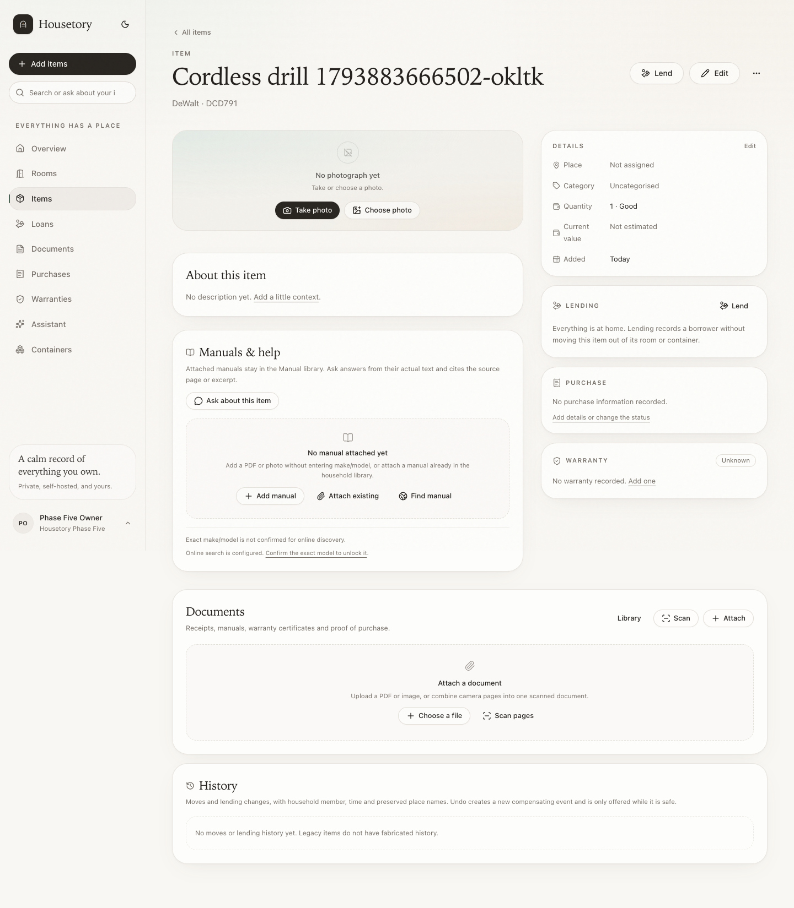
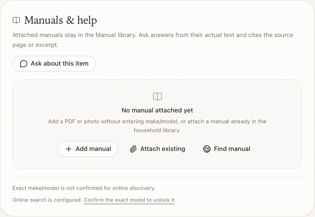
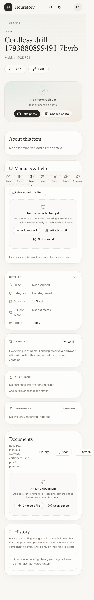
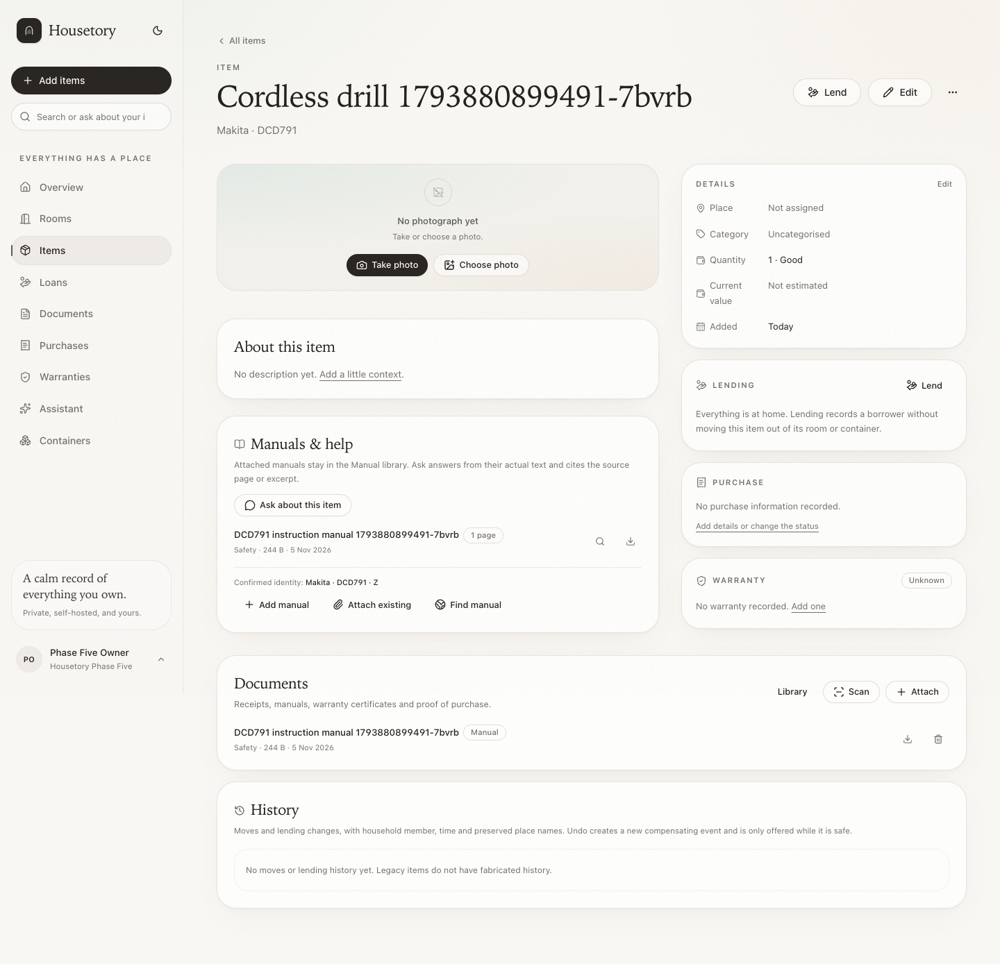
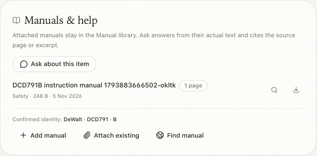
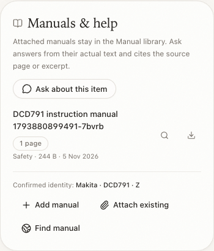
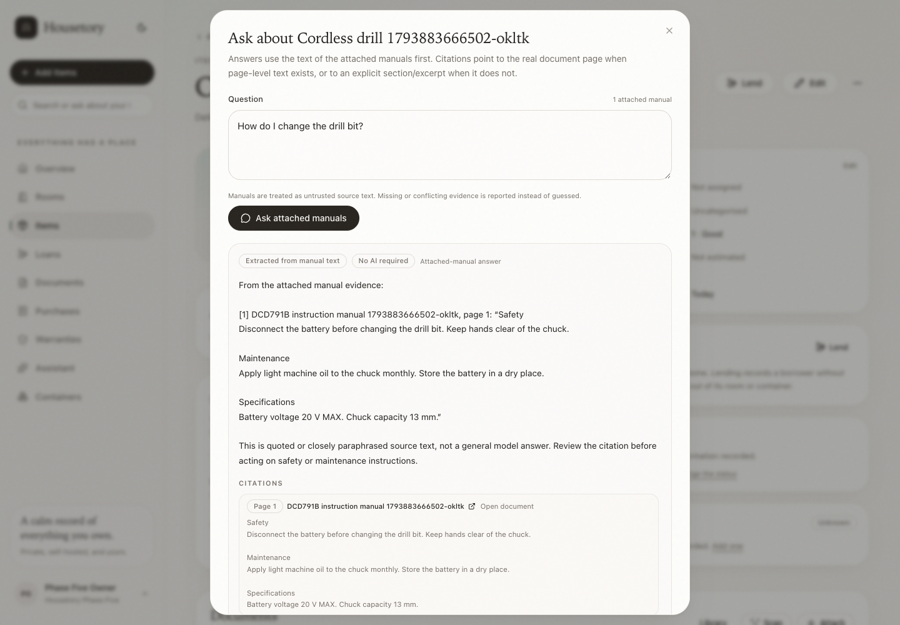
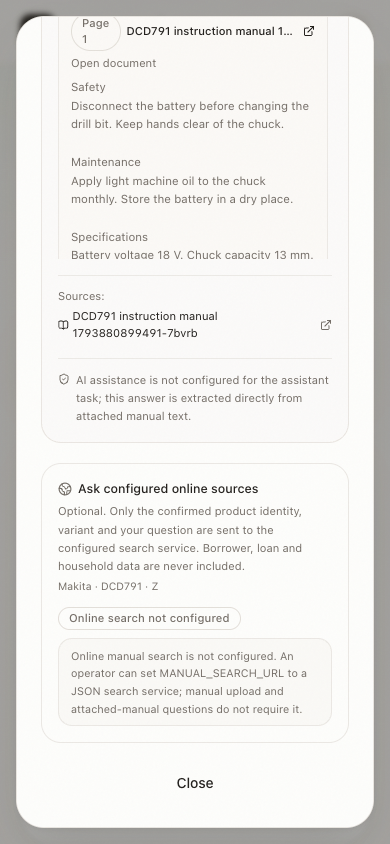
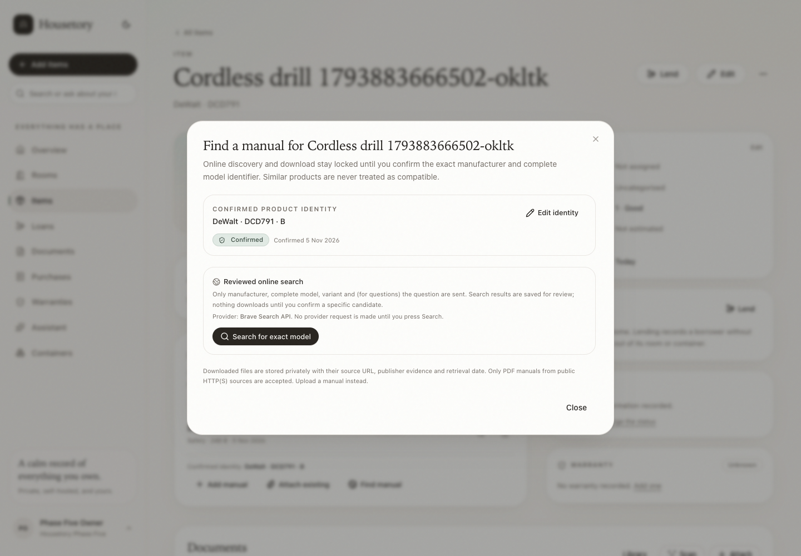
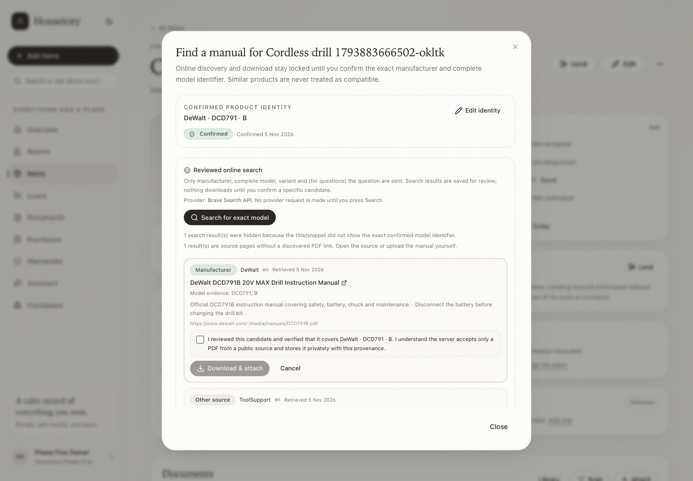

# Item manuals and grounded product help

This milestone adds compact manual attachment, grounded manual answers and an
explicit reviewed path for finding a manual online. It deliberately reuses the
existing **Manual** document type, document library, upload validation, OCR,
private storage and authenticated file routes. There is no separate manual
library.

The milestone does not start evidence export, stocktake, properties or
multi-household work.

## Attaching manuals

- **Add manual** on an item opens the ordinary document upload in manual mode.
  A PDF, image or text manual can be uploaded without any make/model fields.
  The exact original is preserved and the normal document limits, duplicate
  warning, OCR, scan and authenticated download behavior still apply.
- **Attach existing** lists manuals already in the household library that are
  not yet linked to the item. One manual can be linked to several compatible
  items through the existing `item_documents` association. Nothing is uploaded
  again and the original document is not copied.
- A non-manual document cannot be attached through the manual route. Cross-
  household documents and items return 404.
- The item page shows a compact **Manuals & help** card. It does not replace the
  existing Documents card, item photos, lending controls or purchase panels.
- The card shows how many items use a manual and warns before linking a manual
  that is already linked elsewhere. Housetory never infers compatibility from a
  shared brand or a similar name.

## Ask about this item

`Ask about this item` reads the actual text of manuals attached to that item.
The deterministic retrieval pipeline is always available:

1. Text comes from `extracted_text` and, when the OCR pipeline has stored it,
   bounded page-level text under `extracted_metadata["ocr_pages"]`.
2. Page text is split into bounded chunks. The question is tokenised and scored
   against those chunks; at most four evidence chunks are used, with at most two
   from one manual.
3. Citations contain the real document, the real page when page metadata exists,
   and an explicit section/excerpt label otherwise. Page numbers are never
   invented. The citation URL opens the stored document (`#page=N` when the
   page is known).
4. If no passage matches, the answer says so and no answer is inferred from the
   title, metadata or general product knowledge.

The existing **assistant** AI task is optional. When it is configured and
consented, the model receives only the question, item name/brand/model and the
bounded numbered evidence excerpts. It must return a strict JSON answer and
citation IDs from that supplied set. Unknown IDs, missing citations, malformed
JSON, unsupported page claims or provider errors fall back to the extractive
answer. The model cannot choose arbitrary document IDs or URLs, execute tools,
or fetch referenced content. No AI configuration is needed to view, download or
search the attached manual text.

Manuals are treated as untrusted data. Instructions inside a manual are not
system or tool instructions. The answer distinguishes quoted source evidence
from general explanation, reports missing evidence, and warns when evidence comes
from multiple manuals or when page-level text is unavailable. This milestone
does not claim semantic conflict detection beyond that warning.

## Confirming the product identity

Online search, online download and online item questions use one server-side
gate stored in `item_manual_profiles`:

- a manufacturer with at least two characters and at least one letter;
- a complete model identifier with at least two characters, containing a letter
  or digit, and not a generic label;
- an optional variant/revision string;
- an explicit `confirmed: true` acknowledgement from a signed-in writer.

Completeness is the manufacturer-specific identity the user verified against the
physical label, not an arbitrary regex. Housetory does **not** require every
model to contain a digit: legitimate letter-only models such as `Sonos One` are
accepted. Generic values such as “Unknown”, “Heavy drill”, “cordless drill”,
“tool” or “manual” are rejected, as are empty/one-character fragments.

The UI pre-fills item brand and model only as suggestions; the user must check
the physical label and confirm. Saving the profile never edits the item's brand,
model or other fields. Regional, hardware or revision variants can be recorded;
when a variant is present, candidate evidence must show the variant or the
concatenated model form (for example DeWalt `DCD791B` for model `DCD791` with
variant `B`).

The gate is rechecked on every automated search, download and online-question
request. Missing or invalid profiles return `409 manual_identity_required` /
`409 incomplete_manual_identity` or `422 incomplete_manual_identity`. Manual
upload and attached-manual questions do not require the gate.

## Reviewed online discovery and download

### Primary provider: Brave Search API

The primary supported adapter uses the official
[Brave Search API](https://api.search.brave.com/) Web Search endpoint. It is a
real search API, not an ordinary chat model and not a hosted Housetory gateway.

Provider contract implemented by Housetory:

```text
GET https://api.search.brave.com/res/v1/web/search
    ?q=<manufacturer, model, variant, manual terms or question>
    &count=<5-10>
    &extra_snippets=true
    &text_decorations=false
    &safesearch=moderate
X-Subscription-Token: <BRAVE_SEARCH_API_KEY>
Accept: application/json
```

Optional `country` and `search_lang` parameters are sent only when
`BRAVE_SEARCH_COUNTRY` / `BRAVE_SEARCH_LANG` are configured. Housetory reads
`web.results[]` and normalizes the documented result fields `title`, `url`,
`description`, `extra_snippets`, `profile.name` / `profile.long_name` and
`language`. It does not use a guessed endpoint or invent result fields.

Registration/configuration (household owner, no restart):

1. Create a Brave Search API account and subscription token in the
   [Brave API dashboard](https://api-dashboard.search.brave.com/). Review
   Brave's current plan, quota and terms; a paid tier may be required for the
   volume you need.
2. Sign in as the household owner and open **Settings → Online search**. Paste
   the token into the write-only **Brave Search API key** field, enable
   **Online manual search**, and save. The key is encrypted at rest with the
   installation credential key and is never returned to the browser, written to
   logs, or placed in a URL. A saved-key indicator confirms storage; leaving the
   field blank keeps the existing key. Replacement and removal are explicit.
3. One saved Brave key serves both manual discovery and reference-image lookup;
   their enable controls are separate. Changes are resolved from the database on
   the next API or worker request, without editing deployment environment files
   or restarting services.
4. Do not press **Search** until you are ready for a real request. The manuals
   status endpoint and UI report whether a provider/key is configured without
   contacting Brave. The first actual Brave request happens only when a writer
   confirms an item's exact identity and explicitly presses **Search for exact
   model**.

Optional connection validation (user-triggered, bounded): the owner can press
**Test connection** in Settings → Online search and confirm the dialog. Housetory
sends one fixed neutral query (`Housetory connectivity test`) to the Brave
endpoints and reports the result. It sends no inventory, manual, borrower or
household content, does not download anything and may use subscription quota. The
manuals status endpoint still reports configuration without contacting Brave.

Installation fallback (operator-only): if a household has no saved online-search
row, the installation environment can provide `BRAVE_SEARCH_API_KEY` and the
older provider-selection variables. Saving the Settings card makes the household
row authoritative, including when both channels are explicitly disabled or the
key is removed; the fallback is not silently reactivated. The advanced
`MANUAL_SEARCH_URL` gateway remains an operator-only fallback and is not edited
in the household card.

The default base URL is the official `https://api.search.brave.com`. The base URL
override exists for a compatible proxy or isolated test fixture; production
should leave it at the official HTTPS endpoint. Automated tests use a fixture
and never call Brave.

Household provider selection is controlled by the saved Settings row:

- **Online manual search** enabled with a saved key: use Brave regardless of the
  installation fallback.
- **Online manual search** disabled: keep upload and attached-manual Q&A, and do
  not fall back to an environment key.
- No household row: use the operator `MANUAL_SEARCH_PROVIDER` fallback:
  - `auto` (default): use `MANUAL_SEARCH_URL` when set (advanced gateway),
    otherwise use `BRAVE_SEARCH_API_KEY` when set, otherwise remain unconfigured.
  - `brave`: require `BRAVE_SEARCH_API_KEY`.
  - `gateway`: require `MANUAL_SEARCH_URL`.
  - `none`: disable online discovery while keeping upload and attached-manual Q&A.

| Variable | Default | Purpose |
| --- | --- | --- |
| `MANUAL_SEARCH_PROVIDER` | `auto` | Operator fallback when no household row exists: `auto`, `brave`, `gateway` or `none` |
| `BRAVE_SEARCH_API_KEY` | empty | Operator-only fallback key; prefer Settings → Online search |
| `BRAVE_SEARCH_BASE_URL` | `https://api.search.brave.com` | Official endpoint or compatible operator test/proxy base |
| `BRAVE_SEARCH_COUNTRY` | empty | Optional Brave country code |
| `BRAVE_SEARCH_LANG` | empty | Optional Brave search language code |
| `MANUAL_SEARCH_URL` | empty | Advanced JSON gateway URL; only when provider is `gateway`/`auto` |
| `MANUAL_SEARCH_API_KEY` | empty | Optional bearer token for the advanced gateway |
| `MANUAL_SEARCH_PROVIDER_LABEL` | `Configured manual search` | Gateway label shown in the UI |
| `MANUAL_SEARCH_TIMEOUT_SECONDS` | `20` | Search, landing-page and manual-download timeout |

### Source evidence and PDF discovery

Brave returns web pages, not a guaranteed manual file. Housetory handles two
real outcomes:

1. **Direct PDF result.** If the result URL path ends in `.pdf`, it is stored as
   the candidate's file URL. The UI labels it as having a direct PDF.
2. **Landing/support page.** The result is still shown with its actual source
   URL and publisher, but no `.pdf` is guessed. For at most two
   manufacturer/official results, Housetory may read that page with the same
   safe public-IP/redirect/byte/deadline fetch path and inspect actual `<a
   href>` links. A linked PDF is accepted only when it is a real anchor ending
   in `.pdf` and its link text/URL shows the confirmed model/variant or clear
   manual wording. No embedded PDF references, JavaScript links, meta refresh or
   guessed paths are followed.

If no real linked PDF is found, the candidate is marked **source page only**.
The UI offers **Open source page** and **Upload manual** instead of a download
button. Housetory never downloads an HTML page as if it were a PDF and never
invents a PDF address.

Brave does not supply an official/manufacturer flag. Housetory derives source
type conservatively:

- `manufacturer` only when the registrable host label matches the confirmed
  manufacturer token and the Brave profile name also matches it (for example
  `dewalt.com` + profile “DeWalt”);
- `official` when a host/profile match exists but not both exact checks;
- `other` otherwise.

This is evidence for review, not a guarantee. The UI shows the real source URL,
publisher, language, model coverage, retrieval date and direct-file state. A
similar-product result is hidden unless its title/snippet/URL actually contains
the confirmed model and variant.

### Advanced gateway option

The original generic JSON gateway remains available for an operator who already
has a custom search service. It is not required and is not the only usable
integration.

Gateway request:

```json
POST <MANUAL_SEARCH_URL>
{
  "mode": "manual",
  "manufacturer": "DeWalt",
  "model": "DCD791",
  "variant": "B"
}
```

For online questions the same endpoint receives:

```json
{
  "mode": "question",
  "manufacturer": "DeWalt",
  "model": "DCD791",
  "variant": "B",
  "question": "What battery does it use?"
}
```

Expected response:

```json
{
  "results": [
    {
      "title": "DCD791B instruction manual",
      "source_url": "https://www.dewalt.com/support/DCD791B",
      "file_url": "https://www.dewalt.com/-/media/manuals/DCD791B.pdf",
      "publisher": "DeWalt",
      "language": "en",
      "source_type": "manufacturer",
      "model_coverage": ["DCD791", "DCD791B"],
      "snippet": "Optional short source excerpt"
    }
  ]
}
```

`source_type` is one of `manufacturer`, `official` or `other`. Candidate titles,
snippets, publishers and coverage must show the exact confirmed model (and
variant, if set); similar products are hidden with a notice. At most 30 gateway
results are inspected and at most 10 exact-model candidates are kept. Gateway
redirects are refused so credentials cannot be forwarded.

Search candidates are persisted in `manual_search_candidates` with source URL,
file URL, publisher, language, source type, model coverage, snippet, retrieval
time, direct-file state and creator. Repeated searches update the same source URL
instead of creating duplicates. Nothing is downloaded during search.

A download is accepted only for a specific reviewed candidate with a direct PDF:

- the candidate must belong to the same household and item;
- `confirm_model: true` and a `request_id` are required;
- an existing download for the same candidate returns the existing document;
- a retry with the same request id does not create another candidate/document;
- identical file bytes already in the household reuse that document and only add
  the item link, never a second copy;
- the returned provenance includes the candidate/source URL, final resolved file
  URL, publisher/language/source type, model coverage, search retrieval time,
  download time and the resulting document.

Only PDF downloads are accepted from online sources. The downloaded original is
stored privately through the same normalized/original document storage as an
uploaded manual, and OCR is queued. If the source is unavailable, ambiguous or
not a PDF, the request fails clearly and the user can still upload a manual.

### Download safety

- URLs must be absolute HTTP(S), contain no embedded credentials and be at most
  2,000 characters.
- The hostname is resolved before connecting. Every resolved address must be a
  public global address; loopback, private, link-local, metadata, multicast,
  reserved, unspecified, IPv4-mapped loopback and alternate numeric forms are
  rejected. Connections use the pinned resolved address while preserving the
  original Host header and TLS server name, which limits DNS rebinding.
- Redirects are bounded to three, revalidated at every hop, and HTTPS may not
  downgrade to plain HTTP. Credentials, invalid ports and unsupported schemes are
  rejected.
- Response size is bounded (`MAX_UPLOAD_MB` for downloads, 512 KB for landing
  pages) and the total wall-clock time by `MANUAL_SEARCH_TIMEOUT_SECONDS`, not
  only per-read socket timeouts. HTML responses and non-PDF bytes are rejected
  even if the declared content type claims otherwise.
- Landing pages are read only from accepted manufacturer/official results, at
  most two per search. Only actual anchor links are inspected; no embedded
  references, linked PDF previews or arbitrary redirects are recursively
  fetched.
- Filenames are reduced to a basename and passed through the existing storage
  sanitizer. Embedded references inside a PDF are never fetched.
- Search/download endpoints do not accept a URL from the browser as their
  destination; the operator-configured provider or a previously stored reviewed
  candidate is the only source. Downloaded text, queries and keys are not logged.

## Optional online item questions

After an attached-manual answer, a writer can explicitly choose to ask the
configured online provider. This requires:

- the same confirmed manufacturer + complete model gate;
- a configured Brave adapter or advanced gateway;
- an explicit user action in the UI.

For Brave, Housetory sends a search query containing only manufacturer, model,
optional variant and the question (bounded to 300 characters in the provider
query). Borrower names, loans, household name, item location, inventory counts
and other household records are not included. The response is shown as web
evidence with source URLs, publisher/language/source type and excerpts,
separately labelled from attached-manual evidence. The optional assistant AI
may synthesise the supplied excerpts with schema-validated citation IDs; it
cannot add URLs or use unreviewed results. No autonomous tool loop, browsing
session or instruction-following from retrieved text is implemented.

If no real search capability is configured, the UI states that plainly and
keeps attached-manual questions and manual uploads available. It does not invent
search results or require a paid provider.

## OCR and citation limitations

- New or newly reprocessed documents store up to 40 pages, 20,000 characters per
  page and 180,000 characters total under `extracted_metadata["ocr_pages"]`;
  `extracted_text` remains capped at 200,000 characters.
- Older manuals without `ocr_pages` still answer from their stored text, but
  citations use explicit section/excerpt labels instead of claiming a page.
- Image OCR maps to page 1. Text documents map to page 1. Digital PDFs and
  scanned PDFs map to their rendered/extracted page numbers.
- Section labels are detected heuristically from short heading-like lines; the
  excerpt itself is the authoritative source.
- The retrieval is lexical and bounded, not a full document QA model. A question
  that does not share useful terms with the text may return no evidence rather
  than guess.

## Permissions and retention

- Viewers can read attached manuals, ask attached-manual questions and download
  permitted documents, but cannot upload, attach, save identity, search online,
  download online candidates or otherwise mutate records. Online question
  requests remain read-only and use the existing assistant consent state.
- Every manual, profile, candidate, document link, citation and answer lookup is
  household-scoped. Deleted documents remove their item links through the
  existing cascade; downloaded files remain ordinary documents with provenance.
- Manuals and candidates are private; no file is served without an authenticated
  household session. Standard original/normalized download headers remain
  `private, no-store`.

## Verification and unverified live setup

Automated backend tests cover upload without make/model, multi-item reuse,
cross-household and viewer boundaries, letter-only and variant model identities,
both search and online-question gates, exact-model filtering, candidate
persistence, reviewed download idempotency, duplicate reuse, provenance,
malformed provider output, optional AI fallback, fabricated-page rejection, OCR
page storage and SSRF/redirect/size/type/timeout guards. Brave-specific tests
use realistic vendor fixtures to verify request construction, the documented
`X-Subscription-Token` header, query parameters, response normalization,
manufacturer provenance validation, direct-PDF versus source-page discovery,
401/403/429/500 parsing, timeouts, invalid JSON, rate limits, key non-disclosure
and the complete API search/download path. Frontend tests cover
attach/ask/citations/no-AI/gated find/review/save, source-page-only candidates and
viewer controls. Playwright starts a fixture Brave service, configures the real
adapter through the disposable API, discovers a candidate, reviews it, saves a
manual through the UI and asks a cited manual question. The browser workflow
fixtures the private PDF fetch response because the disposable mock service is
not a public SSRF destination; real server-side PDF fetch, validation,
idempotency and duplicate handling are covered by PostgreSQL backend tests.

Not live-verified in this milestone: calling the real Brave Search API with a
real subscription token, downloading a real vendor PDF, and calling a paid cloud
model for manual synthesis. No real Brave credential is stored by this change.
To verify live, register a Brave Search API token, save it under
**Settings → Online search** as the household owner, use the explicit
**Test connection** action if desired, then perform one deliberate search and
one download while watching the API/worker logs. Configure a consented assistant
provider only if AI synthesis is wanted. No live network, paid AI, email or
remote deployment is performed by the automated tests.

## Representative screenshots

The walkthrough used a disposable Compose stack, a synthetic text manual and a
fixture Brave-compatible search service through the real Brave adapter. No real
household record, live Brave request or paid provider was used.

### Before and after on the item page

The existing item layout, typography, palette, photo area, lending, purchase,
warranty and Documents panels are unchanged. The manual card is added compactly
in the main column.













### Grounded answers and reviewed discovery









## Verification

- **286 PostgreSQL-backed backend tests** pass, including the new manual
  attachment, identity-gate, citation, idempotency, duplicate, provider-output
  and SSRF tests.
- **124 Vitest frontend tests** pass, including manual card/actions, Ask dialogs,
  real-page citations, no-AI/unconfigured states, identity confirmation,
  candidate review/download and viewer controls.
- **33 disposable-stack Playwright workflows** pass, including two named manual
  workflows: a real synthetic upload/attach/answer flow and a mocked
  gated search/review/save flow at mobile width.
- Ruff, strict TypeScript typecheck, production build and Alembic migration drift
  check pass. The new migration is append-only.
- The local Compose deployment was backed up first, migrated to
  `c4e6a8b0d2f4`, and preserved all real inventory, loan, settings, AI, SMTP,
  document and upload data. The test-only PostgreSQL port remained unpublished.
- No live manufacturer search, real vendor PDF download, paid AI manual answer,
  email send or remote deployment was performed.
