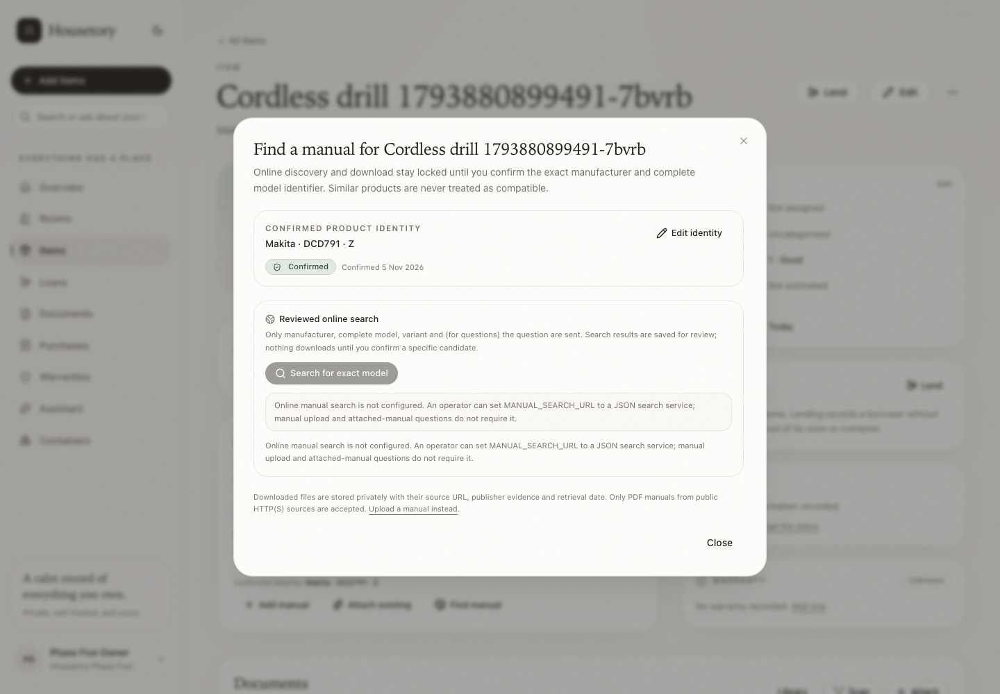

# Item manuals and grounded product help

This milestone adds compact manual attachment, grounded manual answers and an
explicit reviewed path for finding a manual online. It deliberately reuses the
existing **Manual** document type, document library, upload validation, OCR,
private storage and authenticated file routes. There is no separate manual
library.

The milestone does not start evidence export, stocktake, properties or
multi-household work.

## Attaching manuals

- **Add manual** on an item opens the ordinary document upload in manual mode.
  A PDF, image or text manual can be uploaded without any make/model fields.
  The exact original is preserved and the normal document limits, duplicate
  warning, OCR, scan and authenticated download behavior still apply.
- **Attach existing** lists manuals already in the household library that are
  not yet linked to the item. One manual can be linked to several compatible
  items through the existing `item_documents` association. Nothing is uploaded
  again and the original document is not copied.
- A non-manual document cannot be attached through the manual route. Cross-
  household documents and items return 404.
- The item page shows a compact **Manuals & help** card. It does not replace the
  existing Documents card, item photos, lending controls or purchase panels.
- The card shows how many items use a manual and warns before linking a manual
  that is already linked elsewhere. Housetory never infers compatibility from a
  shared brand or a similar name.

## Ask about this item

`Ask about this item` reads the actual text of manuals attached to that item.
The deterministic retrieval pipeline is always available:

1. Text comes from `extracted_text` and, when the OCR pipeline has stored it,
   bounded page-level text under `extracted_metadata["ocr_pages"]`.
2. Page text is split into bounded chunks. The question is tokenised and scored
   against those chunks; at most four evidence chunks are used, with at most two
   from one manual.
3. Citations contain the real document, the real page when page metadata exists,
   and an explicit section/excerpt label otherwise. Page numbers are never
   invented. The citation URL opens the stored document (`#page=N` when the
   page is known).
4. If no passage matches, the answer says so and no answer is inferred from the
   title, metadata or general product knowledge.

The existing **assistant** AI task is optional. When it is configured and
consented, the model receives only the question, item name/brand/model and the
bounded numbered evidence excerpts. It must return a strict JSON answer and
citation IDs from that supplied set. Unknown IDs, missing citations, malformed
JSON, unsupported page claims or provider errors fall back to the extractive
answer. The model cannot choose arbitrary document IDs or URLs, execute tools,
or fetch referenced content. No AI configuration is needed to view, download or
search the attached manual text.

Manuals are treated as untrusted data. Instructions inside a manual are not
system or tool instructions. The answer distinguishes quoted source evidence
from general explanation, reports missing evidence, and warns when evidence comes
from multiple manuals or when page-level text is unavailable. This milestone
does not claim semantic conflict detection beyond that warning.

## Confirming the product identity

Online search, online download and online item questions use one server-side
gate stored in `item_manual_profiles`:

- a manufacturer with at least two characters and at least one letter;
- a complete model identifier with at least three characters and identifying
  digits;
- an optional variant/revision string;
- an explicit `confirmed: true` acknowledgement from a signed-in writer.

Generic values such as “Unknown”, “Heavy drill” or “model” are rejected. A
non-empty string alone is not proof of completeness. The UI pre-fills item brand
and model only as suggestions; the user must check the physical label and
confirm. Saving the profile never edits the item's brand, model or other fields.
Regional, hardware or revision variants can be recorded; when a variant is
present, candidate evidence must show the variant or the concatenated model
form (for example `DCD791Z`).

The gate is rechecked on every automated search, download and online-question
request. Missing or invalid profiles return `409 manual_identity_required` /
`409 incomplete_manual_identity` or `422 incomplete_manual_identity`. Manual
upload and attached-manual questions do not require the gate.

## Reviewed online discovery and download

Online discovery is available only when an operator configures a real search
gateway. Housetory does not bundle a search provider, fake web results, bypass
paywalls/accounts, crawl sites in the background or turn an ordinary chat model
into a browser.

Configuration:

| Variable | Default | Purpose |
| --- | --- | --- |
| `MANUAL_SEARCH_URL` | empty | Absolute HTTP(S) URL of one JSON search gateway. Empty means unconfigured. |
| `MANUAL_SEARCH_API_KEY` | empty | Optional bearer token sent only to that gateway. |
| `MANUAL_SEARCH_PROVIDER_LABEL` | `Configured manual search` | Human-readable provider label shown in the UI. |
| `MANUAL_SEARCH_TIMEOUT_SECONDS` | `20` | Gateway and manual download timeout in seconds. |

The gateway contract is intentionally small:

```json
POST <MANUAL_SEARCH_URL>
{
  "mode": "manual",
  "manufacturer": "Makita",
  "model": "DCD791",
  "variant": "Z"
}
```

For online questions the same endpoint receives:

```json
{
  "mode": "question",
  "manufacturer": "Makita",
  "model": "DCD791",
  "variant": "Z",
  "question": "What battery does it use?"
}
```

The response must be:

```json
{
  "results": [
    {
      "title": "DCD791 instruction manual",
      "source_url": "https://manufacturer.example/support/DCD791",
      "file_url": "https://manufacturer.example/support/DCD791.pdf",
      "publisher": "Makita",
      "language": "en",
      "source_type": "manufacturer",
      "model_coverage": ["DCD791", "DCD791Z"],
      "snippet": "Optional short source excerpt"
    }
  ]
}
```

`source_type` is one of `manufacturer`, `official` or `other`. Candidate titles,
snippets, publishers and coverage must show the exact confirmed model (and
variant, if set); results for similar products are hidden with a notice. At most
30 gateway results are inspected and at most 10 exact-model candidates are kept.
The gateway's redirects are refused so its credentials cannot be forwarded.

Search candidates are persisted in `manual_search_candidates` with source URL,
file URL, publisher, language, source type, model coverage, snippet, retrieval
time and creator. Repeated searches update the same URL pair instead of creating
duplicates. Nothing is downloaded during search.

A download is accepted only for a specific reviewed candidate:

- the candidate must belong to the same household and item;
- `confirm_model: true` and a `request_id` are required;
- an existing download for the same candidate returns the existing document;
- a retry with the same request id does not create another candidate/document;
- identical file bytes already in the household reuse that document and only add
  the item link, never a second copy;
- the returned provenance includes the candidate/source URL, the final resolved
  file URL, publisher/language/source type, model coverage, search retrieval time,
  download time and the resulting document.

Only PDF downloads are accepted from online sources. The downloaded original is
stored privately through the same normalized/original document storage as an
uploaded manual, and OCR is queued. If the source is unavailable, ambiguous or
not a PDF, the request fails clearly and the user can still upload a manual.

### Download safety

- URLs must be absolute HTTP(S), contain no embedded credentials and be at most
  2,000 characters.
- The hostname is resolved before connecting. Every resolved address must be a
  public global address; loopback, private, link-local, metadata, multicast,
  reserved, unspecified, IPv4-mapped loopback and alternate numeric forms are
  rejected. Connections use the pinned resolved address while preserving the
  original Host header and TLS server name, which limits DNS rebinding.
- Redirects are bounded to three, revalidated at every hop, and HTTPS may not
  downgrade to plain HTTP. Credentials, invalid ports and unsupported schemes are
  rejected.
- Response size is bounded by `MAX_UPLOAD_MB` and the socket timeout by
  `MANUAL_SEARCH_TIMEOUT_SECONDS`. HTML responses and non-PDF bytes are rejected
  even if the declared content type claims otherwise.
- Filenames are reduced to a basename and passed through the existing storage
  sanitizer. Embedded references inside a PDF are never fetched.
- Search/download endpoints do not accept a URL from the browser as their
  destination; the operator-configured gateway or a previously stored reviewed
  candidate is the only source. Downloaded text is not logged.

## Optional online item questions

After an attached-manual answer, a writer can explicitly choose to ask the
configured online source. This requires:

- the same confirmed manufacturer + complete model gate;
- a configured search gateway;
- an explicit user action in the UI.

Only `mode`, manufacturer, model, optional variant and the question are sent to
the gateway. Borrower names, loans, household name, item location, inventory
counts and other household records are not included. The response is shown as
web evidence with source URLs, publisher/language/source type and excerpts,
separately labelled from attached-manual evidence. The optional assistant AI
may synthesise the supplied excerpts with schema-validated citation IDs; it
cannot add URLs or use unreviewed results. No autonomous tool loop, browsing
session or instruction-following from retrieved text is implemented.

If no real search capability is configured, the UI states that plainly and
keeps attached-manual questions and manual uploads available. It does not invent
search results or require a paid provider.

## OCR and citation limitations

- New or newly reprocessed documents store up to 40 pages, 20,000 characters per
  page and 180,000 characters total under `extracted_metadata["ocr_pages"]`;
  `extracted_text` remains capped at 200,000 characters.
- Older manuals without `ocr_pages` still answer from their stored text, but
  citations use explicit section/excerpt labels instead of claiming a page.
- Image OCR maps to page 1. Text documents map to page 1. Digital PDFs and
  scanned PDFs map to their rendered/extracted page numbers.
- Section labels are detected heuristically from short heading-like lines; the
  excerpt itself is the authoritative source.
- The retrieval is lexical and bounded, not a full document QA model. A question
  that does not share useful terms with the text may return no evidence rather
  than guess.

## Permissions and retention

- Viewers can read attached manuals, ask attached-manual questions and download
  permitted documents, but cannot upload, attach, save identity, search online,
  download online candidates or otherwise mutate records. Online question
  requests remain read-only and use the existing assistant consent state.
- Every manual, profile, candidate, document link, citation and answer lookup is
  household-scoped. Deleted documents remove their item links through the
  existing cascade; downloaded files remain ordinary documents with provenance.
- Manuals and candidates are private; no file is served without an authenticated
  household session. Standard original/normalized download headers remain
  `private, no-store`.

## Verification and unverified live setup

Automated backend tests cover upload without make/model, multi-item reuse,
cross-household and viewer boundaries, generic/partial/variant gates on both
search and online questions, exact-model candidate filtering, candidate
persistence, reviewed download idempotency, duplicate reuse, provenance,
malformed provider output, optional AI fallback, fabricated-page rejection,
OCR page storage and SSRF/redirect/size/type/timeout guards. Frontend tests cover
attach/ask/citations/no-AI/gated find/review/save and viewer controls. Playwright
runs against a disposable stack with synthetic manuals and mocked search results.

Not live-verified in this milestone: connecting to a real manufacturer or
third-party search gateway, downloading a real vendor PDF, and calling a paid
cloud model for manual synthesis. `MANUAL_SEARCH_URL` is empty by default. To
verify live, configure the operator gateway described above, configure a real
assistant task/provider with consent, then perform one deliberate search and one
download while watching the API/worker logs. No live network, paid AI, email or
remote deployment is performed by the automated tests.

## Representative screenshots

The walkthrough used a disposable Compose stack, a synthetic text manual and a
mocked search candidate. No real household record or live search provider was
used.

### Before and after on the item page

The existing item layout, typography, palette, photo area, lending, purchase,
warranty and Documents panels are unchanged. The manual card is added compactly
in the main column.


### Grounded answers and reviewed discovery





## Verification

- **280 PostgreSQL-backed backend tests** pass, including the new manual
  attachment, identity-gate, citation, idempotency, duplicate, provider-output
  and SSRF tests.
- **123 Vitest frontend tests** pass, including manual card/actions, Ask dialogs,
  real-page citations, no-AI/unconfigured states, identity confirmation,
  candidate review/download and viewer controls.
- **33 disposable-stack Playwright workflows** pass, including two named manual
  workflows: a real synthetic upload/attach/answer flow and a mocked
  gated search/review/save flow at mobile width.
- Ruff, strict TypeScript typecheck, production build and Alembic migration drift
  check pass. The new migration is append-only.
- The local Compose deployment was backed up first, migrated to
  `c4e6a8b0d2f4`, and preserved all real inventory, loan, settings, AI, SMTP,
  document and upload data. The test-only PostgreSQL port remained unpublished.
- No live manufacturer search, real vendor PDF download, paid AI manual answer,
  email send or remote deployment was performed.
