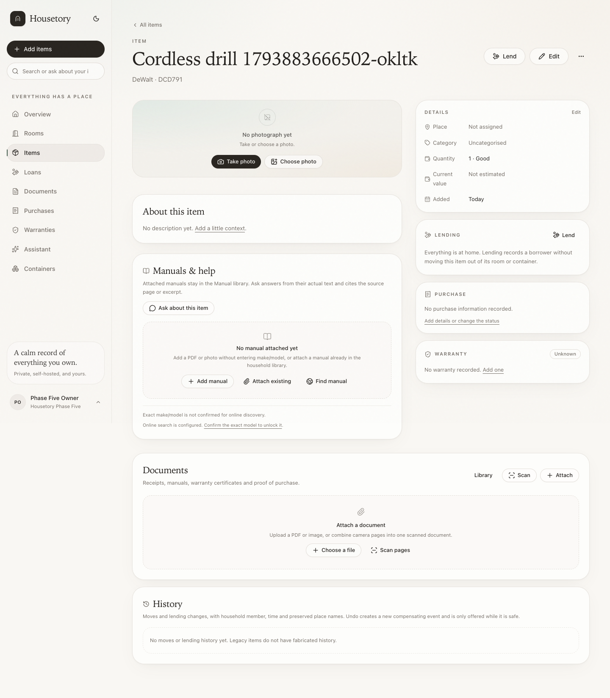
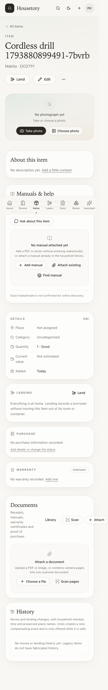
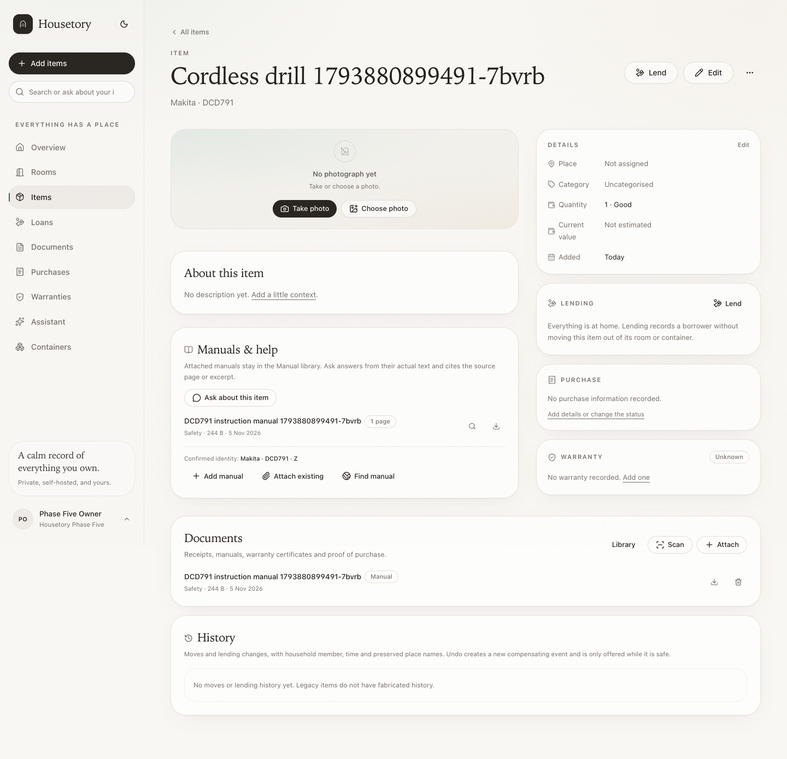
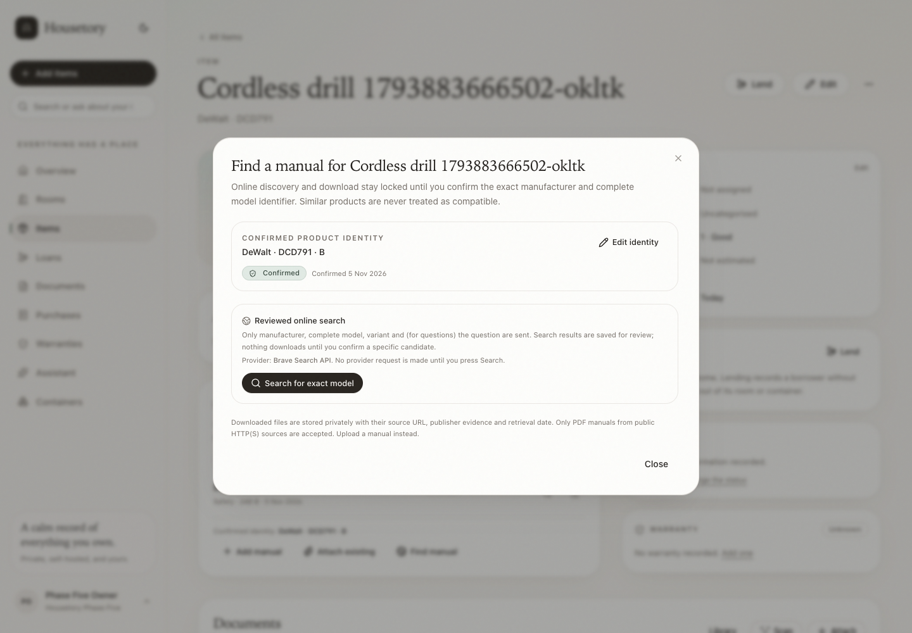
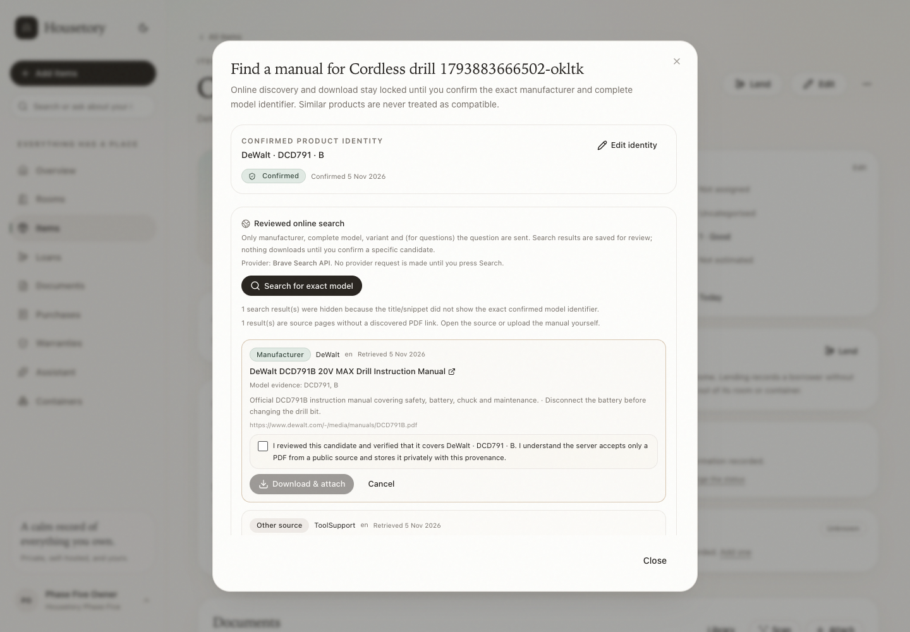

# Item manuals and grounded product help

This milestone adds compact manual attachment, manual reading by the assistant
and an explicit reviewed path for finding a manual online. It deliberately
reuses the
existing **Manual** document type, document library, upload validation, OCR,
private storage and authenticated file routes. There is no separate manual
library.

The milestone does not start evidence export, stocktake, properties or
multi-household work.

## Attaching manuals

- **Add manual** on an item opens the ordinary document upload in manual mode.
  The current item ID is submitted automatically, so the dialog does not ask the
  user to choose compatible items again. A PDF, image or text manual can be
  uploaded with a title and notes but without any make/model fields. The exact
  original is preserved and the normal document limits, duplicate warning, OCR,
  scan and authenticated download behavior still apply. To cover additional
  items later, use **Link existing** from those items rather than repeating the
  upload.
- **Link existing** in the combined **Documents & manuals** surface lists every
  household document not yet linked to the item, including manuals, receipts and
  warranty certificates. One manual can be linked to several compatible items
  through the existing `item_documents` association. Nothing is uploaded again
  and the original document is not copied.
- A non-manual document cannot be attached through the manual route. Cross-
  household documents and items return 404.
- The item page shows one **Documents & manuals** surface. Manuals and ordinary
  documents are de-duplicated by document ID, so a manual is not listed twice.
  Item photos, lending controls and purchase panels remain separate.
- The card shows how many items use a manual and warns before linking a manual
  that is already linked elsewhere. Housetory never infers compatibility from a
  shared brand or a similar name.

## Reading manuals: where AI is needed and where it is not

Housetory keeps a clear line here.

- **Without AI** you can open a manual in the file viewer, download it, and read
  the text of its pages on the document's **Details** page. Attaching, linking
  and removing manuals also need no AI.
- **Understanding a manual is the assistant's job.** There is one assistant and
  it uses the provider set for the **assistant** AI task. Housetory has no second
  question-answering pipeline and no keyword-based answer generator.
- When the assistant is not set up, the item page says so: “Questions about
  manuals need the AI assistant, which is not set up. Every file can still be
  opened and downloaded.” The **Ask about this item** button is disabled. The
  app does not pretend to answer.

**Ask about this item** opens the assistant on the item page. The assistant
already knows which item the page shows.

### Page text is stored with the document

A document's text is stored page by page in the `document_page_texts` table.
The text belongs to the document, so every item the document is linked to uses
the same rows. Nothing is read twice.

- The first reading of an upload is short on purpose. It reads the first pages
  only, which is what a receipt review needs (`OCR_MAX_PDF_PAGES`, default 5,
  for a scanned PDF).
- For documentation (types **Manual**, **Specification** and **Other**) a
  background job, `documents.read_pages`, then reads every remaining page. A
  page with a text layer uses that text. A scanned page is drawn with Poppler
  and read with Tesseract, the same tools as the first reading.
- The job works in small batches (8 scanned pages or 90 seconds) and queues
  the next batch itself, so one long manual does not block other work. It reads
  up to 500 pages.
- One page that cannot be read is stored as unreadable and the job goes on. If
  the OCR tools are missing, the job stops and keeps the reason.
- Replacing a document's file starts a new generation. Text from the old file
  no longer counts.

The job is queued after the first reading (also when that reading failed), when
a manual is linked to an item, and when the assistant asks for it. A manual
stored before this change gets its remaining pages in any of these ways: the
assistant calls `process_manual`, the manual is linked again, or **Run OCR** is
used on its **Details** page.

`GET /documents/{id}/text` returns the stored pages and the progress. The
**Details** page shows them under **Extracted text**, one block per page, each
with a link to that page in the file viewer.

### The map

When all pages are read and the assistant is set up, a second job,
`documents.map`, asks the assistant's provider to index the document. The
result is stored in `document_readings.map`:

- **sections**: title and page range;
- **topics**: a short phrase and the pages that cover it, with other words a
  person might use (for example “measuring current (amps, amperage)”).

The map is built once and reused. It is rebuilt when more pages are read or
the file is replaced.

- A PDF's own bookmarks are used as the sections when it has three or more.
- A manual that fits in one request is sent whole. A longer one is sent as the
  start of each page, in at most six requests.
- Every page number is checked. Pages that do not exist or were not read are
  dropped. A section whose title stands alone on a line of one page is moved to
  that page. Page numbers printed inside the text are not trusted.
- The map helps to find pages. It is never shown as a source and never cited.

### The assistant's tools

The tools are in `services/assistant_tools/registry.py` and
`services/assistant_tools/manual_tools.py`.

| Tool | What it does |
| --- | --- |
| `find_manuals` | Lists the manuals of an item, or one manual by document ID, with **Open**, **Download** and **Details** links and how many pages are read. Returns no text. |
| `read_manual` | Without `pages`: the map and, if the manual is short enough (about 30,000 characters), its complete text. A longer manual returns the map, or its first pages when no map exists. With `pages` (“11”, “9-12”, “3,7-9”): the text of those pages. |
| `search_manual` | Finds pages that contain given words and shows the matching lines. It points to pages; it returns no page text. |
| `look_at_manual_page` | Draws one page and lets a vision model read it. For garbled text, drawings, symbols and tables. The result is stored with the page. |
| `process_manual` | Queues the reading of missing pages, or the map. Needs the owner or member role. The assistant then waits and reads the manual again by itself. |

The assistant is told to read further when the pages it has do not answer the
question, and that a word search that finds nothing proves nothing. Search and
the map are aids. They do not limit what the assistant may read.

`look_at_manual_page` uses the assistant's own model when it can read pictures.
Otherwise it uses the model of the **Vision** task. If neither exists, the tool
says so and the stored text stays readable.

Both `find_manuals` and `read_manual` take an item ID, a document ID, or both.
When both are given, the document must belong to the item: it is linked to the
item now, or a reviewed online download saved it for that item. Any other pair
is refused with `manual_not_for_item`. The tool never guesses a link.

Three kinds of document count as an item's manual:

1. Manual-library documents linked to the item.
2. Documents that a reviewed online download saved for the item, found through
   `manual_search_candidates`.
3. Other documentation attached to the item with the type **Specification** or
   **Other**.

Receipts, invoices and warranty certificates are never read as manuals. A
Manual-library document with no linked item can be opened and read by its
document ID, after `search_documents` finds it.

The tool result always says what the situation is, and the assistant repeats it:

| Situation | What the assistant is told |
| --- | --- |
| No manual attached | Offer **Add manual**, **Link existing** or **Find manual** on the item page. |
| Only some pages read | The result starts with “INCOMPLETE: only N of M pages…”. Call `process_manual` (owner or member), or say that an owner or member has to start it. |
| Pages are being read | Wait. The request continues when reading is done. |
| Reading failed | The stored reason is given, for example that the OCR tools are missing. |
| Manual too long to return whole | Choose pages from the map, or search. |
| No vision model | The page cannot be looked at. Its stored text can still be read. |

In every case except the first the manual keeps its links, and the assistant is
told not to ask for a new upload.

### Citations

An answer names the pages it rests on. The model lists them in `sources`
(document, pages and an optional short quote).

- A page is kept as a citation only if a tool returned its text in this request
  or in one of the four turns before it.
- A quote is shown only when its words really stand on that page. The words are
  taken from the stored page, not from the model.
- Each citation links to `/documents/{id}/view?page=N`, the file viewer at that
  page.
- The wording of the answer comes from the model and is not checked sentence by
  sentence.

### Keeping the conversation small

- A read returns at most about 30,000 characters of page text. One prompt keeps
  at most about 56,000 characters of page text from all steps.
- An earlier step or an earlier turn keeps the map and the numbers of the pages
  that were read, not their text. A follow-up reads only the pages it needs.
- The item and document IDs stay in the conversation, so “How do I check
  amperage?” after “Show me the multimeter documentation” needs no new search.

### Safety

- Page text, the map and what a vision model read are untrusted data. They
  reach the model only inside tool results. Summaries written by the tools never
  contain page text.
- Household and property scope are checked on every call. A manual outside the
  conversation's property is reported as not found.
- Reading a manual creates no import, no capture and no extraction review.

### The file viewer

**Open** goes to `/documents/{id}/view`. This page shows the stored file and
nothing else from the document page: it starts no extraction review and no
processing. It loads the document's name and the file, with the same API calls
and the same access checks as a download.

- A PDF is drawn page by page on canvases by pdf.js, inside the app. The
  browser's own PDF viewer is not used. Nothing inside the file is run or can
  be clicked: no scripts, no working forms, no links. The file is still only
  served as a download (`Content-Disposition: attachment`).
- An image is shown as an image. A text file is shown as plain text.
- `?page=N` opens a PDF at page N. Citations use it.
- Zoom buttons stay under the app header. Zooming, turning the phone and
  resizing the window keep the place being read.
- Only pages near the screen are drawn, so a long manual does not fill the
  memory.
- **Download** and **Details** are on the page. **Details** is the document page.
- A link from a conversation in another household switches to that household
  first, if the user is a member. Otherwise the file is not loaded.

Limits of the viewer: text on a page cannot be selected or searched, and links
inside a PDF cannot be clicked. Use **Download** for that. The viewer was tested
in Chrome on desktop and phone sizes only.

## Confirming the product identity

Online search, online download and online item questions use one server-side
gate stored in `item_manual_profiles`:

- a manufacturer with at least two characters and at least one letter;
- a complete model identifier with at least two characters, containing a letter
  or digit, and not a generic label;
- an optional variant/revision string;
- an explicit `confirmed: true` acknowledgement from a signed-in writer.

Completeness is the manufacturer-specific identity the user verified against the
physical label, not an arbitrary regex. Housetory does **not** require every
model to contain a digit: legitimate letter-only models such as `Sonos One` are
accepted. Generic values such as “Unknown”, “Heavy drill”, “cordless drill”,
“tool” or “manual” are rejected, as are empty/one-character fragments.

The UI pre-fills item brand and model only as suggestions; the user must check
the physical label and confirm. Saving the profile never edits the item's brand,
model or other fields. Regional, hardware or revision variants can be recorded;
when a variant is present, candidate evidence must show the variant or the
concatenated model form (for example DeWalt `DCD791B` for model `DCD791` with
variant `B`).

The gate is rechecked on every automated search, download and online-question
request. Missing or invalid profiles return `409 manual_identity_required` /
`409 incomplete_manual_identity` or `422 incomplete_manual_identity`. Manual
upload and the assistant's reading of attached manuals do not require the gate.

## Reviewed online discovery and download

### Primary provider: Brave Search API

The primary supported adapter uses the official
[Brave Search API](https://api.search.brave.com/) Web Search endpoint. It is a
real search API, not an ordinary chat model and not a hosted Housetory gateway.

Provider contract implemented by Housetory:

```text
GET https://api.search.brave.com/res/v1/web/search
    ?q=<manufacturer, model, variant, manual terms or question>
    &count=<5-10>
    &extra_snippets=true
    &text_decorations=false
    &safesearch=moderate
X-Subscription-Token: <BRAVE_SEARCH_API_KEY>
Accept: application/json
```

Optional `country` and `search_lang` parameters are sent only when
`BRAVE_SEARCH_COUNTRY` / `BRAVE_SEARCH_LANG` are configured. Housetory reads
`web.results[]` and normalizes the documented result fields `title`, `url`,
`description`, `extra_snippets`, `profile.name` / `profile.long_name` and
`language`. It does not use a guessed endpoint or invent result fields.

Registration/configuration (household owner, no restart):

1. Create a Brave Search API account and subscription token in the
   [Brave API dashboard](https://api-dashboard.search.brave.com/). Review
   Brave's current plan, quota and terms; a paid tier may be required for the
   volume you need.
2. Sign in as the household owner and open **Settings → Online search**. Paste
   the token into the write-only **Brave Search API key** field, enable
   **Online manual search**, and save. The key is encrypted at rest with the
   installation credential key and is never returned to the browser, written to
   logs, or placed in a URL. A saved-key indicator confirms storage; leaving the
   field blank keeps the existing key. Replacement and removal are explicit.
3. One saved Brave key serves both manual discovery and reference-image lookup;
   their enable controls are separate. Changes are resolved from the database on
   the next API or worker request, without editing deployment environment files
   or restarting services.
4. Do not press **Search** until you are ready for a real request. The manuals
   status endpoint and UI report whether a provider/key is configured without
   contacting Brave. The first actual Brave request happens only when a writer
   confirms an item's exact identity and explicitly presses **Search for exact
   model**.

Optional connection validation (user-triggered, bounded): the owner can press
**Test connection** in Settings → Online search and confirm the dialog. Housetory
sends one fixed neutral query (`Housetory connectivity test`) to the Brave
endpoints and reports the result. It sends no inventory, manual, borrower or
household content, does not download anything and may use subscription quota. The
manuals status endpoint still reports configuration without contacting Brave.
Walkthrough screenshots: [not configured](walkthrough/online-search/01-not-configured.png),
[saved write-only key](walkthrough/online-search/02-saved-write-only-key.png),
[test confirmation](walkthrough/online-search/03-test-confirmation.png) and
[bounded test result](walkthrough/online-search/04-test-result.png).

Installation fallback (operator-only): if a household has no saved online-search
row, the installation environment can provide `BRAVE_SEARCH_API_KEY` and the
older provider-selection variables. Saving the Settings card makes the household
row authoritative, including when both channels are explicitly disabled or the
key is removed; the fallback is not silently reactivated. The advanced
`MANUAL_SEARCH_URL` gateway remains an operator-only fallback and is not edited
in the household card.

The default base URL is the official `https://api.search.brave.com`. The base URL
override exists for a compatible proxy or isolated test fixture; production
should leave it at the official HTTPS endpoint. Automated tests use a fixture
and never call Brave.

Household provider selection is controlled by the saved Settings row:

- **Online manual search** enabled with a saved key: use Brave regardless of the
  installation fallback.
- **Online manual search** disabled: keep upload and attached-manual Q&A, and do
  not fall back to an environment key.
- No household row: use the operator `MANUAL_SEARCH_PROVIDER` fallback:
  - `auto` (default): use `MANUAL_SEARCH_URL` when set (advanced gateway),
    otherwise use `BRAVE_SEARCH_API_KEY` when set, otherwise remain unconfigured.
  - `brave`: require `BRAVE_SEARCH_API_KEY`.
  - `gateway`: require `MANUAL_SEARCH_URL`.
  - `none`: disable online discovery while keeping upload and attached-manual Q&A.

| Variable | Default | Purpose |
| --- | --- | --- |
| `MANUAL_SEARCH_PROVIDER` | `auto` | Operator fallback when no household row exists: `auto`, `brave`, `gateway` or `none` |
| `BRAVE_SEARCH_API_KEY` | empty | Operator-only fallback key; prefer Settings → Online search |
| `BRAVE_SEARCH_BASE_URL` | `https://api.search.brave.com` | Official endpoint or compatible operator test/proxy base |
| `BRAVE_SEARCH_COUNTRY` | empty | Optional Brave country code |
| `BRAVE_SEARCH_LANG` | empty | Optional Brave search language code |
| `MANUAL_SEARCH_URL` | empty | Advanced JSON gateway URL; only when provider is `gateway`/`auto` |
| `MANUAL_SEARCH_API_KEY` | empty | Optional bearer token for the advanced gateway |
| `MANUAL_SEARCH_PROVIDER_LABEL` | `Configured manual search` | Gateway label shown in the UI |
| `MANUAL_SEARCH_TIMEOUT_SECONDS` | `20` | Search, landing-page and manual-download timeout |

### Source evidence and PDF discovery

Brave returns web pages, not a guaranteed manual file. Housetory handles two
real outcomes:

1. **Direct PDF result.** If the result URL path ends in `.pdf`, it is stored as
   the candidate's file URL. The UI labels it as having a direct PDF.
2. **Landing/support page.** The result is still shown with its actual source
   URL and publisher, but no `.pdf` is guessed. For at most two
   manufacturer/official results, Housetory may read that page with the same
   safe public-IP/redirect/byte/deadline fetch path and inspect actual `<a
   href>` links. A linked PDF is accepted only when it is a real anchor ending
   in `.pdf` and its link text/URL shows the confirmed model/variant or clear
   manual wording. No embedded PDF references, JavaScript links, meta refresh or
   guessed paths are followed.

If no real linked PDF is found, the candidate is marked **source page only**.
The UI offers **Open source page** and **Upload manual** instead of a download
button. Housetory never downloads an HTML page as if it were a PDF and never
invents a PDF address.

Brave does not supply an official/manufacturer flag. Housetory derives source
type conservatively:

- `manufacturer` only when the registrable host label matches the confirmed
  manufacturer token and the Brave profile name also matches it (for example
  `dewalt.com` + profile “DeWalt”);
- `official` when a host/profile match exists but not both exact checks;
- `other` otherwise.

This is evidence for review, not a guarantee. The UI shows the real source URL,
publisher, language, model coverage, retrieval date and direct-file state. A
similar-product result is hidden unless its title/snippet/URL actually contains
the confirmed model and variant.

### Advanced gateway option

The original generic JSON gateway remains available for an operator who already
has a custom search service. It is not required and is not the only usable
integration.

Gateway request:

```json
POST <MANUAL_SEARCH_URL>
{
  "mode": "manual",
  "manufacturer": "DeWalt",
  "model": "DCD791",
  "variant": "B"
}
```

For online questions the same endpoint receives:

```json
{
  "mode": "question",
  "manufacturer": "DeWalt",
  "model": "DCD791",
  "variant": "B",
  "question": "What battery does it use?"
}
```

Expected response:

```json
{
  "results": [
    {
      "title": "DCD791B instruction manual",
      "source_url": "https://www.dewalt.com/support/DCD791B",
      "file_url": "https://www.dewalt.com/-/media/manuals/DCD791B.pdf",
      "publisher": "DeWalt",
      "language": "en",
      "source_type": "manufacturer",
      "model_coverage": ["DCD791", "DCD791B"],
      "snippet": "Optional short source excerpt"
    }
  ]
}
```

`source_type` is one of `manufacturer`, `official` or `other`. Candidate titles,
snippets, publishers and coverage must show the exact confirmed model (and
variant, if set); similar products are hidden with a notice. At most 30 gateway
results are inspected and at most 10 exact-model candidates are kept. Gateway
redirects are refused so credentials cannot be forwarded.

Search candidates are persisted in `manual_search_candidates` with source URL,
file URL, publisher, language, source type, model coverage, snippet, retrieval
time, direct-file state and creator. Repeated searches update the same source URL
instead of creating duplicates. Nothing is downloaded during search.

A download is accepted only for a specific reviewed candidate with a direct PDF:

- the candidate must belong to the same household and item;
- `confirm_model: true` and a `request_id` are required;
- an existing download for the same candidate returns the existing document;
- a retry with the same request id does not create another candidate/document;
- identical file bytes already in the household reuse that document and only add
  the item link, never a second copy;
- the returned provenance includes the candidate/source URL, final resolved file
  URL, publisher/language/source type, model coverage, search retrieval time,
  download time and the resulting document.

Only PDF downloads are accepted from online sources. The downloaded original is
stored privately through the same normalized/original document storage as an
uploaded manual, and OCR is queued. If the source is unavailable, ambiguous or
not a PDF, the request fails clearly and the user can still upload a manual.

### Download safety

- URLs must be absolute HTTP(S), contain no embedded credentials and be at most
  2,000 characters.
- The hostname is resolved before connecting. Every resolved address must be a
  public global address; loopback, private, link-local, metadata, multicast,
  reserved, unspecified, IPv4-mapped loopback and alternate numeric forms are
  rejected. Connections use the pinned resolved address while preserving the
  original Host header and TLS server name, which limits DNS rebinding.
- Redirects are bounded to three, revalidated at every hop, and HTTPS may not
  downgrade to plain HTTP. Credentials, invalid ports and unsupported schemes are
  rejected.
- Response size is bounded (`MAX_UPLOAD_MB` for downloads, 512 KB for landing
  pages) and the total wall-clock time by `MANUAL_SEARCH_TIMEOUT_SECONDS`, not
  only per-read socket timeouts. HTML responses and non-PDF bytes are rejected
  even if the declared content type claims otherwise.
- Landing pages are read only from accepted manufacturer/official results, at
  most two per search. Only actual anchor links are inspected; no embedded
  references, linked PDF previews or arbitrary redirects are recursively
  fetched.
- Filenames are reduced to a basename and passed through the existing storage
  sanitizer. Embedded references inside a PDF are never fetched.
- Search/download endpoints do not accept a URL from the browser as their
  destination; the operator-configured provider or a previously stored reviewed
  candidate is the only source. Downloaded text, queries and keys are not logged.

## Optional online item questions

**Ask online sources** on the item page lets a user send a question to the
configured online provider. It is separate from the assistant's reading of
attached manuals. This requires:

- the same confirmed manufacturer + complete model gate;
- a configured Brave adapter or advanced gateway;
- an explicit user action in the UI.

For Brave, Housetory sends a search query containing only manufacturer, model,
optional variant and the question (bounded to 300 characters in the provider
query). Borrower names, loans, household name, item location, inventory counts
and other household records are not included. The response is shown as web
evidence with source URLs, publisher/language/source type and excerpts,
separately labelled from attached-manual evidence. The optional assistant AI
may synthesise the supplied excerpts with schema-validated citation IDs; it
cannot add URLs or use unreviewed results. No autonomous tool loop, browsing
session or instruction-following from retrieved text is implemented.

If no real search capability is configured, the UI states that plainly and
keeps manual uploads and the assistant available. It does not invent
search results or require a paid provider.

## OCR and citation limitations

- A manual's document page keeps OCR status, extracted text and downloads. Like
  every other document type, it also has an open **Extraction review** section
  for purchase-style fields and product lines. The stored extraction result is
  loaded with the page once the text has been read. The full review opens with
  **Review extraction**; lookups of related items, rooms and locations wait
  until then. To read a manual without this section, use
  [the file viewer](#the-file-viewer). Questions about a manual are asked in
  the assistant, not on the document page.
- The first reading still stores up to 40 pages under
  `extracted_metadata["ocr_pages"]` and `extracted_text` (capped at 200,000
  characters). The later pages of a manual are stored only in
  `document_page_texts`. So text search over documents and the extraction
  review still see the first reading only.
- Image OCR maps to page 1. Text documents map to page 1. Digital PDFs and
  scanned PDFs map to their real page numbers.
- OCR makes mistakes, most often with symbols. In the AstroAI multimeter manual
  the dial symbols µA, mA and A are read as “pas”, “mas” and “at”. The words
  around them are right. `look_at_manual_page` exists for such pages and needs
  a model that can read pictures.
- A manual with more than 500 pages is read up to page 500.
- `search_manual` matches the start of words. It does not know synonyms. That
  is why it is only an aid and the assistant may always read pages directly.
- No answer is produced without an AI provider.

## Permissions and retention

- Viewers can open and download attached manuals, read their page text and ask
  the assistant about them, but cannot upload, attach, save identity, search
  online, download online candidates, start page reading or otherwise mutate
  records. Online question requests remain read-only and use the existing
  assistant consent state.
- Every manual, profile, candidate, document link, citation and answer lookup is
  household-scoped. Deleted documents remove their item links through the
  existing cascade; downloaded files remain ordinary documents with provenance.
- Manuals and candidates are private; no file is served without an authenticated
  household session. Standard original/normalized download headers remain
  `private, no-store`.

## Verification and unverified live setup

Automated backend tests cover upload without make/model, multi-item reuse,
cross-household and viewer boundaries, letter-only and variant model identities,
both search and online-question gates, exact-model filtering, candidate
persistence, reviewed download idempotency, duplicate reuse, provenance,
malformed provider output, OCR
page storage and SSRF/redirect/size/type/timeout guards. Manual reading has its
own tests: page reading in batches, the map and its page checks, the five
assistant tools, citations of pages that were really read, follow-ups, long
manuals, unfinished reading, a missing vision model and household isolation
(`tests/test_document_pages.py`, `tests/test_assistant_manuals.py`).
`tests/test_real_manual.py` reads a real scanned manual with Poppler and
Tesseract. It is skipped unless `HOUSETORY_MANUAL_PDF` points to the AstroAI
file `ASIM6K0R-EN-v2.pdf`; the model in it is scripted, so it calls no AI
provider. Brave-specific tests
use realistic vendor fixtures to verify request construction, the documented
`X-Subscription-Token` header, query parameters, response normalization,
manufacturer provenance validation, direct-PDF versus source-page discovery,
401/403/429/500 parsing, timeouts, invalid JSON, rate limits, key non-disclosure
and the complete API search/download path. Frontend tests cover
attach, opening the assistant, the no-AI notice, gated find/review/save, source-page-only candidates and
viewer controls. Playwright starts a fixture Brave service, configures the real
adapter through the disposable API, discovers a candidate, reviews it, saves a
manual through the UI and checks that its page text is stored. The browser workflow
fixtures the private PDF fetch response because the disposable mock service is
not a public SSRF destination; real server-side PDF fetch, validation,
idempotency and duplicate handling are covered by PostgreSQL backend tests.

Not live-verified in this milestone: calling the real Brave Search API with a
real subscription token, downloading a real vendor PDF, and calling a paid cloud
model for manual synthesis. No real Brave credential is stored by this change.
To verify live, register a Brave Search API token, save it under
**Settings → Online search** as the household owner, use the explicit
**Test connection** action if desired, then perform one deliberate search and
one download while watching the API/worker logs. Configure a consented assistant
provider only if AI synthesis is wanted. No live network, paid AI, email or
remote deployment is performed by the automated tests.

## Representative screenshots

The walkthrough used a disposable Compose stack, a synthetic text manual and a
fixture Brave-compatible search service through the real Brave adapter. No real
household record, live Brave request or paid provider was used.

### Before and after on the item page

The item layout, typography, palette, photo area, lending, purchase and warranty
panels keep their existing feel. The separate Manuals card and Documents card are
now one compact Documents & manuals surface with the same upload, scan, link,
ask and online-discovery actions. See
[`ITEM_FORM_AND_FILES.md`](ITEM_FORM_AND_FILES.md) for before/after screenshots.

> The walkthrough screenshots below were captured with the earlier separate
> Manuals card. They remain as historical evidence for manual upload, answers and
> discovery; current combined-surface screenshots are in
> [`ITEM_FORM_AND_FILES.md`](ITEM_FORM_AND_FILES.md).









### Grounded answers and reviewed discovery






## Verification

- **455 PostgreSQL-backed backend tests** pass, including household online-search
  credential lifecycle/fallback/domain tests plus manual attachment,
  identity-gate, citation, idempotency, duplicate, provider-output and SSRF tests.
- **230 Vitest frontend tests** pass, including the write-only online-search
  Settings card, bulk AI-task progress/skips/confirmation, manual card/actions,
  Ask dialogs, real-page citations, no-AI/unconfigured states, identity
  confirmation, candidate review/download and viewer controls.
- **95 disposable-stack Playwright workflows** pass (94 passed, 1
  fixture-dependent skip), including online-search Settings, bulk AI-task
  confirmation/results and two named manual workflows: a real synthetic
  upload/attach/answer flow and a mocked gated search/review/save flow at mobile
  width.
- Ruff, strict TypeScript typecheck, production build and Alembic migration drift
  check pass. The new migration is append-only.
- The local Compose deployment was backed up first, migrated to
  `c4e6a8b0d2f4`, and preserved all real inventory, loan, settings, AI, SMTP,
  document and upload data. The test-only PostgreSQL port remained unpublished.
- No live manufacturer search, real vendor PDF download, paid AI manual answer,
  email send or remote deployment was performed.
