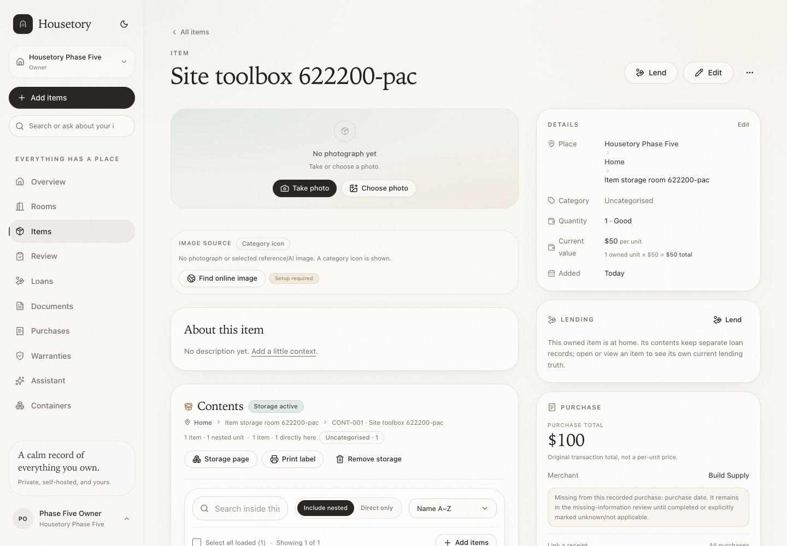
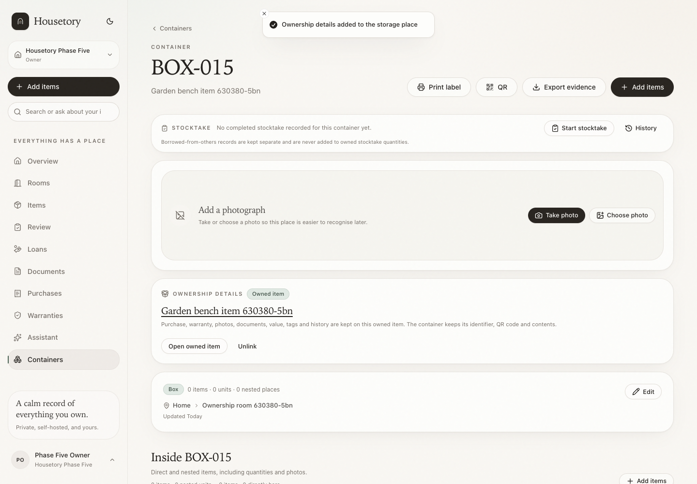
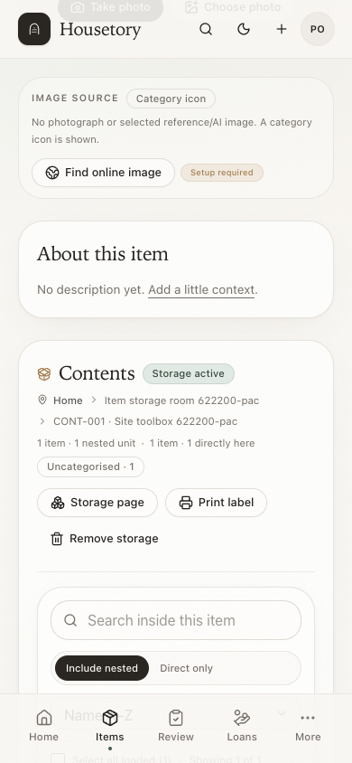
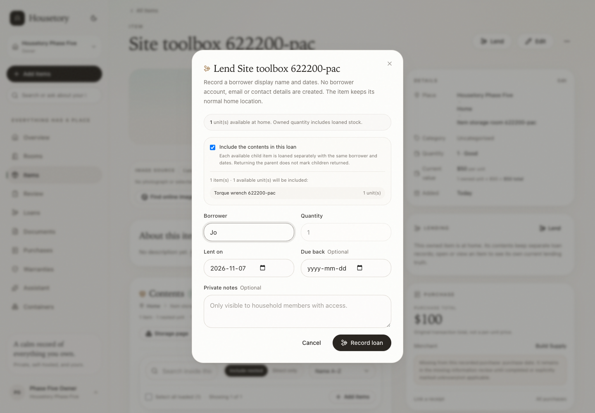
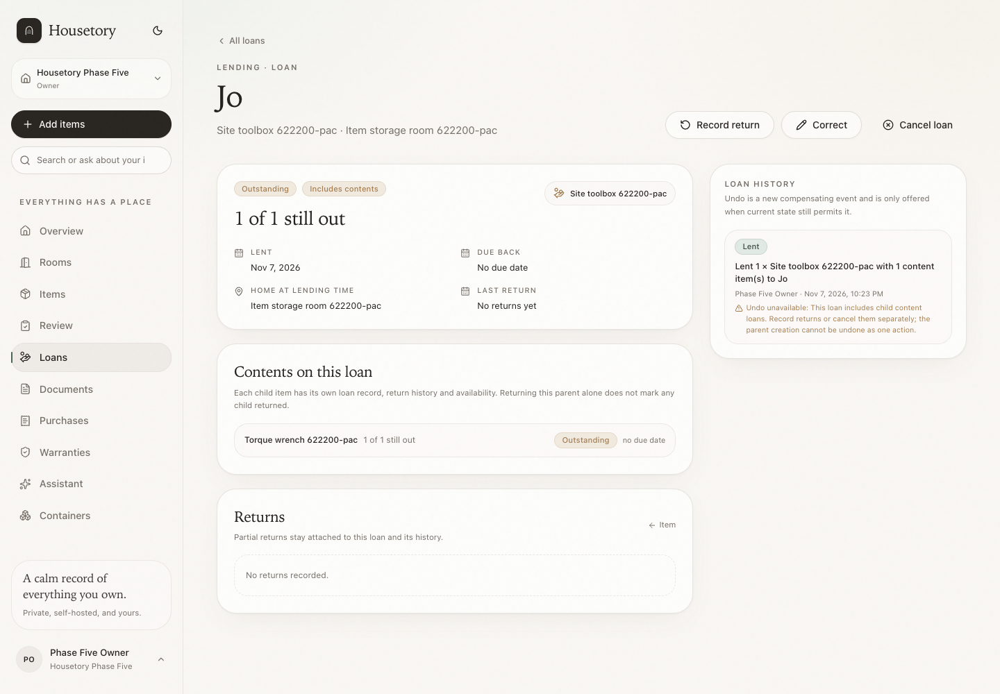

# Owned items that provide storage

A toolbox, TV stand, car or chest is an owned item **and** a place that can hold
other items. Housetory keeps one owned item record for its purchase, warranty,
current value, photographs, documents, tags and history, and one linked
`StorageLocation` for the contents, identifier and QR code. The item itself is
always recorded outside that storage place. For a car, use nested places such as
Boot and Glovebox; the car retains its own purchase/warranty/documents and usual
home while its contents stay independently searchable and movable.

## One link, one identity

`StorageLocation.owner_item_id` is a nullable, unique foreign key to `items`.
There is no second inventory record, no second value and no separate manually
named space.

- **Item → Store items inside** creates a container with its own permanent
  identifier and QR code. Clicking it again is idempotent and returns the same
  storage place.
- **Existing container → Add ownership details** either creates one owned item or
  deliberately links one existing item. A container is never matched to an item
  by name automatically.

- The owned item name and container name stay synchronised. Renaming from either
  page updates the same user-facing identity.
- The owned item's `storage_location_id` remains its physical home outside the
  storage place. That keeps all ordinary room/location search, stocktake, loan
  home snapshots, imports and exports consistent.
- Fixed places and rooms may remain unowned. Housetory does not create ownership
  records automatically for them.

## Quantity and physical instances

A storage-bearing item must have **quantity 1**. A physical toolbox or TV stand
cannot be an ambiguous aggregate of several storage interiors.

- The item form locks quantity at 1 while storage is active and explains the rule.
- Separate boxes or furniture units must be separate items.
- Housetory never splits a quantity, loses units or invents individual instances.

## Contents and movement

The item page shows live direct and nested counts, category totals, search,
direct/nested scope, ordinary item cards, bulk actions and **Add items**.

- Contents are assigned through the normal storage-location destination picker.
- Moving the owned item moves its backing storage place, nested places and
  contents atomically. The parent item remains outside its own backing storage.
- Container-only move/delete routes are blocked when the container is owned. Move
  the owning item instead so its home, contents and QR identity cannot diverge.
- Destination validation prevents self-containment, descendant cycles,
  cross-household links and room mismatches.
- Item move undo also moves the backing storage subtree. Restore-assisted undo for
  a storage-bearing item is deliberately blocked because the original deleted
  place cannot be restored coherently without an explicit item move.

## Lending

Lending a storage item is an explicit choice:

- **Parent only** (default): only the owned item is loaned. Contents are not
  implied to be with the borrower.
- **Include contents**: every available owned item in the active storage subtree
  gets a separate child loan with the same borrower, lent date and due date.
  Each child keeps its own quantity, availability, return history and undo
  behavior. Borrowed-from-others records are excluded and shown with a reason.
- A child already fully on loan is excluded; a partially loaned child contributes
  only its at-home quantity.
- Returning the parent does not mark children returned. A parent creation undo is
  blocked while child content loans exist.
- There is no kit/BOM model, automatic bundle, borrower directory or email.

## Values, evidence and reports

- The host item and each content item are counted once each. The host's current
  value never includes its contents implicitly.
- Shared purchase transaction totals remain counted once per purchase; reviewed
  allocations remain per item. No retroactive financial facts are invented.
- Container evidence scope includes the owning item once together with its
  contents, so the host object's ownership evidence is not silently omitted.
- Room scope, financial overview and inventory reports continue to use ordinary
  item rows, so there is no double counting.
- Labels still print only identifier, optional name and QR; contents are never
  printed.

## Safe removal and deletion

- Removing storage is allowed only when the container is empty of items, nested
  places and active borrowed placements, and the owned item is not on loan.
- Removal tombstones the storage place and keeps its identifier, QR history and
  audit. Restoring reuses the same place and identifier.
- Archiving or deleting an item with active storage is blocked. Remove the storage
  capability first after moving contents out.
- Deleting an owned container through container, location or place-transfer
  routes is blocked; the item page is the only explicit removal path.
- Unlinking ownership from an existing container is separate from deleting either
  record. The container and owned item both remain, and open host loans block it.
- Permission, household scoping, locking, idempotency and activity history follow
  the existing item/container patterns.

## API summary

- `POST /items/{id}/storage` — create or restore the item's storage place;
  optional `existing_location_id` deliberately links a co-located container.
- `DELETE /items/{id}/storage` — remove an empty storage capability safely.
- `POST /containers/{id}/ownership` — create or link one owned item.
- `DELETE /containers/{id}/ownership` — unlink ownership without deleting either.
- `GET /items/{id}` — includes the live `storage` summary when linked.
- `GET /items/{id}/loan-options` — parent-only versus contents-included plan.
- `POST /loans` with `include_contents` — atomic parent plus child loans.
- Container list hides owned containers by default; labels and direct QR/detail
  routes can request them explicitly.

## Limits

- One owned item can provide one storage place. Nested owned storage items are
  supported through the normal location hierarchy.
- No automatic name matching, AI merge, kit/BOM, separate examples per quantity,
  borrower directory or contact management.
- Parent and child loans are intentionally independent after creation; partial
  returns and corrections are not silently propagated across the group.
- Existing container ownership can be linked only when the item is co-located
  directly outside the container.
