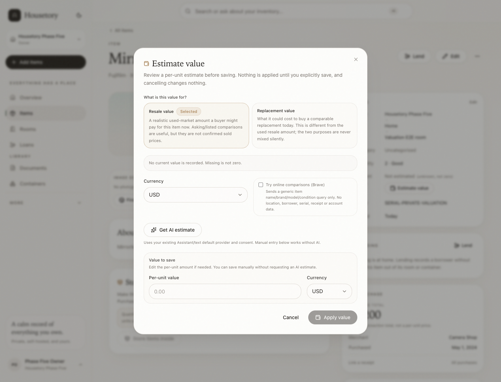
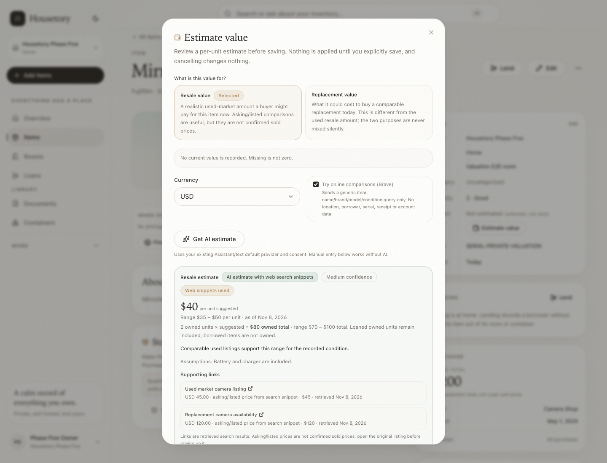
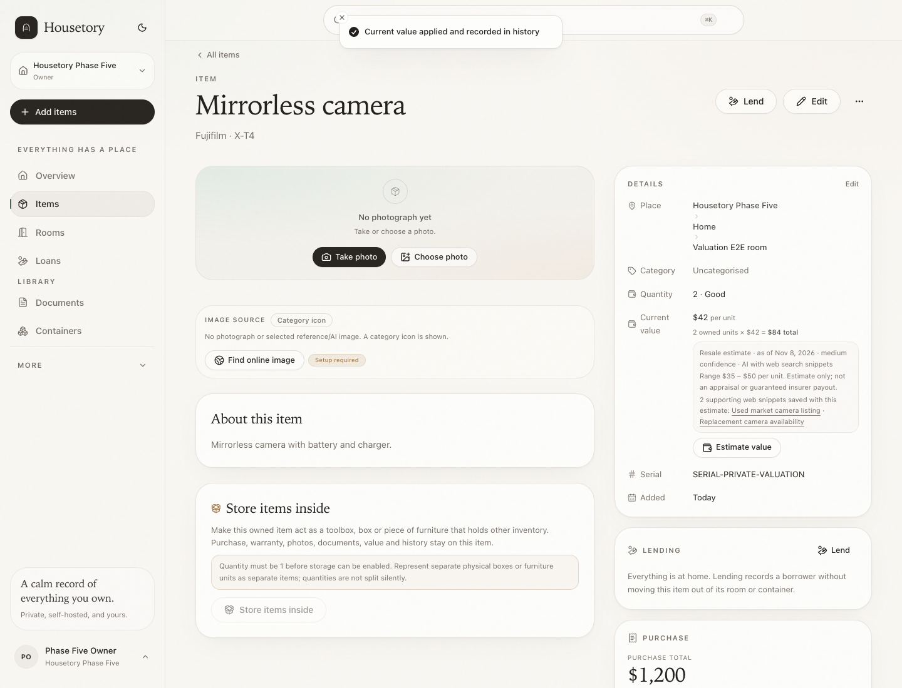
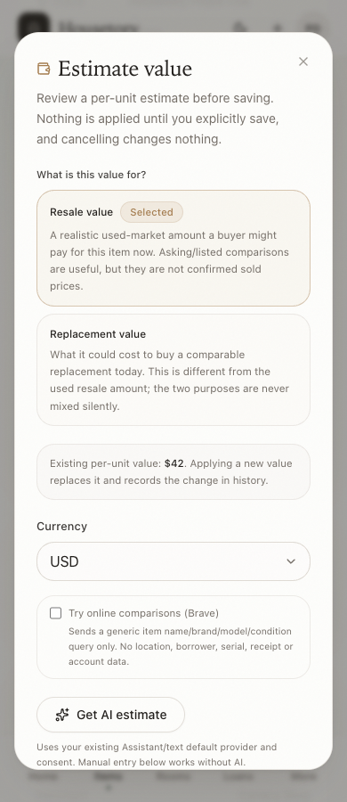

# On-demand item valuation

This batch adds one explicit action on an individual item: **Estimate value**. It
is not an automatic, periodic, whole-household or bulk valuation feature, and it
does not add a review dashboard.

## Purposes and unit rules

The owner/member chooses either:

- **Resale value** — a realistic used-market amount, using asking/listed
  comparisons only as unconfirmed evidence; or
- **Replacement value** — what a comparable replacement could cost today.

The two purposes are never mixed silently. Changing purpose after a preview
clears that preview and requires a new AI estimate or a manually entered value.

Values are always **per owned unit**. The preview shows the range, the suggested
amount and the owned total using `unit × owned quantity`. Loaned owned units
remain included; borrowed-from-others records are never owned inventory. A
storage-bearing item's value includes only that item, not its contents, and shared
purchase transaction totals are never treated as per-unit prices.

Legacy `legacy_record_total` values remain reported once and are not multiplied.
Applying a new per-unit value converts a legacy total only after explicit review,
and the prior value/provenance is retained in item history.

## Optional AI and web comparisons

The existing Assistant/text default provider and consent are reused. There is no
new mandatory valuation model setting or subscription. The optional online
comparison checkbox sends only a generic item name, brand/model and condition
query to the configured Brave integration. It never sends location, borrower,
serial, receipt, account or document contents. No result page is fetched; only
Brave snippets and their links are used.

AI output is validated for currency, integer minor-unit bounds and ordered
low/suggested/high ranges. Item text is treated as data, never instructions, and
AI-generated links are omitted. Web sources are real retrieved result links;
snippet prices are labelled asking/listed prices, never confirmed sold prices.
Currency inferred from a symbol is marked as inferred. If web search is not
available, the preview clearly states it is a rough estimate without verified
current comparisons. If AI is unavailable, manual entry remains fully usable.

## Preview, apply and stale safety

A preview is stored for at most 24 hours and never changes the item value. The
review dialog lets the user edit the per-unit amount and currency or cancel.
Applying:

1. checks the item's valuation fingerprint (quantity, relevant item facts,
   purchase/allocation facts and existing value metadata) for changes;
2. checks the preview still exists, has not expired, and still matches purpose and
   currency;
3. validates the reviewed amount and safe extended total;
4. saves the per-unit value, purpose, range, as-of date, confidence, assumptions
   and real source links;
5. records an `item.value_updated` history event with from/to value and estimate
   provenance.

If the item changed after preview, apply returns a stale error and writes nothing.
Manual edits through the ordinary item form continue to work and clear old
estimate provenance rather than mislabelling the new value.

## Evidence and reports

The evidence/insurance PDF shows per-unit value, owned-quantity total, purpose,
as-of date, confidence, range, real source links (marked asking/listed, retrieved
date) and a clear estimate-only disclaimer. Unknown values remain unknown, not
zero. Existing CSV columns and existing stored values are unchanged unless the
user applies a new value.

## Verification

- Backend tests cover per-unit quantity totals, legacy totals, shared purchase
  allocations, owned storage hosts, borrowed exclusion, rough AI vs web sources,
  currency/condition/missing input/provider failure, invalid AI output, purpose
  switching, stale fingerprints, manual fallback, permissions/cross-household
  isolation, privacy prompts, evidence PDF metadata and migration preservation.
- Frontend tests cover purpose selection, preview, edited amount, manual save,
  purpose-change preview clearing, AI failure fallback, cancel-without-write and
  accessible source links.
- Disposable Playwright coverage runs at desktop, 768, 390 and 320 widths with a
  mock AI/Brave endpoint. No paid calls or real credentials are used.

## Limits

- No automatic, scheduled, bulk or whole-household valuation.
- No professional appraisal, guaranteed resale price or guaranteed insurer payout.
- No listing-page scraping or confirmed sold-price claim. Brave is the supported
  optional web provider for this flow.
- No AI warranty feature, investment advice or financial decision guidance.
