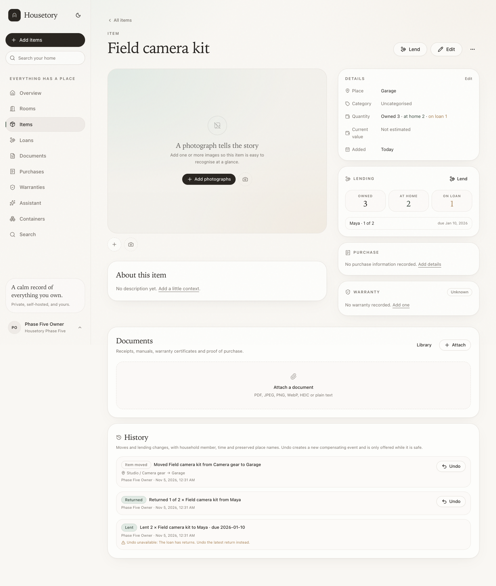
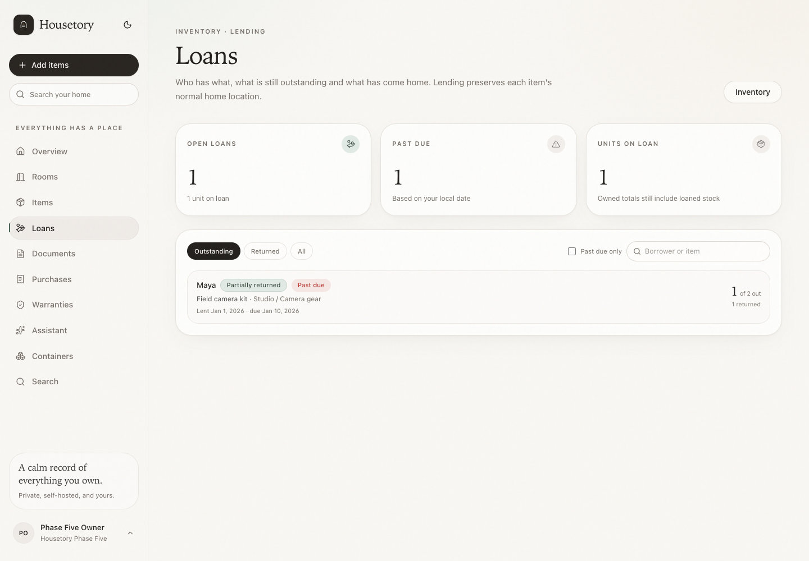
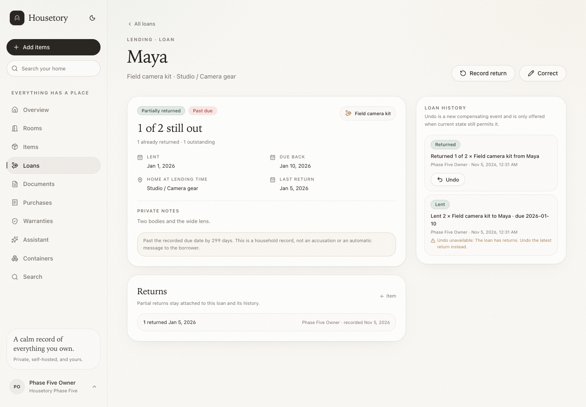
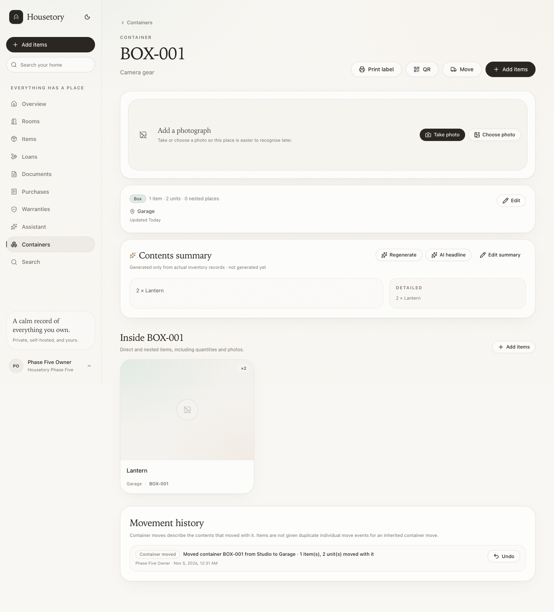
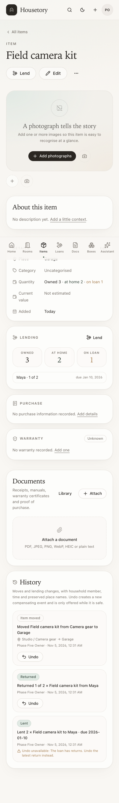
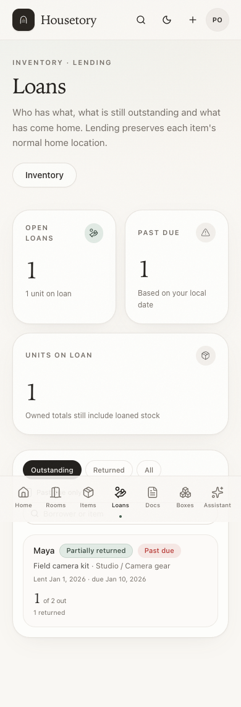

# Lending, movement history and safe undo

This milestone adds everyday lending, household-scoped movement history and
compensating undo without changing the existing visual shell or moving items into
fictitious rooms.

## Quantity definitions

For an item with recorded **owned quantity** `Q`:

- **Owned**: `items.quantity`; this is the total recorded stock and still includes
  anything currently lent out.
- **On loan**: the sum of `quantity - returned_quantity` for all open loans
  (`outstanding` and `partially_returned`).
- **At home / available**: `owned - on loan`. The server prevents this from being
  negative.
- **Returned**: the sum of active return records on a loan. Reversed returns are
  retained in history but no longer count.

Several open loans for the same item are allowed. Every lending, returning and
quantity-changing operation locks the item row (and the loan where relevant), so
stale frontend values cannot oversell stock.

## Loan rules

- A borrower is a display name only. No borrower account, email address or
  contact details are collected, and no reminders are sent.
- `lent_on` is required. `due_on` is optional and cannot precede `lent_on`.
- A loan starts as `outstanding`; partial returns move it to
  `partially_returned`; returning all quantity moves it to `returned`.
- `quantity > 0`, `returned_quantity >= 0`, and
  `returned_quantity <= quantity`.
- Lending more than available returns `409 insufficient_available_stock`.
- Returning more than outstanding returns `409 return_exceeds_outstanding`.
- A return date cannot precede the lent date.
- Multiple partial returns are separate immutable records. The visible loan status
  and outstanding quantity update atomically.
- Corrections update borrower, dates, notes and the original loan quantity. A
  correction cannot reduce quantity below what has already been returned, and an
  increase must be covered by available stock. Corrections create history events;
  they are not themselves undoable.
- Cancellation is available only before any return. It keeps the loan record and
  creates a cancellation event. A partially returned loan cannot be cancelled.
- Items keep their normal room/container. Lending never changes the home location.
- While outstanding loans exist:
  - owned quantity cannot be reduced below on-loan quantity;
  - the item cannot be archived or deleted.
  - moving the item or its container is allowed and recorded in history.
- Deleting a closed loan's item leaves the loan/history snapshots readable. Open
  loans block deletion.

## Date-only and overdue behavior

Dates are stored as calendar dates, not timestamps. The UI sends the browser's
local date as `on_date` to the loan list/detail/item-loan endpoints. Overdue means
the due date is before that local date. It is labelled **Past due** or “past the
recorded due date”; it is not an automatic accusation and does not send borrower
email. Without an explicit `on_date`, the server uses its own current date.

## History

`activity_events` records household-scoped actions with:

- actor user id plus a name snapshot;
- action and entity type;
- stable item/container/loan IDs where available;
- human-readable summary;
- preserved room/location names, identifiers and paths;
- quantity, borrower, due date and return details where relevant;
- timestamp using `clock_timestamp()` for reliable ordering;
- optional `request_id` for retry idempotency and `undoes_event_id` for undo.

Recorded actions:

- item room/container moves;
- container moves, including affected item/unit/container counts;
- loan creation, partial/full returns, corrections and cancellation;
- item/container move undo, loan-creation undo and return undo.

Renaming a room or container later does not rewrite old snapshots. Legacy items
with no events show an empty history; the migration does not fabricate creation
dates or old moves.

A container move records one inherited-content event. It does not create a
misleading individual move event for every item inside it, and it does not change
item ownership or loan quantities.

## Safe undo

Undo is a new compensating event. It never deletes or rewrites history.

Supported:

| Action | Conditions checked before undo |
| --- | --- |
| Item move | Item exists, is not archived, is still at the destination, has no later move, and the original room/place still exists or is a recoverable-deleted storage-place tombstone. |
| Container move | Container is still at the destination, has no later container move, and the original room/parent still exists. Current contents move with it. |
| Loan creation | No returns, corrections or cancellation; loan untouched and item still exists. The loan becomes cancelled. |
| Return | Return is active and latest; loan was not cancelled/corrected afterwards; undoing would not make outstanding exceed owned quantity. |

Blocked with a clear explanation:

- any second undo of the same event;
- undoing a compensating undo event;
- item/container moved again after the event;
- item archived or deleted;
- the original room is gone, or a storage place was permanently deleted before
  recoverable tombstones existed;
- loan corrected/cancelled or return history superseded;
- item quantity reduced too far after a return;
- unsupported action types such as quantity edits, archive/delete, loan correction
  and loan cancellation.

Undo requires the same owner/member write permission as the original action.
Viewers can read history but cannot lend, return, correct, cancel or undo.

## Restore-assisted item-move undo

Deleting an empty storage place retains a recoverable tombstone. If a later item
history entry still points at that tombstone, item history offers **Restore
container and undo move…** instead of ordinary Undo.

- The item history event carries a live preview with the deleted container's
  identity, identifier, property/room/parent and the single item that would be
  returned. `GET /history/{event_id}/restore-preview` refreshes that state before
  confirmation.
- Confirmation calls `POST /history/{event_id}/restore-undo`. The server locks the
  history event, item and tombstone, rechecks every blocker, restores the original
  row/identity/identifier, returns one item, and records both
  `container.restored` and `item.move_undone` compensating events atomically.
- It never restores the container's other former contents, never recreates a
  missing room or parent hierarchy, and never creates a duplicate identity.
- A second item moved from the same container uses ordinary Undo after the first
  restore; the container is reused, not recreated.
- Blocked previews are explicit: later item move, archived/missing item, missing
  room or parent, deleted parent, property mismatch, identifier/name conflict or
  legacy hard deletion without a tombstone.
- Deliberately deleting an otherwise empty room or parent container with only
  historical tombstones is allowed after a truthful warning. The tombstones keep
  their identity/audit/photos and original room/parent snapshots, but their
  restore is then blocked because the original parent is gone.
- Repeated requests are idempotent. Concurrent confirms are serialized; exactly
  one succeeds and the other reports the event as already undone.
- Photos on the tombstoned storage place are retained. Photos on a deleted room
  are not recoverable.

## Retry and concurrency safety

Loan, return, correction, cancellation and undo payloads require a client
`request_id` (UUID). Repeating the same request returns the existing result
instead of applying it again. Unique constraints enforce household/request
uniqueness. Item and loan row locks serialize competing stock operations; the
original history event is locked and can only receive one compensating event.

## UI

- **Loans** is a small addition to the existing navigation. It lists open loans by
  default, with borrower, item link, quantity, lent/due dates, status and an
  optional local-date past-due filter.
- Item details have a **Lend** action, owned/at-home/on-loan quantities, open-loan
  links and a history timeline.
- Loan detail shows borrower/date/quantity context, returns, corrections,
  cancellation and history with safe undo controls.
- Container detail shows movement history, including inherited-content counts.
- Overview shows a compact loan banner only when loans exist; the existing layout
  and shell are unchanged.

## Permissions and privacy

All rows and queries are explicitly household-scoped. Cross-household loan,
return, item-loan and undo access returns 404, and viewer writes return 403.
Borrower names and notes are untrusted display content; no borrower contact fields
are stored. Notes are visible only to household members with access and are not
included in history snapshots.

## Verification scope

Automated PostgreSQL tests cover authorization and cross-household IDOR, stock
limits, concurrent lending/returns, retries, partial returns, corrections, date
and overdue handling, quantity/archive/delete restrictions, item and container
history snapshots, safe/blocked/replayed undo, and concurrent single-winner undo.
Frontend tests cover loan lists, dialogs, timeline confirmation, grouped
quantities and the restore-assisted preview/blocker. Disposable-stack browser
workflows cover lending, partial return, outstanding list, item timeline,
item/container move history, ordinary undo and restore-assisted container undo.

No paid AI, borrower email or real household content is used in tests. Real
borrower messaging is intentionally out of scope.

## Representative screenshots

The existing shell, typography, palette, cards, rounded controls and spacing are
unchanged. The only navigation change is one **Loans** item; lending and history
surfaces reuse the existing compact card and dialog patterns.

Desktop item detail with owned/at-home/on-loan quantities, Lend action and history:

Outstanding loans list with borrower, item link, quantity, dates and past-due filter:

Loan detail with partial-return history and safe undo controls:

Container movement history showing inherited contents:

Mobile item detail:

Mobile loans list:

## Restore-assisted undo screenshots

- [Deleted-container restore preview](walkthrough/restore-assisted-undo/01-preview.png)
- [Restored container and compensating item move](walkthrough/restore-assisted-undo/02-restored.png)
- [Room deletion warning for recoverable places](walkthrough/restore-assisted-undo/03-room-delete-warning.png)
- [Honest missing-room blocker after detachment](walkthrough/restore-assisted-undo/04-detached-blocker.png)
