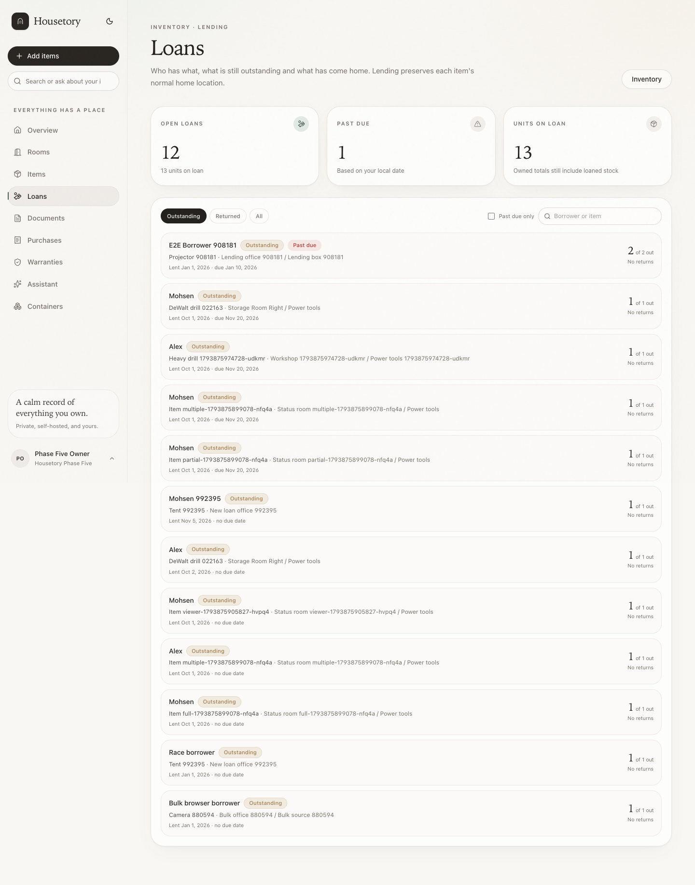
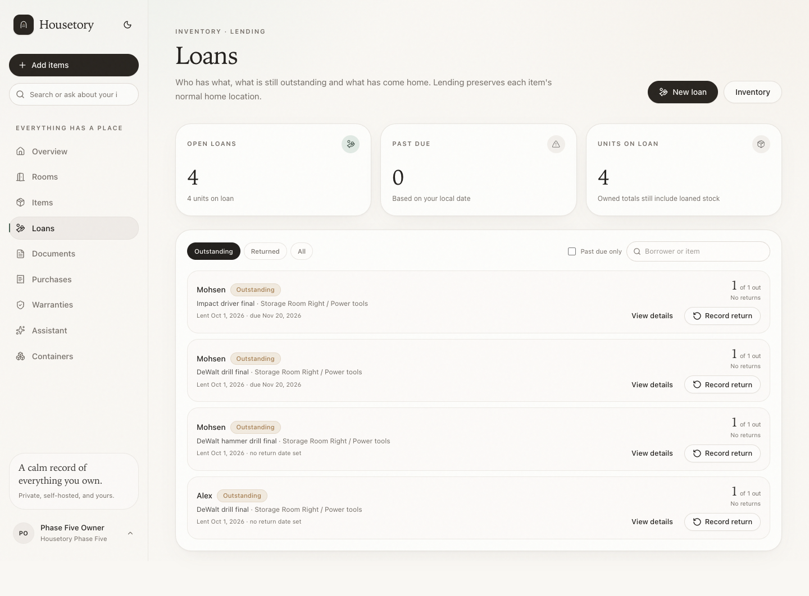
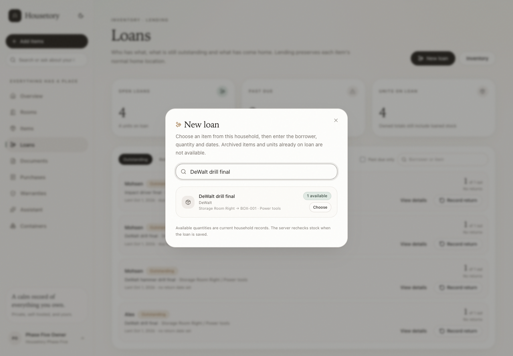
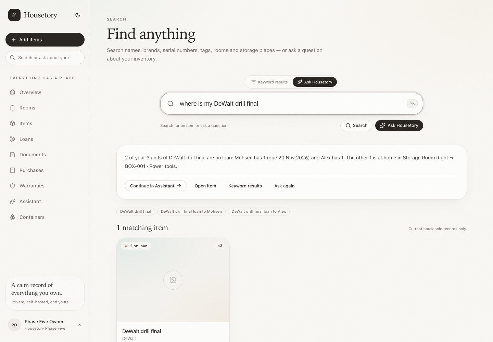
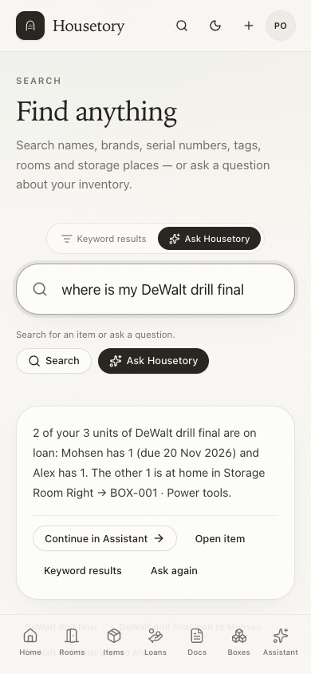

# Loans usability and natural inventory wording

This follow-up completes the queued point-of-use lending actions and rewrites
simple grounded answers in natural language. It reuses the existing loan,
return, validation and history code; no schema, stock rule or server permission
changed.

## New loan from the Loans page

The Loans page now has a **New loan** action (owner/member only):

1. Search or browse active household inventory. Archived items are excluded.
2. Each result shows its recorded brand/model and home path plus the currently
   available quantity. Fully loaned items are disabled.
3. **Choose** opens the existing Lend dialog with the selected item and available
   stock. Borrower, quantity, lent date, optional return date and private notes
   use the same validation and idempotency as item-detail lending.
4. The server rechecks archived state and available stock when saving. If stock
   changed after the picker loaded, the dialog shows the existing
   `insufficient_available_stock` or `item_archived` error rather than
   over-lending.
5. Successful creation switches the list to Outstanding, refreshes loans and
   inventory queries, and returns focus to New loan after the dialog closes.

No borrower account or person record is created.

## Outstanding loan rows

Each row now provides:

- borrower name as plain text (not a fake person link);
- the item name linking to item detail;
- recorded home path, lent date, optional return date and overdue text;
- outstanding/returned loan quantity;
- separate **View details** and **Record return** actions.

Record return opens the existing dialog for that exact loan. The dialog defaults
to the outstanding quantity, supports partial returns, requires explicit
confirmation and retains idempotency/history/undo. Opening a row never changes
state. Returned/cancelled rows keep View details but show no return action.
Viewers see item/loan navigation but no New loan or Record return controls.

## Natural grounded answers

The retrieval permissions, household scope and loan facts are unchanged. Only the
presentation is more natural:

- Fully loaned, no date:
  “Mohsen has your DeWalt Heavy drill. No return date is set. You normally keep it
  in Storage Room Right → BOX-006 · Power tools.”
- Fully loaned with date: the same direct sentence followed by “Due 20 Nov 2026.”
- Partial:
  “Mohsen has 1 of your 3 units of DeWalt Heavy drill. Due 20 Nov 2026. The other
  2 are at home in Storage Room Right → BOX-006 · Power tools.”
- Multiple borrowers:
  “2 of your 3 units of DeWalt Heavy drill are on loan: Mohsen has 1 (due 20 Nov
  2026) and Alex has 1. The other 1 is at home in …”
- Returned/no open loan: “Your DeWalt Heavy drill is recorded at home in …. No
  open loan is recorded.”
- Missing home location is stated plainly rather than invented.
- Ambiguous names still list the possible matches and ask which one; no match is
  still explicit.

Removed from user-facing answers: “Grounded answer”, “whereabouts of …”, built-in
loan quantity/count repetition, “loaned units are not recorded there” and the
generic due-date guarantee disclaimer. Due dates are still recorded facts.
Search helper text is now “Search for an item or ask a question.”
The model/provider/consent state remains available in the Assistant’s secondary
privacy details.

## Verification

- 268 PostgreSQL tests, 117 Vitest tests and 31 disposable-stack Playwright
  workflows pass.
- Backend wording tests cover fully/partially loaned items, multiple borrowers,
  a single borrower across loans, returned stock, no return date, missing home
  location, brand/name display, ambiguity and no match without an LLM.
- Frontend tests cover New loan selection/available stock, direct partial return,
  separate item/loan navigation, plain borrower text, viewer controls and the
  removed internal answer labels.
- Browser coverage covers New loan creation, no-match search, over-lending
  prevention, stale-stock error, direct row return, viewer restrictions and the
  natural answer copy on desktop/mobile with isolated fixtures.
- Ruff, strict TypeScript typecheck, production build, migration checks and the
  full existing suites pass.

Screenshots are under `docs/walkthrough/loans-wording/` (Loans page and New loan
picker before/after, natural search/assistant examples on desktop/mobile).

## Remaining limits

- No bulk return and no borrower/person-management subsystem.
- Return dates are recorded facts, not reminders or guarantees.
- The manual/product-help milestone has not been started.
- No live paid-provider or remote deployment was used.

## Screenshots

Loans page before:

Loans page after with New loan and direct row actions:

New loan item picker:

Natural grounded answer:

Mobile search answer:

