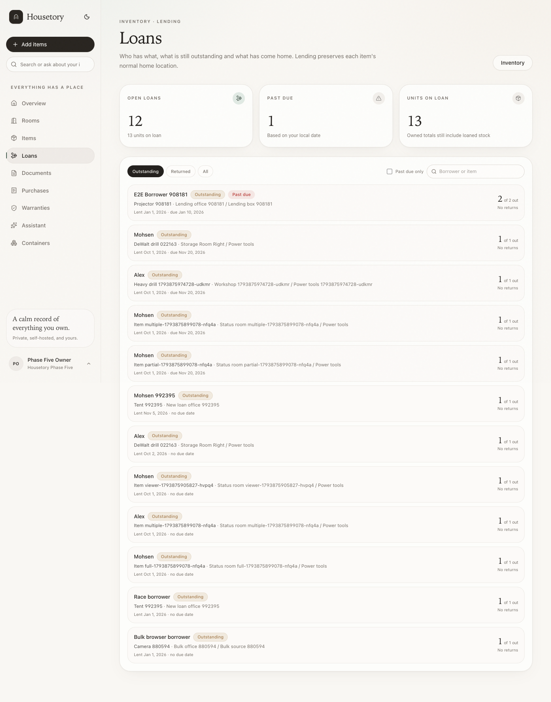
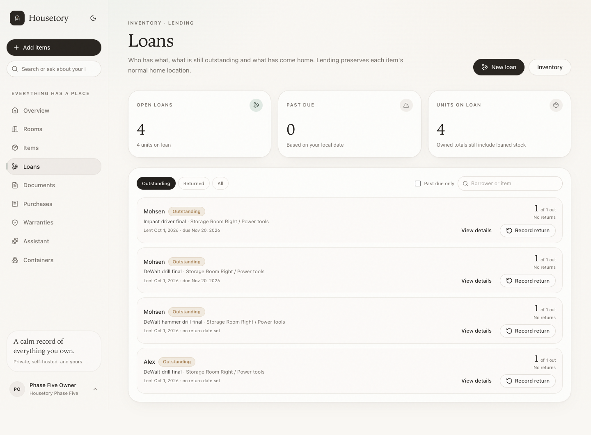
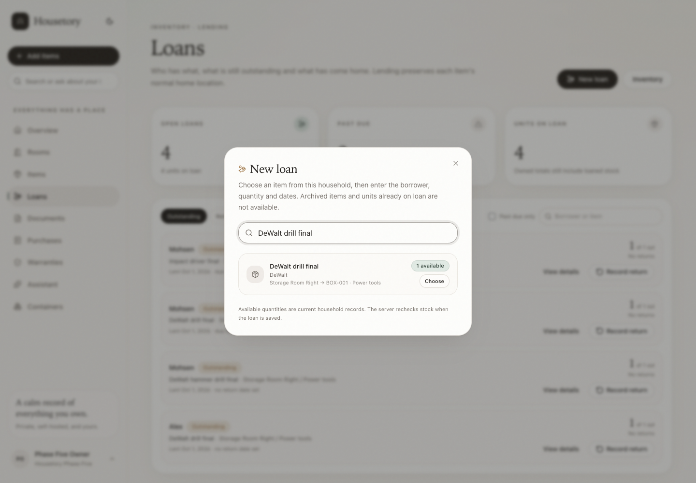
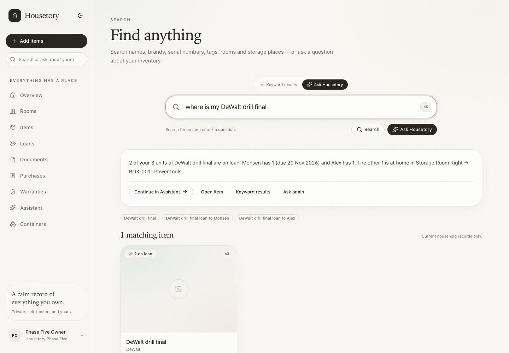
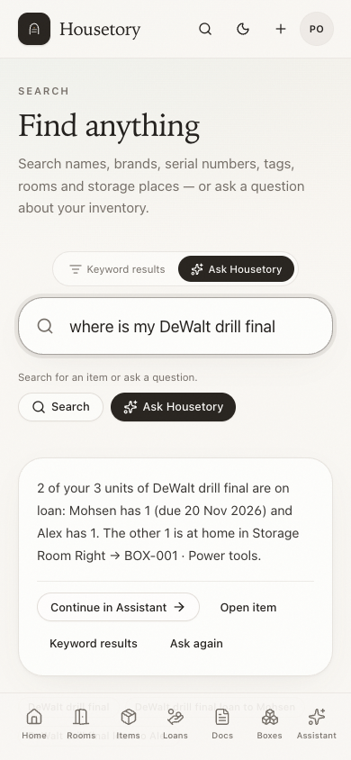

# Loans usability and natural inventory wording

This follow-up completes the queued point-of-use lending actions and rewrites
simple grounded answers in natural language. It reuses the existing loan,
return, validation and history code; no schema, stock rule or server permission
changed.

## New loan from the Loans page

The Loans page has a **New loan** action (owner/member only). It opens one
surface, not a chain of dialogs:

1. Two chips choose the direction: **Lend out** (the default) or **Borrow**.
   One short line under them says what the choice means.
2. To lend, the surface starts with the three essentials: **Item**, **Borrower**
   and **Quantity**. The item field searches active household inventory and
   shows a few matches with their home place and the units available. Archived
   items are excluded and fully loaned items are disabled. Typing narrows the
   list. A chosen item can be changed.
3. **More options** is closed at first. It holds **Lent on** (today unless it is
   changed), **Due back** and **Private notes**. Its row shows the current
   choice, for example "today, no due date". It opens by itself when a date is
   not valid, so the error is never hidden.
4. To borrow, the essentials are **Item name**, **Owner** and **Quantity**. Brand,
   model, dates, photo, keeping place and notes are under **More options**.
5. Validation, idempotency and the server rechecks are unchanged. If stock
   changed after the item was chosen, the surface shows the existing
   `insufficient_available_stock` or `item_archived` error rather than
   over-lending.
6. Successful creation switches the list to Outstanding, refreshes loans and
   inventory queries, and returns focus to New loan after the surface closes.

The Lend dialog on an item page uses the same fields with the item fixed.

## Loans page layout

- The list starts directly under the title. One line replaces the three summary
  cards, for example "5 out · 1 past due · 2 borrowed". The past-due part is a
  shortcut to the past-due filter.
- Two chips (**Lent out**, **Borrowed**) and the search field stay in view. With
  no chip pressed, both directions are shown.
- **Filters** opens the status, person and past-due filters. The button shows
  how many of them are active. Active filters also appear as chips that can be
  removed one by one. All filters stay in the URL as before.

No borrower account or person record is created.

## Storage-bearing items

When the selected item provides storage, the Lend dialog adds one explicit
checkbox: **Include the contents in this loan**. Off is the default and lends only
the parent item. On shows the available child items and total units; archived
items, fully loaned children and borrowed-from-others records are listed as
excluded. Saving creates separate child loans with the same borrower and dates.
Each child keeps independent returns and history. Returning the parent never
marks child loans returned.

## Outstanding loan rows

Each row now provides:

- borrower name as plain text (not a fake person link);
- the item name linking to item detail;
- recorded home path, lent date, optional return date and overdue text;
- outstanding/returned loan quantity;
- separate **View details** and **Record return** actions.

Record return opens the existing dialog for that exact loan. The dialog defaults
to the outstanding quantity, supports partial returns, requires explicit
confirmation and retains idempotency/history/undo. Opening a row never changes
state. Returned/cancelled rows keep View details but show no return action.
Viewers see item/loan navigation but no New loan or Record return controls.

## Natural grounded answers

The retrieval permissions, household scope and loan facts are unchanged. Only the
presentation is more natural:

- Fully loaned, no date:
  “Mohsen has your DeWalt Heavy drill. No return date is set. You normally keep it
  in Storage Room Right → BOX-006 · Power tools.”
- Fully loaned with date: the same direct sentence followed by “Due 20 Nov 2026.”
- Partial:
  “Mohsen has 1 of your 3 units of DeWalt Heavy drill. Due 20 Nov 2026. The other
  2 are at home in Storage Room Right → BOX-006 · Power tools.”
- Multiple borrowers:
  “2 of your 3 units of DeWalt Heavy drill are on loan: Mohsen has 1 (due 20 Nov
  2026) and Alex has 1. The other 1 is at home in …”
- Returned/no open loan: “Your DeWalt Heavy drill is recorded at home in …. No
  open loan is recorded.”
- Missing home location is stated plainly rather than invented.
- Ambiguous names still list the possible matches and ask which one; no match is
  still explicit.

Removed from user-facing answers: “Grounded answer”, “whereabouts of …”, built-in
loan quantity/count repetition, “loaned units are not recorded there” and the
generic due-date guarantee disclaimer. Due dates are still recorded facts.
The placeholder of the search and ask field is now “Search or ask…”.
The model/provider/consent state remains available in the Assistant’s secondary
privacy details.

## Verification

This is the record of the original follow-up. The counts are from that time.
The current tests are in `loans-page.test.tsx`, `loan-dialogs.test.tsx`,
`e2e/lending.spec.ts` and `e2e/simple-loan-names.spec.ts`.

- 268 PostgreSQL tests, 117 Vitest tests and 31 disposable-stack Playwright
  workflows pass.
- Backend wording tests cover fully/partially loaned items, multiple borrowers,
  a single borrower across loans, returned stock, no return date, missing home
  location, brand/name display, ambiguity and no match without an LLM.
- Frontend tests cover New loan selection/available stock, direct partial return,
  separate item/loan navigation, plain borrower text, viewer controls and the
  removed internal answer labels.
- Browser coverage covers New loan creation, no-match search, over-lending
  prevention, stale-stock error, direct row return, viewer restrictions and the
  natural answer copy on desktop/mobile with isolated fixtures.
- Ruff, strict TypeScript typecheck, production build, migration checks and the
  full existing suites pass.

Screenshots are under `docs/walkthrough/loans-wording/` (Loans page and New loan
picker before/after, natural search/assistant examples on desktop/mobile).

## Remaining limits

- No bulk return and no borrower/person-management subsystem.
- Return dates are recorded facts, not reminders or guarantees.
- The manual/product-help milestone has not been started.
- No live paid-provider or remote deployment was used.

## Screenshots

These are older screens. They show the Loans page, the New loan picker and the
search results page as they were before the mobile-first programme.

Loans page before:

Loans page after with New loan and direct row actions:

New loan item picker:

Natural grounded answer:

Mobile search answer:

