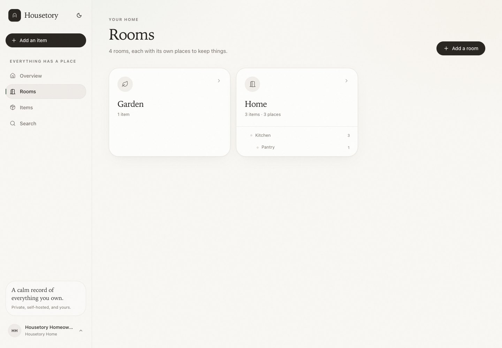
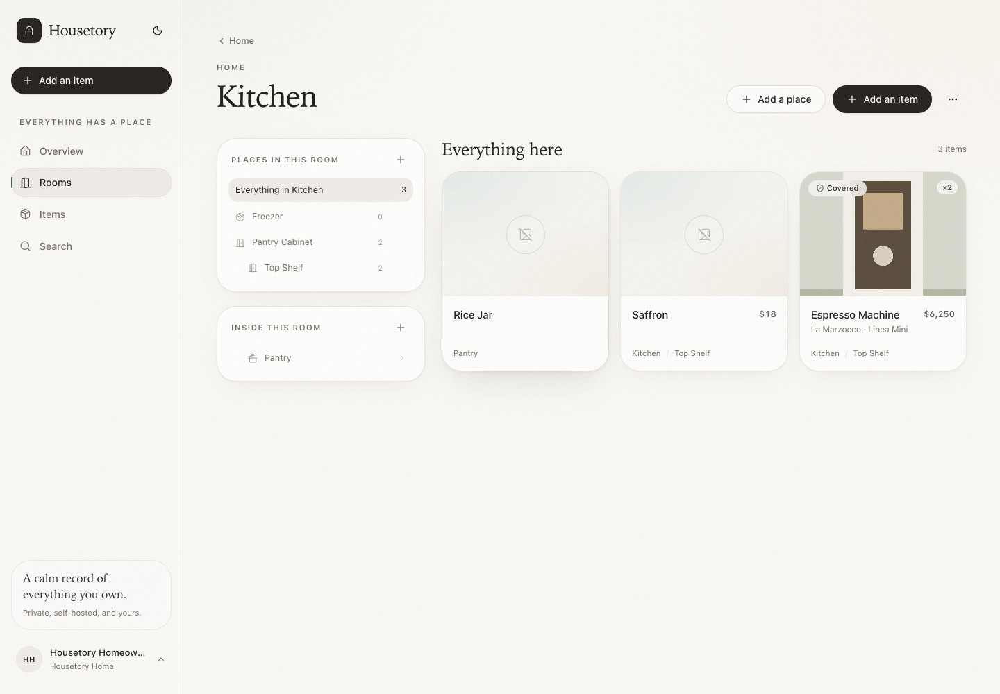
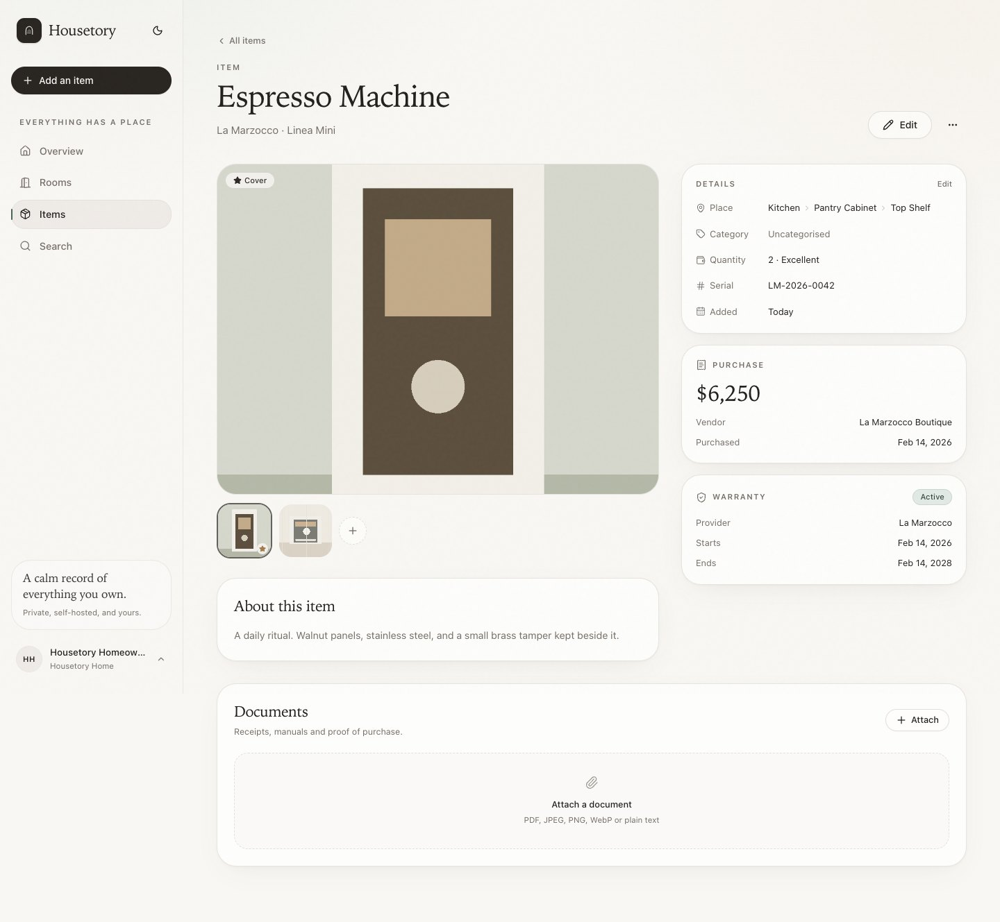
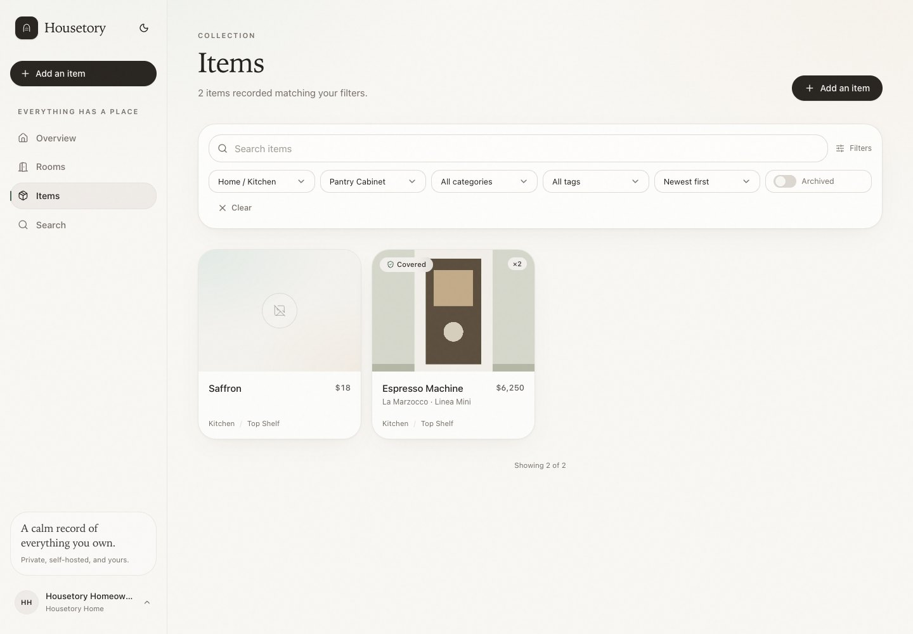
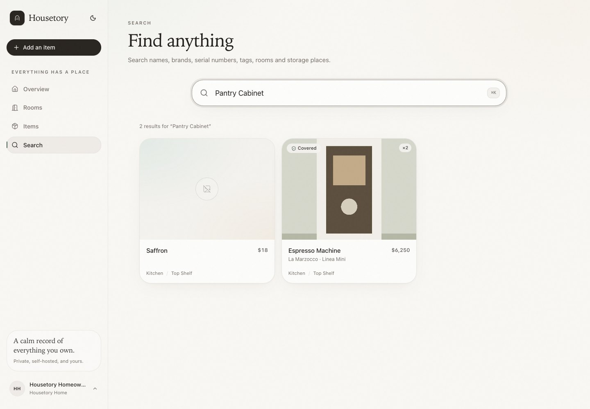
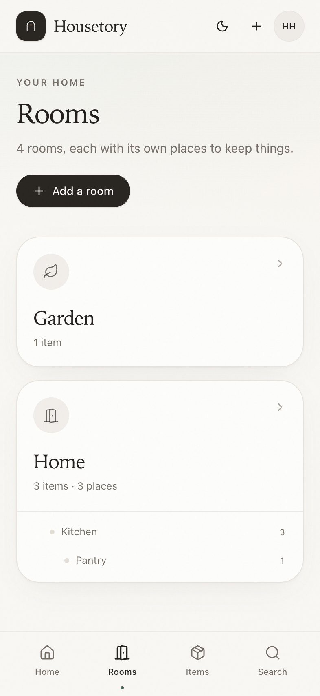
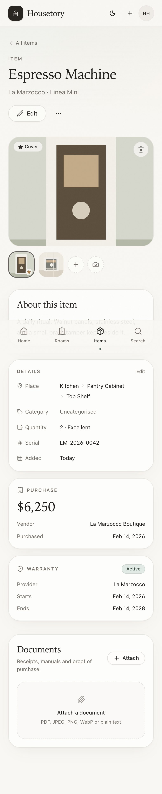
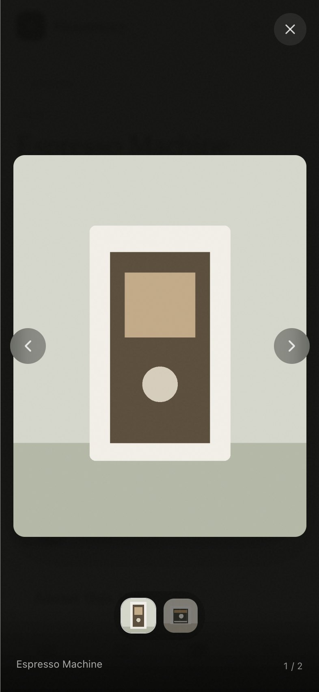

# Phase 2 — Core Inventory Experience

**Status:** complete and verified on desktop and iPhone-sized Chromium.  
**Built on:** the authenticated Phase 1 API, existing item/photo/document
foundation, and the security-gated deployment.

The walkthrough below used disposable test data. It was removed from the database
before handoff. The screenshots capture that temporary review state and are not
shipped as production data.

## What already existed

The foundation already had item CRUD, multi-photo uploads, document attachments,
purchase and warranty records, flat category/tag selection, search, filtering,
nested room creation and nested storage-place creation. Phase 2 did not duplicate
those flows.

## What was added in Phase 2

- Hierarchy-aware inventory browsing:
  - Room and storage-location counts now include nested descendants.
  - Room and place filters include descendant rooms/locations.
  - Room detail selections are URL-driven and filter by an exact place plus all
    nested places.
  - Rooms and places render the full nested hierarchy, with path-aware filter
    labels such as `Home / Kitchen`.
- Search across the real inventory context:
  - Free-text search now matches room names, storage-location names, category
    names, tags, item names, descriptions, brands, models and serial numbers.
  - Matching a parent room or place includes items in its nested descendants.
- Item place context:
  - Item detail shows the full room → place chain, with links back into the
    filtered room view.
  - Item forms show hierarchical room choices and the selected place path.
- Photo experience:
  - Choose any photo as the item cover; it becomes the primary image.
  - Full-screen photo viewer with previous/next controls, keyboard navigation,
    thumbnail navigation and mobile layout.
  - iPhone camera capture action in addition to photo-library uploads.
- A dialog-positioning defect discovered during the walkthrough was fixed: the
  opening animation was overriding the centering transform, placing modals
  off-screen. All dialogs now centre correctly.
- Item PATCH responses force a fresh relationship read so moving an item between
  places returns the new place immediately.

## Desktop walkthrough

1. Completed first-run setup.
2. Created `Home`, then nested `Kitchen` and `Pantry` rooms through the room
   dialog; created a separate `Garden`.
3. In Kitchen, created `Freezer` and `Pantry Cabinet`, then nested `Top Shelf`
   through the place menu.
4. Selected `Top Shelf`, chose **Add an item**, and confirmed the room and place
   were preselected from the URL.
5. Created an Espresso Machine with brand, serial, quantity, condition, purchase
   and warranty information.
6. Uploaded two photographs, set the second as the cover, opened the full-screen
   viewer, navigated between photos and closed it.
7. Edited the item, changed quantity, moved it to another place, and verified the
   detail page reflected the move.
8. Added additional inventory through the authenticated API, then verified:
   - filtering `Home / Kitchen` included the nested `Pantry` item;
   - filtering `Pantry Cabinet` included the nested `Top Shelf` item;
   - `Garden` items were excluded from both Kitchen filters;
   - search for `Pantry Cabinet` found the item on its nested shelf;
   - search for `Kitchen` included the Pantry descendant item.
9. Reopened the item after the API update; the full place path and cover photo
   persisted.

### Screenshots

| Nested rooms | Room places and descendant items |
| --- | --- |
|  |  |

| Item with cover and full place path | Nested place filter |
| --- | --- |
|  |  |

| Search by storage place |
| --- |
|  |

## iPhone walkthrough

A second browser context used an iPhone-sized viewport (393 × 852, touch
enabled) and the same authenticated session state.

- Opened Rooms and verified the full nested hierarchy and aggregate counts.
- Opened the Espresso Machine, verified the cover photo, full place path and
  visible camera action.
- Opened the full-screen photo viewer and navigated it.
- Confirmed the fixed bottom navigation and safe-area layout.

| Rooms | Item | Photo viewer |
| --- | --- | --- |
|  |  |  |

## Automated verification

- Backend: **72 pytest tests passed**, including descendant counts, hierarchy
  filters, ancestor-aware search, cover-photo ordering, cross-household protection
  for the new endpoint, and item-move response correctness.
- Frontend: **16 Vitest tests passed**, including nested hierarchy utilities,
  location paths, RoomCard aggregate rendering and photo-lightbox navigation.
- Strict TypeScript check and production build passed.
- Production Compose stack rebuilt and healthy.
- Walkthrough reported **0 console errors and 0 failed network requests**.

## Limits of this phase

- Photo reordering is limited to choosing a cover; drag-to-reorder and captions
  remain Phase 4 product depth.
- Search is still PostgreSQL `ILIKE`-based rather than ranked full-text search.
- Category/tag edit/delete UI, custom fields, multi-user sharing and Tauri remain
  outside this phase.
- Tailscale HTTPS setup still requires the operator's actual tailnet.

## Suggested Phase 3

The core inventory milestone is complete. The next phase should be chosen from
the product plan rather than started implicitly. The strongest next candidates
are:

1. **Advanced organisation:** custom fields, category/tag management and safe
   reassignment flows.
2. **Desktop:** Tauri 2 macOS shell against the now-stable web application.
3. **Media depth:** drag reordering, captions and a document library.
