# Phase 3 — Documents, Receipts & Ownership

**Status:** complete and verified end-to-end against the production Compose stack.  
**Built on:** the Phase 1 security gate, Phase 2 inventory experience, PostgreSQL
job queue and local file storage.

The walkthrough used disposable review data. It was removed from the running
database before handoff. Screenshots capture that temporary review state and are
not shipped as production data.

## What was added

### Document library

- Dedicated Documents section with a searchable, type-filtered library.
- Receipts, invoices, warranty certificates, manuals, specifications and other
  documents.
- PDF, JPEG, PNG, WebP, HEIC/HEIF and plain-text uploads.
- One document can be linked to one item, several items, or kept in the
  household library without an item.
- Metadata: title, type, merchant, document date, notes, filename, size, linked
  items and OCR state.
- Search across title, filename, merchant, extracted text, extracted metadata
  (invoice numbers, product names, serials), associated item names and document
  or purchase dates.
- Authenticated downloads, original-file downloads, and confirmed deletion.
- Existing file protections are retained: content-based validation, private
  `0600` files under `0700` directories, authenticated no-store responses,
  attachment downloads and safe filenames.

### Original upload preservation

- Every new upload is stored twice: a normalized/safe download copy and the
  exact original bytes.
- Images keep the original bytes (including metadata) in the private original
  file, while the default download is re-encoded with EXIF removed.
- PDFs are byte-identical in both copies, but remain separately addressable.
- Existing documents from earlier phases are migrated to point at their safe
  copy because their original pre-sanitization bytes no longer existed.
- The worker only reads uploads; the original and normalized files are included
  automatically in the existing uploads backup volume and restore archive.

### Local OCR

- CPU-only Tesseract OCR in the worker image, with Poppler rendering scanned PDF
  pages. No GPU or external API is used.
- Digital PDFs use embedded text first, avoiding OCR when possible.
- Uploads enqueue a durable `documents.ocr` job; the API never waits for
  extraction.
- The document screen shows queued, processing, extracted and failed states,
  confidence, source and the full worker error.
- Failed OCR can be retried.
- Heuristic extraction proposes merchant, purchase date, total, currency,
  invoice/order number, product names and serial numbers.
- OCR writes only document metadata. Inventory records change only after the
  user reviews and confirms the proposed values.
- Confirmation can create or update a shared purchase, attach the document as
  its receipt, apply a product name and serial number to one linked item, and
  records the review time and applied item IDs.

### Purchases

- Shared purchase records replace the old one-to-one purchase rows.
- Date, price, currency, merchant, order number, notes and receipt document.
- One purchase can cover several items without duplicating the amount.
- Items can join an existing shared purchase or detach from it.
- Empty purchase shells are pruned when items move elsewhere.
- Deleting a purchase or item detaches records safely without deleting the other
  side.
- Dedicated Purchases page with search, currency/date filters and CSV export.

### Warranties

- Provider, start date, duration in calendar months, calculated expiration,
  document, coverage notes, optional per-warranty reminder override and computed
  status.
- Household-level reminder window (default 30 days) configurable in Settings.
- Overview dashboard sections for expiring soon, active and expired warranties.
- Dedicated Warranty page with status tabs and persisted counts.
- Calendar-month expiration clamps correctly, e.g. 31 January + 1 month becomes
  28/29 February.

### Ownership overview

- Total purchase value, counted once per shared purchase.
- Estimated current value, kept separate from purchase value.
- Value by category and room.
- Most valuable items.
- Items missing purchase information.
- Multiple currencies are always reported separately. No exchange-rate
  conversion is configured, so no cross-currency addition occurs.
- For category/room breakdowns, shared purchase amounts are allocated equally
  across the active items they cover, with remainder cents distributed
  deterministically so the allocated total still equals the purchase total.
- CSV exports for documents, purchases, warranties and inventory.

## Desktop walkthrough

1. Completed first-run setup and created Kitchen, Living Room and Study.
2. Seeded real review records through the authenticated API:
   - espresso machine, grinder, sofa, coffee table, camera, lamp, bookshelf and
     printer;
   - USD and EUR purchases, estimated current values, active/expiring/expired
     warranties and missing-purchase items;
   - a shared furniture purchase for the sofa and coffee table.
3. Uploaded an invoice, warranty PDF, manual and specification. Real Tesseract
   processing completed for every document.
4. Verified the Overview ownership and warranty sections with two currencies.
5. Opened the Documents library and checked type, merchant and date controls.
6. Uploaded a photographed receipt through the UI, linked it to the espresso
   machine, and waited for the worker to finish OCR without blocking the page.
7. Verified the review screen was prefilled with merchant, date, total, currency,
   invoice number and serial. Confirmed the review explicitly, then verified:
   - the item received a purchase and serial number;
   - the purchase used the document as its receipt;
   - the document recorded the confirmation time.
8. Opened the item detail and verified purchase, current value, warranty,
   receipt and linked documents.
9. Edited the La Marzocco purchase in the Purchases page to add the coffee
   grinder, producing a shared purchase without duplicating the amount.
10. Verified the Warranty dashboard and full list.
11. Searched Documents for `Marzocco`, matching the merchant, linked item and
    extracted content, then opened the item form and verified the current-value,
    receipt, duration and warranty-document controls.

### Screenshots

| Overview: value + warranties | Documents library |
| --- | --- |
| 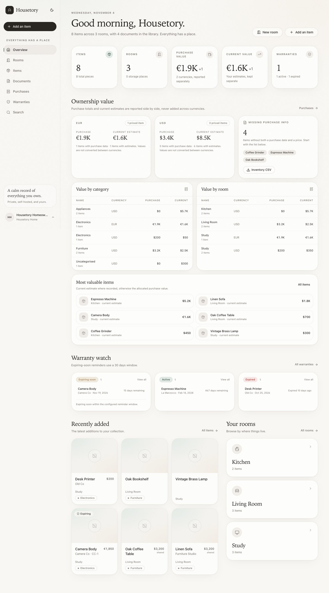 | 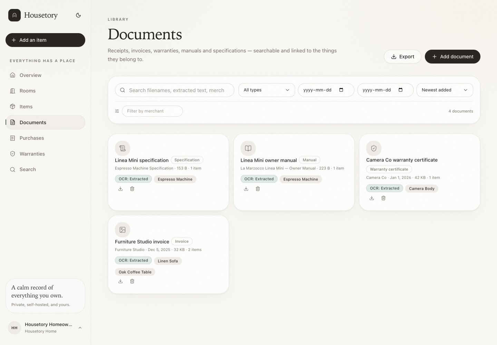 |

| OCR review before confirmation | Confirmed and applied |
| --- | --- |
| 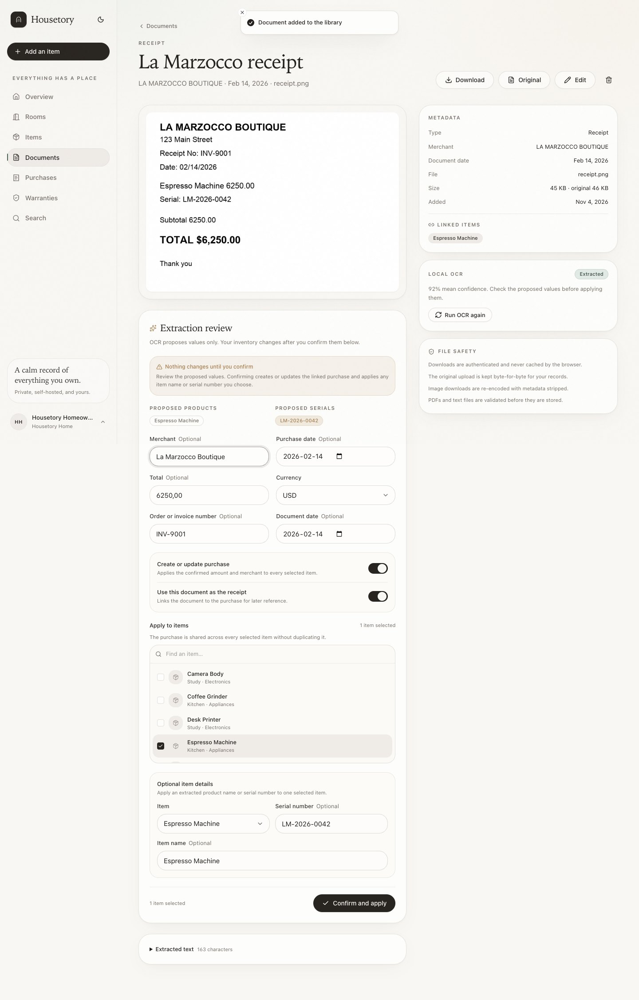 | 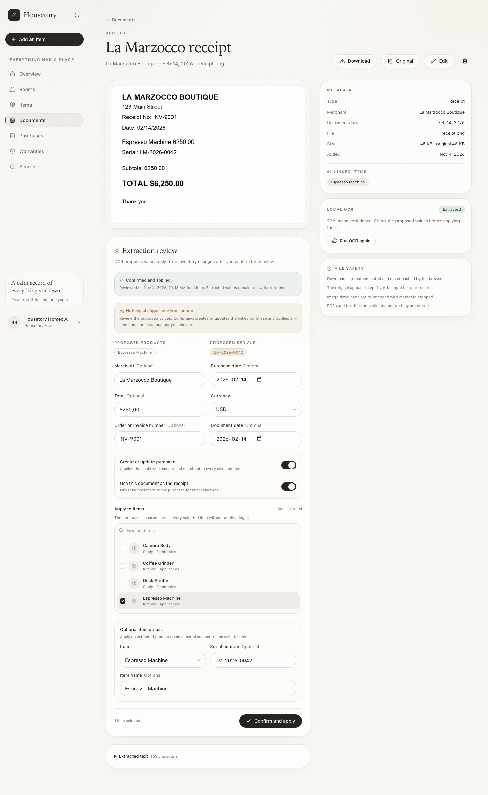 |

| Item detail with ownership data | Shared purchases |
| --- | --- |
| 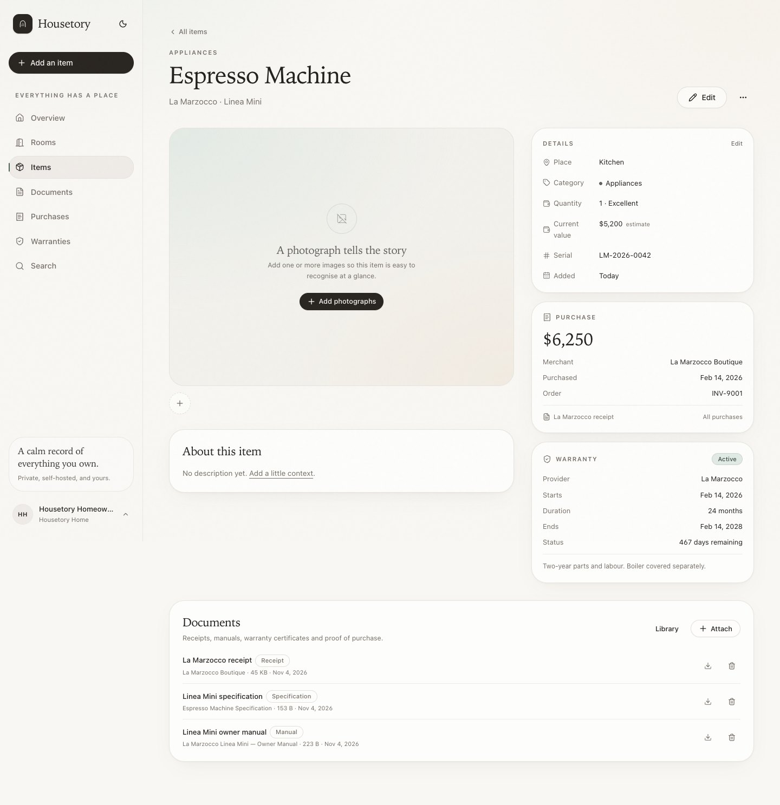 | 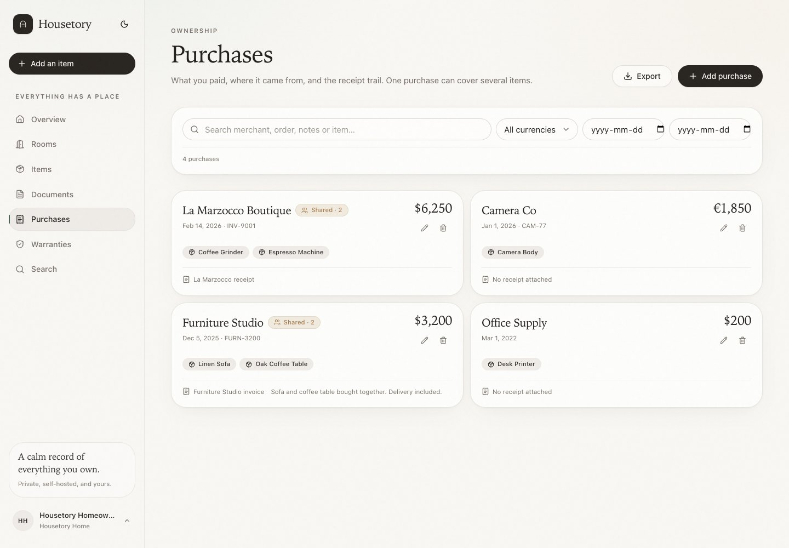 |

| Warranty management | Document search |
| --- | --- |
| 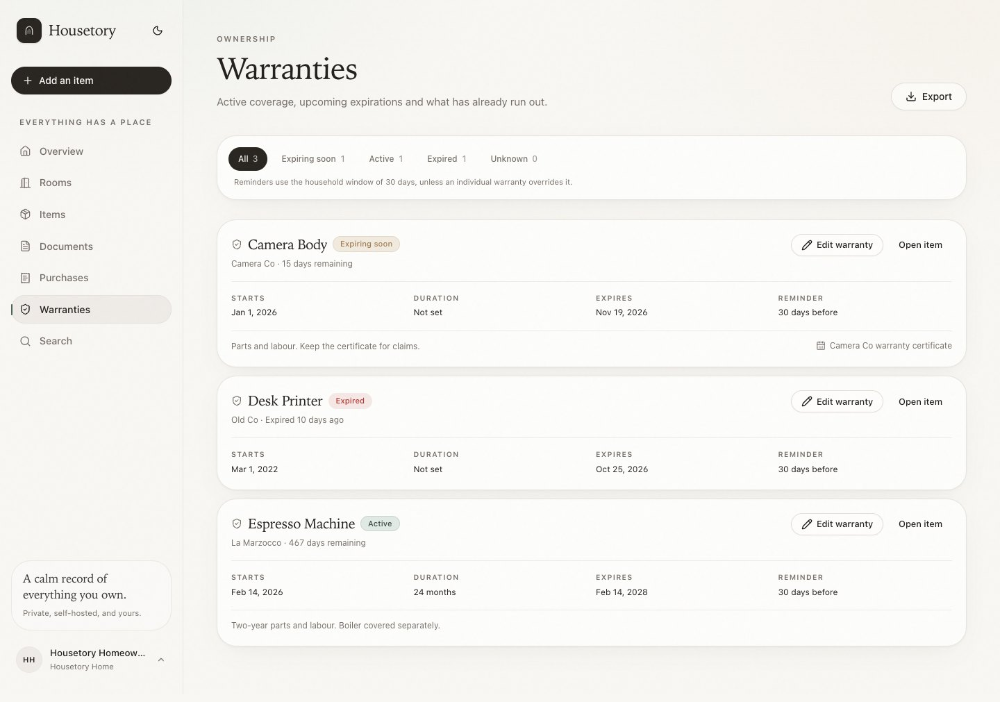 | 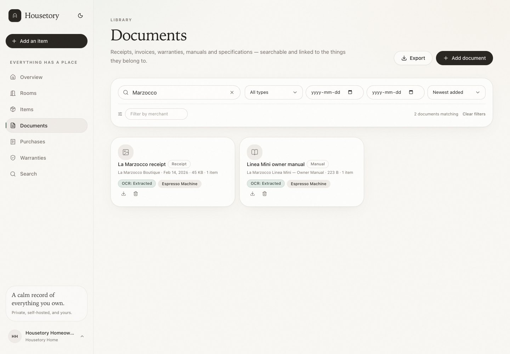 |

| Item form: purchase, current value and warranty |
| --- |
| 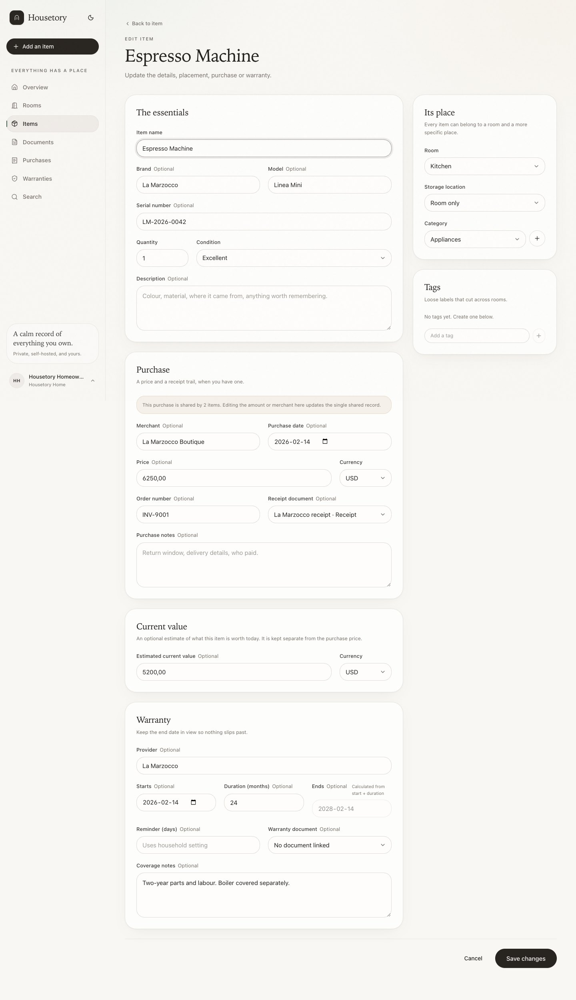 |

## iPhone walkthrough

A second browser context used a 393 × 852 touch viewport and the same
authenticated session.

- Verified the Overview value cards and ownership section.
- Verified the Documents library and fixed bottom navigation.
- Opened the receipt, confirmed the inline preview, downloads and OCR review
  form layout.

| Mobile overview | Mobile ownership |
| --- | --- |
| 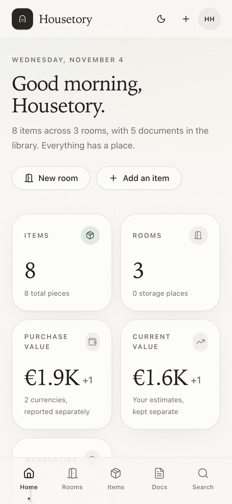 | 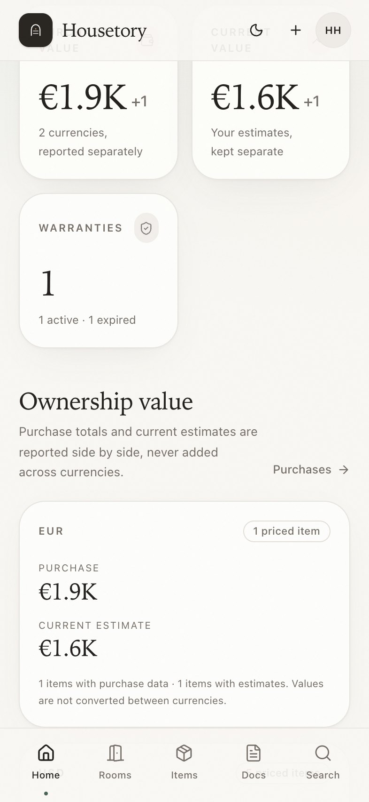 |

| Mobile documents | Mobile OCR review |
| --- | --- |
| 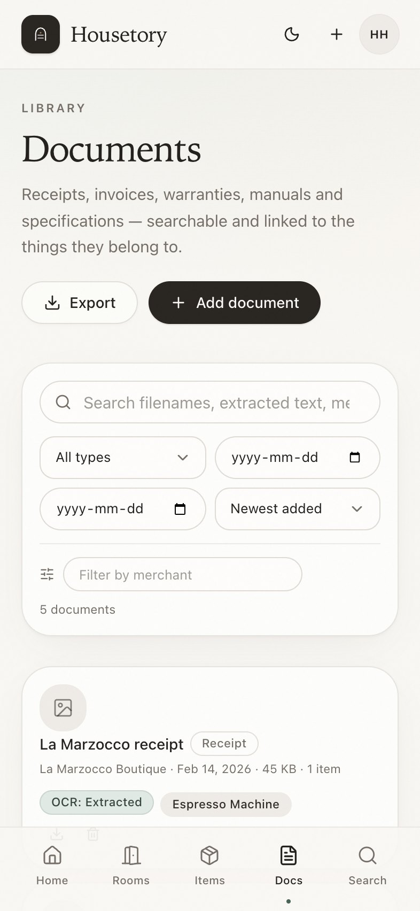 | 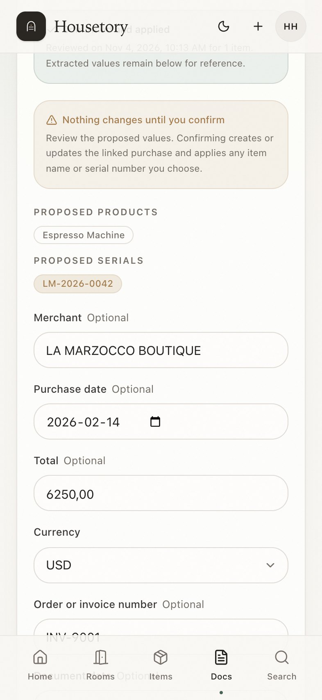 |

## Verification

- **104 backend pytest tests passed** against PostgreSQL with the full Alembic
  migration chain.
- **20 frontend Vitest tests passed**; strict TypeScript check and production
  build passed.
- Ruff formatting and linting passed.
- Real Tesseract OCR was exercised in the Compose worker: the photographed
  receipt produced merchant `LA MARZOCCO BOUTIQUE`, date `2026-02-14`, total
  `625000`, currency `USD`, invoice `INV-9001`, serial `LM-2026-0042` and 92%
  mean confidence. Confirmation created the purchase and attached the receipt.
- Desktop and mobile walkthroughs reported **0 console/page errors and 0 failed
  network responses**.
- All Compose services reported healthy.
- Cross-household tests cover documents, original downloads, document mutation,
  OCR retry/apply, purchases, warranties, financial overview and every CSV
  export.
- Backup/restore tests include original-document paths under
  `households/*/documents/originals/`.

## Honest limitations

- OCR is heuristic, English-first and tuned for receipts. It can misread dates,
  taxes, totals, addresses or product names; every value must be reviewed.
- Product names and serial numbers are proposals for one selected item at a
  time. OCR does not auto-create inventory items or parse full line-item
  purchases.
- PDF OCR renders only the first configured pages (`OCR_MAX_PDF_PAGES`, default
  5) to bound CPU time.
- Tesseract language support is limited to the language packs installed in the
  worker image (`eng` by default). Add the required Alpine language data package
  and set `OCR_LANGUAGE` to change it.
- No exchange rates are configured. Multi-currency totals are always separate;
  most-valuable-item ordering is numeric within the displayed currency rather
  than a converted global ranking.
- Shared purchase amounts are allocated equally for category/room breakdowns;
  individual item cost allocation across a mixed purchase is not editable.
- CSV is the only export format; there is no PDF report export.
- The original upload is preserved exactly as received. There is no antivirus or
  malware scanner; PDFs download as attachments and should be opened with a
  patched reader.
- Document previews render images inline; PDFs and text files use download
  rather than an embedded viewer.
- Search remains household-scoped `ILIKE`, not ranked full-text search.
- The browser walkthrough is a manual Playwright session, not a checked-in E2E
  suite.
- Tauri packaging and the AI assistant were intentionally not started.

## Recommended next phase

The ownership milestone is stable enough for **Phase 4 (Tauri 2 macOS desktop)**
or **advanced organisation** (custom fields, taxonomy management and multi-user
sharing). Do not start either until explicitly approved.
