# Phase 4 — AI Intelligence, Smart Import & Inventory Automation

**Status:** complete and verified end-to-end against the production Compose stack.  
**Built on:** the Phase 1–3 API, security gate, document storage, OCR worker,
PostgreSQL job queue and React application.

The walkthrough used an isolated temporary Compose project and disposable review
data. It was removed without touching the user's running household data.
Screenshots capture that temporary review state.

## What was reused

- Household authentication, authorization and cross-household denial.
- Existing item, room, location, category, tag, purchase, warranty and document
  services and validation rules.
- Content-validated private file storage, original preservation and authenticated
  no-store downloads.
- Tesseract/Poppler OCR pipeline and document review.
- PostgreSQL `FOR UPDATE SKIP LOCKED` job queue, retries and stale-job recovery.
- React Query, the API client and the existing design system.

## Implemented

### Bulk import

Supported sources:

- Pasted text.
- `.txt`, `.md`, `.markdown`.
- `.csv`, `.xlsx`, `.docx`, `.pdf`.
- JPEG, PNG, WebP, HEIC/HEIF list images through OCR.
- `.zip` Obsidian vaults containing nested folders, Markdown notes and attachments.

The importer extracts item name, description, quantity, category, brand, model,
serial number, room, storage location, purchase date/price/currency/merchant/
order number, warranty information, tags and notes when explicitly present.

Each field carries provenance:

- **Explicit** — stated in the source.
- **Inferred** — proposed by AI/heuristics.
- **Missing** — not present.

Missing facts are never invented. The natural-language walkthrough example was
covered by tests and produced the expected rooms, storage places and quantities.

### Review, duplicates and locations

- Dedicated import history and review screen.
- Source context, note/folder path, confidence and warnings for every entry.
- Editable fields with explicit/inferred markers.
- Room and storage-place matching against the live hierarchy.
- Missing rooms/places are suggestions only; they require an explicit inline
  create action before use.
- Ambiguous matches block import until resolved.
- Duplicate candidates show matched item, score and reasons.
- Per-entry actions: import as new, skip, reject or merge.
- Merge is field-level and never silently overwrites an existing item.
- Partial approval and all-selected approval.
- Summary of created, merged, skipped, rejected and failed entries.
- Retry-safe jobs; applying imported entries twice does not duplicate items.
- Imported items show their source batch/note on item detail.
- Original sources, vault notes and attachments remain private and downloadable.

CSV/XLSX/DOCX parsing uses the standard library; no new Office dependency was
added. PDFs and images reuse the existing OCR pipeline.

### Obsidian and Markdown

Supported:

- Nested folders and complete vault ZIP uploads.
- Practical YAML frontmatter/properties.
- Wikilinks, aliases and embedded links.
- Standard Markdown links and images.
- Nested tags.
- Markdown tables, bullet/numbered lists and checklists.
- Attachment lookup by relative path or unique basename.
- Broken-link and ignored-note reporting.
- Vault tree display and selective attachment downloads.
- Preserved original archive plus extracted note/attachment files.
- Notes classified as rooms, purchases, receipts, warranties, manuals,
  maintenance, templates or unrelated content are not automatically turned into
  possessions.
- Collection notes produce separate item proposals and retain the collection,
  note title, folder, frontmatter, tags, links and backlinks as relationships.

Not executed: HTML/JavaScript, Obsidian plugins, Dataview queries, canvas files.
A practical YAML subset is implemented, not a full YAML engine.

### Grounded assistant

- Read-only tools: item search/details, location search, room contents, documents,
  purchase history, warranty status, inventory summary and missing-information
  queries.
- Every factual answer executes a server-side tool against the authenticated
  household before responding.
- Deterministic assistant mode works with AI disabled/unavailable.
- Optional model planning and answer phrasing use strict validated JSON.
- Item/document/location/purchase/warranty references are returned as application
  links.
- Multiple matches are presented as alternatives.
- No SQL, shell, write or arbitrary tool access.
- Uploaded notes/documents/descriptions are delimited as untrusted data and never
  treated as instructions or authorization.
- Conversation is stateless server-side; the browser sends recent history with the
  question.

### Natural-language search

The existing Search page now has **Keyword** and **Smart search** modes.

Smart search safely maps requests such as:

- “Find all electronics in the attic.”
- “Show expensive items without purchase records.”
- “Find tools stored outside the garage.”
- “Show items with warranties expiring soon.”
- “Find everything related to photography.”
- “Show items purchased in the last year.”

into structured filters for room/category/location, missing purchase/serial,
warranty status, purchase dates, price range and free text. Keyword search remains
the fallback.

### AI/OCR item recognition

- Upload or camera capture on the recognition page.
- Recognition runs asynchronously in the worker.
- Configured vision models produce strict suggestions.
- Without a vision model, readable text on packaging is used as an OCR fallback,
  clearly marked as inferred.
- The user edits the suggestion, chooses create-new or update-existing, chooses
  whether to attach the photo, then explicitly confirms.
- Applying uses the existing item create/update and photo endpoints.
- Photos and suggestions are private and authenticated.

### Document relationship suggestions

- OCR/merchant/product/serial metadata is compared with existing items.
- The document page shows scored suggestions with reasons.
- Linking is an explicit user action; nothing is changed automatically.
- The existing OCR review/apply workflow is unchanged.

### AI provider architecture

- `AI_PROVIDER=disabled|ollama|openai_compatible`.
- Local Ollama is preferred; CPU-only and no GPU assumption.
- No automatic model download.
- Configurable model, base URL, timeout, concurrency, context/chunk limits.
- Cloud inference is disabled by default and additionally requires explicit
  `AI_CLOUD_ENABLED=true` **and** `AI_CLOUD_CONSENT=true`.
- Provider status, model availability, cloud/consent state and errors are shown in
  Settings and the Assistant page.
- Invalid model output is rejected by strict Pydantic schemas and falls back to
  deterministic behavior.
- Import, recognition and AI jobs use the existing queue, retry and failure
  handling. Ordinary inventory operations do not depend on AI.

## Walkthrough

1. Completed first-run setup in an isolated Compose stack.
2. Seeded rooms, locations, categories, items, purchases, warranties and a receipt
   photograph through the authenticated API.
3. Uploaded a real nested Obsidian vault ZIP through the UI.
4. The worker parsed 5 notes and 7 vault files, ignored room/purchase/template
   notes, reported 3 broken links and proposed 6 inventory entries.
5. Reviewed the proposals; created a missing **Loft** room inline from the
   “Vinyl records” entry.
6. Approved all 6 entries. The summary reported 6 created, 0 skipped, 0 failed.
7. Asked the assistant “Where is my camera?” and verified a grounded answer with
   item and source references.
8. Confirmed Settings reports AI disabled with deterministic operation.
9. Ran smart search for “electronics stored outside the office” and verified only
   the Kitchen television was returned.
10. Opened the camera receipt photo without an item link and verified the document
    suggestion for “Camera Body,” including serial/text match reasons.
11. Uploaded a toaster photo with no vision model. OCR fallback suggested the item,
    the user edited brand/model/category, created the item and attached the photo.
12. Repeated assistant and import review on an iPhone-sized viewport.

### Screenshots

| Vault review (6 proposals) | Inline room creation |
| --- | --- |
| 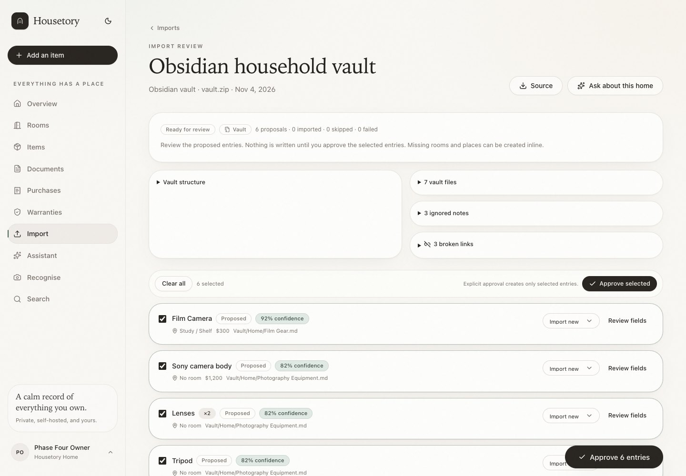 | 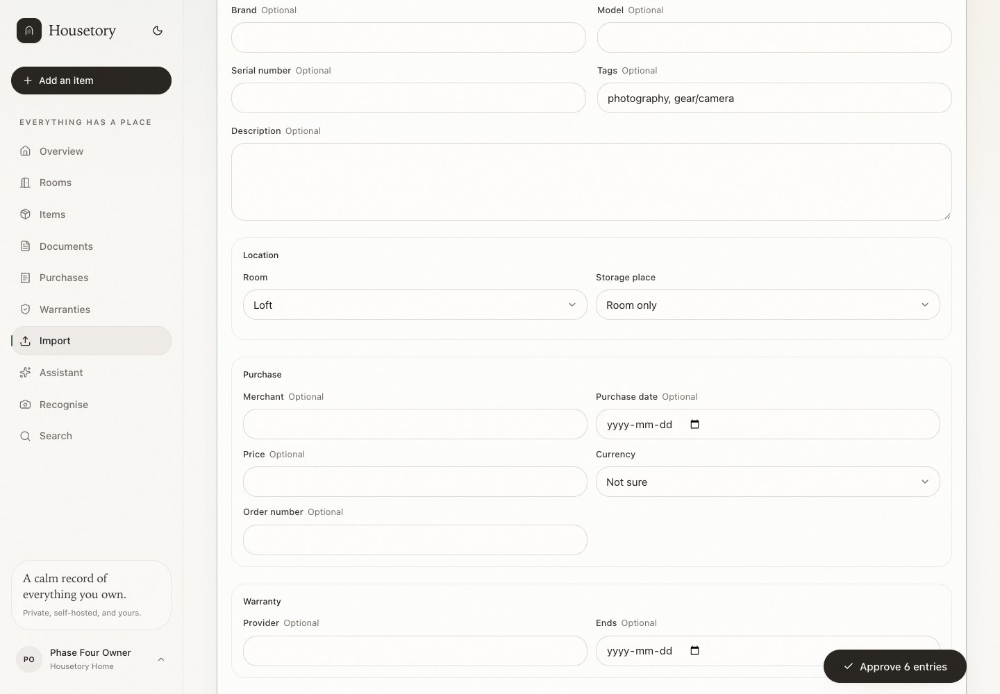 |

| Import applied | Grounded assistant |
| --- | --- |
| 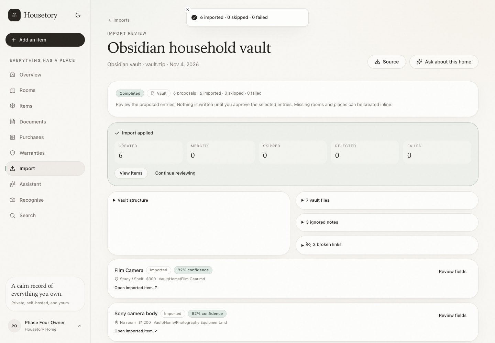 | 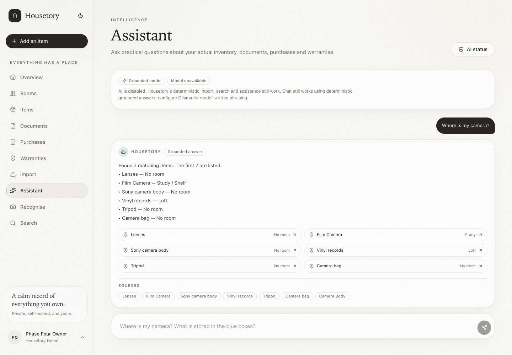 |

| AI status | Smart search |
| --- | --- |
| 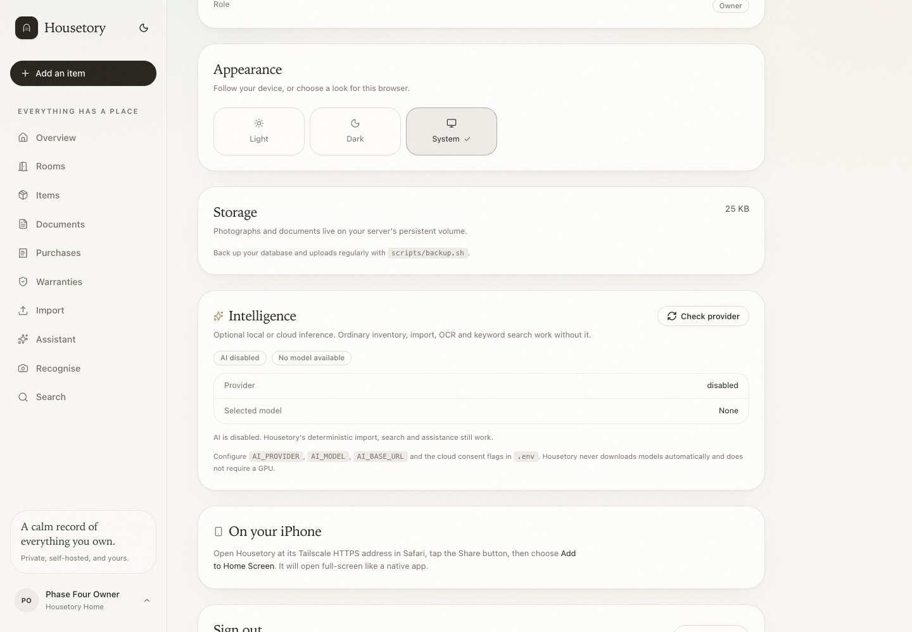 | 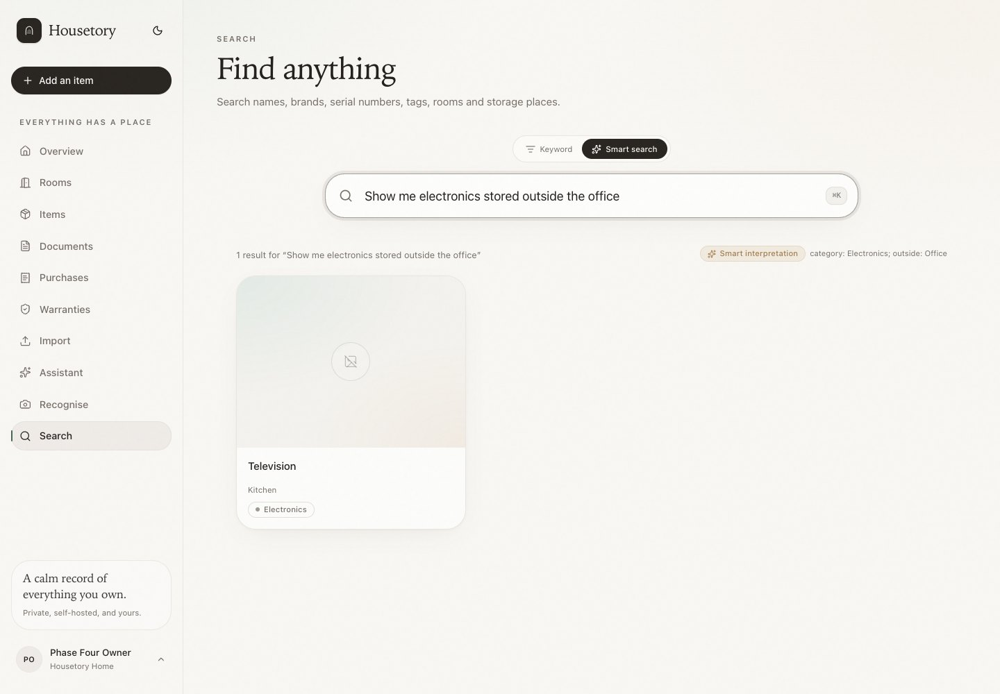 |

| Document relationship suggestions | Recognition review |
| --- | --- |
| 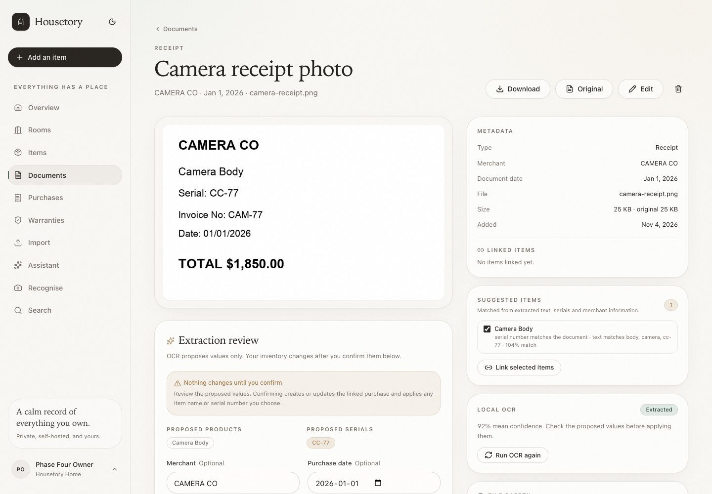 | 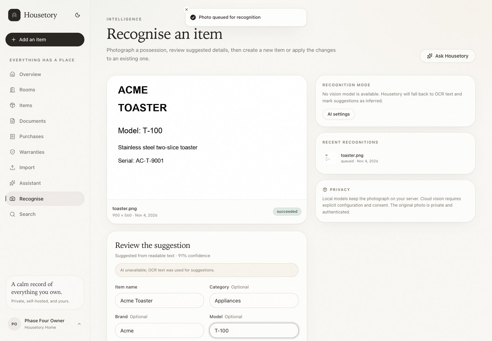 |

| Recognized item with photo | Mobile assistant |
| --- | --- |
| 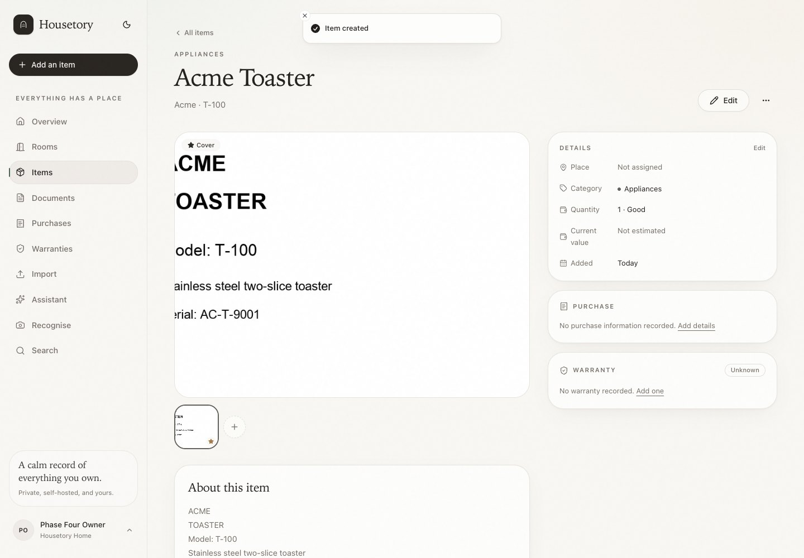 | 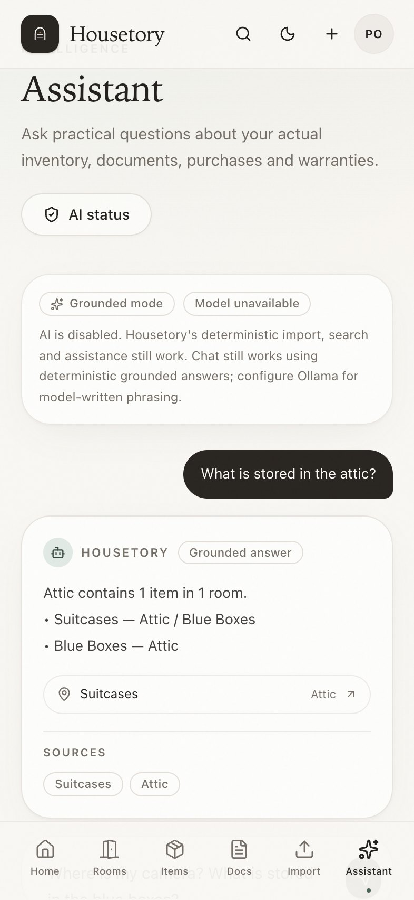 |

| Mobile import review |
| --- |
| 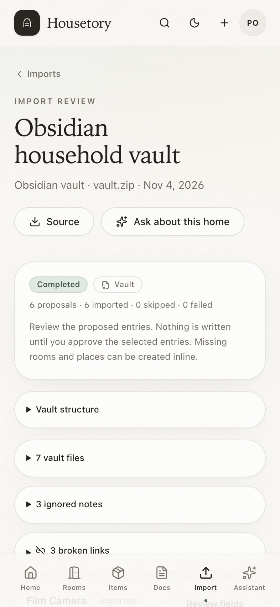 |

## Actual AI models and performance

**No real local model was available on the review machine.** Ollama was not
installed and no model was downloaded, as required by the no-automatic-download
rule. Therefore:

- No LLM model was actually run for inference.
- LLM latency, quality and CPU memory usage are **not measured**.
- Provider planning/answer/vision/import contracts were tested with controlled
  fake outputs, strict schema validation, timeouts and unavailable-model paths.
- The deterministic import, smart-search and assistant paths were tested
  end-to-end.
- Real Tesseract OCR ran in Compose for document extraction and the recognition
  fallback; the receipt OCR job completed in under a second in the local stack.

Review hardware: Apple M2 Max, 32 GB unified memory, macOS. No GPU requirement is
declared or assumed by the application.

## Verification

- **128 backend pytest tests passed** against PostgreSQL with the full Alembic
  chain from the initial migration through Phase 4.
- **21 frontend Vitest tests passed**; strict TypeScript check and production build
  passed.
- Ruff formatting/linting passed.
- Compose worker processed real document OCR, Obsidian import and recognition jobs.
- Desktop and iPhone walkthroughs reported **0 console/page errors** and **0 failed
  network responses**.
- A full destructive backup/restore was rehearsed with the new private imports
  volume. Restored import source/vault files were retrieved through authenticated,
  no-store endpoints; the least-privilege DB role retained its grants and remained
  non-superuser.
- Cross-household tests cover imports, source downloads, apply/retry/delete,
  recognition files, assistant queries, smart search and document suggestions.
- Archive tests cover traversal, symlinks, hidden plugin files, unsupported files,
  file-count limits and safe extraction.
- Provider tests cover invalid structured output, unavailable model, timeout,
  prompt-injection tool attempts and cloud transmission without consent.

## Known limitations

- No bundled model; local AI requires an existing Ollama installation and a model
  the operator has pulled. Model quality is therefore untested here.
- AI extraction is review-only and may still be wrong. The importer does not
  auto-create records.
- Obsidian support is practical rather than complete: no plugin execution,
  Dataview, canvas or full YAML.
- PDF and image import depends on Tesseract/Poppler; OCR accuracy varies.
- Import archives are bounded by file-count/decompressed-size/file-size limits,
  but large or highly CPU-intensive sources still cost processing time.
- Smart search uses deterministic intent parsing by default; no model is used to
  rewrite natural-language filters.
- Assistant answers use the last eight client-supplied history messages; there is
  no persisted server conversation or per-user transcript.
- Duplicate detection is heuristic and can miss duplicates or propose weak
  candidates; the user decides.
- Merge requires choosing fields manually and only supports duplicate candidates
  presented by the importer.
- Imported source files are sensitive; backups remain unencrypted unless the
  operator encrypts them.
- No antivirus/malware scanner.
- The checked-in browser E2E suite remains absent; this phase used a manual
  Playwright walkthrough.
- Tauri packaging and destructive AI actions remain out of scope.

## Remaining risks

- Prompt injection in uploaded content could influence model-written prose, even
  though tools are read-only and strict schemas reject unauthorized actions.
- Malicious files can exploit parser/OCR/model-runtime vulnerabilities; keep
  images patched and rebuilt.
- Cloud inference can disclose household excerpts if an operator enables it and
  consents; provider retention/training policies are outside Housetory.
- Heuristic extraction and duplicate scoring can produce false positives/negatives.
- Import files and backups are private but not encrypted at rest by the app.
- Model availability/latency is operator-dependent and not guaranteed.

## Recommended next phase

**Phase 5 — Tauri 2 macOS desktop**, using the production web build, with advanced
organisation and multi-user sharing afterwards. No destructive AI actions or
automatic inventory creation should be added without a separate approval design.
