# Phase 5 — Physical Storage, Smart Containers & QR Labels

**Status:** complete and verified end-to-end against an isolated Compose stack.  
**Built on:** the Phase 1–4 API, hierarchy, imports, assistant tools, document
storage, job queue and React application.

The walkthrough stack used disposable data on port 8090. The live household on
port 8080 was not reset or used for test records.

## What changed

### Container model

Containers reuse the existing `storage_locations` row rather than introducing a
second hierarchy. A movable container adds:

- permanent household-unique `identifier` (`BOX-001`, `BIN-001`, …);
- `is_container` and `container_type`
  (`box`, `bin`, `crate`, `suitcase`, `bag`, `other`);
- optional display name (the identifier is shown when no name is supplied);
- notes using the existing description;
- deterministic summary headline/short/detailed snapshots;
- summary freshness hash/timestamp/source and label-generated timestamp.

Fixed shelves, cabinets and drawers remain fixed places. They can receive an
optional identifier such as `SHELF-001` and print QR labels without becoming
movable.

### Identifier allocation

Identifiers are allocated from `location_identifier_counters`, keyed by household
and prefix. Allocation is one atomic PostgreSQL
`INSERT … ON CONFLICT DO UPDATE … RETURNING` operation, so concurrent single or
bulk creation cannot produce duplicates. Counters are never decremented and are
not derived from `MAX(identifier) + 1`. Deleting an empty box does not reuse its
identifier.

### Cross-room movement

Moving a container is one transaction:

1. Take a per-household transaction advisory lock.
2. Lock the household's storage-location rows in deterministic order.
3. Validate the destination room and parent.
4. Reject self-parenting and moves into descendants.
5. Update the whole moved subtree's `room_id`.
6. Update every item assigned within that subtree to the destination room.
7. Commit; any failure rolls back the location and item updates together.

The UUID, identifier, summary, documents, import links and QR payload do not
change. Room counts, location counts, breadcrumbs, item search, financial
breakdowns, exports and assistant tools read the updated rows.

### Existing-place conversion

`POST /containers/convert` is explicit. It keeps the location UUID and allocates
a container identifier unless one already exists. Items, nested places, documents
and import provenance remain attached. Existing places are never converted
automatically.

### QR identity

QR codes encode only:

```text
<QR_BASE_URL or APP_BASE_URL>/containers/<location UUID>
```

The payload contains no inventory data and uses an opaque UUID rather than a
sequential ID. It remains valid after moving or renaming. The destination is a
normal authenticated route; there is no anonymous or public sharing. The QR SVG
is generated locally by `segno`. The UI warns when `QR_BASE_URL` points at a
localhost address a phone cannot reach.

### Summaries

Deterministic summaries are built from real items and quantities. Example:

```text
3 × Winter jacket
2 × Scarf
Gloves
Ski goggles
```

Detailed summaries group by category. They support short/detailed limits,
sensible “and N more” truncation and empty containers. A SHA-256 contents hash
detects changes after the summary or label was generated.

The optional AI action uses the Phase 4 provider/consent/schema boundary. It
returns only a short **headline**; printed item lines are always generated from
actual records. Missing/unavailable/invalid AI falls back to deterministic text.
No AI call happens automatically when contents change. Manual summary editing is
explicit and stored as a manual snapshot.

### Printable labels

Server-side ReportLab PDFs use millimetre coordinates, vector QR modules and
embedded DejaVu Sans regular/bold fonts. The implementation supports:

- compact, standard and detailed layouts;
- one container, selected containers, all containers in a room or fixed places;
- copies per container;
- partial-sheet first-empty-position selection;
- calibration horizontal/vertical offsets saved in the browser;
- A4 preview, PDF download and calibration-sheet download;
- custom paper/label dimensions, margins, rows, columns and pitch with server
  validation that prevents overflow;
- 1000-label per-job cap.

Preset geometry:

| Preset | Label size | Grid | Top margin | Side margin | Pitch |
| --- | --- | --- | --- | --- | --- |
| Avery L7160 | 63.5 × 38.1 mm | 3 × 7 | 15.2 mm | 7.3 mm | 66.0 × 38.1 mm |
| Avery L7163 | 99.1 × 38.1 mm | 2 × 7 | 15.2 mm | 4.7 mm | 101.6 × 38.1 mm |
| Avery L7165 (default) | 99.1 × 67.7 mm | 2 × 4 | 13.1 mm | 4.7 mm | 101.6 × 67.7 mm |
| Avery L7651 | 38.1 × 21.2 mm | 5 × 13 | 10.7 mm | 4.8 mm | 40.6 × 21.2 mm |
| Large A6 | 105 × 148 mm | 2 × 2 | 0.5 mm | 0 mm | 105 × 148 mm |

The label sizes were checked against Avery’s published product dimensions. The
sheet margins and pitches were checked against published A4 template
measurements; L7165 was also cross-checked against Avery’s Word template
(99.06 × 67.73 mm, 8 per A4). PDF page media boxes are exactly A4
(595.28 × 841.89 pt). Coordinates, start slots, offsets, clipping and all available
presets are covered by tests.

## Walkthrough

1. Completed first-run setup on an isolated Compose stack.
2. Created rooms and fixed places, then created `BOX-001`, `BOX-002`, `BIN-001`,
   `CRATE-001` and `SUITCASE-001`.
3. Added quantities, categories and items to the containers.
4. Moved `BIN-001` from the Office cupboard to the Attic; its identifier, items
   and QR payload stayed unchanged.
5. Regenerated deterministic summaries and verified the contents.
6. Created and viewed an authenticated QR destination.
7. Opened the label builder, selected L7165/detailed, started at the third
   position on a partially used sheet, previewed the generated PDF and downloaded
   it.
8. Downloaded the calibration sheet and saved offsets.
9. Asked the assistant “What is in BOX-001?” and verified deterministic grounded
   contents, item links and a container reference.
10. Imported “Camera charger in BIN-001. Walking poles in CRATE-001.” through the
    Phase 4 import path; the worker matched both container identifiers and the
    review showed the expected container paths.
11. Verified smart search by container identifier.
12. Repeated the container list/detail and label flows at iPhone width.

Result: **0 console/page errors and 0 failed network responses** after correcting
the CSP to permit the local PDF blob iframe.

### Screenshots

| Containers | Create without a name |
| --- | --- |
| 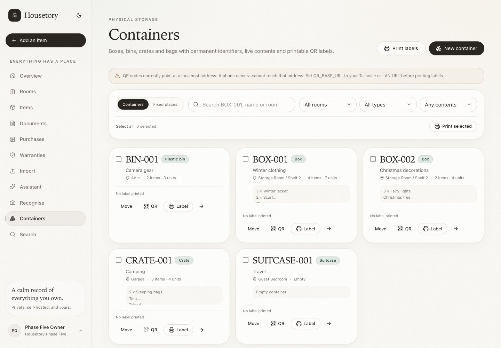 | 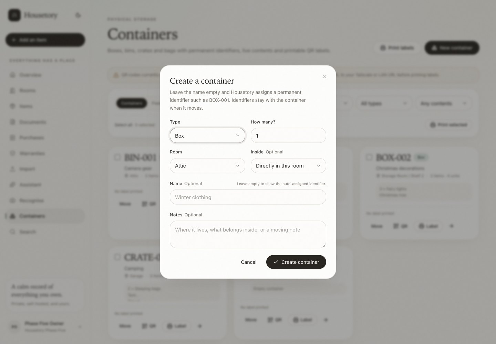 |

| Container detail and summary | Authenticated QR |
| --- | --- |
| 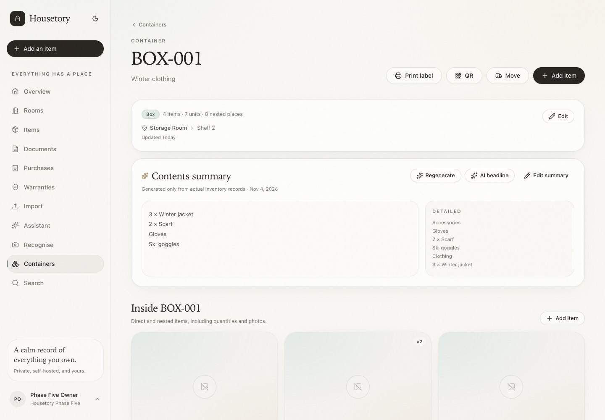 | 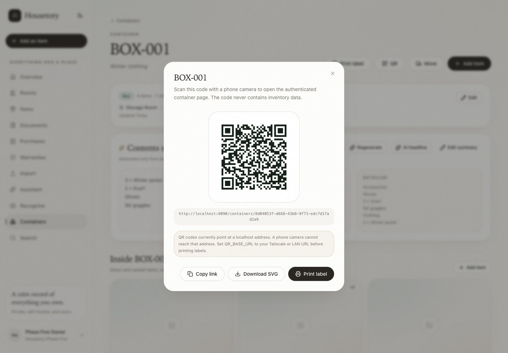 |

| Label builder | Preview, partial sheet and calibration |
| --- | --- |
| 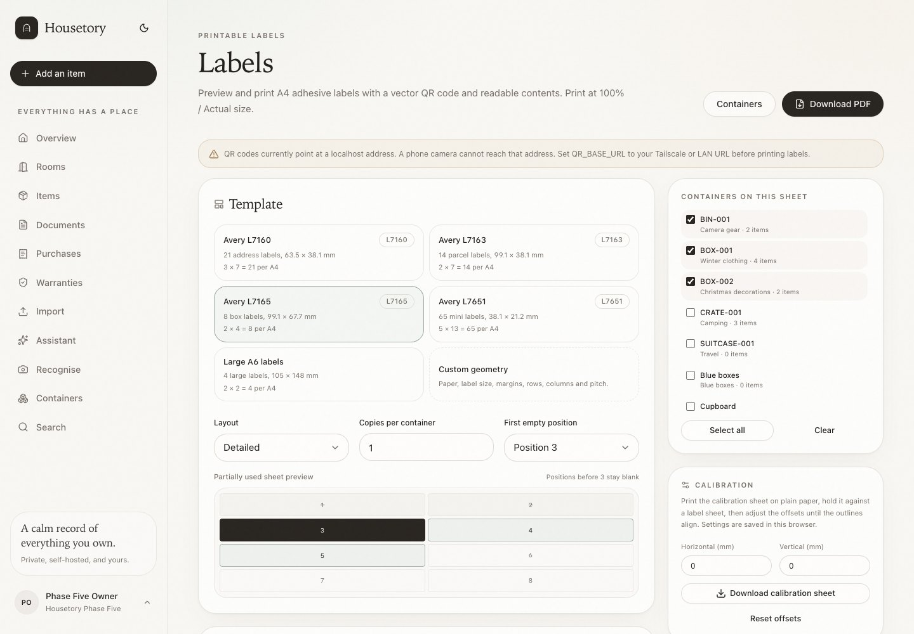 | 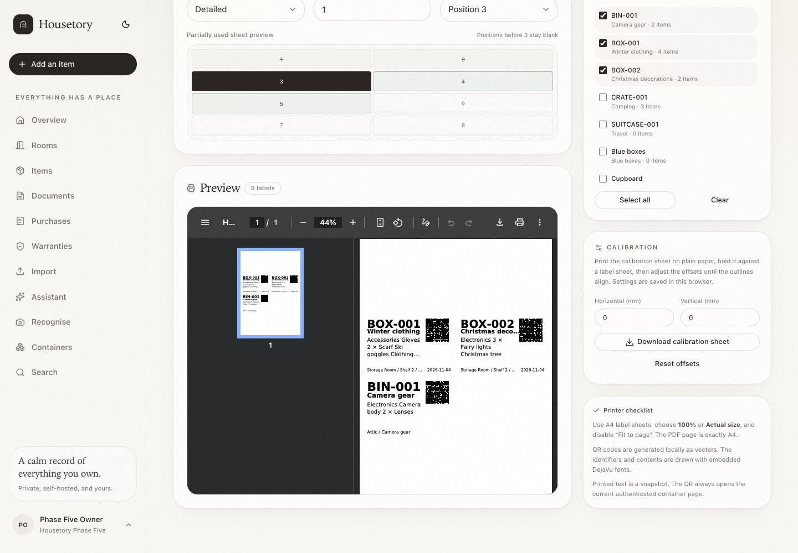 |

| Assistant container answer | Phase 4 import regression |
| --- | --- |
| 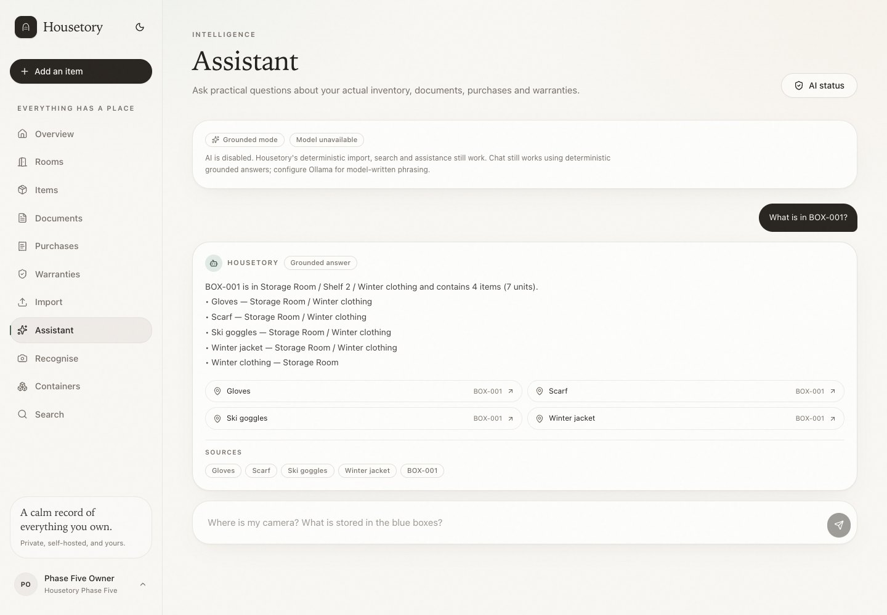 | 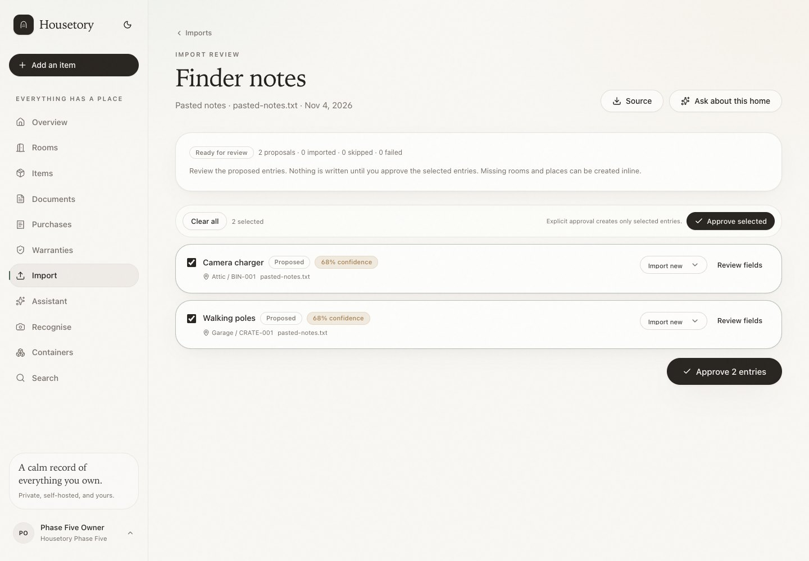 |

| Smart search | Mobile containers |
| --- | --- |
| 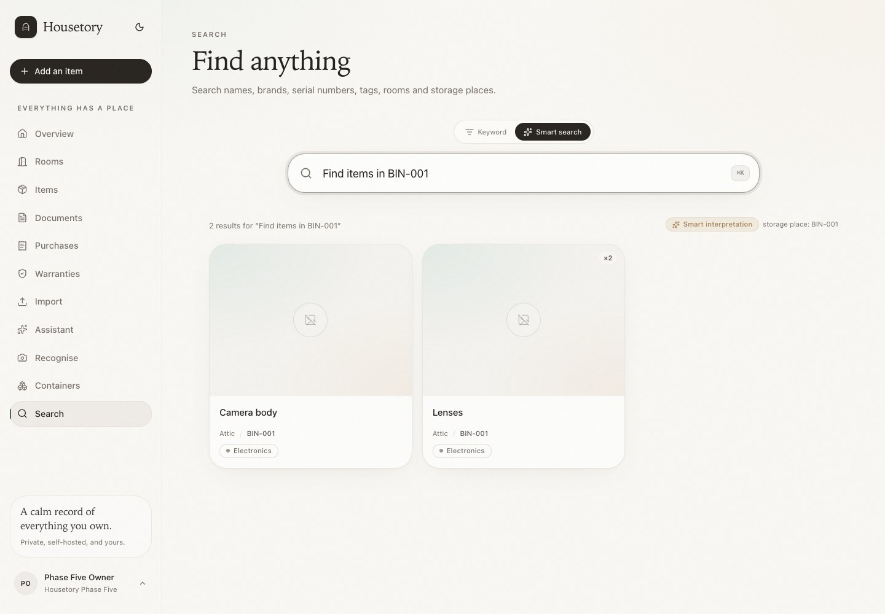 | 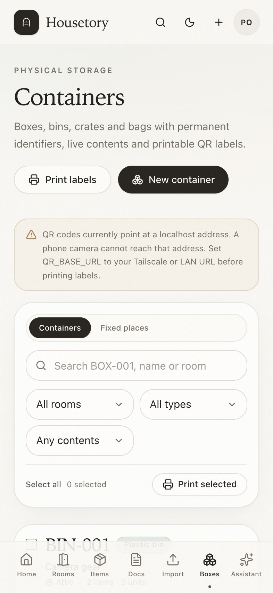 |

| Mobile container detail | Mobile labels |
| --- | --- |
| 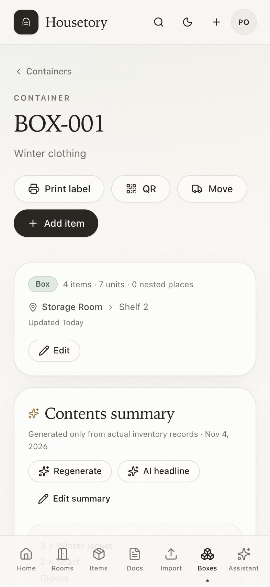 | 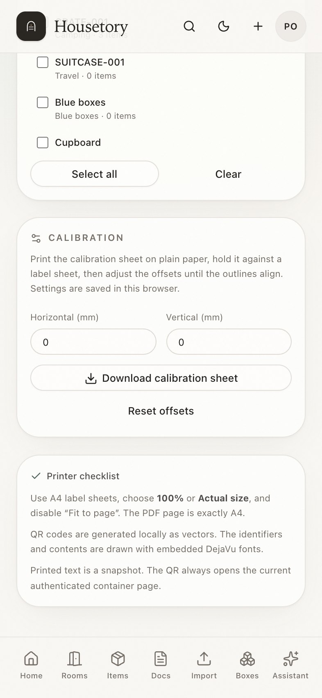 |

### Example printable PDFs

- [`example-label-sheet.pdf`](walkthrough/phase5/example-label-sheet.pdf) — two
  fictional L7165 detailed labels (`BOX-024`, `BIN-003`).
- [`example-calibration-sheet.pdf`](walkthrough/phase5/example-calibration-sheet.pdf)
  — L7165 calibration sheet.

## QR and printer verification

- QR content was decoded from a rendered PDF crop with macOS Vision; the decoded
  payload matched the expected authenticated container URL. This verifies the QR
  encoder/PDF rendering path, not a physical iPhone camera scan.
- A physical printer was not available. PDF page geometry, label coordinates,
  start-slot placement, clipping, calibration offsets and vector QR output were
  tested programmatically. Physical alignment must be checked with the
  calibration sheet at **100% / Actual size** before using expensive label
  sheets. This limitation is stated rather than claiming a printer test occurred.
- Real iPhone camera scanning was not performed because the disposable stack was
  loopback-only and printed test labels correctly warned about localhost. Set
  `QR_BASE_URL` to a Tailscale/LAN URL for real phone scanning.

## Verification

- **141 backend pytest tests** pass against PostgreSQL with the full Alembic chain.
- **25 frontend Vitest tests** pass; strict TypeScript and production build pass.
- **4 Playwright workflows** pass on the disposable stack: unnamed/bulk
  creation, cross-room movement, label preview/download/calibration and QR/mobile
  views.
- A full destructive backup/restore was rehearsed with the Phase 5 schema. After
  restore, containers, identifiers, items, counters and label generation still
  worked; the application role remained non-superuser.
- Cross-household tests cover container detail, QR, movement and label PDFs.
- Concurrent creation and movement, cycle rejection, rollback, identifier
  non-reuse, summary staleness, PDF geometry, template validation, partial sheets
  and calibration are covered by tests.

## Known limitations

- Physical printer alignment and real iPhone camera scanning remain
  environment-dependent and were not performed.
- The AI-provider path still has no installed model on this machine; AI headline
  generation was exercised with controlled outputs and deterministic fallback.
- Summaries are snapshots. They can be stale until regenerated; the UI flags this
  and the QR always opens live data.
- Custom geometry is powerful but the user must match the physical sheet; the
  calibration sheet is the safe verification step.
- There is no thermal-printer driver or Tauri/macOS packaging in this phase.
- QR access requires an authenticated Housetory session; there is intentionally no
  anonymous sharing.
- Label PDFs are generated synchronously; very large jobs are capped at 1000
  labels.
- Containers can only be moved when they are marked as containers. Fixed places
  must be explicitly converted first.
- Existing places with an already-assigned fixed identifier keep that identifier
  if converted, because identifiers are immutable.

## Recommended Phase 6

**Tauri 2 macOS desktop and further polish**, including a real Ollama benchmark on
the target hardware, physical printer/iPhone verification in the operator’s
environment, accessibility automation and visual regression tests. Advanced
organisation and multi-user sharing remain Phase 7.
