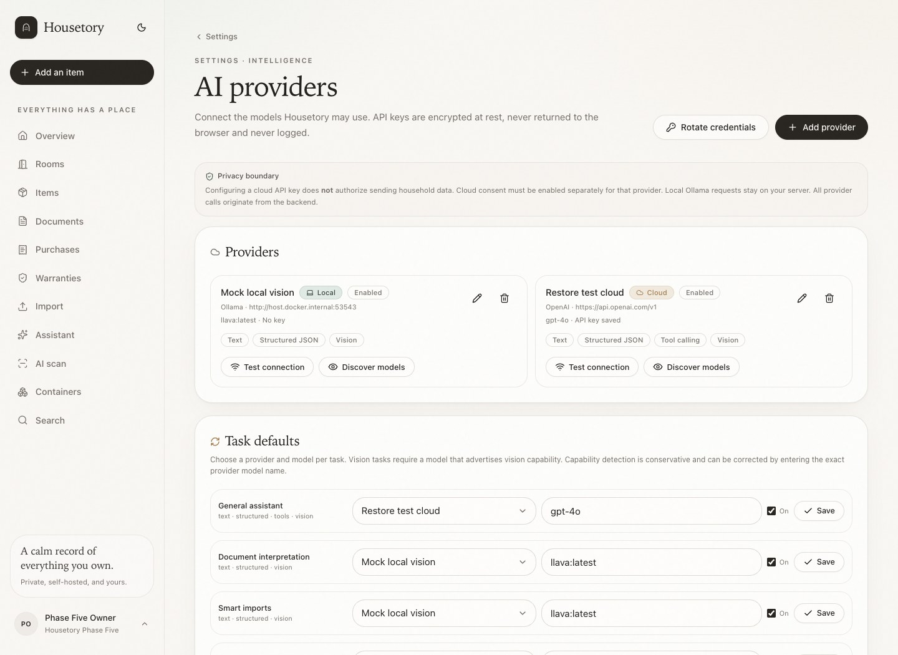
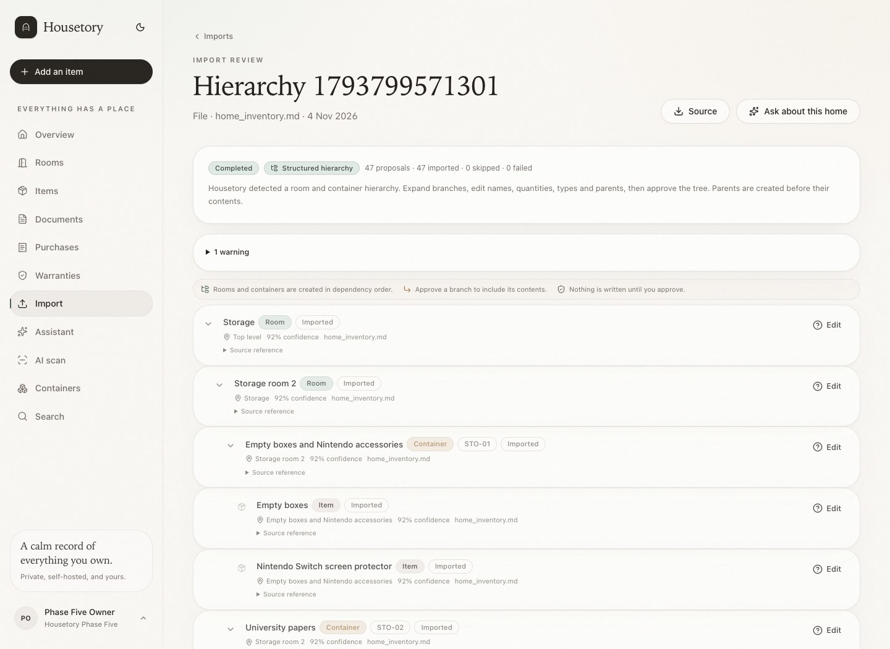
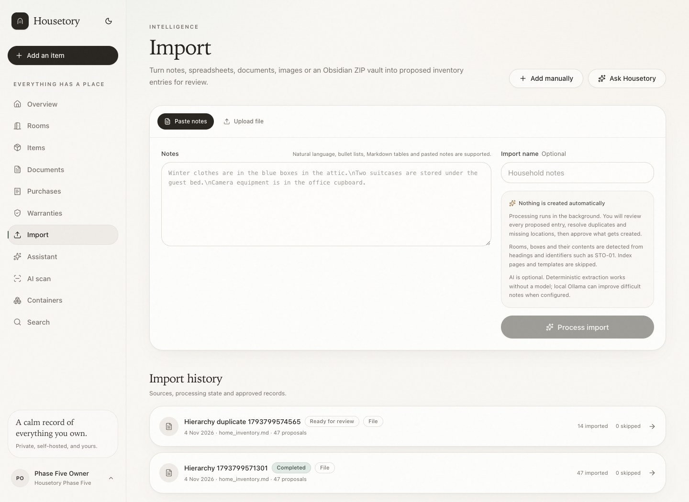
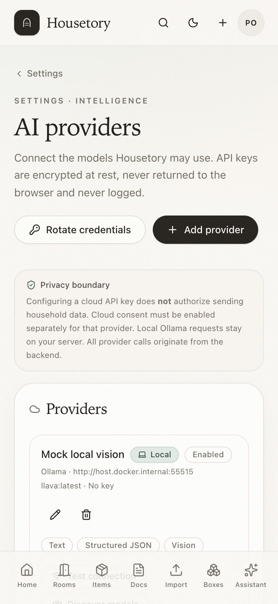

# Phase 6 — AI Intelligence, Mobile Camera & Smart Import

**Status:** Phase 6 corrections implemented and verified end-to-end on a fresh
disposable Compose stack. The unchanged actual `Inventory.md` passes upload,
paste, review, approved application and re-import. Real cloud credentials, a real
local vision model, a physical iPhone camera and a physical printer were not
available; those items are explicitly marked as unverified rather than implied.

The live household on port 8080 was not reset or redeployed during this correction
task. Verification used a separate project, separate volume names and port 8092.

## Correction pass — root causes and fixes

1. **Actual Inventory.md fell back to flat extraction.** The old parser skipped
   the entire `## Box list (template)` section because it matched “template”, so
   it discarded the real STO-01…STO-06 records. The rewritten test fixture also
   used explicit room headings that the real note does not have. The parser now
   reads the Index as reference metadata, distinguishes a box-list section
   containing real records from empty example containers, derives
   Storage → Storage room 2 from the index plus container headings, parses
   parenthesized quantities, preserves evidence in names/notes, and prunes only
   genuinely empty nodes.
2. **AI normalization accepted fabricated facts.** Existing-key-only validation
   was insufficient. Names, quantities, identifiers, entity types and container
   types are now checked against the deterministic source excerpt; unsupported
   edits are rejected, original values are retained, and reviewable warnings are
   stored. Prompt instructions are not treated as validation.
3. **Ollama was always classified as local.** Endpoint scope is now derived from
   the host: loopback/container-host is local, LAN/Tailscale/private DNS is
   private-network, and other hosts are remote. Private-network and remote
   endpoints require consent; redirects are refused and TLS verification remains
   enabled.
4. **Semantic evidence validation remained too permissive after cycle 1.**
   Quantity validation accepted any number in the source, so an age (`4 years`)
   or dimension (`~1m`) could become a count. Name validation used fuzzy
   similarity, so a fabricated close spelling could pass. Identifier validation
   used substring membership, so `STO-0` could match `STO-03`. Validation now uses
   the deterministic count parser (and never overrides an explicit deterministic
   quantity), exact content/number token preservation for names, and full
   token-boundary matching for identifiers. Document identifiers and AI search
   names use boundary/exact matching too. Unsupported edits retain the
   deterministic fact and emit review warnings.
5. **Remaining gaps closed.** Recognition suggestions have explicit merge/split
   controls with idempotent entry keys. Natural-language search and document OCR
   now use their selected task models with validated, deterministic fallback. The
   iPhone settings guidance names trusted HTTPS, LAN and optional Tailscale
   rather than presenting Tailscale as mandatory.

## 1. Implemented features

### AI provider management

- Owner-only **Settings → AI providers** page.
- Add, edit, enable, disable and remove OpenAI, Anthropic Claude, Google Gemini,
  xAI Grok, OpenRouter and Ollama providers with local, private-network or remote
  endpoints.
- API key or local endpoint, connection test and model discovery against the
  provider's official catalog API, with searchable default/task model pickers,
  display names, model kinds, capability provenance, refresh/cache behavior,
  explicit manual-ID fallback and a compact general-Settings summary that shows
  only provider/model/mode/consent plus a catalog count.
- Separate provider/model defaults for assistant, smart imports, document
  interpretation, natural-language search, image recognition and optional label
  headlines.
- Capability heuristics for text, vision, structured JSON and tool calling, with
  understandable errors when a model cannot perform the selected task.
- Provider-level remote-processing consent controls that are separate from saving
  an API key. Loopback/container-host Ollama remains local; LAN, Tailscale and
  external Ollama endpoints are private-network/remote and require consent. AI
  can be disabled per task.
- Task-aware status endpoint and processing-mode labels in the UI.
- Environment-based AI remains a bootstrap/fallback path when no database
  provider exists, preserving Phase 4 behavior.

### Credential security

- API keys are encrypted with Fernet using `AI_CREDENTIAL_KEY` supplied through
  the deployment environment, never PostgreSQL.
- `AI_CREDENTIAL_KEY_PREVIOUS` supports rotation; **Rotate credentials**
  re-encrypts existing keys. A missing or wrong key fails closed and produces a
  provider error instead of sending an unauthenticated request.
- Saved keys are never included in API responses, frontend state or logs; the UI
  only receives `has_api_key` and a key version.
- Settings mutations are owner-only. All provider calls originate in the API or
  worker, never the browser.
- Backups do not include the encryption key; the documentation states that the
  key must be backed up separately or restored credentials cannot be decrypted.

### Camera and photo management

- **Take Photo** and **Choose Photo** actions on item, room and container screens.
- Rear-camera hint where the browser supports it, with a consistent file-input
  fallback. No need to save the photo to the iPhone library first.
- Local preview with **Retake**, **Cancel** and explicit upload. Upload progress,
  validation errors and retry are surfaced.
- Item, room and storage-location photographs reuse the validated storage
  pipeline: content validation, EXIF orientation/metadata stripping, HEIC/HEIF
  normalization, WebP thumbnails, 20-photo cap and authenticated no-store file
  routes.
- Multiple photos, cover selection, earlier/later reordering, full-size viewer and
  deletion. Container movement keeps photos attached because they are linked to
  the stable location UUID.

### AI visual inventory

- **AI Scan Items** page at `/scan`, linked from assistant, items, rooms and
  containers.
- Container context defaults every suggestion to that container; destination can
  be changed per suggestion.
- A vision model can return multiple separate suggestions with name, quantity,
  description, category, visible brand/model, confidence, tags, warnings and
  field provenance.
- Suggestions are editable; users can accept/reject, create new records, update
  an existing item, allow an intentional duplicate or choose another destination.
- Suggestions can be merged with the next suggestion or split into separate
  records. Split records use stable entry keys so retrying approval is idempotent.
- Potential duplicates are shown with scores and reasons. Strong matches are
  blocked unless the user explicitly allows a new record or chooses update.
- Apply is explicit and idempotent, uses savepoints, reports partial failures,
  records `recognition_item_links` and source-photo provenance, and never uses the
  whole scan photo as every item's cover.
- Without a vision-capable model, OCR fallback suggestions are labelled as OCR and
  the UI explains the limitation. A failure offers manual entry.

### Hierarchical imports

- Removed the dedicated Obsidian tab. TXT, Markdown, CSV, XLSX, DOCX, PDF, images
  and ZIP vaults all go through **Import → Upload file**.
- Deterministic extraction runs first. A conservative hierarchy parser only
  activates when it recognizes room/container structure, so ordinary flat
  Markdown and Obsidian imports keep their Phase 4 behavior.
- Recognizes rooms, fixed locations, movable and nested containers, items,
  quantities and legacy identifiers such as `STO-01`, `STO-CABLE-01`,
  `APT-KIDS-01` and `CAR-TOOLS-01`.
- Parses the actual note’s Index as metadata and imports the real records inside
  a “Box list (template)” section, while skipping instructions, empty example
  containers and index duplicates.
- Extracts parenthesized quantities, preserves model numbers/dimensions/ages in
  names or notes, combines “Ethernet cables (7) + long ethernet cable (1)” into
  eight while retaining both source quantities, and keeps nested painting notes as
  context for the five paintings rather than creating another possession.
- Optional LLM normalization may edit only supplied keys, and every proposed name,
  quantity, identifier, entity type and container type is validated against the
  deterministic source evidence. Unsupported edits are rejected and reported.
- Tree review supports expand/collapse, inline name/quantity/type/parent/legacy-ID
  editing, source excerpts, duplicate warnings, individual selection and branch
  approval.
- Apply creates approved rooms and containers in dependency order, reuses
  matching existing records, preserves legacy labels as aliases, links items to
  their reviewed parent, reports partial failures and is idempotent.
- Legacy labels do not replace Phase 5 permanent identifiers. `STO-03` remains a
  recognized alias while the container receives a `BOX-###` identifier.

### HTTPS, nginx and PWA

- nginx remains the only public web process. PostgreSQL, API and worker remain
  internal.
- Optional `compose.tls.yaml` + `nginx.tls.conf` provide direct TLS 1.2/1.3 on
  the configurable HTTPS port (443 by default), an HTTP→HTTPS redirect on 8080
  (except `/healthz`) and the same security headers as HTTP.
- `APP_BASE_URL`, `COOKIE_SECURE=true`, Host/Origin checks, authenticated QR
  URLs, PWA assets and API routing are documented for HTTPS.
- Tailscale Serve is optional. Trusted LAN and public trusted-certificate modes
  are documented.
- PWA installation via Safari Share → Add to Home Screen; secure-context camera
  requirements are explained.

## 2. Architecture decisions

- Extended the Phase 4 AI boundary rather than replacing it. Provider-neutral
  adapters: OpenAI-compatible (OpenAI/xAI/OpenRouter/self-hosted), Anthropic
  Messages, Gemini `generateContent` and Ollama chat.
- Database-backed provider/task settings with environment fallback. Credentials
  are decrypted per request in the API/worker; configuration is never cached in
  the browser or queried directly by the client.
- Added `room_photos` and `location_photos` rather than a second image system.
  Existing item photos and storage validation remain authoritative.
- Recognition and hierarchy apply reuse existing item/container/location services
  and require explicit user approval. AI has no SQL, shell, write or tool-call
  path into inventory.
- Hierarchy parsing is deterministic-first and conservative; AI is an optional
  normalizer over validated keys, not an extractor that can add records. Every AI
  edit is checked against source evidence before it can reach review.
- Ollama endpoint scope is derived from the URL host rather than provider type.
  Provider requests do not follow redirects, preventing a local endpoint from
  silently forwarding content to an unconsented remote host.
- TLS is an opt-in Compose overlay. The HTTP deployment remains valid for
  localhost, private networks and Tailscale Serve.

## 3. Database migration

Append-only Alembic revision:

`c1a7e5d9f320_ai_providers_photos_hierarchy.py`

Adds:

- `ai_providers` with household/provider uniqueness, encrypted key, key version,
  enabled state and remote-processing consent.
- `ai_task_settings` keyed by household and task.
- `room_photos` and `location_photos`.
- `storage_locations.legacy_identifier` and `aliases`, with a lookup index.
- Import hierarchy fields: `entity_type`, `parent_entry_id`, `created_room_id`,
  `created_location_id`, `legacy_identifier`.
- Recognition destination/mode/apply fields and `recognition_item_links`.
- Required index/type alignment for the new model.

`alembic upgrade head` and `alembic check` pass on a fresh PostgreSQL database.
No earlier migration was rewritten and no live data was reset.

## 4. Supported AI providers

| Provider | Adapter | API key | Model discovery |
| --- | --- | --- | --- |
| OpenAI | OpenAI-compatible chat/completions | Yes | `GET /models` |
| Anthropic Claude | Messages API | Yes (`x-api-key`) | `GET /models` |
| Google Gemini | `generateContent` | Yes (query key) | `GET /models` |
| xAI Grok | OpenAI-compatible | Yes | `GET /models` |
| OpenRouter | OpenAI-compatible | Yes | `GET /models` |
| Ollama | Native `/api/chat` and `/api/tags` | Optional | `GET /api/tags` |

No model catalog is hardcoded as the only option; users can enter an exact
model name. Vision formats are provider-specific (OpenAI image URL, Anthropic
base64 image blocks, Gemini inline data, Ollama images array).

## 5. Credential storage and security

- Fernet token format `fernet:v1:<token>`; key must decode to 32 bytes.
- Save, replace, clear and rotate are owner-only operations.
- `AI_CREDENTIAL_KEY_PREVIOUS` is tried after the current key during rotation.
- Decryption failure returns a provider configuration error and prevents the
  call; it does not silently fall back to cloud or local processing.
- Provider keys are write-only from the client's perspective.
- Provider/model errors are bounded and do not include request headers or keys.
- Credential rotation test verifies re-encryption and key-version increment.
- Backup documentation calls out the key as a separate secret.

## 6. Model selection and capabilities

Capabilities are conservative heuristics based on provider and model name:
`text`, `vision`, `structured`, `tools`. The UI displays them and the API rejects
assigning a non-vision model to the vision task. Capability detection is not
presented as a substitute for a real provider test; connection and model
availability are checked through the provider's API.

The search task is connected to natural-language filter interpretation with
allowed room/location/category/tag names and deterministic fallback. The document
task is connected to OCR metadata normalization; merchant/product/brand/model/
invoice/serial changes must appear in OCR text, while date/total/currency changes
are rejected unless unchanged. Unsupported edits remain deterministic and are
reported. The UI shows whether processing was deterministic, local, private or
remote.

## 7. Camera capture behavior

Verified in desktop Chromium with a file-input capture path: camera action,
preview, retake, cancel, upload progress and successful photo display. Room and
container photo managers likewise upload, select covers, reorder and delete.
iPhone Safari and installed-PWA camera behavior were not physically tested.

## 8. Multi-object recognition results

Controlled local Ollama response returned two suggestions from one image:
`Camera body` and `USB-C cables ×3`. The UI showed local processing, confidence,
editable fields, destination defaulted to the container, and duplicate review.
Approval created two records in the container with the correct quantity. A retry
did not create duplicates. Split and merge controls were exercised: two entries
for the same source suggestion used stable keys and were idempotent, while merged
suggestions produced one reviewed record. The item detail confirmed the scan image
was not automatically attached as an item cover. The E2E run used unique names per
run to avoid collisions with prior disposable data.

This validates the adapter/schema/review/apply path, **not** real model accuracy.
No real vision model was installed or benchmarked.

## 9. Hierarchical import results for the actual Inventory.md

The unchanged source (`sha256 9443d010bc4ac62d2d03ef13ba0183c4872a4ee6f075852c1895db97144292d4`)
produced:

- 8 nodes: Storage, Storage room 2 and STO-01…STO-06.
- 52 item entries.
- STO-01 ×2, STO-02 ×4, STO-03 ×16, STO-04 ×5, STO-05 ×6 and STO-06 ×19.
- STO-06 flagged as an ambiguous loose-items group at confidence 45.
- Keyboards (incl. Dell keyboard) ×2; toner ×3; MagSafe 2 cable; Compact 5V
  adapter; PS5 empty box; Long wood pieces (~1m) ×10; Persian carpet (6 m²);
  Child car seat (up to 4 years).
- Ethernet cables (7) + long ethernet cable (1) → one reviewed item with quantity
  8 and both source quantities retained in notes.
- Wall-hanging paintings (5 total) (3 + 2) → quantity 5, with the nested
  “Includes 2 wall-hanging paintings…” note attached as context rather than a new
  item.
- The populated `## Box list (template)` records were imported; empty
  STO-KITCH-01, STO-CABLE-01, STO-TOOLS-01, APT-KIDS-01 and CAR-TOOLS-01 examples
  were skipped.
- No Apartment or Car rooms/containers were invented; no index/legend/instruction
  content became an item; no purchases were created.
- Legacy labels were preserved as aliases while containers received permanent
  `BOX-###` identifiers.

Both upload and paste paths produced the same 8/52 hierarchy with AI disabled.
Approved application persisted `Storage room 2` under `Storage`, all six
containers under that room, and item quantities/locations correctly. Replaying
the same batch skipped all 60 entries without new items. Re-importing the same
source flagged duplicates; default decisions skipped the existing items, and an
explicit duplicate attempt was blocked.

## 10. Markdown regression verification

`tests/fixtures/home_inventory_actual.md` is a byte-for-byte copy of the real
source. Backend tests assert the exact 8-node/52-item structure, quantities,
preserved numbers, nested context, exclusions, parent relationships, approved
apply, partial-approval dependency, duplicate guard, retry idempotency and
unsupported-AI-edit rejection. Playwright performs upload, tree review, approval
and re-import through the real UI/API on a fresh disposable household.

The earlier rewritten fixture remains as a generic nested-room regression test,
but it is no longer the acceptance fixture.

## 11. Phase 5 integration

- Hierarchy apply uses Phase 5 container creation and permanent identifiers.
- Legacy IDs become aliases; no internal identifier is overwritten.
- Container-scoped scan defaults to that container and respects it after apply.
- Container detail links to **Scan contents**.
- Photo associations survive moves because they use the location UUID.
- Phase 5 Playwright container/move/label/QR tests still pass in the same run as
  the Phase 6 suite.

## 12. HTTPS/PWA verification

- Direct TLS stack: `compose.yaml` + `compose.tls.yaml`, self-signed
  localhost certificate, ports 80/443.
- HTTP returns `301 https://localhost/`.
- HTTPS returns HTTP/2, HSTS, CSP, `nosniff`, COOP/CORP and camera Permissions
  Policy.
- Authentication, secure cookies, deep links, manifest, service worker
  registration and mobile-width AI settings rendered successfully through
  `https://localhost`.
- The self-signed certificate required Playwright’s test-only certificate bypass.
  A real trusted certificate is required for real iPhone camera/PWA confidence.

## 13. Test results

- Backend: **182 pytest tests** passed against PostgreSQL with the full migration
  chain and `alembic check` clean.
- Frontend: **62 Vitest tests** passed; strict TypeScript and production build
  passed.
- Playwright: **11 workflows** passed on a fresh disposable stack at a separate
  project, volume names and port. Coverage includes Phase 5 regressions, provider
  configuration with a mocked local Ollama service, camera upload, multi-object
  review/split/merge/approval, the actual Inventory.md hierarchy, duplicate
  prevention, PWA routing, desktop/mobile quick search and the unified Add items
  chooser with contextual destinations and import-history access.
- Ruff checks passed for API and tests.

## 14. Security scans

- Production `pip-audit`: **no known vulnerabilities**.
- `npm audit --omit=dev` and full `npm audit`: **0 vulnerabilities**.
- Trivy HIGH/CRITICAL vulnerability scans: **0 findings** in the API, worker, web
  and database images after upgrading `cryptography` to 50.0.2.
- Ruff, strict TypeScript and production build pass.
- Live database role inspection confirms the API/worker role is not superuser
  and cannot create roles or databases.
- No real provider credentials or consumer account tokens were used.

## 15. Real-model versus mocked testing

Mocked/test-controlled:

- Ollama model discovery and chat responses.
- Multi-object suggestion content.
- Optional hierarchy normalization output, including fabricated-edit rejection.
- Search and document AI normalization responses.
- AI provider connection test via a local Node HTTP service.

Real:

- Backend HTTP requests to the mock official-format Ollama endpoint.
- PostgreSQL persistence and encryption/decryption.
- Actual file upload, image validation, thumbnail generation and authenticated
  retrieval.
- Actual hierarchy parsing/apply, database relationships and duplicate checks.
- Actual nginx HTTP/TLS proxying and browser service-worker registration.

Not real:

- Cloud provider account credentials, rate limits or model quality.
- Real semantic quality of AI search/document/hierarchy normalization.
- A real local vision model's recognition accuracy.
- A physical iPhone camera, installed-home-screen PWA or printer.

### Screenshots

| AI providers | Hierarchical import review |
| --- | --- |
|  |  |

| Upload file without an Obsidian tab | Mobile AI settings |
| --- | --- |
|  |  |

## 16. Desktop/iPhone walkthrough

Desktop Chromium completed provider setup, camera preview/upload, scan review,
bulk approval, hierarchy tree review/apply and duplicate review with no failed
test steps. A 393×852 mobile context verified the AI settings page, scan layout,
container and label views. Real Safari/iPhone hardware was unavailable.

### Troubleshooting

- **Provider test fails:** confirm the base URL is an absolute `http(s)` URL,
  the model name exactly matches the provider's model list, and the API key is
  current. Loopback/container-host Ollama needs no remote consent; LAN, Tailscale
  and external endpoints do. The API/worker must be able to reach the endpoint.
- **The provider dialog clips fields or actions:** the dialog is width-constrained
  with wrapped fields and wrapping footer actions. Long model IDs, endpoints and
  consent text wrap or truncate with the full value available in the input/title.
  The model list scrolls independently; resizing or opening discovery does not
  force the dialog wider than the viewport.
- **Escape closes the provider dialog while the model list is open:** the first
  Escape closes only the model list and preserves the dialog input; a second
  Escape closes the provider dialog deliberately.
- **No models appear after saving a provider:** confirm the key or local
  endpoint is valid, then use **Refresh models**. Discovery requests only catalog
  metadata and does not require household-data consent. If a private/custom model
  is absent, type its exact ID and press Enter; discovery can be retried later
  without clearing the saved selection.
- **A model capability looks uncertain:** capabilities marked “Heuristic —
  verify” are inferred from the provider/model name, not proven by listing the
  model. Prefer a model whose provider metadata or a real test confirms the task.
- **General Settings says “Model not listed” while a model is selected:** the
  status check compares the saved task model against the provider's exact catalog
  IDs. A readable label such as “GPT-6 Luna” is not necessarily the API model ID
  (for example `~openai/gpt-luna-latest`). Open **Manage AI providers**, choose
  the task model from the discovered picker, and save. General Settings never
  prints the full catalog and does not send an inference prompt to verify access.
- **An AI-proposed item edit disappeared:** it did not match the source evidence.
  The deterministic value is retained and the import warnings list the rejected
  edit for review.
- **Ollama is shown as private-network or remote:** that is intentional when the
  host is not loopback/container-host. Enable consent or move the endpoint to the
  server/Docker host.
- **Saved credential cannot be decrypted:** restore the matching
  `AI_CREDENTIAL_KEY`, or set it as `AI_CREDENTIAL_KEY_PREVIOUS` together with a
  new key, restart API/worker, rotate, verify, then remove the previous key.
- **No camera action works:** camera APIs require a secure context. Use
  `https://` or localhost, allow camera permission, and in an installed PWA check
  iOS Settings → Housetory → Camera. The Choose Photo path remains available if
  `capture` is unsupported.
- **Scan shows OCR fallback:** assign a vision-capable model to the vision task
  in Settings → AI providers. OCR does not provide reliable object recognition.
- **Hierarchy tree is not shown:** the source lacked recognizable room/container
  structure or item bullets, so the normal flat import review was used. Add
  headings or legacy identifiers for the tree mode.
- **A hierarchy apply reports a duplicate:** review the existing match, choose
  skip/merge, or explicitly tick “Create a separate item anyway”. Default
  decisions never overwrite or duplicate silently.
- **PWA/service worker does not register over HTTPS:** use a trusted certificate;
  a self-signed certificate may allow page navigation but still block secure
  service-worker/camera features in Safari.
- **ZIP upload is rejected:** archives are limited by `IMPORT_MAX_FILES`,
  decompressed size and per-file size; encrypted entries, traversal paths and
  symlinks are rejected.

## 17. Known limitations and remaining risks

- Real cloud/local-model quality, latency and context-window behavior are
  unmeasured. Mocked tests validate contracts, not accuracy.
- No real iPhone camera/PWA test; secure-context and permission behavior must be
  confirmed on the device.
- No physical printer or QR scan test.
- Hierarchy AI normalization is intentionally conservative; ambiguous headings
  may need manual review.
- An operator who loses `AI_CREDENTIAL_KEY` must replace saved provider keys.
- Direct TLS requires correctly permissioned certificate/key files and a trusted
  certificate for real secure-context features.
- Public deployment still relies on first-run setup being claimed immediately,
  rate limiting, strong credentials and host patching. No WAF, MFA or external
  identity provider is implemented.
- Firefox/Safari camera `capture` hints vary; the UI falls back to normal file
  selection and still accepts uploads.

## 18. Recommended Phase 7 scope

Tauri 2 macOS desktop, followed by real-model benchmarks, physical iPhone
camera/PWA validation, accessibility automation and visual regression testing. Advanced organisation (custom fields, taxonomy UI
and multi-user sharing) should follow.
