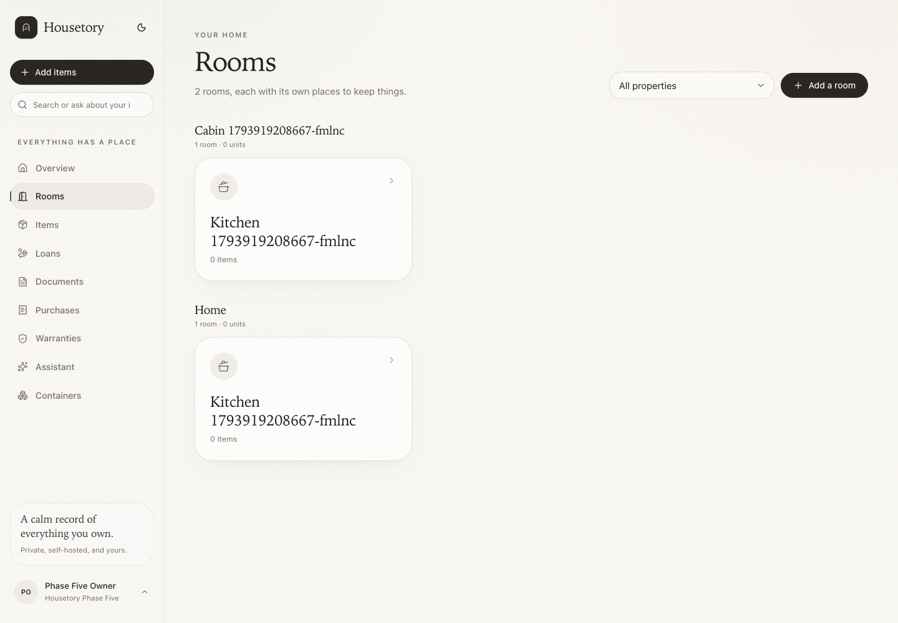
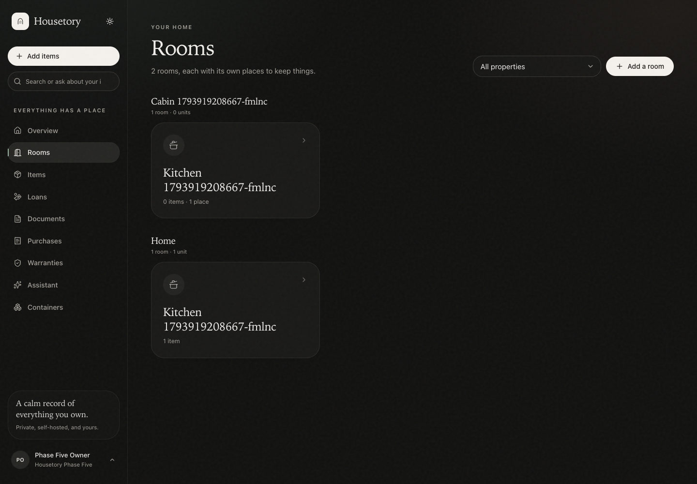
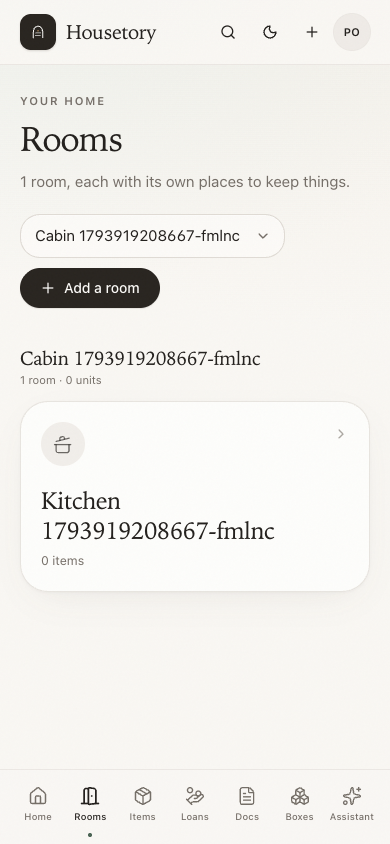
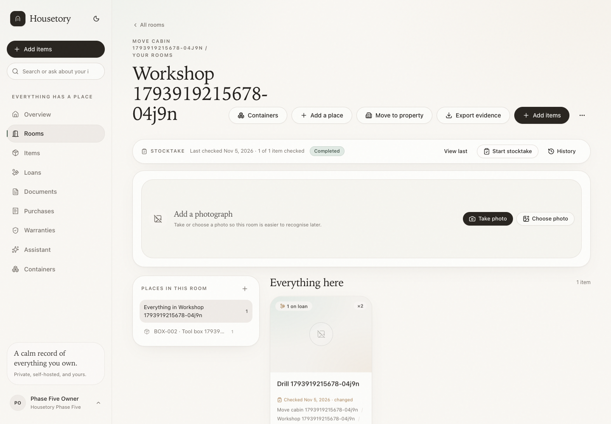
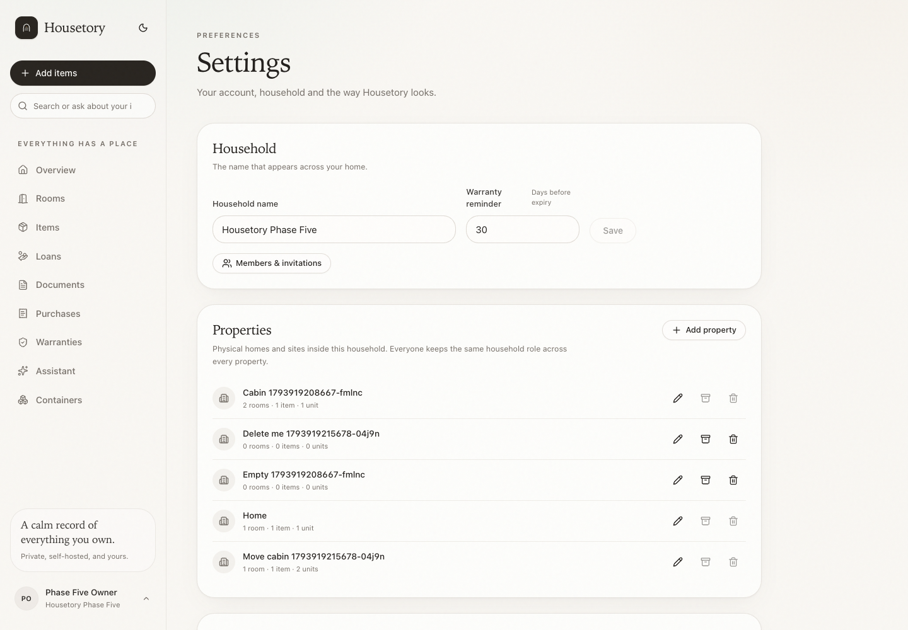

# Properties within one household

Properties are physical homes or sites inside a single household: the main home,
a summer house, a storage unit. They are an inventory grouping, **not** a new
permission boundary. The household remains the membership and security boundary,
and every member keeps the same role across all of its properties.

## Hierarchy

```text
Household
  Property
    Room (existing nested room tree)
      Fixed place / container (existing storage-location tree)
        Item
```

`rooms.property_id` is the authoritative property link. Storage locations derive
their property through their room; items derive it through their recorded room
and, for legacy rows, their storage location's room. There is no second editable
property field on items or containers that could drift out of sync.

Unlocated items remain explicitly unlocated: they appear under “All properties”
but are not assigned to a property just because one exists. The item form shows
“No property / unlocated” and requires choosing a property only when placing the
item into that property's rooms.

## Migration and initial property

The append-only migration:

1. creates one `Home` property for every existing household;
2. adds `rooms.property_id` and assigns every existing room to that household's
   initial property;
3. preserves every room, container, item, photo, document, loan, purchase,
   import, stocktake and QR identifier/UUID;
4. does not change `items.updated_at`, so existing last-checked state is not
   silently invalidated by the backfill;
5. creates one property per household, independent of any fixed UUID, so an
   existing multi-household database is supported;
6. does not rewrite historical activity snapshots to pretend a property was
   recorded at the time.

New households created through first-run setup get a `Home` property too. A
room-creation request may omit `property_id` only when the household has exactly
one active property; otherwise the caller must choose one explicitly.

## Property management

- **Settings → Properties** lists active and archived properties with room,
  item and unit counts.
- Owners and members can create, rename, describe, archive/restore and delete
  properties under the existing household write rules.
- Viewers can read properties and all property-scoped inventory but cannot mutate
  them.
- A populated property cannot be archived or deleted. Move its rooms to another
  property, or delete the rooms/items through the normal reviewed flows first.
  The API enforces this independently of the UI.
- Archived properties are excluded from the default property selector. They can
  be restored from Settings.
- Property names are unique within a household (case-insensitive validation).

Property deletion never cascades to rooms/items. The database foreign key is
`ON DELETE RESTRICT`, and the service checks content counts under the household
hierarchy lock before archiving or deleting.

## Room creation, nesting and same names

- Creating a top-level room needs an explicit property when more than one active
  property exists; the selected property is remembered by the current filter.
- A nested room inherits its parent's property. Supplying a different property
  is rejected with `room_property_mismatch`.
- Room-name uniqueness is scoped by property and parent. Two properties may both
  have a `Kitchen`; they are distinct rooms with distinct IDs.
- Parent/child property consistency is enforced by both application validation
  and a composite database foreign key.

### Cross-property room subtree move

A **top-level** room can be moved to another active property from the room page.
The flow is explicit:

1. preview the source/destination properties and affected rooms, places, items,
   units and on-loan units;
2. confirm with a review fingerprint and request ID;
3. move the entire room subtree in one transaction.

The move keeps all room, container, item, photo, document and QR IDs. It updates
the property path for every affected room, but does not change item quantities,
loan status or availability. Items' `updated_at` is advanced so prior
last-checked dates correctly show **changed since** rather than claiming the item
is still verified at its old property path. The history event is `room.moved`;
generic undo is intentionally not offered for a property/subtree move.

A nested room cannot be moved on its own because that would break its parent
relationship. Move the top-level room, or detach it explicitly first. A room
whose name already exists at the top level of the destination property is
blocked until one is renamed.

## Containers and bulk moves

Existing container moves can target a room in another property. They preserve
the container ID, permanent identifier and QR payload, update affected items'
room/property path and record history with source/destination property names.
Partial loans remain outstanding exactly as before; moving the usual home does
not record a return.

Bulk item moves use the same destination model. The destination path and on-loan
unit count are shown in the existing reviewed bulk flow. Historical move events
from before this milestone have no property fields and remain valid historical
snapshots; new events include property snapshots.

## Filters and scope

- Rooms, items and containers have an **All properties** selector. It is the
  default when no remembered selection exists.
- A selected property is remembered in local storage and reflected in the URL
  (`property_id`), so refresh/back navigation retains it. Choosing All clears it.
- Changing property clears room/location filters and any loaded bulk selection so
  a hidden selection cannot be applied to another property.
- Property filters are enforced server-side for room, item and container list
  routes. They are not frontend-only.
- The global quick search, search page, assistant and current-home evidence
  export default to all properties in the household and label property paths.
  A deliberately selected browse filter does not silently rewrite every search
  or assistant query.
- Property paths are shown as `Property / Room / Place` in item cards/details,
  container detail, search results, evidence PDF/CSV/manifest, stocktake
  snapshots and assistant location wording.

## Imports, voice, scans and document extraction

- Imports carry an explicit property context. Room/container matching is scoped
  to that property, and hierarchy-created rooms inherit it. With multiple
  properties and no chosen context, creation requires a property rather than
  guessing.
- Voice notes store their default property (derived from the room context or
  explicitly selected). Spoken room matching is scoped to it. The same room name
  appearing in two properties is reported as ambiguous, so the user chooses
  rather than the backend silently picking one.
- Photo recognition and document extraction continue to use existing room/
  location choices, whose labels include the property and whose saves validate
  that room and container belong together. Those flows can still deliberately
  create an unlocated item if the user chooses no room.
- Documents, purchases and manuals remain household-owned and can relate to
  items across properties; the property layer does not duplicate or hide shared
  evidence.

## Counts, reports and exports

- Household overview, financial and ownership totals remain household-wide and
  are not multiplied by properties. Shared purchase totals are counted once,
  exactly as before.
- Property filters only narrow room/item/container browsing. They do not create
  property-specific currencies or purchase ownership.
- Evidence exports include `property_id`/`property_name` on items and add them to
  the CSV and manifest, while `full_location_path` now starts with the property.
  Scope is still item/room/container/current-home based; “Current home” becomes
  “All properties” when more than one active property exists.
- Stocktake sessions started from a room/container include the property in the
  scope label and snapshot paths. Existing sessions and historical last-checked
  paths are not rewritten.

## QR and deep links

QR payloads remain `/containers/{container_id}`. Old printed labels and old deep
links continue to resolve the same container record and now show its current
property path. No new public or unauthenticated link is introduced. If a
container or room moves property, the URL/identifier stays stable.

## Limits and unsupported behavior

- Property-specific permissions are intentionally not implemented; household
  roles apply across every property.
- There is no property-only stocktake or property-only evidence endpoint yet;
  choose rooms/containers that belong to the property.
- Cross-property moves are explicit and currently supported for top-level room
  subtrees, containers and bulk item moves. Nested-only room property moves are
  rejected with a clear warning.
- Archiving/deleting a populated property is rejected rather than cascading.
- Unlocated legacy items are listed but are not silently assigned to the initial
  property.
- Property lists are household-scoped and bounded by the household's data; all
  move/apply batches retain their existing limits and household locks.

## Verification

- Backend tests cover initial-property backfill for multiple households, stable
  IDs/timestamps, unlocated records, property CRUD/archive/delete guards,
  duplicate room names across properties, parent-property constraints, room
  subtree preview/apply with QR/loan/last-checked stale behavior, container and
  bulk moves, property filters in search/stocktake/evidence/assistant, import
  and voice property scoping/ambiguity, viewer write rejection and cross-
  household IDOR checks.
- Vitest tests cover property management guards and the room-subtree move
  preview/confirmation dialog.
- Disposable-stack Playwright workflows cover two same-named rooms in different
  properties, remembered property filters, add-item/container context,
  cross-property room move with preserved IDs/QR/loans and populated-property
  archive/delete guards.

Screenshots:











Final verification: **307 PostgreSQL backend tests**, **132 Vitest tests** and
**39 disposable-stack Playwright workflows** pass. Ruff, strict TypeScript
typecheck, production build and Alembic drift checks pass. Local backup
`backups/housetory-20261105T223653Z` includes database, uploads, imports and the
separate exports volume; migration `f1a3c5e7b9d2` preserved room/container/item
ID hashes and item `updated_at` hashes.
