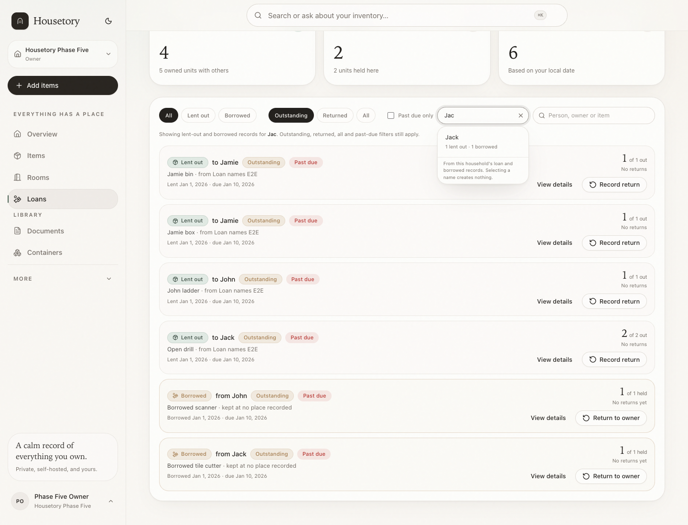
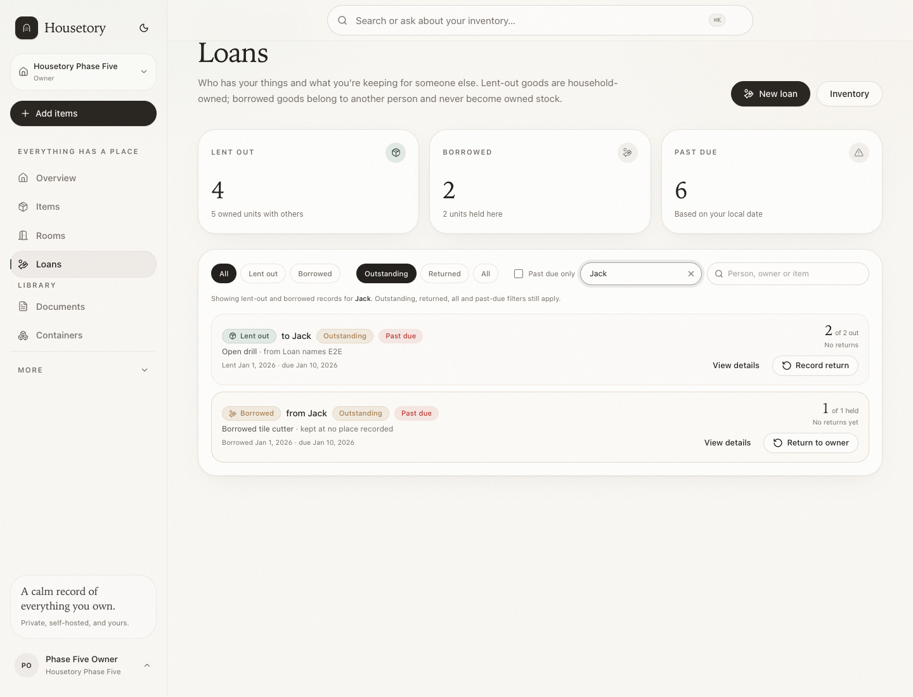
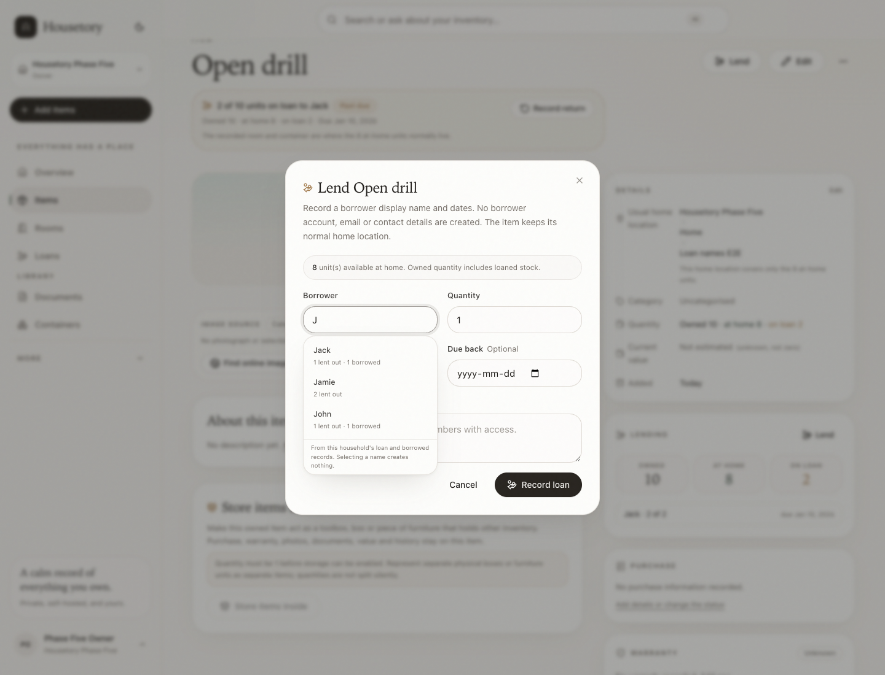
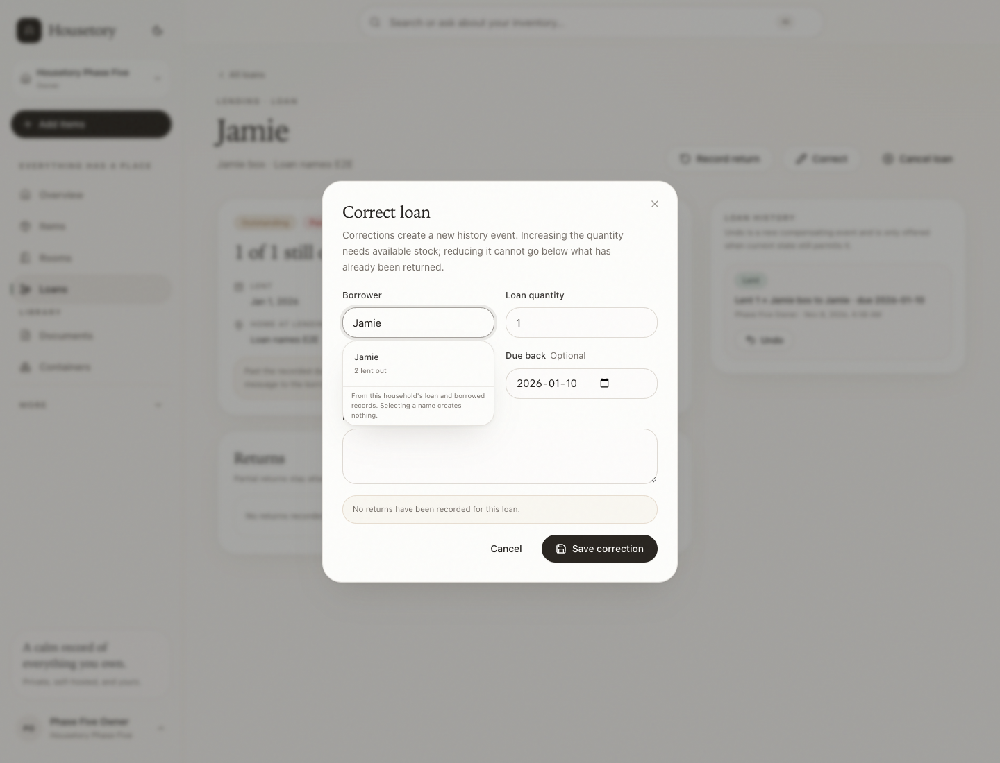
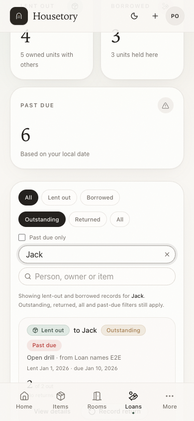
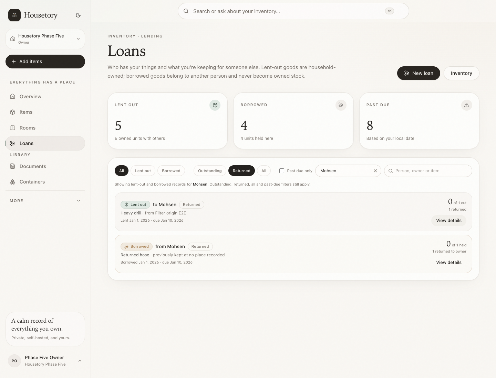
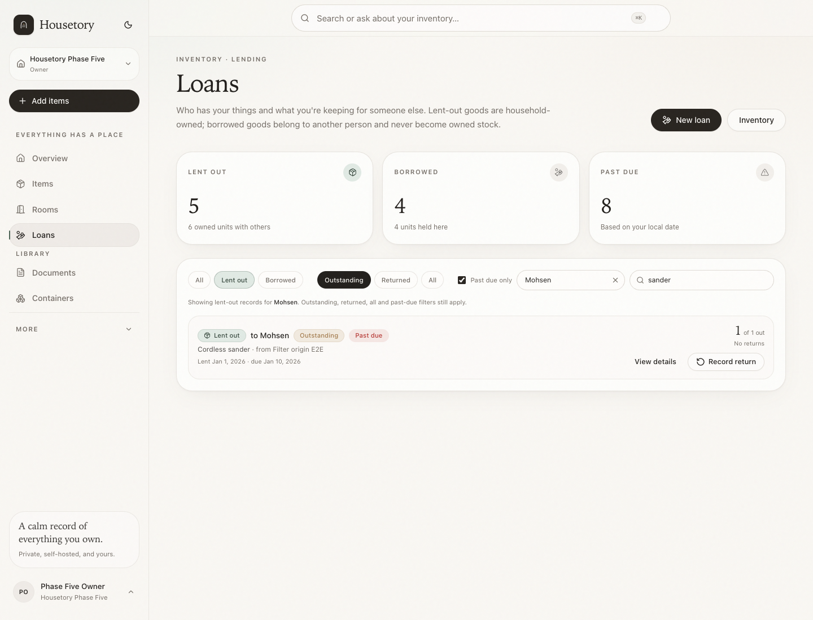

# Simple loan names and person filters

This batch makes borrower/lender names faster to enter and easier to filter
without turning them into people, contacts or accounts. Names remain display
values stored on each individual loan or borrowed record.

## Name suggestions

Borrower and owner-name inputs now share one household-scoped autocomplete
control on:

- item-detail **Lend**;
- **New loan → Lend out an item** (including contents-included lending);
- **New loan → Borrow from someone**;
- individual loan and borrowed-record **Correct** dialogs;
- the Loans-page person filter.

Suggestions come only from existing `loans.borrower_name` and
`borrowed_records.owner_name` values in the current household. The endpoint
returns no cross-household data and is unavailable to anonymous callers. Viewers
can use suggestions because they can already read the household's lending
records; only owner/member write controls create or correct records.

Typing `J` can suggest an existing `Jack` with compact counts such as
`1 lent out · 1 borrowed`. Selecting a suggestion only fills the input. Typing a
new name directly is always allowed. A new name is persisted only when the loan
or borrowed contract is saved; cancelling creates nothing and never leaves a
phantom suggestion. Cancelled-only names are excluded from suggestions, though an
explicit filter can still find their historical records.

The control supports pointer selection, Arrow Up/Down, Enter, Escape and Tab, and
uses combobox/listbox ARIA semantics. It is usable at 390px without horizontal
overflow.

## Name comparison and preservation

Comparison uses trimmed, NFKC-normalised, case-folded keys with conservative
Arabic/Persian letter normalisation (for example Arabic/Persian yeh and kaf
variants). This groups casing and common Persian spelling variants for duplicate
counts and filters without rewriting the stored display name. There is no fuzzy
identity merge: different non-equivalent names remain separate suggestions.

Editing a borrower or lender on one contract updates that record only. Other
contracts with the same old name are unchanged, and history keeps the existing
actor snapshots and before/after contract details. Grouping and filters simply
read the current stored names.

## Loans-page person filter and history

A single **Filter by person** input sits beside the existing direction and
Outstanding/Returned/All/past-due controls. There is no People tab and no new
directory page. Selecting or typing a person:

- filters both lent-out (`borrower_name`) and borrowed-in (`owner_name`) records;
- keeps the existing direction badges and All / Lent out / Borrowed views;
- composes with Outstanding, Returned, All, past-due, item scope and text search;
- stays in the URL as `?person=…`, so reload and the existing detail back link
  return to the filtered view.

Status (`status=outstanding|returned|all`), direction
(`direction=lent_out|borrowed`), past-due (`overdue=1`), text search (`q`) and
item scope (`item_id`) use the same URL state. Defaults stay out of the URL, so
plain `/loans` and existing item deep links keep their established behaviour.
Changing one tab or checkbox preserves every other parameter. Both lent-out and
borrowed **View details** links carry the exact composed origin; the **All loans**
back link and browser Back restore the same status, direction, person, text,
past-due and item-scope view. Editing or returning on the detail page does not
reset that origin.

An exact normalised name wins over a longer prefix (`Jack` does not absorb
`Jackie`). Without an exact match, prefix matches are shown. Returned history is
available through the existing Returned/All filters, with partial quantities,
availability, due dates and returns unchanged.

## Verification

- 469 PostgreSQL backend tests pass, including both-direction counts, direct
  new-name save, cancellation without a phantom, exact/prefix filters, Unicode
  variants, per-record corrections, returned/partial history, household/role
  scoping and unchanged audit actors.
- 236 Vitest tests pass; strict TypeScript typecheck and production build pass.
- Focused disposable-stack Playwright workflows pass: the existing borrowed-item
  and lending suites plus the new name/filter workflows. The browser run covers
  J→Jack selection, direct typing, cancel-without-create, both directions,
  returned/past-due composition, per-contract rename, keyboard selection, 390px
  layout, URL/back preservation, the returned-person detail round trip and
  borrowed/past-due/text composition.
- No paid inference calls, real credentials or real inventory records were used.

## Screenshots

## Limits

- No People page, contact management, merge UI, borrower accounts, emails or
  reminders.
- Names are not global identities; identical display names can still represent
  different people, and the app does not guess otherwise.
- No bulk rename. Corrections are explicit per contract.
- Suggestions are read-only and never create a person or record.
