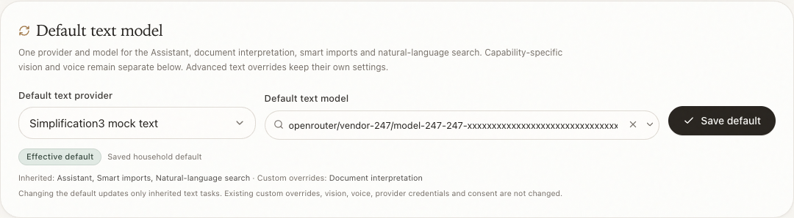
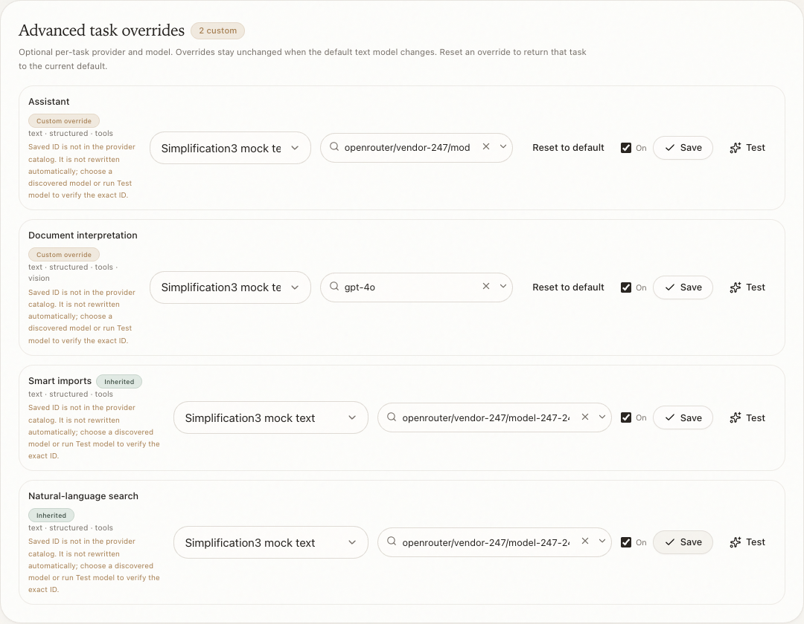
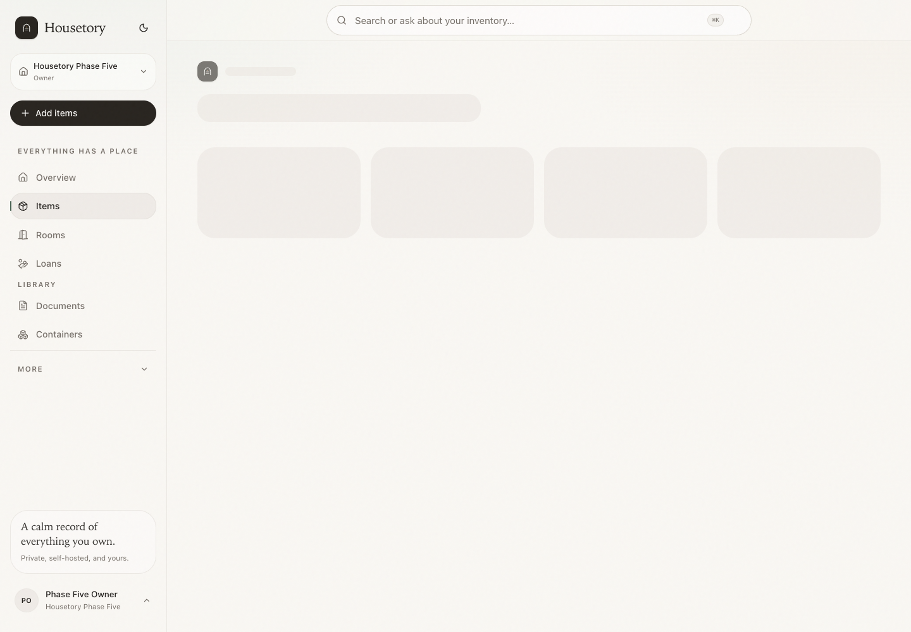
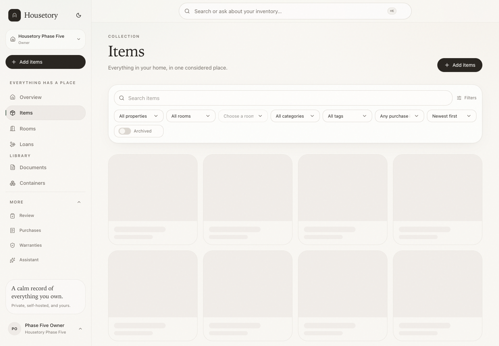
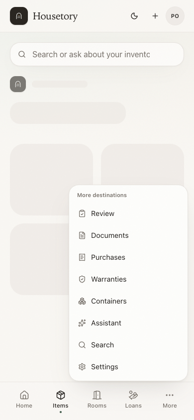

# Simplification 3: default AI setup, calmer navigation and optional schedules

This batch keeps the existing permissions, stored task assignments, provider
credentials, consent, search context and visual style. It reduces setup and
navigation friction without deleting features or adding a subscription.

## One default text model

The normal **Settings → AI providers** screen now presents:

- one **Default text model** provider/model choice for Assistant, document
  interpretation, smart imports and natural-language search;
- separate **Vision & voice** rows for image recognition and voice
  transcription;
- collapsed **Advanced task overrides** for the four text tasks.

The default is a saved household choice, not a value recomputed from task rows:

1. the owner saves one provider/model pair as the household default;
2. existing installations are bootstrapped once from their stored text
   assignments — a common pair or strict majority becomes the saved default;
3. a tie or non-committed plurality leaves no default, and every configured
   text task remains an explicit override;
4. afterwards, edits to individual tasks never move the saved default.

Text tasks have an explicit inheritance flag. **Inherited** tasks follow the
saved default. Saving any custom provider/model marks that task as a **Custom
override**, even when the saved pair happens to equal the current default.
**Reset to default** explicitly returns that task to inheritance. A task with no
assignment inherits the saved default when one exists; otherwise it is **Not
configured**.

Changing the default writes only inherited tasks. Explicit overrides, vision,
voice, provider credentials, provider default model and cloud consent are not
changed. Disabled inherited tasks stay disabled; saving the default does not
silently enable them. The saved default remains visible even when all four text
tasks are explicit overrides.

### Compatibility and discovery

The existing task capability contract remains authoritative:

- confirmed incompatible API/input/output combinations are excluded or rejected;
- unverified compatible manual IDs remain selectable and are validated on save;
- recommendations are optional ordering, not a gate;
- the searchable model picker still discovers provider catalogs;
- retired illustration and label-headline tasks do not return.

System status keeps **Test all enabled AI tasks**, which tests each enabled and
configured effective task with its own saved provider/model and skips disabled or
unconfigured tasks with a reason. The passive action is now labelled **Reload
status snapshot** and explicitly does not call a provider. Credentials remain
encrypted and write-only.

## Navigation

Desktop navigation keeps the calm visual hierarchy:

- core: Overview, Items, Rooms, Loans;
- library: Documents, Containers;
- **More**: Review, Purchases, Warranties, Assistant.

The global search remains in the top centre. Assistant is secondary through the
Search page action and the More navigation/deep links. Review/Purchases/Warranties
are less prominent without being removed.

Mobile keeps exactly five bottom destinations: Home, Items, Rooms, Loans and More.
All other routes remain in the More menu, including Review, Documents, Purchases,
Warranties, Containers, Assistant, Search and Settings. Route origin, back links,
context and permissions are unchanged.

## Scheduled reviews

Scheduled review remains optional, owner-only and off by default. When no schedule
has ever been configured, setup sits behind **Advanced · Scheduled review** on the
Review page. Existing configured schedules remain visible even when disabled or
waiting for consent, so an active routine is not hidden.

The backend schedule, consent, scope, caps, timezone, next-due and run-status
behaviour is unchanged. Enabling a schedule still never enables AI or sends
household data automatically.

## Verification

- 463 backend tests pass, including the persisted-default migration/bootstrap,
  explicit same-default overrides, reset/inherit, preserved disabled tasks,
  provider deletion/rollback and cross-household permissions.
- 230 frontend tests pass, including default save/reset, explicit inheritance,
  advanced disclosure, navigation and existing schedule consent tests.
- The focused disposable-stack Playwright workflow passes, covering saved-default
  persistence, an explicit override equal to the default, default changes,
  reset/inherit, reload and the all-overrides default state. The mocked
  bulk-task-test and system-status summary regressions also pass. The checked-in
  95-workflow suite remains the broader regression gate.
- No paid inference calls were made by automated tests. AI provider output was
  mocked/disposable; no real keys or main data were copied.

## Limits

- There is no new user-facing token, budget, subscription or follow-up model
  setting. Existing providers, models and consent are reused.
- The saved default is a household-level `ai_text_defaults` row and each text
  task stores an explicit `inherits_text_default` flag. The migration bootstraps
  existing assignments once without rewriting provider, model, enabled or
  consent values; ties and non-committed pluralities leave no default. Later
  reads never recompute the default from task majority.
- Unverified compatible model IDs remain allowed and must be verified by the
  owner when desired; hard incompatible IDs are rejected.
- A schedule that was explicitly disabled remains visible but off; it is not
  auto-re-enabled by this batch.
