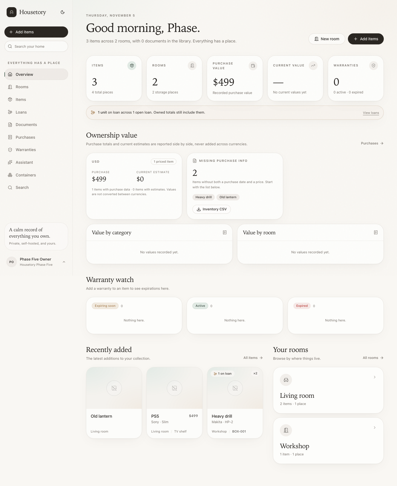
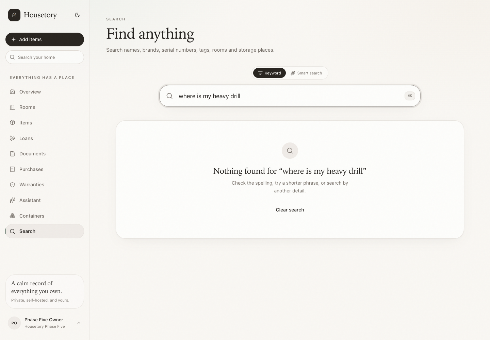
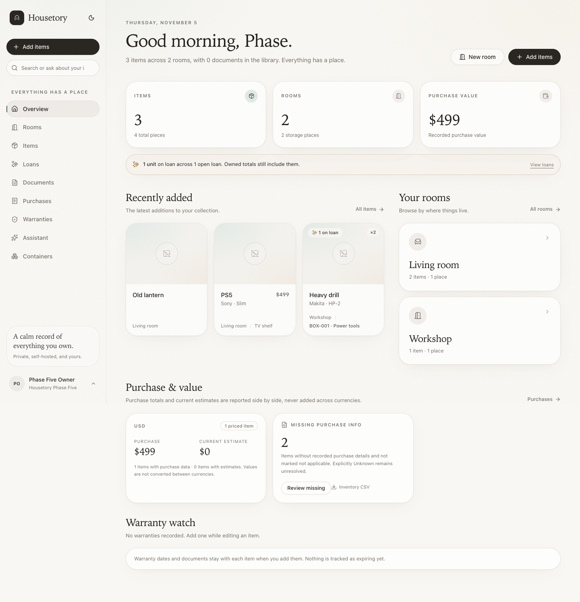
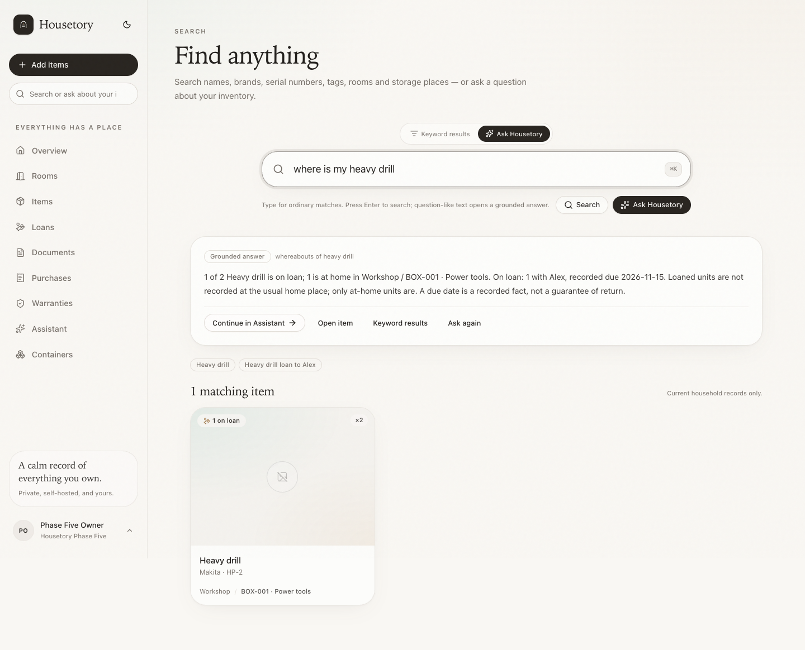
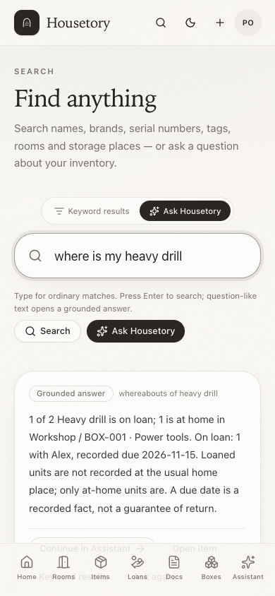
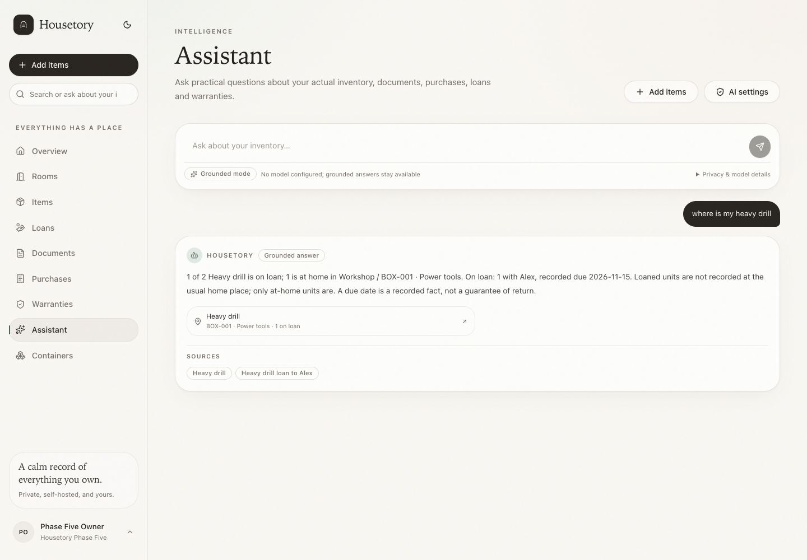

# Single-home polish: unified search, grounded assistant and everyday refinements

This milestone makes the existing single-household inventory easier to search and
ask about without replacing the visual shell, adding multi-household UI or
expanding AI authority. Every write still requires an explicit form action; search
and assistant remain read-only.

## Unified everyday entry

The existing sidebar and mobile-overview input is now labelled **“Search or ask
about your inventory…”**:

- Typing immediately runs ordinary, database-backed quick search. It does not call
  an LLM. Short terms such as `PS5` show matching items, boxes and fixed places.
- `Enter` submits the full query. A clear structured question opens grounded
  answer/results; an ordinary keyword opens normal search results.
- A **View all results** action preserves the query on the existing `/search` route.
- Question-like quick results expose an explicit **Ask Housetory** action. The
  longer conversation stays on `/assistant`, not in the dropdown.
- Arrow keys, `Enter`, `Escape`, focus dismissal, `⌘K`/`Ctrl+K` focusing and the
  mobile search icon continue to work. The redundant Search nav entry was removed;
  `/search` and all existing result links remain valid.

## The Heavy drill case

A question such as **“where is my heavy drill?”** resolves the item name, then
answers from current household loan and item records. It shows:

1. owned quantity, on-loan quantity and at-home quantity;
2. open borrower names, outstanding quantities and any *recorded* due date;
3. the usual home room/container path, explicitly marked as the usual home;
4. an honest statement that loaned units are not recorded there.

A due date is displayed as a recorded fact, not a promise of return. No borrower,
date or location is invented. Fully loaned items are not described as physically
in their storage box. Partial loans distinguish at-home and loaned units. Returned
items fall back to their current home location and “no open loan”. Ambiguous names
return the possible matches and ask the user to choose rather than picking one.
No match returns a clear no-match answer.

The exact regression is covered with isolated fixtures in
[`services/api/tests/test_single_home_polish.py`](../services/api/tests/test_single_home_polish.py)
and the disposable-stack browser workflow
[`apps/web/e2e/single-home-polish.spec.ts`](../apps/web/e2e/single-home-polish.spec.ts).
The user's live loan is never used as a fixture.

## Deterministic structured questions

These intents are handled without an AI call when the wording is clear:

| Question family | Database result |
| --- | --- |
| Item whereabouts / “where is …” | Item, quantities, open loans and usual home path |
| “What is on loan?” / borrowers / overdue | Open loans, quantities and recorded due dates |
| “How many … do I own?” | Matching item records, total units and on-loan units |
| Missing purchase information | Items with no recorded purchase details, plus explicitly Unknown items; Not applicable is excluded |
| Missing purchase date/price | Recorded purchases missing that field |
| Not applicable / unknown purchase information | Explicit status filters |
| Missing serial, room, location or warranty | Same missing-information semantics used by the assistant and Items filter |
| Room/container contents | A room subtree or a specific container by identifier |
| Documents, purchase history, warranty status, inventory summary | Read-only household-scoped tools |

The Items page exposes the same purchase filters: **Missing or unknown**,
**Recorded**, **Unknown**, **Not applicable**, **Missing purchase date** and
**Missing purchase price**. Counts in the overview, assistant, search and filters
come from the same rules.

## Purchase-information states

`items.purchase_info_status` stores only an explicit override: `unknown` or
`not_applicable`; legacy rows and ordinary edits leave it null. The effective state
is derived:

- **Recorded** — at least one meaningful purchase detail exists (merchant, date,
  price, order number, notes, receipt or review allocation).
- **Unrecorded** — no meaningful purchase detail and no explicit override.
- **Unknown** — explicitly unresolved when no purchase details exist.
- **Not applicable** — deliberately excluded from missing-purchase tasks.

Recorded details are never deleted by changing the status. If details exist, the
effective state is Recorded unless the item is explicitly Not applicable; an
existing amount continues to be reported as historical purchase value. Setting the
status back to automatic restores the derived state. The append-only migration
adds the nullable column and leaves every existing item untouched.

## AI role, privacy and fallback

- Structured intents and ordinary keyword search work with AI disabled.
- On an explicit question submission, the existing consented **search** task may
  refine filter interpretation; the existing **assistant** task may interpret an
  open-ended question. No model is called while typing.
- The database executes fixed, household-scoped read-only queries/tools. AI never
  receives SQL authority, tools or mutation ability, and unknown tool names,
  candidate IDs, rooms or labels are rejected/ignored.
- Cloud/private endpoints remain disabled without the household's explicit
  consent. Query, history, candidate and label context is bounded and treated as
  untrusted text. No private query, borrower name or document content is logged by
  these flows.
- If a provider is unconfigured, unavailable or returns malformed output, ordinary
  matches and deterministic answers remain available with a clear explanation.
  The user can open the dedicated assistant to rephrase a question.

## Other polish in this milestone

- **Overview** now leads with items, rooms, recently added records, room cards and
  a compact outstanding-loan summary. Empty purchase/current-value and warranty
  panels collapse to one-line summaries; useful value cards still appear when data
  exists. Borrower notes are not shown on the overview.
- **Storage display** uses human name plus permanent identifier where available
  (for example `BOX-006 · Power tools`), and room/location filters use full
  hierarchy paths. Stored names and identifiers are not renamed.
- **Items filters** hide empty category/tag options, show removable active-filter
  chips and a reset action, and clear bulk selection with visible feedback when a
  filter changes. The remembered card/compact-list view is unchanged.
- **Item photos** use a compact empty state and one Take photo / Choose photo
  control pair; populated galleries keep their existing gallery, lightbox and
  ordering controls. The follow-up
  [`ITEM_LOAN_STATUS.md`](ITEM_LOAN_STATUS.md) also surfaces open-loan truth under
  the item title and labels stored places as the usual home while units are out.
- **Documents** no longer offer an export action for an empty library; Scan pages
  and Add document remain primary, and export returns when documents exist.
- **Assistant** leads with the question and grounded inventory content. Provider
  model IDs and detailed consent/privacy copy live in a compact expandable
  “Privacy & model details” section, while the active mode and remote-transmission
  state stay visible. A `?q=` handoff from search opens the same question and
  follows up with conversation history.

## Verification

- 267 PostgreSQL tests, 109 Vitest tests and 26 disposable-stack Playwright
  workflows pass.
- Regression coverage includes the exact Heavy drill question, partial/full/
  returned loans, no due date, ambiguous names, no match, household isolation,
  viewer access, purchase-status count/filter parity, AI malformed-output fallback,
  keyboard/Enter behavior, typing without natural-language calls, stale-answer
  handling, filter chips, sparse/populated overview, photo controls and empty
  document export behavior.
- No live paid-provider inference was performed. Browser AI workflows use mocked
  providers and isolated storage/database.

## Remaining limits

- Single household only; property and multi-household scopes are later milestones.
- No barcode field or page-mapped OCR evidence.
- Tax, discount and shipping amounts remain unallocated by design.
- Structured result lists are bounded (the missing-information assistant list is
  capped at 50); the Items filter remains available for the complete filtered view.
- Natural-language interpretation is intentionally conservative. Ambiguous intent
  prefers ordinary matches plus an explicit assistant action over a guessed answer.
- Live paid-provider quality and latency were not validated.

## Screenshots

Before (prior local build):

After:

