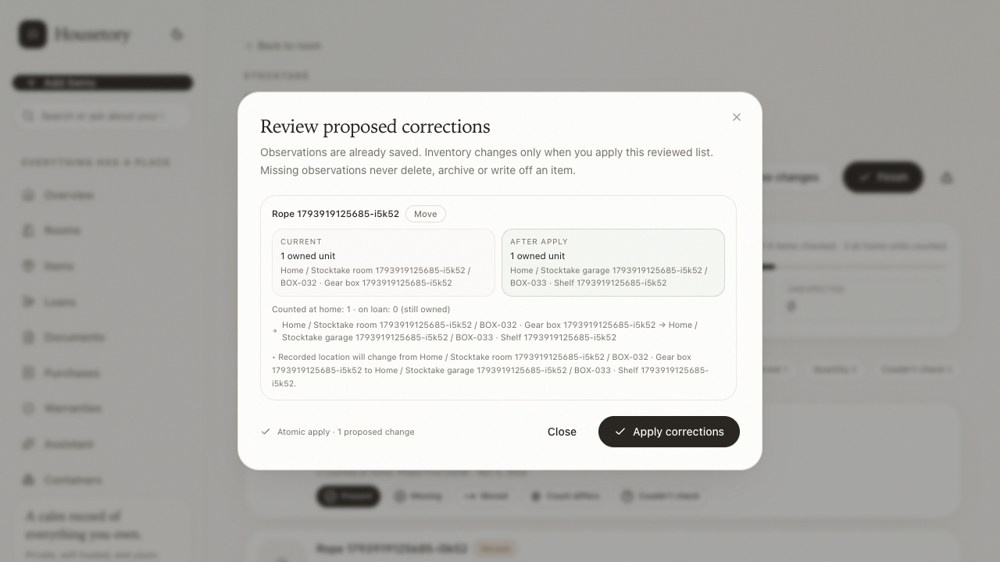
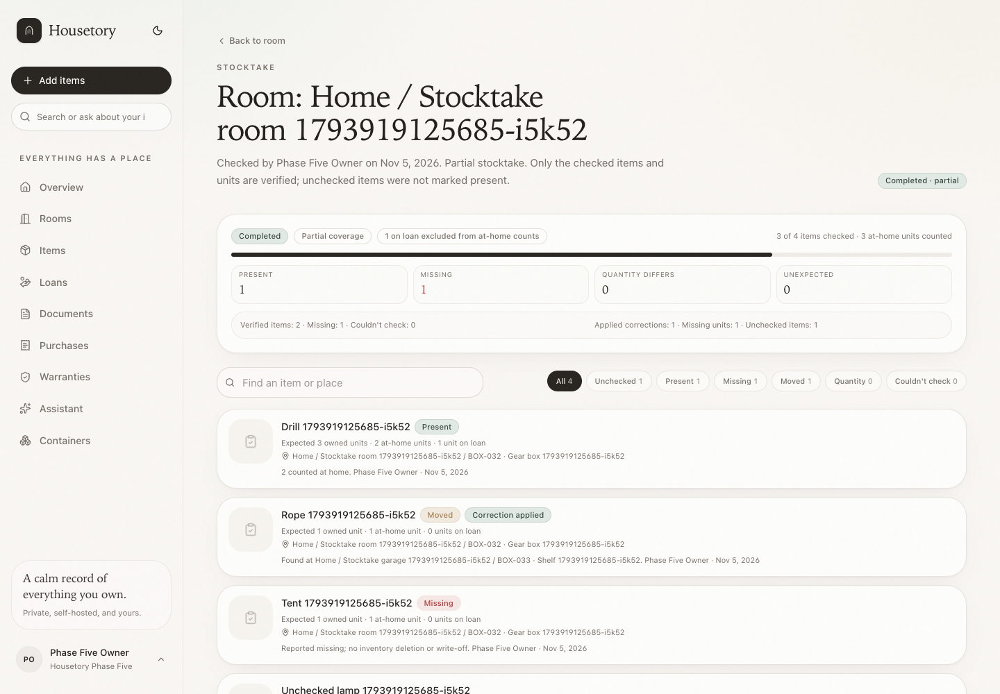
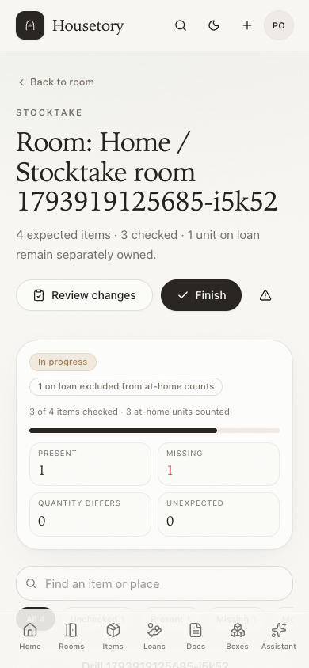
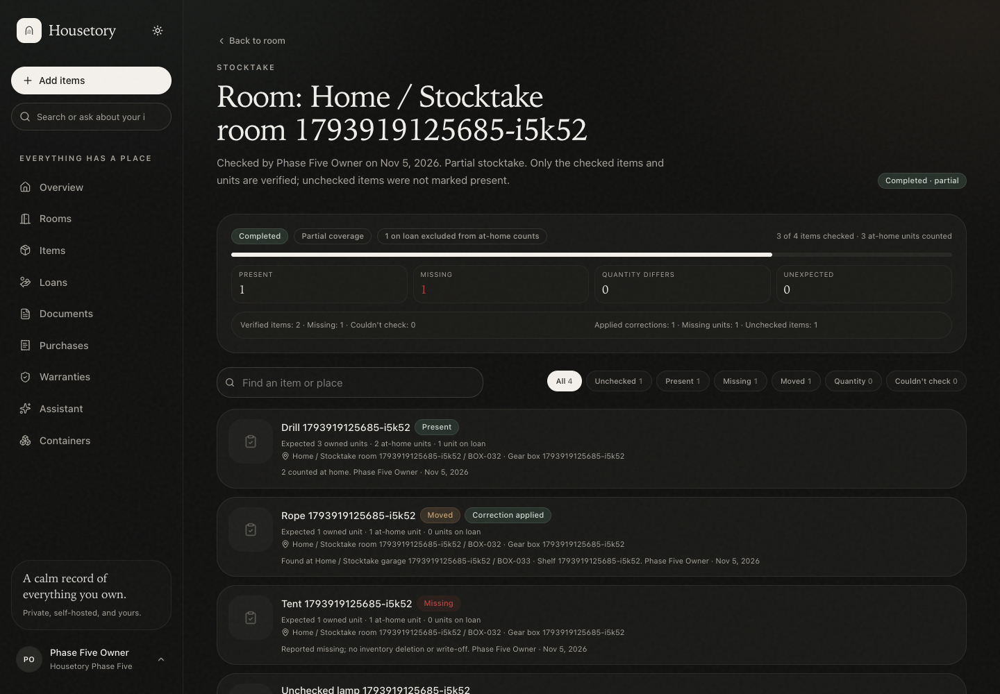
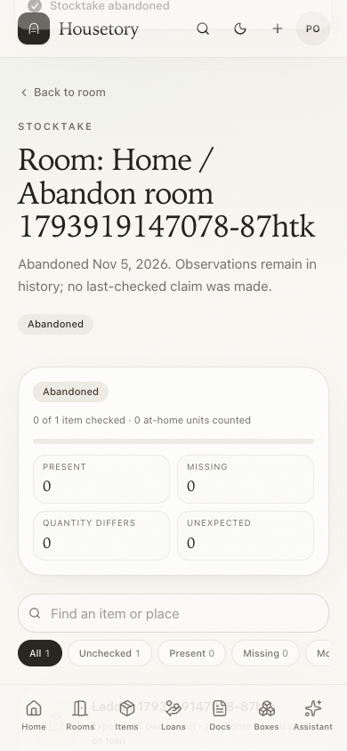
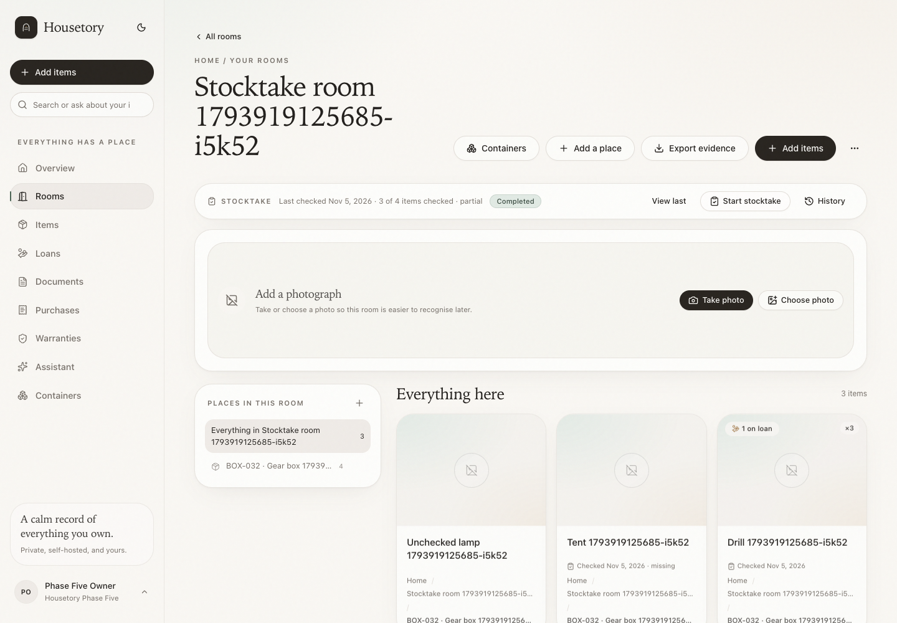

# Stocktake and last verified here

This milestone adds a bounded room/container stocktake that separates field
observations from inventory edits. It records who checked what and when, keeps
loaned units out of expected-at-home counts, and only updates an item's
“Last checked” state after a completed session.

It is not a background monitoring system, a write-off workflow, an insurance
stocktake claim, or a replacement for normal item editing.

## Where to start

- Open a **room** or **container** and use the compact stocktake strip.
- **Start stocktake** captures the current expected items in that scope and its
  explicit descendants.
- **History** lists in-progress, completed and abandoned sessions for that
  scope.
- **Resume** continues an in-progress session from any device signed in to the
  household. Progress is saved after each observation, so a refresh or network
  retry does not lose previous checks.

No new top-level navigation was added.

## Scope and snapshot

Scope labels and snapshot paths include the property when the room belongs to
one. Starting from a room includes that room, descendant rooms, items assigned to
those rooms, and items inside storage places in those rooms. Starting from a
container includes that container, descendant containers and the items assigned
to them. Selecting both is supported; the union is de-duplicated by item ID.

On start the server records an immutable expected snapshot:

- item ID and name;
- recorded owned quantity, at-home quantity and on-loan quantity;
- room and full location path;
- the item's `updated_at` version.

The snapshot is not treated as current truth. If an item, loan or location
changes during the session, the checklist shows a **Changed since start** note
with current values. Recording against a stale item returns `409 item_changed`;
a changed loan quantity returns `409 loans_changed`. Reload the session and
record against the current values.

**Refresh scope** explicitly adds items that appeared in the scope after the
session started. It is idempotent, keeps existing snapshot rows, and never
deletes historic observations. Archived items are not expected items.

## Checklist statuses

| Status | Meaning | Inventory edit? |
| --- | --- | --- |
| Unchecked | No observation. Opening the page never marks it present. | No |
| Present | All expected at-home units were explicitly counted at the recorded place. | No |
| Missing | The item was not found at the expected place. | No delete, archive or write-off |
| Moved | The item was found in an existing room and optional existing place. | Reviewed move only |
| Quantity discrepancy | The counted at-home quantity differs from the recorded at-home quantity. | Reviewed quantity correction only |
| Couldn't check | Explicitly not checked. It is not counted as verified. | No |
| Unexpected | An unrecorded item was found. It can link an existing item or use the normal item form. | No automatic create or duplicate |

Every observation records the verifier, time, counted quantity (where relevant),
observed location, optional notes, current owned/at-home/on-loan context and an
idempotency request ID. Observations are household-scoped and returned without
borrower names or loan notes.

### Owned, at home and on loan

Loans do not reduce owned quantity. For an item with 3 owned units and 1 on
loan:

- expected at home = 2;
- expected on loan = 1, still owned;
- Present requires a count of 2, not 3;
- the loaned unit is never marked missing;
- a quantity correction proposes `counted at home + current on-loan` as the new
  owned quantity. A reduction can never go below the outstanding loan quantity.

## Observation versus edit

Marking present, missing, moved or quantity-different writes an observation only.
Inventory changes require **Review changes**, which shows old/current/new values:

- current recorded quantity and location path;
- proposed quantity and/or destination;
- loan context and explicit reduction/increase warnings;
- any conflict with a concurrent item edit or loan change.

Applying is one atomic transaction over a bounded batch. A stale review token,
changed item, changed loan, deleted item, missing destination or quantity below
loans causes the whole apply to abort with no partial inventory writes. The same
request ID replays the original application without applying twice.

Moves reuse the existing item move history event and safe undo. Quantity
corrections add a `stocktake.quantity_corrected` history event; that action is
not claimed as undoable. Applying never deletes, archives or writes off missing
items.

## Completion and coverage

A session can be finished partially. The completion dialog/API reports:

- expected, checked and unchecked items;
- present/verified, missing, quantity-difference and couldn't-check counts;
- unexpected findings;
- expected at-home units versus counted at-home units;
- expected on-loan units;
- applied correction count.

If anything was not checked, the user must explicitly acknowledge partial
coverage. The completed session stores `coverage.partial`, a full coverage
summary and the verifier/time. A completed session is immutable; an abandoned
session keeps observations for inspection but never updates last-checked state.
Neither status fabricates legacy verification history.

## Last checked semantics

Completing a session updates a derived state for items with an explicit
present/missing/moved/quantity observation. The state stores:

- verifier session and completion date;
- observed status and counted at-home quantity;
- owned and on-loan quantity at completion;
- verified location/path, including the property where known;
- the item version at completion.

The item serializer compares that state with current inventory. If the item,
quantity, loan quantities, room or place changed later, the historical date is
retained but labelled **Changed since** (including in evidence exports). It is
not presented as still verified at the current state.

Room and container pages show a compact last-completed session summary with
checked coverage, a partial label and a link to the session history. Item cards
show a small checked date; item details show the status, quantity/time and a
session link.

## Evidence exports

Evidence package rows/PDF/CSV/manifest may include per-item last-checked fields
only when an exact completed observation exists:

- `last_checked_at`, `last_checked_status`, `last_checked_quantity`,
  `last_checked_owned_quantity`, `last_checked_on_loan_quantity`,
  `last_checked_location_path`, `last_checked_stale`.

A changed item is exported with `last_checked_stale=yes` and PDF wording such as
“the recorded item, quantity or location changed after that check.” The package
does not imply that the whole export scope was physically verified; its existing
recorded-not-verified wording remains.

## Permissions and privacy

- Owners and members can start, observe, refresh, review, apply, complete and
  abandon.
- Viewers can list/read sessions and review observations but all write POSTs are
  rejected by the existing household write guard.
- Every route, scope, item, snapshot, destination, observation, application and
  state lookup is household-scoped. Cross-household IDs return 404 or a validation
  error before any write.
- Stocktake responses expose loan quantities only, never borrower names, loan
  notes, purchase notes or document contents.
- Notes are optional and bounded. No raw inventory payloads or private document
  contents are logged.

## Limits and retention

| Setting | Default | Meaning |
| --- | --- | --- |
| `STOCKTAKE_MAX_ITEMS` | `500` | Maximum expected items in one session |
| `STOCKTAKE_MAX_APPLY_BATCH` | `200` | Maximum corrections in one atomic apply |
| `STOCKTAKE_MAX_ACTIVE_SESSIONS` | `25` | Maximum unfinished sessions per household |
| `STOCKTAKE_MAX_NOTES_CHARS` | `2000` | Maximum observation note length |
| `STOCKTAKE_MAX_OBSERVATIONS_PER_SESSION` | `2000` | Maximum observations recorded in one session |

Sessions, snapshots, observations, applications and corrections are retained as
history. Abandoning does not delete observations. Generated reports or original
photos/documents are never removed by stocktake cleanup, and stocktake does not
delete activity history. No public links, background AI work or external service
calls are used.

## API summary

- `POST /stocktake/sessions` — start with room/container scope and request ID
- `GET /stocktake/sessions` — household session list, optional scope/status filter
- `GET /stocktake/sessions/{id}` — checklist, observations, current values
- `POST /stocktake/sessions/{id}/observations` — immutable observation
- `POST /stocktake/sessions/{id}/refresh` — explicitly add new in-scope items
- `GET /stocktake/sessions/{id}/review` — old/current/new proposals and conflicts
- `POST /stocktake/sessions/{id}/apply` — atomic reviewed corrections
- `POST /stocktake/sessions/{id}/complete` — completed/partial coverage
- `POST /stocktake/sessions/{id}/abandon` — abandon without a verification claim
- `GET /stocktake/summary?room_id=…|container_id=…` — compact scope status

## Verification

- PostgreSQL tests cover room/container hierarchy and overlap de-duplication,
  present/missing/partial/on-loan behavior, moved and unexpected observations,
  no-write-before-apply, loan-safe quantity corrections, stale item/loan/review
  conflicts, request-id replay and payload mismatch, partial completion,
  last-checked staleness, viewer read-only access and household isolation.
- Frontend tests cover the checklist, explicit unchecked state, observation save,
  review/apply old-current-new values, partial completion acknowledgement and
  keyboard/mobile states.
- Disposable-stack Playwright workflows cover start → mark → refresh/resume →
  review/apply → complete, partial completion, keyboard close, failed save,
  abandonment, mobile and light/dark screenshots.

Representative screenshots are in
[`docs/walkthrough/stocktake/`](walkthrough/stocktake/):

Verification on the final local build: **307 PostgreSQL backend tests**,
**132 Vitest tests** and **39 disposable-stack Playwright workflows** pass. Ruff,
strict TypeScript typecheck, production build and Alembic drift checks pass.
