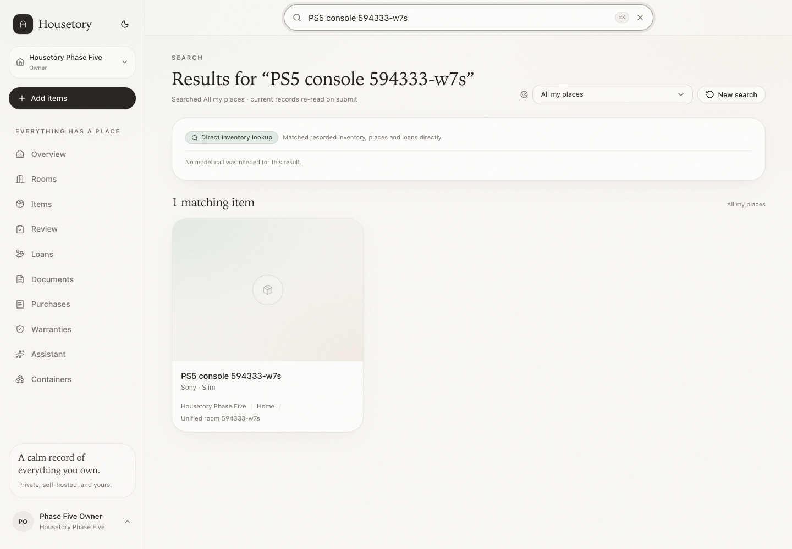
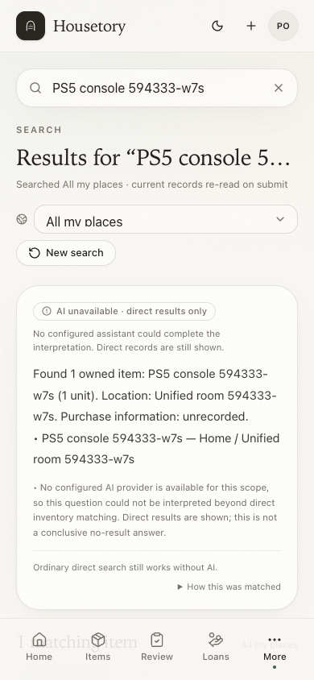
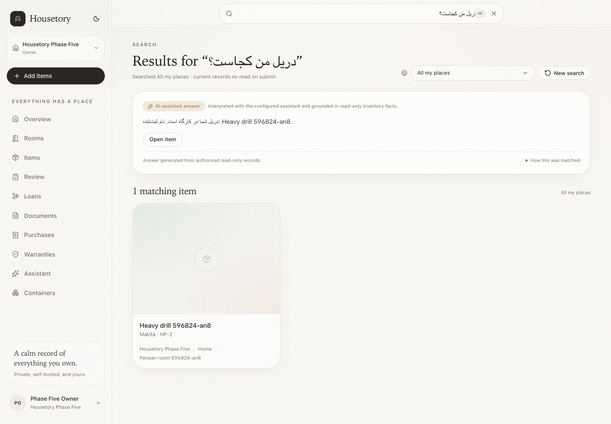
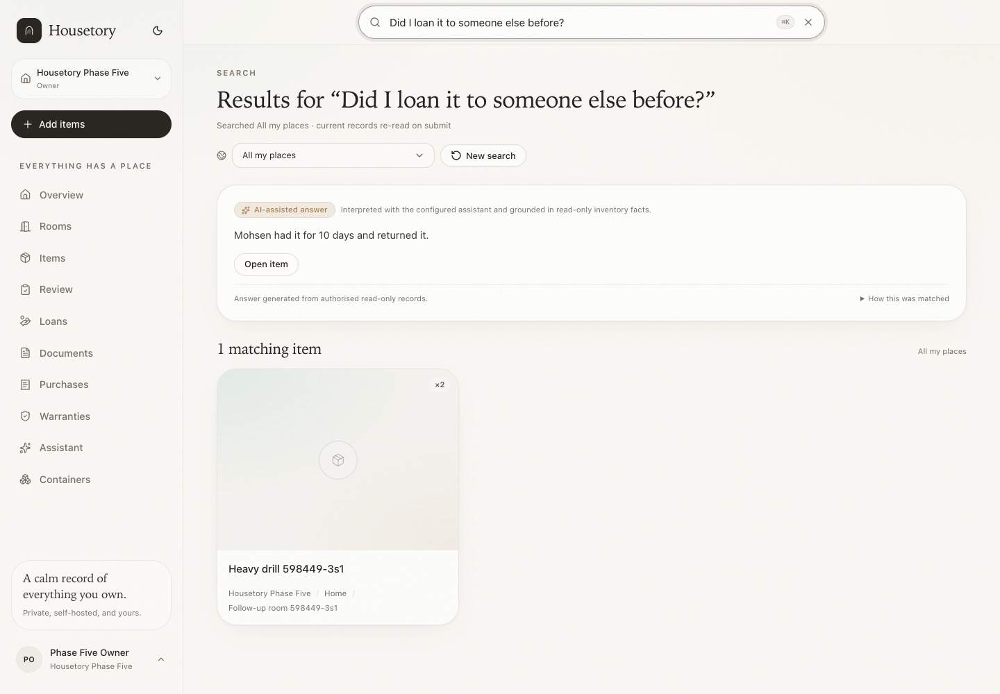
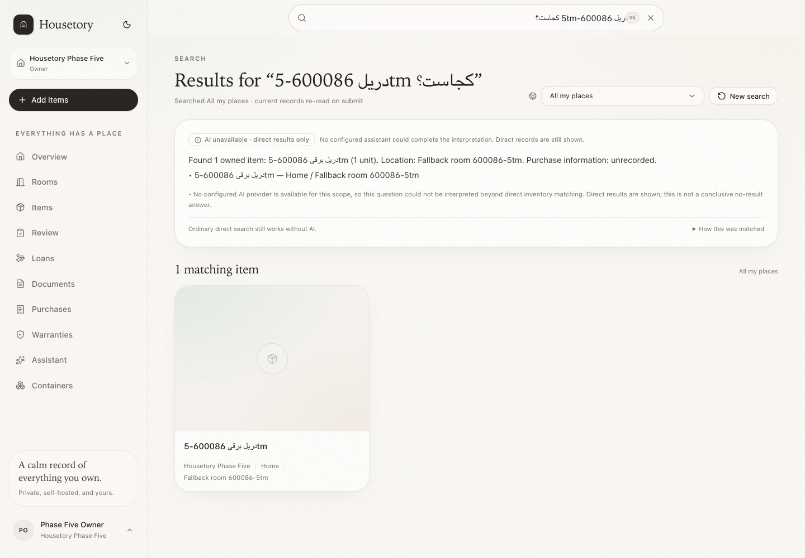

# Unified search and multilingual assistant

Housetory has one submit-time search flow across the global top box, the mobile
entry, the search results page and the secondary Assistant page. Typing is still
a cheap, local direct lookup; pressing Enter submits the same request everywhere.

## One box, one flow

- Desktop inventory pages show one prominent centred search box in the top bar.
  It is not hidden in the sidebar.
- Mobile pages show one search box near the top of the content. The old header
  search icon and the separate sidebar quick-search box were removed.
- `/search` does not render a second input or keyword/Ask mode switch. Its
  results are driven by the same global box and the same endpoint.
- `⌘K` / `Ctrl+K` focuses the box. Escape closes the suggestion panel.
- The input uses `dir="auto"` so Persian/Arabic queries render correctly.
- Local list filters remain separate and clearly scoped.

While typing, `/search/quick` performs ordinary authorised item, container,
location and borrowed-record matching. No AI provider is called per keystroke.
Enter navigates to the shared results flow; Shift+Enter and the explicit **Ask
Housetory** action request AI interpretation directly.

## Submit-time order

`POST /api/v1/search/query` is the shared endpoint. It executes:

1. **Direct inventory lookup** — current item, container, place and borrowed
   records for the selected scope.
2. **Reliable structured answer** — location, count, current loans, missing
   information or historical loan facts when the intent and match are reliable.
3. **Configured, consented AI** — only when interpretation is needed, or when a
   reliable direct/structured match could not be established.

The response has an honest `mode`:

| Mode | Visible label | Meaning |
| --- | --- | --- |
| `direct` | Direct inventory lookup | Facts came from direct/structured reads; no model call. |
| `ai` | AI-assisted answer | A validated read-only tool result was interpreted by the configured provider. |
| `fallback` | AI unavailable · direct results only | Interpretation was unavailable or failed; direct records are still shown and no conclusive no-result is claimed. |

## Unicode and cross-language behaviour

Normalisation is used only for comparison; stored names and provider output keep
their original script and spelling.

- ASCII `?`, Persian/Arabic `؟` and full-width `？` are optional question signals.
- Persian/Arabic letter variants (`ي`/`ی`, `ك`/`ک`, `أ`/`إ`/`آ`/`ا`, `ة`/`ه`) and
  Arabic-Indic/Persian digits meet during matching.
- ZWNJ/half-space, tatweel, bidi controls and Arabic diacritics are folded only
  for matching. Non-Latin scripts are never stripped or transliterated.
- Multi-word non-Latin input and explicit Ask escalate automatically on submit.
- A configured model can interpret Persian, other languages, mixed-language
  queries and translated item terms against the household's own inventory index.
  Original item names, model numbers, serial numbers and IDs are preserved.
- The answer is requested in the user's language and may only use the supplied
  read-only tool facts. The model cannot invent matches, locations or borrowers.

Direct offline lookup still works without any provider. When a question needs
interpretation and no provider is available, the UI shows the direct records it
has and an explicit limitation; it does not claim a conclusive no-result.

## Scope, consent and provider boundaries

- A single household with or without a property filter uses that household's
  configured search task, or its configured assistant task when search is not
  assigned. Existing provider/model/consent settings are reused.
- All-my-places and multi-property scope executes one household at a time. Each
  household's bounded inventory labels and facts are sent only to that
  household's own configured provider.
- A household without a provider stays deterministic and never falls back to
  another household's provider.
- IDs supplied in conversation context are re-authorised against the current
  memberships and property scope before any read.
- Changing household or property resets browser session context and invalidates
  server-side candidate/loan references.

## Conversation context and follow-ups

Context is bounded and on by default:

- up to eight recent user/assistant turns;
- up to six resolved item references;
- up to twelve candidate item references;
- up to twelve loan references with item, borrower and current status;
- the last query and a scope key.

There is no user-facing context size, token or cost setting. Mutable loan and
location facts are re-read from the database on every turn; no factual answer is
cached. A new search or scope change resets the session.

The accepted four-turn sequence works without a bare item ID being the only
memory:

1. **Where is my drill?** → direct location/current-loan facts resolve the item.
2. **Did I loan it to someone else before?** → `get_loan_history` reads current
   and returned loans for the resolved item.
3. **Do I have another one of it?** → matching item records expose aggregate
   quantity and genuinely different models separately.
4. **Check the one that Mohsen had and tell me how long he had it.** → validated
   item/loan context plus the borrower named in the prior context is used to
   calculate the recorded duration.

Returned and outstanding loans are distinct. A returned loan reports how long the
borrower had it and states that it is no longer with them. Multiple concrete
candidate loans produce a concise clarification instead of a guess. Loan history
is never used to infer damage, loss or its cause.

## Read-only grounding

The shared assistant tools are household-scoped reads: items, locations,
containers, documents, purchases, warranties, borrowed records and historical
loans. AI plans are validated against allowed tool names and item IDs before
execution. No assistant path creates, edits, moves, lends or deletes records.

## Verification

- Backend tests cover Unicode/ZWNJ/Arabic variants, Persian drill questions with
  and without punctuation, explicit Ask bypass, cross-language AI planning,
  Swedish and mixed model-number direct matching, four-turn context, returned vs
  outstanding durations, alias ambiguity, provider failure, no-provider fallback,
  property isolation and per-household provider boundaries.
- Frontend tests cover the direct submit flow, AI-assisted rendering, fallback
  labelling, reset and context request shape.
- Playwright workflows cover one global box at desktop/mobile widths, RTL input,
  direct results, mocked AI-assisted answers, follow-up history/context and the
  real no-provider fallback.

## Limits

- Live paid-provider answer quality is not exercised by automated tests; the
  automated provider responses are mocked or disposable.
- Deterministic English wording remains the fallback when no provider can answer
  a multilingual question. It is labelled as a fallback and keeps direct records.
- Cross-language matching depends on the configured model's interpretation for
  terms that are not literally present in the household's records.
- Context is intentionally short and bounded; it is not an open-ended chat
  history, and it never carries facts across a household or property boundary.
- Search and assistant do not generate or execute SQL. They use the existing
  validated read-only tools.
