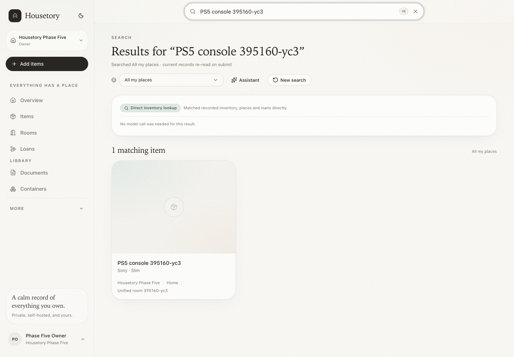
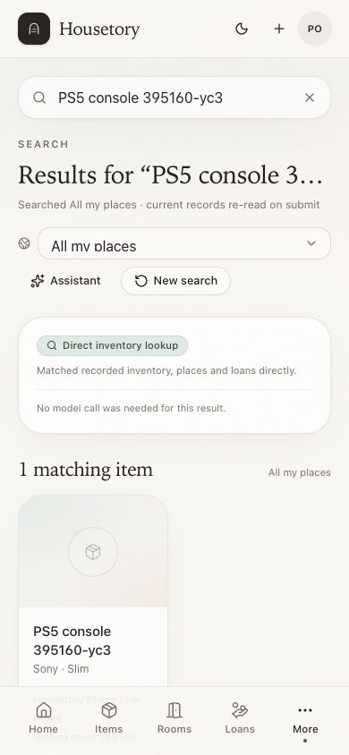
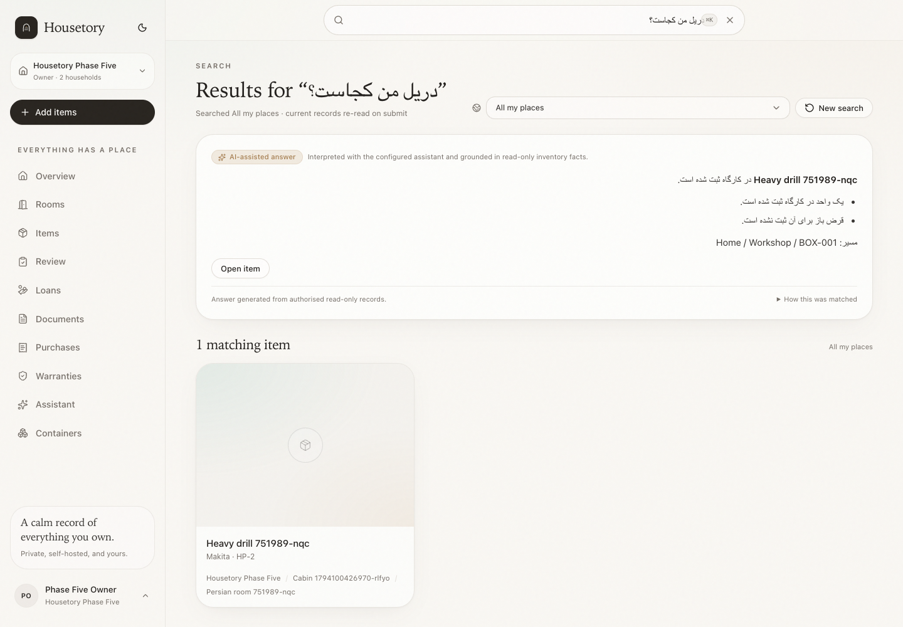
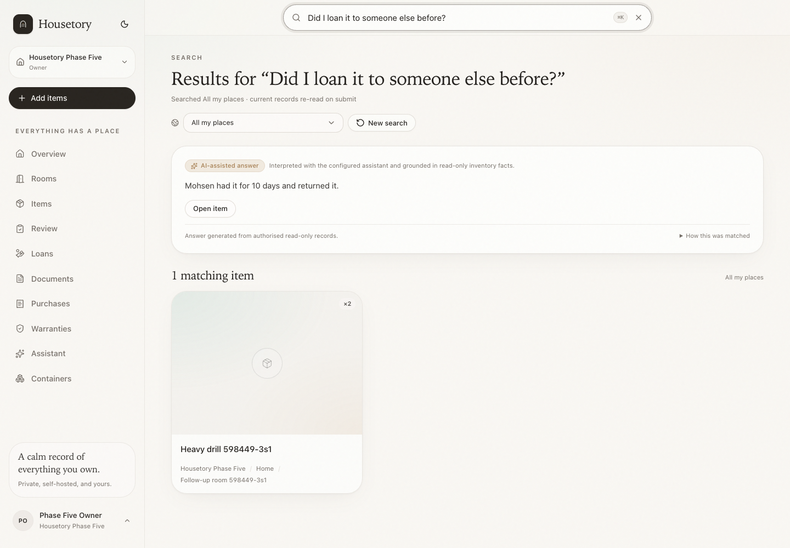
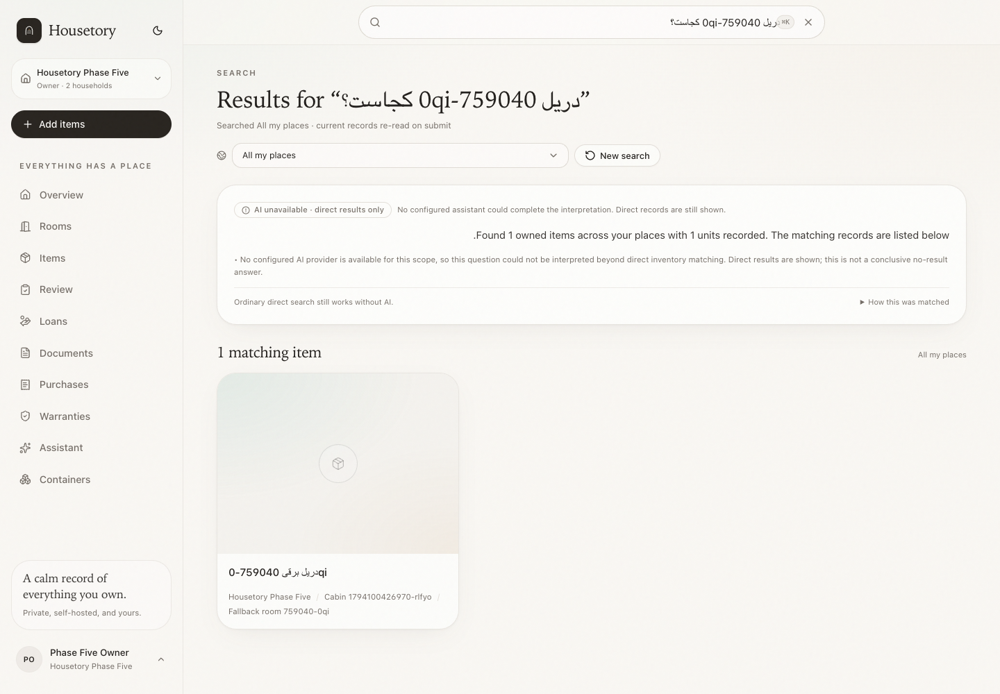

# Unified search and multilingual assistant

> **Superseded in part.** There is no longer a Search page or a separate Assistant page: `/search` and `/assistant` redirect, and the assistant opens as a panel from the robot button in the bottom bar. The submit-time order and scope rules below still apply to the no-AI fallback. What the AI assistant does today is in “The assistant today” below.

Housetory has one search and ask field. It sits in the bar at the bottom of the
screen, on phones and on desktop. Typing is still
a cheap, local direct lookup; pressing Enter submits the request.

## One box, one flow

- The field is in the bottom bar on every page, between the show/hide rooms
  button (phones only) and **Add**. The top bar and the search box near the top
  of mobile pages were removed with the old header. The placeholder is “Search
  or ask…”.
- The field also holds the robot button (opens the assistant), attach and the
  microphone. On a phone, attach and voice hide while there is text, and the
  field takes the whole width while it has focus.
- On an item, room, place or document page the field shows a chip (**This
  item**, **This room**, **This place**, **This document**). Its × removes the
  page from the question.
- There is no `/search` page. `/search?q=…` redirects to the item list with
  that search.
- `/items` uses that same global input: its debounced text updates the
  page's URL `q` while preserving room, category, tag and other filters. There is
  no second Items-specific search box. The filtered list is ordered by how well
  the name matches. Enter keeps a plain name that clearly matches as a list
  filter; other text goes to the assistant. Shift+Enter always asks the
  assistant.
- `⌘K` / `Ctrl+K` focuses the box. Escape closes the suggestion panel.
- The input uses `dir="auto"` so Persian/Arabic queries render correctly.
- Local list filters remain separate and clearly scoped.

While typing, `/search/quick` performs ordinary authorised item, container,
location and borrowed-record matching. No AI provider is called per keystroke.
Enter on a highlighted suggestion opens that record. Shift+Enter and the
explicit **Ask the assistant** row send the text to the assistant directly.

## Submit-time order

`POST /api/v1/search/query` is the shared endpoint. It executes:

1. **Direct inventory lookup** — current item, container, place and borrowed
   records for the selected scope.
2. **Reliable structured answer** — location, count, current loans, missing
   information or historical loan facts when the intent and match are reliable.
3. **Configured, consented AI** — only when interpretation is needed, or when a
   reliable direct/structured match could not be established.

The response has an honest `mode`:

| Mode | Visible label | Meaning |
| --- | --- | --- |
| `direct` | Direct inventory lookup | Facts came from direct/structured reads; no model call. |
| `ai` | AI-assisted answer | A validated read-only tool result was interpreted by the configured provider. |
| `fallback` | AI unavailable · direct results only | Interpretation was unavailable or failed; direct records are still shown and no conclusive no-result is claimed. |

## Unicode and cross-language behaviour

Normalisation is used only for comparison; stored names and provider output keep
their original script and spelling.

- ASCII `?`, Persian/Arabic `؟` and full-width `？` are optional question signals.
- Persian/Arabic letter variants (`ي`/`ی`, `ك`/`ک`, `أ`/`إ`/`آ`/`ا`, `ة`/`ه`) and
  Arabic-Indic/Persian digits meet during matching.
- ZWNJ/half-space, tatweel, bidi controls and Arabic diacritics are folded only
  for matching. Non-Latin scripts are never stripped or transliterated.
- Multi-word non-Latin input and explicit Ask escalate automatically on submit.
- A configured model can interpret Persian, other languages, mixed-language
  queries and translated item terms against the household's own inventory index.
  Original item names, model numbers, serial numbers and IDs are preserved.
- The answer is requested in the user's language and may only use the supplied
  read-only tool facts. The model cannot invent matches, locations or borrowers.

Direct offline lookup still works without any provider. When a question needs
interpretation and no provider is available, the UI shows the direct records it
has and an explicit limitation; it does not claim a conclusive no-result.

## Scope, consent and provider boundaries

- A single household with or without a property filter uses that household's
  configured search task, or its configured assistant task when search is not
  assigned. Existing provider/model/consent settings are reused.
- All-my-places and multi-property scope executes one household at a time. Each
  household's bounded inventory labels and facts are sent only to that
  household's own configured provider.
- A household without a provider stays deterministic and never falls back to
  another household's provider.
- IDs supplied in conversation context are re-authorised against the current
  memberships and property scope before any read.
- Provider inputs are partitioned before planning and answer synthesis. Item
  names, borrowers and loan references are re-read from authorised rows for that
  household and property; client-supplied labels are not trusted.
- Raw prior conversation prose is reused directly when the scope is one
  household without a property filter. In all-places or property scopes, each
  provider receives a bounded per-household/property dialogue memory instead of
  mixed raw prose. It records the prior user intent (including filters,
  preferences, exclusions and selected alternatives) and that partition's own
  prior answer meaning, alongside verified item/candidate/loan references.
- Memory is generated server-side from that partition's outcome, then
  re-sanitised before every provider call. Known item names, borrowers, document
  titles, location labels and UUIDs from other households or the other property
  are redacted. Client-supplied memory cannot bypass this redaction. The current
  user question is still sent because the user authored it intentionally.
- Memory keeps the most recent three turns per household/property and at most 24
  entries overall. It is not an unbounded chat archive. Scope changes discard
  entries outside the current household/property and current authorisation.
- Changing household or property resets browser session context and invalidates
  server-side candidate/loan references.

## Conversation context and follow-ups

Context is bounded and on by default:

- up to eight recent user/assistant turns;
- up to six resolved item references;
- up to twelve candidate item references;
- up to twelve loan references with item, borrower and current status;
- the last query and a scope key.

There is no user-facing context size, token or cost setting. Mutable loan and
location facts are re-read from the database on every turn; no factual answer is
cached. A new search or scope change resets the session.

A plain recorded name remains a direct inventory lookup even when the browser has
restored structured context. Reloading or repeating the same named lookup does
not call a model and does not append another dialogue turn. Context is only used
as a reason to interpret queries that actually contain a follow-up reference or
pronoun.

The accepted four-turn sequence works without a bare item ID being the only
memory:

1. **Where is my drill?** → direct location/current-loan facts resolve the item.
2. **Did I loan it to someone else before?** → `get_loan_history` reads current
   and returned loans for the resolved item.
3. **Do I have another one of it?** → matching item records expose aggregate
   quantity and genuinely different models separately.
4. **Check the one that Mohsen had and tell me how long he had it.** → validated
   item/loan context plus the borrower named in the prior context is used to
   calculate the recorded duration.

Returned and outstanding loans are distinct. A returned loan reports how long the
borrower had it and states that it is no longer with them. Multiple concrete
candidate loans produce a concise clarification instead of a guess. Loan history
is never used to infer damage, loss or its cause.

## Read-only grounding

The shared assistant tools are household-scoped reads: items, locations,
containers, documents, purchases, warranties, borrowed records and historical
loans. AI plans are validated against allowed tool names and item IDs before
execution. This search flow (`POST /search/query`) creates, edits, moves,
lends or deletes nothing. The AI assistant (`POST /assistant/runs`) is a
separate engine that can prepare changes; see “The assistant today”.

## Answer presentation

AI answers are rendered through a small safe renderer that supports paragraphs,
headings, bullet and numbered lists, small pipe tables, bold, italic and inline
code only. A table scrolls sideways inside its own box on a narrow phone. Raw
HTML and Markdown links are never interpreted; they remain text.

Direction comes from the question/dominant script hint returned by the server, not
from the first character of the answer. A Persian answer that starts with an
English item name therefore keeps an RTL base direction. Known original item
names, model numbers, identifiers and path segments are wrapped in `bdi dir=auto`
so their internal LTR order survives inside RTL prose. Reference links remain in
the separate grounded links area. The results heading isolates the user's
question with `bdi` as well.

The answer prompt asks for concise natural prose in the user's language, forbids
JSON/internal field names/condition codes/technical rationale, and asks the model
to translate recorded labels. Items are summarised without unasked purchase,
warranty, value, condition or serial clutter. If no loan record exists, the model
is instructed to say no loan is recorded in the available records rather than
claim the item was never loaned to anyone.

## The assistant today

This part was added by the mobile-first programme
([`MOBILE_FIRST_PROGRAMME.md`](MOBILE_FIRST_PROGRAMME.md)). It describes the AI
assistant (`POST /assistant/runs`), which needs a configured Assistant model.
Without one, the field runs in local search mode as before.

- **The page is the default subject only.** A question asked on an item page is
  about that item when it names nothing else. A question that names another
  thing is about that thing. A page record that was deleted or is outside the
  scope is left out and does not stop the request.
- **General questions need no lookup.** “How is a thing usually done” or “what
  does a term mean” is answered without an inventory lookup. The answer is
  labelled “General guidance · not from your records”. Limits, settings and
  steps of one specific product still need evidence from a tool (a record, a
  manual page, an online source).
- **Clear single-item changes are applied directly.** The server, not the
  model, decides. Only two kinds are on the list: an edit of one item (name,
  description, brand, model, serial number, quantity, condition) and a move of
  one item. The new values, or the name or identifier of the destination, must
  be in the user's own words in that request. The change is shown as done, with
  **Undo**. Undo is refused, with the reason, when the record changed again
  afterwards.
- **Everything else is still a proposal** that the user reviews and applies:
  lending, borrowing, returns, moves of several items, a move of an item that
  holds other things, clearing a value, a quantity of zero or below what is on
  loan, a change the assistant worked out by itself, any change after text of
  a document or a web page was read in the conversation, and more than three
  direct changes in one request. Viewers get no changes.
- **While a request runs** the page shows what is being done, taken from the
  real state of the request (for example “Searching your items…”). It is not a
  percentage. A new message changes the rest of the work; what is finished is
  kept. Typing “stop” (also “cancel”, “avbryt”, “stopp”) or pressing **Stop
  assistant** ends it. The stop message says what was finished and what had
  already been sent.
- **Sources.** Everything an answer rests on (manuals, cited pages, online
  sources, records) is in one closed **Sources (n)** list under the answer.
- **Where a fact comes from.** Item details given to the assistant say what was
  entered by a household member, what comes from an import or a recorded
  purchase, and what is an estimate. The assistant is told to keep these apart
  in its answer and not to treat a record as a checked fact.
- **Manuals.** See [`ITEM_MANUALS.md`](ITEM_MANUALS.md) for finding a manual
  online without the routine identity confirmation.

Limits: this behaviour is covered by scripted tests with scripted model
replies. It was not tried with a real AI model in this programme, and not on a
real iPhone. Links to videos were not built.

## Verification

- Backend tests cover Unicode/ZWNJ/Arabic variants, Persian drill questions with
  and without punctuation, explicit Ask bypass, cross-language AI planning,
  Swedish and mixed model-number direct matching, four-turn context, returned vs
  outstanding durations, alias ambiguity, provider failure, no-provider fallback,
  property isolation and per-household provider boundaries.
- Privacy tests inspect the full captured system/user payload for every planning
  and answer call across two providers. Distinct item, borrower and document
  sentinels from prior history/context and dialogue memory never appear in the
  other household's provider payload, including property scope.
- Capability tests prove a prior constraint that is not encoded in item/loan IDs
  (for example “only the corded one, not the battery drill”) is retained and
  materially changes the next ambiguous follow-up, in both multi-household and
  property scopes. A single-household default all-places turn also retains its
  relevant recent dialogue.
- Direct-context tests prove a plain named lookup remains direct with populated
  context, re-reads newly created loan facts, and does not call a provider. The
  browser test reloads the same named URL three times and keeps one dialogue
  pair.
- Frontend tests cover the direct submit flow, AI-assisted rendering, fallback
  labelling, reset, duplicate-turn prevention, safe Markdown subset rendering,
  HTML/link non-interpretation, RTL direction with a leading English item name,
  bullet lists, numeric text and normal LTR answers.
- Playwright workflows cover one global box at 320/390/768/1440 widths, the only
  visible/tabbable search entry and Cmd/Ctrl+K target, RTL/mixed input, direct
  results, an RTL Markdown-format AI answer, follow-up history/context and the
  real no-provider fallback.

The screenshots below are older screens. They show the top search box and the
results page that were removed.

## Limits

- Live paid-provider answer quality is not exercised by automated tests; the
  automated provider responses are mocked or disposable.
- Deterministic English wording remains the fallback when no provider can answer
  a multilingual question. It is labelled as a fallback and keeps direct records.
- Cross-language matching depends on the configured model's interpretation for
  terms that are not literally present in the household's records.
- Context is intentionally short and bounded; it is not an open-ended chat
  history, and it never carries facts across a household or property boundary.
- Search and assistant do not generate or execute SQL. The search flow uses the
  existing validated read-only tools; the assistant uses its registered tools.
